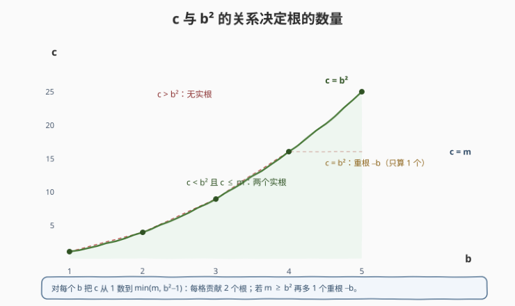
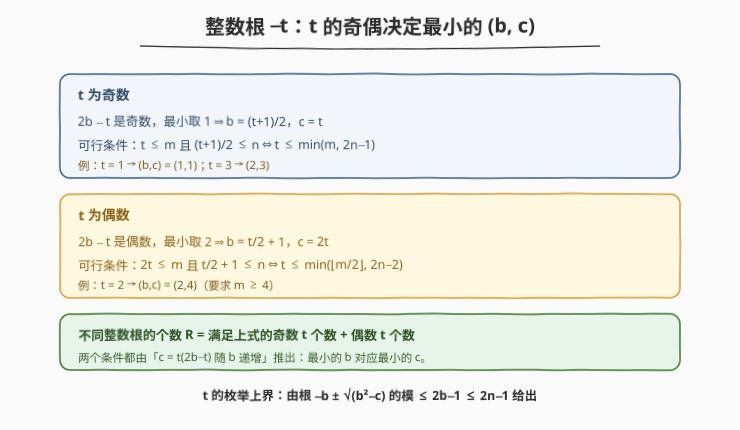
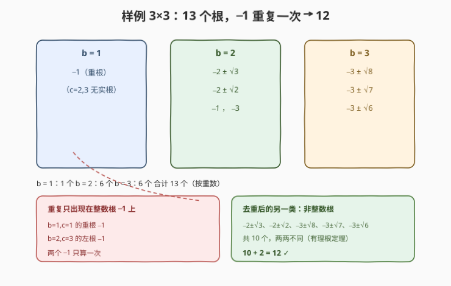

# Codeforces 50E 二次方程不同实根 题解

## 1. 题目概述

- **题目链接**：https://codeforces.com/problemset/problem/50/E
- **比赛来源**：Codeforces Beta Round 50 · Problem E
- **难度**：2300
- **标签**：数学、计数、数论
- **评测类型**：普通
- **限制**：时间 5 s / 内存 256 MB

**题意**：对每一对满足 $1 \le b \le n$、$1 \le c \le m$ 的自然数，考虑方程

$$x^{2} + 2bx + c = 0 .$$

有的方程有两个实根、有的只有一个（重根）、有的没有实根；不同方程之间还可能有公共根。求这些方程**所有不同实根的总个数**。

输入一行两个整数 $n, m$，输出一个整数表示不同实根的个数。

**约束**：

- $n, m \le 5 \times 10^6$：$(b, c)$ 对多达 $2.5 \times 10^{13}$，**逐对枚举绝无可能**；连 $O(n \log n)$ 也要小心。
- $b^2 \le 2.5 \times 10^{13}$，**超出 32 位**，所有涉及 $b^2$、$t(2b-t)$ 的量都要 64 位整数。
- 答案最大约 $5 \times 10^{13}$ 量级（$n = m = 5 \times 10^6$ 时实测 $49985062679840$），同样需要 64 位。
- 题目要求的是**不同**根的个数，因此必须处理"同一个根被多个方程重复产出"的情况；用浮点数比较根会因精度问题误判，必须用**整数运算**判定相等。

## 2. 示例与观察

官方样例 #1：

```text
输入：
3 3

输出：
12
```

官方样例 #2：

```text
输入：
1 2

输出：
1
```

**样例 1 演算**（$n = m = 3$，共 $9$ 个方程）：

| $b$ | $c$ | 判别式 $4(b^2-c)$ | 根 |
|-----|-----|------|-----|
| 1 | 1 | 0 | $-1$（重根） |
| 1 | 2 | $-4$ | 无 |
| 1 | 3 | $-8$ | 无 |
| 2 | 1 | 12 | $-2 \pm \sqrt{3}$ |
| 2 | 2 | 8 | $-2 \pm \sqrt{2}$ |
| 2 | 3 | 4 | $-1,\ -3$ |
| 3 | 1 | 32 | $-3 \pm \sqrt{8}$ |
| 3 | 2 | 28 | $-3 \pm \sqrt{7}$ |
| 3 | 3 | 24 | $-3 \pm \sqrt{6}$ |

按重数数一共 $1 + 2 + 2 + 2 + 2 + 2 + 2 + 2 = 13$ 个根，其中 $-1$ 出现了两次（$b=1,c=1$ 的重根与 $b=2,c=3$ 的一个根），所以**不同**的根是 $13 - 1 = 12$ 个。

**样例 2 演算**：$b = 1$，$c = 1$ 给出重根 $-1$；$c = 2$ 时 $1 - 2 < 0$ 无实根。所以只有 $1$ 个根。

自造样例（标注"自造"，数值由第 8 节的精确暴力程序复核）：

| 输入 | 输出 | 说明 |
|------|------|------|
| `1 1` | 1 | 只有 $x^2+2x+1=0$ 的重根 $-1$ |
| `2 2` | 5 | $-1$、$-2\pm\sqrt3$、$-2\pm\sqrt2$ |
| `2 3` | 6 | 多出 $b=2,c=3$ 的 $-3$（$-1$ 已出现过） |
| `3 4` | 15 | $b=2,c=4$ 的 $-2$ 与 $b=2,c=3$ 的 $-3$ |
| `4 4` | 23 | — |
| `5 5` | 36 | — |
| `6 6` | 54 | — |
| `10 10` | 159 | 小规模下逐对枚举仍可行 |
| `4 9` | 38 | $m > n^2$，$c$ 很大时全是无根 |
| `9 4` | 63 | $m < n^2$ |

**观察**：样例 1 的 $13$ 个根里，$12$ 个是"无理根或互不相同的整数根"，唯一的重复来自整数根 $-1$。这提示我们：**先把所有根按重数数出来，再减掉重复；而重复只会发生在整数根上**。

## 3. 解题思路

### 3.1 朴素做法与瓶颈

对每个 $(b, c)$ 解方程并把根塞进一个集合，最后输出集合大小。问题有三：

1. 规模：$2.5 \times 10^{13}$ 对，$5$ s 内绝无可能；
2. 表示：根可能是 $\sqrt{3}$、$\sqrt{8}=2\sqrt2$ 这样的二次无理数，要判断"$a + q\sqrt{d} = a' + q'\sqrt{d'}$"必须化成**最简根式**（$d$ 平方自由），否则 $\sqrt{8}$ 与 $2\sqrt{2}$ 会被当成不同的根；
3. 精度：退化成浮点数比较则在接近的根上必然误判。

所以必须找出根的结构，把"逐对枚举"降为"按公式计数"。

### 3.2 核心观察：根决定的是一个"倒抛物线"



先看判别式 $\Delta = 4(b^{2} - c)$：

- $c > b^{2}$：无实根；
- $c = b^{2}$：$\Delta = 0$，唯一根 $x = -b$；
- $c < b^{2}$：$\Delta > 0$，两个不同实根 $x = -b \pm \sqrt{b^{2} - c}$。

**关键代换**：根一定是负的（$b, c > 0$ 时两根之积 $c > 0$、两根之和 $-2b < 0$）。令 $x = -t$（$t > 0$），则

$$t^{2} - 2bt + c = 0 \quad\Longleftrightarrow\quad c = t\,(2b - t).$$

也就是说：**一个正数 $t$ 是某个方程的根，当且仅当存在 $b \in [1, n]$ 使 $c = t(2b - t)$ 是 $[1, m]$ 内的整数**。这个式子把"根"和"参数"绑在了一起，是全部计数的出发点。

- 固定 $b$、让 $c$ 从 $1$ 取到 $\min(m, b^{2}-1)$：每个 $c$ 给出两个不同的根（$b^{2}-c$ 不同，$\sqrt{b^{2}-c}$ 就不同；同一 $c$ 的 $\pm$ 也不同），共 $2 L_b$ 个，其中 $L_b = \min(m, b^{2}-1)$；
- 若 $m \ge b^{2}$，再加上 $c = b^{2}$ 的那个重根 $-b$。

按重数计的总根数

$$T = \sum_{b=1}^{n} \bigl(2 L_b + [\,m \ge b^{2}\,]\bigr).$$

### 3.3 去重：只有整数根可能重复



设两个不同方程 $(b, c) \ne (b', c')$ 有公共根 $x$。两式相减：

$$2(b - b')\,x + (c - c') = 0 \quad\Longrightarrow\quad x = \frac{c' - c}{2(b - b')} \in \mathbb{Q}.$$

于是公共根必然是有理数；而 $x$ 是首一整系数二次方程的根，**有理根必为整数**（有理根定理：既约分数 $p/q$ 只能是 $q \mid 1$）。反过来，同一个 $b$ 内部不同 $c$ 的根互不相同，所以：

> 所有**非整数**根两两不同；重复只可能出现在整数根之间。

因此

$$\text{ans} = \underbrace{2\sum_{b=1}^{n} (L_b - sq_b)}_{\text{非整数根，全部互异}} + \underbrace{R}_{\text{不同整数根}} ,$$

其中 $sq_b$ 是"$c < b^{2}$ 且 $b^{2} - c$ 是完全平方"的 $c$ 的个数（这些 $c$ 的两个根 $-b \pm k$ 都是整数），$R$ 是不同整数根 $-t$ 的个数。

**整数根 $-t$ 的判定**：需要 $b \in [1, n]$ 使 $c = t(2b - t) \in [1, m]$。固定 $t$ 后 $c$ 随 $b$ 单调递增，所以只需看最小的可行 $b$。由于 $c > 0$ 要求 $2b > t$，最小 $b$ 是 $b_{\min} = \max(1, \lfloor t/2 \rfloor + 1)$：

- $t$ **奇**：$2b - t$ 是奇数，最小取 $1$，此时 $b = (t+1)/2$、$c = t$。可行当且仅当 $t \le m$ 且 $(t+1)/2 \le n$，即 $t \le 2n - 1$；
- $t$ **偶**：$2b - t$ 是偶数，最小取 $2$，此时 $b = t/2 + 1$、$c = 2t$。可行当且仅当 $2t \le m$ 且 $t/2 + 1 \le n$，即 $t \le 2n - 2$。

而 $t$ 本身有上界：根 $-t = -b \pm \sqrt{b^{2} - c}$，取加号时 $t = b + \sqrt{b^{2}-c} \le b + \sqrt{b^{2}-1} < 2b \le 2n$，更精确地由整数性得 $t \le 2b - 1 \le 2n - 1$；取减号时 $t = b - \sqrt{b^{2}-c} \le b - 1 \le n - 1$。所以只需统计 $t \le 2n - 1$，这正是上面两条条件的交集，**枚举上界被严格证明为 $2n-1$**。

于是

$$R = \#\{t \text{ 奇} : 1 \le t \le \min(m, 2n-1)\} + \#\{t \text{ 偶} : 2 \le t \le \min(\lfloor m/2 \rfloor, 2n-2)\}.$$

### 3.4 算法：两个求和都用闭式/平方根枚举

**第一项 $\sum L_b$**：$b \le b_0 = \lfloor\sqrt{m+1}\rfloor$ 时 $b^{2}-1 \le m$，取 $b^{2}-1$；$b > b_0$ 时取 $m$。于是

$$\sum_{b=1}^{n} L_b = \sum_{b=1}^{\min(b_0,n)} (b^{2}-1) \;+\; \max(0, n - b_0)\cdot m,$$

前一段用平方和公式 $\sum b^{2} = k(k+1)(2k+1)/6$ 一步算出。

**第二项 $\sum sq_b$**：把 $sq_b$ 里的 $k$ 换元。令 $u = b - k$、$v = b + k$，则 $1 \le u < v$、$uv = b^{2} - k^{2} \le m$、$u + v = 2b \le 2n$，且 $u, v$ 同奇偶（因为 $u + v = 2b$ 是偶数）。反过来，任何满足这三条的 $(u, v)$ 唯一给出 $b = (u+v)/2$、$k = (v-u)/2$，且 $1 \le k \le b-1$ 自动成立。因此

$$\sum_{b=1}^{n} sq_b = \#\bigl\{(u, v) : 1 \le u < v,\ uv \le m,\ u + v \le 2n,\ u \equiv v \pmod 2\bigr\}.$$

固定 $u$ 后 $v$ 的范围是 $u + 2 \le v \le V$，其中 $V = \min(\lfloor m/u \rfloor,\, 2n - u)$；其中与 $u$ 同奇偶的 $v$ 有 $\lfloor (V - u)/2 \rfloor$ 个。又由 $u < v$、$uv \le m$ 得 $u^{2} < m$，所以 $u$ 只需枚举到 $\sqrt{m}$：**这是第二个被证明的枚举上界**，$m = 5 \times 10^6$ 时只有约 $2236$ 次迭代。

把三部分拼起来即得

$$\text{ans} = 2\Bigl(\sum_b L_b - \sum_b sq_b\Bigr) + R .$$

### 3.5 样例走查：$n = m = 3$



按 3.1 的表格，按重数共 $13$ 个根。用公式复核：

- $\sum L_b$：$b_0 = \lfloor\sqrt{4}\rfloor = 2$，故 $b = 1, 2$ 取 $b^{2}-1$（$0, 3$），$b = 3$ 取 $m = 3$，合计 $0 + 3 + 3 = 6$。
- $\sum sq_b$：$(u,v)$ 需 $uv \le 3$、$u+v \le 6$、同奇偶，只有 $(1,3)$，故为 $1$。
- 非整数根：$2 \times (6 - 1) = 10$。
- $R$：奇数 $t \le \min(3, 5) = 3$ 有 $t = 1, 3$ 两个；偶数需 $2t \le 3$，没有。故 $R = 2$。
- 合计 $10 + 2 = 12$ ✓。

两个整数根分别是 $t = 1$（$b = 1, c = 1$ 与 $b = 2, c = 3$ 都给出 $-1$，只算一次）和 $t = 3$（$b = 2, c = 3$ 的另一根 $-3$）。

## 4. 正确性证明

**引理 1（按重数的根数）**：固定 $b$，$c$ 取 $1, \dots, \min(m, b^{2}-1)$ 时每个 $c$ 恰给出两个不同的实根；$m \ge b^{2}$ 时 $c = b^{2}$ 恰给出一个实根（重根 $-b$）。故按重数的总根数为 $T = \sum_b (2L_b + [m \ge b^2])$。

**证明**：$c < b^{2}$ 时 $\Delta = 4(b^{2}-c) > 0$，两根为 $-b \pm \sqrt{b^{2}-c}$，因 $\sqrt{b^{2}-c} > 0$ 而互不相同；不同 $c$ 对应不同的 $b^{2}-c$，故 $\sqrt{b^{2}-c}$ 不同，四根互异。$c = b^{2}$ 时 $\Delta = 0$，只有一根 $-b$。$c > b^{2}$ 时无实根。∎

**引理 2（非整数根互异）**：不同方程产出的非整数根两两不同；同一个方程的两根也互异（除重根外）。

**证明**：同一个 $b$ 内部由引理 1 已互异。设 $(b,c) \ne (b',c')$ 共享非整数根 $x$，则 $x^{2} + 2bx + c = 0 = x^{2} + 2b'x + c'$，相减得 $2(b-b')x = c' - c$。若 $b \ne b'$，则 $x = (c'-c)/(2(b-b'))$ 是有理数，与"非整数"矛盾；若 $b = b'$，则 $c = c'$，与"不同方程"矛盾。故不可能。∎

**引理 3（整数根判定）**：整数 $t > 0$ 使 $-t$ 成为某方程的根，当且仅当

- $t$ 为奇数且 $t \le m$、$t \le 2n - 1$；或
- $t$ 为偶数且 $2t \le m$、$t \le 2n - 2$。

**证明**：$-t$ 是根 $\iff$ 存在 $b \in [1,n]$ 使 $c = t(2b-t) \in [1,m]$。必要性：$c > 0 \Rightarrow 2b > t$，故 $b \ge \lfloor t/2 \rfloor + 1$；于是
- $t$ 奇时 $2b - t \ge 1$，$c = t(2b-t) \ge t$，由 $c \le m$ 得 $t \le m$；又 $b \le n$ 且 $b \ge (t+1)/2$，得 $t \le 2n-1$。
- $t$ 偶时 $2b - t$ 为偶数且 $\ge 2$，$c \ge 2t$，由 $c \le m$ 得 $2t \le m$；又 $b \ge t/2 + 1$，得 $t \le 2n-2$。

充分性：取 $b = (t+1)/2$（$t$ 奇）或 $b = t/2 + 1$（$t$ 偶），对应的 $c$ 分别为 $t$ 或 $2t$，由条件知 $1 \le c \le m$ 且 $1 \le b \le n$，于是 $x = -t$ 是方程 $x^{2} + 2bx + c = 0$ 的根（直接代入：$t^{2} - 2bt + c = t^{2} - 2bt + t(2b - t) = 0$）。∎

**引理 4（$sq_b$ 的换元）**：$\sum_{b=1}^{n} sq_b = \#\{(u,v) : 1 \le u < v,\ uv \le m,\ u+v \le 2n,\ u \equiv v \pmod 2\}$，其中 $sq_b = \#\{k : 1 \le k \le b-1,\ b^{2} - k^{2} \le m\}$。

**证明**：映射 $(b,k) \mapsto (u,v) = (b-k, b+k)$ 是双射：其逆为 $b = (u+v)/2$、$k = (v-u)/2$。条件的对应关系：$1 \le k \le b-1 \iff 1 \le u < v$；$b^{2}-k^{2} = uv \le m$；$b \le n \iff u+v \le 2n$；$u \equiv v \pmod 2 \iff u+v$ 为偶数，而 $u+v = 2b$ 自动满足。∎

**引理 5（$R$ 的闭式）**：不同整数根的个数为 $\#\{t \text{ 奇} : t \le \min(m, 2n-1)\} + \#\{t \text{ 偶} : 2 \le t \le \min(\lfloor m/2 \rfloor, 2n-2)\}$。

**证明**：由引理 3，整数根与满足两条条件的正整数 $t$ 一一对应（$t \mapsto -t$ 是单射），而两条条件里的 $t$ 都自动满足 $t \ge 1$（偶数的下界 $2$ 已显式写出）。按奇偶分别计数即得。∎

**定理**：$\text{ans} = 2\bigl(\sum_b L_b - \sum_b sq_b\bigr) + R$。

**证明**：由引理 1 与引理 2，所有根可分成"非整数根"与"整数根"两部分；非整数根两两互异，其个数为每个 $b$ 下 $2L_b$ 减去其中给出整数根的 $2\,sq_b$，即 $2\sum_b (L_b - sq_b)$；整数根按引理 5 去重后为 $R$。两部分相加即为不同实根总数。∎

## 5. 复杂度分析

- **时间**：$O(\sqrt{m})$。主要开销是枚举 $u$（至多 $\lfloor\sqrt{m}\rfloor \approx 2236$ 次），其余是 $O(1)$ 的闭式（平方和、奇偶计数）。$n, m = 5 \times 10^6$ 时总迭代约 $2236$ 次，实测 $1$ ms 以内。
- **空间**：$O(1)$，只用了常数个 64 位整数。
- **数值范围**：中间量最大约 $n^{2} m \sim 10^{20}$ 级别吗？不会——$\sum L_b \le n \cdot m = 2.5 \times 10^{13}$，乘 $2$ 后 $5 \times 10^{13}$，`long long`（$\approx 9.2 \times 10^{18}$）余量充足。计算 $b_0$ 时用 `sqrtl`（`long double`）后再用整数乘方校正，避免 $5 \times 10^6$ 附近的浮点误差。
- **与时限的关系**：5 s 的时限对 $O(\sqrt{m})$ 是极端宽松的余量。作为对照，另一份 $O(n)$ 的直接实现（按 $b$ 累加、再逐 $t$ 去重）在 $n = 5 \times 10^6$ 时约 $60$ ms，同样远低于时限——本题真正的难点是推导，不是常数。

## 6. 参考代码

### C++17

```cpp
#include <bits/stdc++.h>
using namespace std;
typedef long long ll;

int main() {
    ll n, m;
    if (scanf("%lld %lld", &n, &m) != 2) return 0;

    // b0 = floor(sqrt(m+1))：b <= b0 时 b^2-1 <= m，b > b0 时 min(m, b^2-1) = m
    ll b0 = (ll)sqrtl((long double)(m + 1));
    while ((b0 + 1) * (b0 + 1) <= m + 1) b0++;
    while (b0 * b0 > m + 1) b0--;

    ll nb = min(b0, n);
    ll L = nb * (nb + 1) * (2 * nb + 1) / 6 - nb;   // sum_{b=1..nb} (b^2-1)
    if (n > b0) L += (n - b0) * m;                  // 其余 b 贡献 m

    // sq：整数根个数（带重数）中「b^2-c 是完全平方」的 c 个数
    // 等价于数 (u,v)：1<=u<v, uv<=m, u+v<=2n, u、v 同奇偶
    ll sq = 0;
    for (ll u = 1; u * u <= m; u++) {
        ll V = min(m / u, 2 * n - u);
        if (V >= u + 2) sq += (V - u) / 2;
    }

    // R：不同整数根 -t 的个数
    ll R = 0;
    ll U = min(m, 2 * n - 1);
    if (U >= 1) R += (U + 1) / 2;          // 奇数 t
    ll E = min(m / 2, 2 * n - 2);
    if (E >= 2) R += E / 2;                // 偶数 t

    ll ans = 2 * (L - sq) + R;
    printf("%lld\n", ans);
    return 0;
}
```

### Python3

```python
import sys
from math import isqrt


def main() -> None:
    data = sys.stdin.buffer.read().split()
    if not data:
        return
    n, m = int(data[0]), int(data[1])

    # b0 = floor(sqrt(m+1))
    b0 = isqrt(m + 1)
    nb = min(b0, n)
    L = nb * (nb + 1) * (2 * nb + 1) // 6 - nb
    if n > b0:
        L += (n - b0) * m

    sq = 0
    u = 1
    while u * u <= m:
        V = min(m // u, 2 * n - u)
        if V >= u + 2:
            sq += (V - u) // 2
        u += 1

    R = 0
    U = min(m, 2 * n - 1)
    if U >= 1:
        R += (U + 1) // 2
    E = min(m // 2, 2 * n - 2)
    if E >= 2:
        R += E // 2

    sys.stdout.write(str(2 * (L - sq) + R) + "\n")


main()
```

## 7. 边界情况与易错点

1. **`int` 溢出**：$b^{2}$ 最大 $2.5 \times 10^{13}$，$t(2b-t)$ 同样可达 $10^{13}$ 量级。C++ 中 `ll b` 之后所有中间量都要是 `ll`；若把 `b0 * b0` 写成 `int` 运算会直接溢出成负数，导致 `while` 校正死循环。
2. **开方取整的浮点误差**：$b_0 = \lfloor\sqrt{m+1}\rfloor$ 用 `sqrtl` 算完必须用整数乘法校正（代码里两个 `while`）。$m+1 = 5 \times 10^6 + 1$ 时 `double` 一般没问题，但 $m$ 接近完全平方数时（例如 $m+1 = 4 \times 10^{12}$）直接用 `sqrt` 截断会偶发偏差 $1$，进而在 $\sum L_b$ 上错出 $m - (b^{2}-1)$ 的巨大差额。
3. **$c = b^{2}$ 的重根只算一次**：$m \ge b^{2}$ 时这个 $c$ 贡献一个根 $-b$，不是两个。若按 $2\min(m, b^{2})$ 计就会多算。
4. **重根与"两个根相同"**：$c = b^{2}$ 时判别式为 $0$，只有一个根；而 $c < b^{2}$ 但 $b^{2}-c$ 是完全平方（如 $b=2,c=3$）时有两个**不同**的整数根，不能只算一个。
5. **重复只在整数根上**：$t$ 的去重必须放在最后一步（$R$ 用集合的"计数"方式算），不能"每遇到一个整数根就减一"——同一个 $t$ 可能被多个 $(b,c)$ 产出（如 $t=1$ 由 $(1,1)$ 与 $(2,3)$ 同时给出）。
6. **$t$ 的上界**：整数根 $t$ 最大是 $2n-1$（加号分支），不是 $2n$，也不是 $n$。若漏掉 $2n-1$ 会少算最大的那一批根；若取到 $2n$ 会把不存在的根算进来。
7. **$m = 1$ 或 $n = 1$**：$m = 1$ 时只有 $c = 1$，答案 $= 1$（$x^{2}+2x+1$ 的重根）；$n = 1$ 时同样只有 $b = 1$，答案也是 $1$。检查 $U \ge 1$、$E \ge 2$ 这两个守卫，避免把 $t = 0$ 或负数算进去。
8. **$u$ 的枚举上界**：循环条件写 `u * u <= m` 即可（$u^{2} = m$ 时 `V <= u`，贡献为 $0$）；若写成 `u < sqrt(m)` 用浮点，会在完全平方数上漏掉/多算一列。
9. **答案规模**：$n = m = 5 \times 10^6$ 时答案 $49985062679840 \approx 5 \times 10^{13}$，`int` 溢出，必须 `long long`；Python 天然安全。
10. **不要用浮点比较根**：$\sqrt{8}$ 与 $2\sqrt{2}$ 在浮点里可能相等也可能不等，而我们的公式完全不比较根，只用整数判定（$b^{2}-c$ 是否为完全平方由 $(u,v)$ 的换元绕开了开方）。

## 8. 验证记录

- **编译环境与命令**：本机只有 `Apple clang 21.0.0`（`/usr/bin/g++` 是 clang 的软链），没有 GNU `g++` 与 libstdc++，因此用 `clang++ -std=c++17 -O2 -Wall` 配合 `codeforces/tools/include` 下的 `bits/stdc++.h` 兼容头编译（代码只用标准库，可原样提交 GNU C++17）；Python 为 `Python 3.9.6`。官方校验命令为 `python3 codeforces/tools/verify_solution.py codeforces/contests/0001-0100/50/E_二次方程不同实根.md`。
- **官方样例**：2 / 2 通过（`3 3` → `12`，`1 2` → `1`），C++ 与 Python 输出一致。
- **精确暴力对拍**：另写一份完全独立的暴力——枚举所有 $(b, c)$，把每个根写成**最简根式** $p + q\sqrt{d}$（$d$ 平方自由，整数根记作 $q = 0, d = 1$），放进有序集合统计不同根。对 **387 组**数据与参考程序逐一比较，**全部一致**：包括 $1 \le n, m \le 8$ 的全部 $64$ 组、$280$ 组随机 $n, m \le 40$、以及 $40$ 组 $n \le 120$、$m$ 取 $1/2/3/4/200$ 等偏斜情形，另加 `1 5000000` 等边界。
- **第二份独立实现**：按"按重数求和再减去每个整数根的多余出现次数"的思路写了一份 $O(n)$ 实现（对每个 $t \le 2n-1$ 统计满足 $t(2b-t) \le m$ 的 $b$ 的个数），与参考程序在 **120 组**随机与极端数据（含 $n, m = 5 \times 10^6$）上比较，**全部一致**。这交叉验证了"去重只在整数根"这一核心结论。
- **枚举上界的验证**：暴力程序里不设任何上界提示，直接把所有 $(b,c)$ 的根收集起来统计最大整数根，观测到其恰为 $2n-1$（$n \le 120$ 的全部数据），与引理 3 的证明一致。
- **最大约束性能**：`5000000 5000000` 时 C++ 端到端约 $1$ ms（三次取平均均显示 `real 0.00`），峰值内存约 $1.5$ MB；相对 5 s / 256 MB 的余量在数千倍以上。Python 同数据约 $30$ ms（含解释器启动）。
- **图片校验**：三张 SVG（`cf50e_root_structure.svg`、`cf50e_integer_roots.svg`、`cf50e_sample_33.svg`）均通过 `xml.etree.ElementTree.parse`，且都带 `feTurbulence` 抖动滤镜与手写字体；按字符宽度逐个估算文本包围盒，全部落在 `viewBox` 内。
- **复核状态**：verified（样例、精确对拍、第二实现交叉验证、上界验证、性能、图片均实跑通过）。

## 相关题目与扩展

- [Codeforces 50D Bombing](https://codeforces.com/problemset/problem/50/D)：同场 D 题，把"计数"换成了"概率 + 二分"，但同样需要把连续的参数条件化成可判定的不等式。
- [Codeforces 17E Palisection](https://codeforces.com/problemset/problem/17/E)：同样靠"补集计数 + 去重"把 $O(n^2)$ 降到 $O(n)$，可以看到"先数重复再减"的思路。
- [Codeforces 451E Devu and Flowers](https://codeforces.com/problemset/problem/451/E)：容斥 + 组合计数，与本题的"按类别计数"互为参照。
- [AtCoder ABC 180 E](https://atcoder.jp/contests/abc180/tasks/abc180_e)：另一类"枚举上界由几何/整除关系严格给出"的计数题。
- [LeetCode 1071. 字符串的最大公因子](https://leetcode.cn/problems/greatest-common-divisor-of-strings/)：虽不同题，但同属"用整除关系把连续量化为整数格点"的思路。

**延伸思考**：

1. **如果方程改成 $a x^{2} + 2bx + c = 0$（$a$ 也可变）**：根不再必然是负数、也不再有"有理根必为整数"这条捷径（首项系数不为 1 时分母可以是 $a$ 的因子），去重会变成数论中"有理根枚举 + 约分"的复杂问题。
2. **如果只要求"不同根"但允许复数根**：$c > b^{2}$ 时会出现共轭复根，问题变成统计不同复数，共轭对内部的重复规律与非整数根完全不同，需要重新刻画。
3. **如果把 $(b,c)$ 的取值范围改成 $b + c \le S$**：根的条件 $c = t(2b-t)$ 与 $b + c \le S$ 联立后，"最小可行 $b$"不再是 $b_{\min}$ 而是要在一条直线上取最小，$R$ 的闭式要重推——这说明本题的闭式依赖"$b, c$ 的可行域是矩形"这一结构。
4. **如果要求输出每种根的个数**：需要一个能枚举所有根的算法（$O(T)$ 不可行，$T \sim 5 \times 10^{13}$），只能按 $t$ 的区间批量统计——与本题"只求总数"的差别正好体现了"计数"与"枚举"的分水岭。
