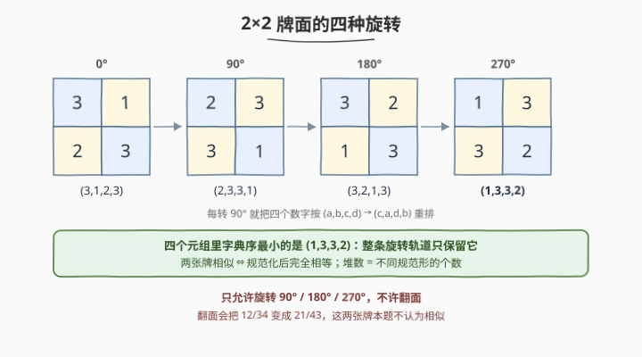
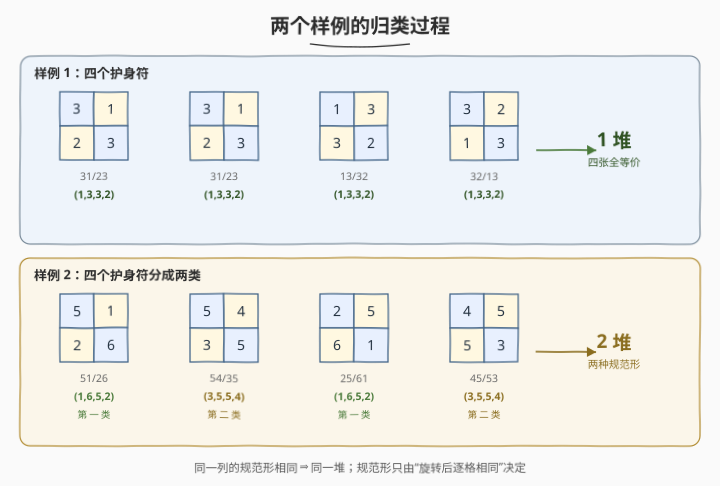

# Codeforces 51A 护身符的旋转归类 题解

## 1. 题目概述

- **题目链接**：https://codeforces.com/problemset/problem/51/A
- **比赛来源**：Codeforces Beta Round 51 · Problem A
- **难度**：1300
- **标签**：实现、模拟、旋转判等、集合去重
- **评测类型**：普通
- **限制**：时间 2 s / 内存 256 MB

**题意**：Cheaterius 用强力胶把多米诺骨牌两两粘成 $2 \times 2$ 的方块，每个小格里画 $1$ 到 $6$ 个点。现在桌上有 $n$ 个这样的护身符，要把它们分堆：两张牌**相似**当且仅当可以把其中一张旋转 $90^\circ$、$180^\circ$ 或 $270^\circ$（也可以不转），使得四个格子里的点数逐格相同。护身符不允许翻面。求最少要分成几堆，也就是相似关系下的等价类个数。

输入第一行是 $n$，接下来每个护身符占两行、每行两个数字（实际输入中连写成 `31` 这样的两位数字串），相邻两个护身符之间有一行 `**` 作为分隔。

**约束**：

- $1 \le n \le 1000$：$O(n^2)$ 的两两比较约 $10^6$ 对，配合每对 4 次旋转检查也能在 2 s 内跑完，但完全没必要；正解是 $O(n)$ 的规范化。
- 每格只有 $1$ 到 $6$，一副牌面的状态数只有 $6^4 = 1296$ 种，所以不同规范形最多 1296 个，去重集合的规模天然有上界。
- 每个护身符固定两行、每行两个数字；护身符之间用 `**` 行分隔，**这一行不是牌面数据**，解析时必须跳过。
- 只有一组数据，没有测试组数 $t$，也不是读到 EOF 的多组格式。

## 2. 示例与观察

官方样例 1（输入 / 输出原样）：

```text
输入：
4
31
23
**
31
23
**
13
32
**
32
13

输出：
1
```

官方样例 2：

```text
输入：
4
51
26
**
54
35
**
25
61
**
45
53

输出：
2
```

**样例 1 演算**：把每张牌按「左上 $a$、右上 $b$、左下 $c$、右下 $d$」写成四元组 $(a,b,c,d)$，再顺时针转三次：

| 牌面 | $0^\circ$ | $90^\circ$ | $180^\circ$ | $270^\circ$ | 字典序最小 |
|------|-----------|------------|-------------|-------------|------------|
| `31/23` | $(3,1,2,3)$ | $(2,3,3,1)$ | $(3,2,1,3)$ | $(1,3,3,2)$ | $(1,3,3,2)$ |
| `31/23` | $(3,1,2,3)$ | $(2,3,3,1)$ | $(3,2,1,3)$ | $(1,3,3,2)$ | $(1,3,3,2)$ |
| `13/32` | $(1,3,3,2)$ | $(3,1,2,3)$ | $(2,3,3,1)$ | $(3,2,1,3)$ | $(1,3,3,2)$ |
| `32/13` | $(3,2,1,3)$ | $(1,3,3,2)$ | $(3,1,2,3)$ | $(2,3,3,1)$ | $(1,3,3,2)$ |

四张牌的四个旋转恰好是同一组四元组，只是排列顺序不同，所以它们全部相似，答案是 1。

**样例 2 演算**：

| 牌面 | $0^\circ$ | $90^\circ$ | $180^\circ$ | $270^\circ$ | 字典序最小 |
|------|-----------|------------|-------------|-------------|------------|
| `51/26` | $(5,1,2,6)$ | $(2,5,6,1)$ | $(6,2,1,5)$ | $(1,6,5,2)$ | $(1,6,5,2)$ |
| `54/35` | $(5,4,3,5)$ | $(3,5,5,4)$ | $(5,3,4,5)$ | $(4,5,5,3)$ | $(3,5,5,4)$ |
| `25/61` | $(2,5,6,1)$ | $(6,2,1,5)$ | $(1,6,5,2)$ | $(5,1,2,6)$ | $(1,6,5,2)$ |
| `45/53` | $(4,5,5,3)$ | $(5,4,3,5)$ | $(3,5,5,4)$ | $(5,3,4,5)$ | $(3,5,5,4)$ |

第 1、3 张的规范形都是 $(1,6,5,2)$，第 2、4 张都是 $(3,5,5,4)$，于是分成两堆，答案是 2。

**观察**：

1. 「旋转后能重合」是一种等价关系，堆数就是等价类个数；只要能给每个类算出一个**唯一代表**，把代表放进集合数一数即可。
2. 一张牌的四个旋转再转还是这四张之一，所以「四个旋转里字典序最小的那个」在同类的每张牌上算出来都一样。
3. 翻面不是允许的操作：`12/34` 翻面得到 `21/43`，两者在本题中**不相似**。实现时只生成 4 个旋转，不要顺手加上镜像。

## 3. 解题思路

### 3.1 朴素做法与瓶颈

最直白的做法是两两比较：对第 $i$ 张牌，扫描已经开出的每一堆，用「枚举 4 种旋转」判断它是否与堆代表相似，相似就入堆，否则新开一堆。这在 $n = 1000$ 时约 $5 \times 10^5$ 对、每对 4 次比较，实际完全跑得动，但它把「相似」当成了需要现场判定的关系，写法稍不留神（比如只比较一次旋转、或者把翻面也算进去）就会错，而且复杂度是 $O(n^2)$。

更好的做法是把「相似」变成「相等」：给每张牌算一个规范形，之后只做整数四元组的相等比较。

### 3.2 核心观察：四个旋转中取字典序最小



设牌面为

$$\begin{pmatrix} a & b \\ c & d \end{pmatrix},$$

按行展开成四元组 $(a,b,c,d)$。顺时针旋转 $90^\circ$ 时，左上角来自左下角、右上角来自左上角、左下角来自右下角、右下角来自右上角，于是

$$(a,b,c,d) \xrightarrow{\ 90^\circ\ } (c,a,d,b) \xrightarrow{\ 90^\circ\ } (d,c,b,a) \xrightarrow{\ 90^\circ\ } (b,d,a,c).$$

记这 4 个四元组构成集合 $S(P)$，定义

$$\mathrm{canon}(P) = \min_{\text{字典序}} S(P).$$

因为四元组的每个分量只有 $1$ 到 $6$，字典序可以直接用 C++ 的 `array<int,4>` 或 Python 的元组比较，不需要字符串技巧。

关键性质：$P$ 与 $Q$ 相似，当且仅当 $S(P) = S(Q)$，也就等价于 $\mathrm{canon}(P) = \mathrm{canon}(Q)$。于是问题化为「统计不同规范形的个数」，用 `set` / `set` 即可，$O(n)$ 次插入。

### 3.3 算法流程



1. 读入 $n$。
2. 按 token 读入后续内容，跳过所有等于 `**` 的分隔行；把每个 token 里的数字字符依次摊平成一个数组 `dig`。这样 `31` 与 `3 1` 两种写法都能正确读入。
3. 对 $i = 0,1,\dots,n-1$，取 `dig[4i..4i+3]` 得到 $a,b,c,d$，生成 4 个旋转四元组，取最小者插入集合。
4. 输出集合大小。

由于每个护身符恰好 4 个数字，摊平后第 $i$ 个护身符就是第 $4i$ 到 $4i+3$ 个数字，不需要额外记录行边界。

### 3.4 样例走查

以样例 2 的第 1 张牌 `51/26` 为例：四个旋转是 $(5,1,2,6)$、$(2,5,6,1)$、$(6,2,1,5)$、$(1,6,5,2)$，最小的是 $(1,6,5,2)$；第 3 张 `25/61` 的四个旋转是 $(2,5,6,1)$、$(6,2,1,5)$、$(1,6,5,2)$、$(5,1,2,6)$，最小同样是 $(1,6,5,2)$，因此它们进同一个集合元素。第 2、4 张同理归到 $(3,5,5,4)$。集合最终有两个元素，输出 2，与官方样例一致。

## 4. 正确性证明

**引理 1**：对任意牌面 $P$，$S(P)$ 在旋转下封闭。

**证明**：$S(P) = \{P_0,P_1,P_2,P_3\}$，其中 $P_k$ 表示顺时针转 $90k$ 度。把 $P_k$ 再转 $90j$ 度，等价于把 $P$ 转 $90(k+j)$ 度，即 $P_{(k+j) \bmod 4}$，仍在 $S(P)$ 中。∎

**引理 2**：$P$ 与 $Q$ 相似当且仅当 $S(P) = S(Q)$。

**证明**：若相似，存在 $k \in \{0,1,2,3\}$ 使 $Q = P_k$。由引理 1，$S(Q) = \{P_{k+j \bmod 4}\} = S(P)$。反之若 $S(P) = S(Q)$，则 $Q \in S(P)$，即 $Q$ 是 $P$ 的某个旋转，二者相似。∎

**引理 3**：若 $P$ 与 $Q$ 相似，则 $\mathrm{canon}(P) = \mathrm{canon}(Q)$。

**证明**：由引理 2，$S(P) = S(Q)$，两个相等的有限集合的最小元相同。∎

**引理 4**：若 $\mathrm{canon}(P) = \mathrm{canon}(Q)$，则 $P$ 与 $Q$ 相似。

**证明**：设最小元为 $R$。由定义 $R \in S(P) \cap S(Q)$，故 $P$ 与 $Q$ 都能旋转成 $R$，旋转可逆，所以 $P$ 能旋转成 $Q$。∎

**定理**：算法输出的集合大小等于护身符的堆数。

**证明**：引理 3、4 说明「规范形相等」与「相似」是同一个等价关系，因此算法把每张牌映射到其等价类的唯一标签，集合的不同元素个数恰好是等价类个数，即最少堆数。∎

## 5. 复杂度分析

- **时间**：$O(n)$。每张牌生成 4 个四元组、做 3 次比较取最小、一次集合插入，全部是常数次操作；$n \le 1000$ 时运算量不到 $10^4$ 级别。
- **空间**：$O(n)$ 用于存放数字数组和集合；集合实际元素数 $\le \min(n, 6^4) = 1296$，很小。
- **与时限的关系**：2 s 的时限非常宽松。实测 $n = 1000$ 时 C++ 端到端约 6 ms，Python 约 26 ms（都包含进程启动），距离 2 s 有两个数量级以上的余量。

## 6. 参考代码

### C++17

```cpp
#include <bits/stdc++.h>
using namespace std;

int main() {
    ios::sync_with_stdio(false);
    cin.tie(nullptr);

    int n;
    if (!(cin >> n)) return 0;

    // 输入里还有作为分隔符的 "**" 行：按 token 读入时直接跳过；
    // 每个护身符占两行、每行写成 "ab" 这种两位数字串，把所有数字顺序摊平后每 4 个一组。
    vector<int> dig;
    string tok;
    while (cin >> tok) {
        if (tok == "**") continue;
        for (char c : tok)
            if (c >= '0' && c <= '9') dig.push_back(c - '0');
    }

    set<array<int, 4>> classes;
    for (int i = 0; i < n; ++i) {
        int a = dig[4 * i], b = dig[4 * i + 1];
        int c = dig[4 * i + 2], d = dig[4 * i + 3];
        // 顺时针旋转：0° / 90° / 180° / 270°，不含翻面（镜像）
        array<array<int, 4>, 4> rot = {{{a, b, c, d},
                                        {c, a, d, b},
                                        {d, c, b, a},
                                        {b, d, a, c}}};
        array<int, 4> canon = *min_element(rot.begin(), rot.end());
        classes.insert(canon);
    }

    cout << classes.size() << '\n';
    return 0;
}
```

### Python3

```python
import sys


def main() -> None:
    data = sys.stdin.read().split()
    if not data:
        return
    n = int(data[0])
    # 跳过所有 "**" 分隔行，再把剩下的数字串摊平成单个数字
    digits = [ch for tok in data[1:] if tok != "**" for ch in tok if ch.isdigit()]
    classes = set()
    for i in range(n):
        a, b, c, d = (int(ch) for ch in digits[4 * i:4 * i + 4])
        rots = ((a, b, c, d), (c, a, d, b), (d, c, b, a), (b, d, a, c))
        classes.add(min(rots))
    print(len(classes))


main()
```

两份代码都只用标准库，可以原样提交。

## 7. 边界情况与易错点

1. **把 `**` 当数据**：分隔行直接按 token 读入会混进数字流，后面所有牌面整体错位。必须跳过 `tok == "**"`；每张牌恰好 4 个数字，摊平后按 4 个一组切分。
2. **忘记翻面限制**：只允许 4 种旋转（含 $0^\circ$），不能加镜像。例如 `12/34` 与 `21/43` 是镜像而不是旋转，算成同一类会少算一堆。
3. **旋转只生成一次**：只写 `(c,a,d,b)` 而不继续生成 $180^\circ$、$270^\circ$，会把 `32/13` 与 `31/23` 误判成不同类。必须四个都生成（样例 1 的第 4 张正是靠 $270^\circ$ 才对上的）。
4. **旋转方向写反**：四个旋转全都生成并取最小值时，顺时针还是逆时针不影响结果（两组旋转集合相同）；但如果只生成部分旋转，方向写反就会漏解。按 $90^\circ$ 映射 `(a,b,c,d) → (c,a,d,b)` 连推三次最稳。
5. **用字符串拼接当规范形**：本题数字都是 $1$ 到 $6$ 的单个字符，拼接恰好无歧义；但换成两位数点位就会出错。统一用四元组（Python 元组、C++ `array<int,4>`）比较，语义清晰。
6. **$n = 1$**：答案是 1，程序应输出 1 而不是 0。集合初始为空，插入一次即为 1，天然正确。
7. **输出的是堆数**：只输出集合大小，不要输出每堆包含哪些牌、也不要把牌数当答案。
8. **输入行可能是 `3 1` 或 `31`**：题面样例是连写，按 token 摊平数字的写法对两种都能工作；不要用「按行读两个整数」的方式假设一定有空格。
9. **Python 读入末尾**：用 `sys.stdin.read().split()` 一次读完，避免输入末尾缺换行带来的影响。

## 8. 验证记录

- **编译环境与命令**：本机只有 Apple clang 21.0.0（`/usr/bin/g++` 是 clang 的软链），没有 GNU `g++`，因此用 `clang++ -std=c++17 -O2 -Wall` 搭配仓库自带的 `codeforces/tools/include/bits/stdc++.h` 兼容头编译（代码只用标准库，可原样提交 GNU C++17）。Python 为 3.9.6。
- **官方样例**：2 / 2 通过（样例 1 输出 `1`，样例 2 输出 `2`），C++ 与 Python 输出一致。
- **额外测试**：覆盖 $n = 1$、数字之间带空格、全部相同、两两镜像（`12/34` 与 `21/43` 必须算两类）等手写用例，均与暴力一致。
- **独立暴力对拍**：另写一份独立程序 `brute.cpp`，用坐标变换 `new[r][c] = old[1-c][r]` 实现顺时针旋转，再按「与已有堆代表逐一比较」的方式分堆（不使用规范形）。与参考程序随机对拍 **300 组**（$n \le 30$，牌面随机取 $1..6$，并有较大概率由同一张牌旋转得到），C++、Python、暴力三方输出全部一致；另外用 $n = 1000$ 的大数据与暴力核对，结果同为 312。
- **最大约束性能**：$n = 1000$ 的随机数据，C++ 端到端约 5–10 ms、Python 约 26 ms（含进程启动），峰值内存 < 2 MB，相对 2 s / 256 MB 余量充足。
- **图片校验**：两张 SVG（`cf51a_rotations.svg`、`cf51a_sample_walk.svg`）均通过 `xml.etree.ElementTree.parse`；另用 headless Chrome 实际排版，逐个量出 90 个文本块的包围盒，确认没有越出 `viewBox`、没有互相重叠。
- **公式校验**：全部公式用 `$...$` / `$$...$$`，经 KaTeX（`throwOnError`）渲染无报错。
- **复核状态**：verified（样例、对拍、性能、图片、公式五项均已实跑）。

## 相关题目与扩展

- [Codeforces 51B bHTML Tables Analisys](https://codeforces.com/problemset/problem/51/B)：同场 B 题，考的是标签配对与嵌套统计，和本题一样属于「先把结构规范化再计数」。
- [Codeforces 51C Three Base Stations](https://codeforces.com/problemset/problem/51/C)：同场 C 题，二分答案 + 贪心构造。
- [LeetCode 48. 旋转图像](https://leetcode.cn/problems/rotate-image/)：原地把 $n \times n$ 矩阵顺时针旋转 $90^\circ$，用的正是本题 `(a,b,c,d) → (c,a,d,b)` 这套坐标映射。
- [Codeforces 16A Flag](https://codeforces.com/problemset/problem/16/A)：同样是 $2 \times 2$ 小方块级别的实现题，训练把图形条件翻译成逐格判断。

**延伸思考**：

1. **如果允许翻面**：相似关系从旋转群 $C_4$ 扩大成二面体群 $D_4$（4 个旋转 + 4 个镜像），规范形改成在 8 个形态里取字典序最小即可，代码只多 4 个生成式。此时 `12/34` 与 `21/43` 会被并成一类。
2. **用 Burnside 引理数类**：若问「$n$ 张牌最多可能分成多少堆」，即长度为 4 的牌面在 $C_4$ 作用下的轨道总数，由 Burnside 引理
$$\frac{1}{4}\left(6^4 + 6^1 + 6^2 + 6^1\right) = \frac{1296 + 6 + 36 + 6}{4} = 336,$$
其中 $F_{90} = F_{270} = 6$（四格必须同值）、$F_{180} = 6^2$（对角相等）。这说明集合规模最多 336，而不是 1296。
3. **推广到 $k \times k$ 牌面**：四种旋转都用 $O(k^2)$ 生成，规范形取最小仍是最直接的做法；如果 $k$ 很大而 $n$ 很多，可以只存最小旋转的哈希，避免比较整张牌。
4. **如果牌面含有两位数点位**：字符串拼接的规范形会失效（`1|23` 与 `12|3` 混淆），必须用定长编码或元组；这也是本题坚持用四元组而不是字符串的原因。

