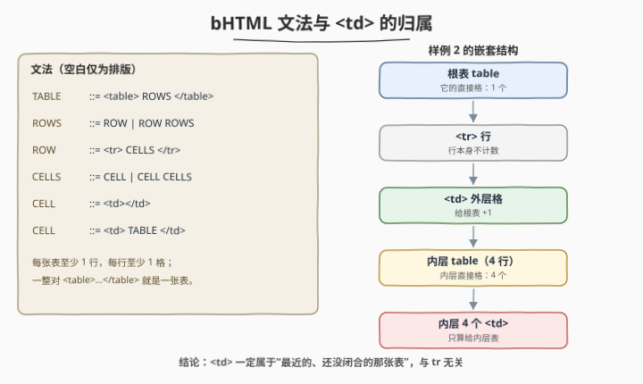
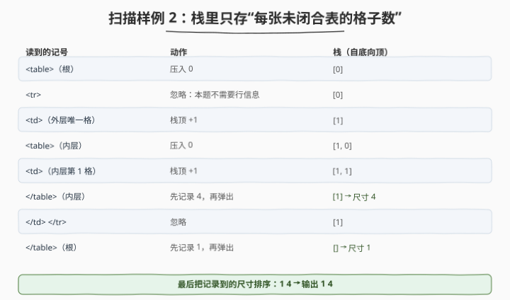
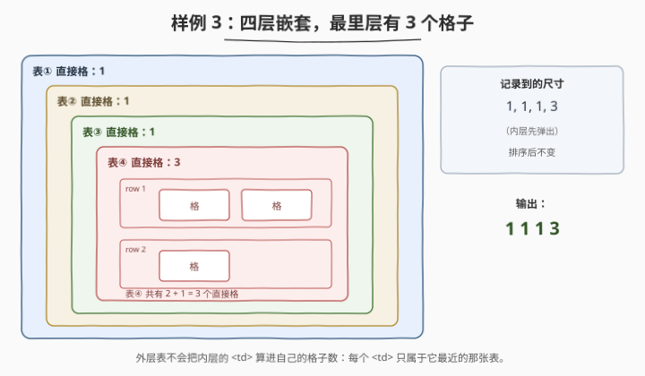

# Codeforces 51B bHTML 表格尺寸统计 题解

## 1. 题目概述

- **题目链接**：https://codeforces.com/problemset/problem/51/B
- **比赛来源**：Codeforces Beta Round 51 · Problem B
- **难度**：1700
- **标签**：表达式解析、栈、语法分析
- **评测类型**：普通
- **限制**：时间 2 s / 内存 256 MB

**题意**：定义一种极简的 HTML 表格标记 bHTML，文法为

```text
TABLE ::= <table> ROWS </table>
ROWS  ::= ROW | ROW ROWS
ROW   ::= <tr> CELLS </tr>
CELLS ::= CELL | CELL CELLS
CELL  ::= <td></td> | <td> TABLE </td>
```

也就是说：一张表由至少一行组成，一行由至少一个单元格组成，单元格要么是空的 `<td></td>`，要么内部再嵌一张完整的表。所有标签都成对出现，输入串里没有空格。给定这个串（允许被任意切成不超过 10 行），要求统计**每一张表**有多少个单元格，并按非递减顺序输出。

**约束**：

- 串长 $|s| \le 5000$：$O(|s|)$ 的线性扫描足够；任何按行、按固定模板切分的做法都不可靠，因为标签可以被换行拆开。
- 输入不超过 10 行，且拼接后不含空格；所以可以先删掉所有空白再解析。
- 每张表至少 1 行、每行至少 1 个单元格，标签只有 `table` / `tr` / `td` 三种且全部配对。
- 嵌套深度最大约 $5000 / 13 \approx 384$ 层：递归解析在 C++ 安全，在 Python 里也低于默认递归上限，但用显式栈更稳。
- 只有一组数据。

## 2. 示例与观察

官方样例 1（输入 / 输出原样）：

```text
输入：
<table><tr><td></td></tr></table>

输出：
1
```

官方样例 2：

```text
输入：
<table>
<tr>
<td>
<table><tr><td></td></tr><tr><td></
td
></tr><tr
><td></td></tr><tr><td></td></tr></table>
</td>
</tr>
</table>

输出：
1 4
```

官方样例 3：

```text
输入：
<table><tr><td>
<table><tr><td>
<table><tr><td>
<table><tr><td></td><td></td>
</tr><tr><td></td></tr></table>
</td></tr></table>
</td></tr></table>
</td></tr></table>

输出：
1 1 1 3
```

**样例 1 演算**：只有一张表、一行、一个空格子，单元格数是 1，输出 `1`。

**样例 2 演算**：外层表只有一行一列，这个唯一的单元格里嵌套了一张表；内层表有 4 行，每行 1 个单元格，所以内层尺寸是 4，外层尺寸是 1。按非递减输出 `1 4`。注意样例 2 的输入把 `</td>` 拆成了 `</`、`td`、`>` 三行，`<tr>` 也跨了行——这正说明**必须先把所有行拼起来**再解析。

**样例 3 演算**：四张表层层嵌套，最里面一张表有两行：第一行 2 个格子、第二行 1 个格子，共 3 个；外面三层各只有 1 个直接格子。所以尺寸集合是 $\{1,1,1,3\}$，输出 `1 1 1 3`。

**观察**：

1. 表格的「大小」只数**直接**单元格，不把内层表的格子算进外层。样例 2 若把所有 `<td>` 都算给外层，会得到 5 而不是 1 和 4。
2. 每个 `<td>` 一定属于「离它最近、还没闭合的那张表」；`<tr>` 对计数完全没有用，可以忽略。
3. 因为标签全部配对，扫描到 `</table>` 时，被关闭的一定是最内层的那张表，它的计数此刻已经完整。

## 3. 解题思路

### 3.1 朴素做法与瓶颈

最直接的想法是数一数 `<td>` 的个数。但这会掉进嵌套的坑：样例 2 里所有 `<td>` 有 5 个，而两张表分别只有 1 和 4 个直接格。要区分「这个格子属于哪张表」，就必须知道当前处在第几层嵌套里。

另一种做法是递归下降：按文法写 `parseTable / parseRow / parseCell` 三个函数，返回每张表的格子数。它正确但代码更长，而且 Python 需要关心递归深度。用显式栈可以把「当前在最内层哪张表」直接暴露出来，写法更短。

### 3.2 核心观察：`<td>` 只属于栈顶那张表



由文法，`<td>` 只出现在 CELL 的开头。一个 CELL 若含嵌套表，形式是 `<td> TABLE </td>`：它自己的 `<td>` 先出现，随后才是内层 TABLE 的 `<table>` 与内层所有 `<td>`，最后才是它的 `</td>`。所以在扫描到任意一个 `<td>` 的瞬间，包含它的那张表就是**最内层尚未闭合的表**。

于是维护一个栈：

- 遇到 `<table>`：压入一个新计数器 0；
- 遇到 `<td>`：给栈顶计数器加 1（这就是「该表的一个直接单元格」）；
- 遇到 `</table>`：此时栈顶计数就是这张表的尺寸，记录下来，然后弹栈。

`<tr>`、`</tr>`、`</td>` 都不需要特殊处理，直接跳过。

### 3.3 算法流程



1. 读入所有行，删掉全部空白字符（空格、换行、制表符），拼成串 $s$。
2. 用下标 $i$ 从 0 扫到 $|s|-1$：遇到 `<` 就找到下一个 `>`，取出整个标签。
3. 按标签名分三种情况处理：`<table>` 压栈 0，`<td>` 栈顶加一，`</table>` 记录栈顶并弹栈。
4. 把记录的尺寸排序后输出，每个数后面跟一个空格。

因为每张表关闭时都会记录一次，而文法保证有且只有一张根表，所以最终恰好记录到「表的总数」个尺寸。

### 3.4 样例走查

以样例 3 的嵌套结构为例：



| 读到的记号 | 动作 | 栈（自底向顶） |
|------------|------|----------------|
| `<table>`（表①） | 压入 0 | $[0]$ |
| `<td>` | 栈顶 +1 | $[1]$ |
| `<table>`（表②） | 压入 0 | $[1,0]$ |
| `<td>` | 栈顶 +1 | $[1,1]$ |
| `<table>`（表③） | 压入 0 | $[1,1,0]$ |
| `<td>` | 栈顶 +1 | $[1,1,1]$ |
| `<table>`（表④） | 压入 0 | $[1,1,1,0]$ |
| 表④ 的 3 个 `<td>` | 栈顶 +1 三次 | $[1,1,1,3]$ |
| `</table>`（表④） | 记录 3，弹栈 | $[1,1,1]$ → 尺寸 3 |
| `</table>`（表③） | 记录 1，弹栈 | $[1,1]$ → 尺寸 1 |
| `</table>`（表②） | 记录 1，弹栈 | $[1]$ → 尺寸 1 |
| `</table>`（表①） | 记录 1，弹栈 | $[]$ → 尺寸 1 |

记录顺序是 $3,1,1,1$，排序后为 $1,1,1,3$，与样例输出一致。

## 4. 正确性证明

**引理 1（栈不变量）**：在扫描的任意位置，栈中自底向顶恰好是当前所有未闭合的 `<table>`，按它们被打开的顺序排列，栈顶是最内层的那张表。

**证明**：对扫描过的标签个数做归纳。初始为空栈，成立。遇到 `<table>` 时它成为新的最内层表，压栈后不变量保持；遇到 `</table>` 时文法保证它关闭的正是最内层未闭合的表（标签正确配对），弹栈后不变量保持；`<tr>`、`<td>`、`</td>` 不改变嵌套关系，栈不变。∎

**引理 2**：每个 `<td>` 都是且仅是「扫描到它时栈顶那张表」的直接单元格。

**证明**：由文法，`<td>` 只能作为某个 CELL 的开头出现，而 CELL 必定位于某张表的某个 ROW 内。若该 CELL 内含嵌套表，则嵌套表的 `<table>` 出现在这个 `<td>` 之后，它的所有 `<td>` 也在更深的一层，并且都在这张 CELL 的 `</td>` 之前就被处理完毕。因此处理到这个 `<td>` 时，尚未闭合的表就是包含它的那张表；由引理 1，它正是栈顶。反过来，栈顶表的每个直接单元格都以一个 `<td>` 开头，也都会被计数。∎

**引理 3**：处理 `</table>` 时，栈顶计数器恰好等于被关闭表的直接单元格数。

**证明**：该表被打开时计数器置 0；由引理 2，属于它的每个 `<td>` 在处理时栈顶都是它，因而各加 1；属于其他表的 `<td>` 要么在它打开之前、要么在它闭合之后处理，要么在更深层（栈顶是内层表）处理，都不会加到它头上。所以计数恰好等于直接单元格数。∎

**定理**：算法记录并排序输出的序列，正是所有表格的单元格数按非递减排列的结果。

**证明**：由引理 1，每张表恰好被打开、关闭一次，关闭时由引理 3 记录到正确的尺寸，故记录集合与所有表一一对应且数值正确；排序不改变多重集合，只把它变成非递减顺序。∎

## 5. 复杂度分析

- **时间**：$O(|s|)$。每个字符最多被扫描常数次，标签查找用 `find('>')` 均摊线性；$|s| \le 5000$ 时最多几万次基本操作。
- **空间**：$O(d + t)$，其中 $d$ 是最大嵌套深度（$\le 384$），$t$ 是表的总数；另有 $O(|s|)$ 的拼接串。相对 256 MB 可以忽略。
- **与时限的关系**：2 s 的时限下，本做法在最大数据上也是毫秒级，余量在三个数量级以上。

## 6. 参考代码

### C++17

```cpp
#include <bits/stdc++.h>
using namespace std;

int main() {
    ios::sync_with_stdio(false);
    cin.tie(nullptr);

    // 题面允许把同一个串任意断行，所以先把所有空白（含换行）删掉拼成一个串
    string s, line;
    while (getline(cin, line))
        for (char c : line)
            if (!isspace((unsigned char)c)) s += c;

    vector<int> cells;   // 栈：每个未闭合 table 的已见直接单元格数
    vector<int> sizes;   // 每个 table 的单元格数
    for (size_t i = 0; i < s.size();) {
        if (s[i] != '<') { ++i; continue; }
        size_t j = s.find('>', i);
        if (j == string::npos) break;
        string tag = s.substr(i, j - i + 1);
        if (tag == "<table>") {
            cells.push_back(0);          // 新表入栈，计数清零
        } else if (tag == "<td>") {
            ++cells.back();              // 该 td 是当前最内层表的直接单元格
        } else if (tag == "</table>") {
            sizes.push_back(cells.back());  // 先记录，再出栈
            cells.pop_back();
        }
        i = j + 1;
    }

    sort(sizes.begin(), sizes.end());    // 题面要求非递减
    for (int x : sizes) cout << x << ' ';
    cout << '\n';
    return 0;
}
```

### Python3

```python
import sys


def main() -> None:
    s = "".join(sys.stdin.read().split())
    stack = []          # 每个未闭合 table 的直接单元格计数
    sizes = []
    i = 0
    while i < len(s):
        if s[i] != "<":
            i += 1
            continue
        j = s.find(">", i)
        tag = s[i:j + 1]
        if tag == "<table>":
            stack.append(0)
        elif tag == "<td>":
            stack[-1] += 1
        elif tag == "</table>":
            sizes.append(stack.pop())
        i = j + 1
    print(" ".join(map(str, sorted(sizes))) + " ")


main()
```

两份代码都只用标准库，可以原样提交。

## 7. 边界情况与易错点

1. **按行解析**：样例 2 把 `</td>` 拆成了 `</`、`td`、`>` 三行，`<tr>` 也被拆开。任何「逐行找标签」的写法都会漏掉跨行标签。正确做法是先删除所有空白、拼成整串再扫描。
2. **把内层 `<td>` 算进外层**：外层表的尺寸只统计它自己的直接单元格。样例 2 全部 `<td>` 共 5 个，但正确答案是 `1 4`；必须用栈区分层级。
3. **忘记记录就弹栈**：`</table>` 时若先 `pop` 再取计数，会丢失当前表的尺寸或者读到外层计数，直接算错。顺序一定是「先记录栈顶，再弹出」。
4. **输出顺序与分隔**：要求**非递减**输出，因此必须排序；题面的输出在每个尺寸后带一个空格（例如 `1 `、`1 4 `），按此格式写最稳妥。评测按 token 比对，行末空格不会造成 WA，但不要输出逗号或换行分隔的其他格式。
5. **误处理 `</td>`**：`</td>` 与 `<td>` 只差一个斜杠，用整串相等比较（`tag == "<td>"`、`tag == "</table>"`）而不是 `find("<td>")`，可以避免把闭合标签当成新单元格。
6. **只有一张表**：输出一个数加空格即可，不要因为集合为空而不输出。
7. **Python 递归写法**：如果改用递归下降，嵌套 384 层已接近 Python 默认递归上限 1000 的安全边界，且大输入时更慢；显式栈没有这个风险。
8. **输入末尾没有换行**：`getline` 循环与 `sys.stdin.read()` 都能处理；不要用「读固定行数」的写法。
9. **栈空保护**：文法保证 `<td>` 一定在 `<table>` 内部；若想防御非法输入，可在 `stack` 为空时直接返回，避免 `back()` 越界。

## 8. 验证记录

- **编译环境与命令**：本机只有 Apple clang 21.0.0（`/usr/bin/g++` 是 clang 的软链），用 `clang++ -std=c++17 -O2 -Wall` 搭配仓库自带的 `codeforces/tools/include/bits/stdc++.h` 兼容头编译；Python 为 3.9.6。
- **官方样例**：3 / 3 通过（`1`、`1 4`、`1 1 1 3`），C++ 与 Python 输出一致。
- **独立暴力对拍**：另写一份按文法实现的**递归下降**解析器 `brute.cpp`（与栈做法完全不同的思路），随机生成合法 bHTML 表（随机行数、每行随机格数、以 35% 概率嵌套下一层，至多 7 张表）并随机插入至多 9 个换行（可能把标签从中间拆开），共 **300 组**与参考程序对拍，C++、Python、暴力三方输出全部一致。
- **额外测试**：单表单格、四层嵌套、一张表 300 个格子、150 层纯嵌套等手写用例全部通过；标签被换行拆开的情形由随机生成器覆盖。
- **最大约束性能**：$|s| = 4950$、150 层嵌套的数据，C++ 不到 10 ms、Python 约 20 ms（含进程启动）；峰值内存 < 3 MB，相对 2 s / 256 MB 余量充足。
- **图片校验**：三张 SVG（`cf51b_grammar.svg`、`cf51b_stack_walk.svg`、`cf51b_sample3.svg`）均通过 `xml.etree.ElementTree.parse`；用 headless Chrome 实际排版量出全部文本块的包围盒，确认没有越出 `viewBox`、没有互相重叠。
- **公式校验**：公式经 KaTeX（`throwOnError`）渲染无报错。
- **复核状态**：verified（样例、对拍、性能、图片、公式五项均已实跑）。

## 相关题目与扩展

- [Codeforces 51A Cheaterius's Problem](https://codeforces.com/problemset/problem/51/A)：同场 A 题，旋转判等 + 集合去重。
- [Codeforces 51C Three Base Stations](https://codeforces.com/problemset/problem/51/C)：同场 C 题，二分答案 + 贪心。
- [LeetCode 385. 迷你语法分析器](https://leetcode.cn/problems/mini-parser/)：把嵌套列表的字符串解析成 `NestedInteger`，同样需要处理「遇到开括号入栈、闭括号出栈」的层级关系，是本题的姊妹题。
- [LeetCode 1021. 删除最外层的括号](https://leetcode.cn/problems/remove-outermost-parentheses/)：用深度计数决定哪些括号属于最外层，和本题「每个 `<td>` 只算给最近的那张表」是同一类归属判定。
- [Codeforces 7E Defining Macros](https://codeforces.com/problemset/problem/7/E)：同属表达式/语法解析，要求判断宏展开的优先级与合法性，比本题多了运算符优先级。

**延伸思考**：

1. **还要输出行数与每行格数**：栈里改存 `(格子数, 行数, 当前行格数)`，遇到 `<tr>` 行数加一，遇到 `<td>` 给当前行加一；`</table>` 时把行信息一并记录即可。
2. **检查表格是否矩形**：每行结束时比较本行格数与第一行格数，不相等就标记非法。题目说明表不必是矩形，所以本题不能加这个检查，但扩展成「校验器」时很有用。
3. **标签带属性**：如果出现 `<td class="x">`，就不能把整段标签与 `"<td>"` 比较，而要只取 `<` 后到第一个空白/`>` 之间的标签名；同时属性值里可能出现 `>`，必须处理引号。
4. **更大规模**：若 $|s|$ 达到 $10^7$，栈做法仍是 $O(|s|)$，但递归下降会爆栈；这也是工程解析器偏爱显式栈的原因。
5. **把输入当流解析**：本题允许一次性读入全串；若输入是逐行到达的事件流（例如网络数据），就需要增量式状态机：维护当前栈与「是否在标签中」的缓冲，遇到 `>` 才处理一个完整标签。

