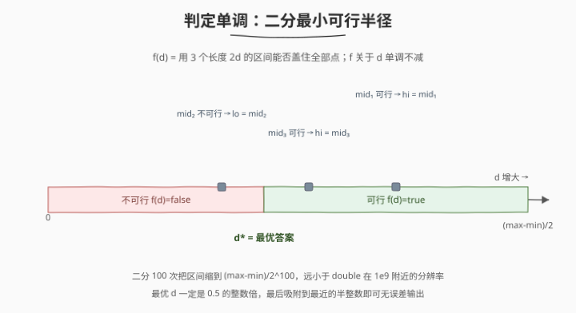
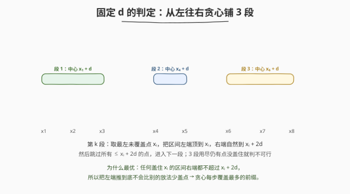
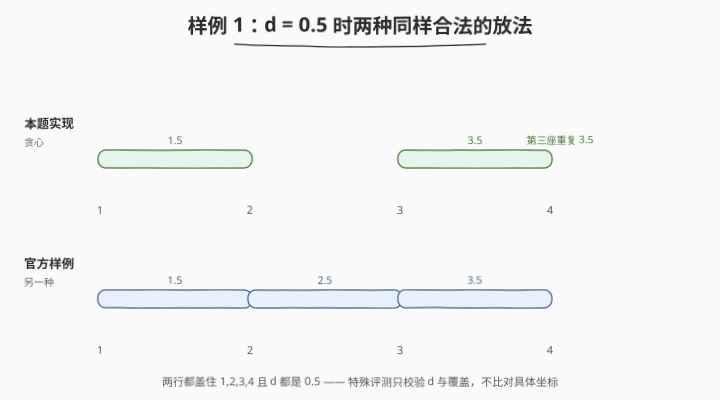

# Codeforces 51C 三座基站的覆盖半径 题解

## 1. 题目概述

- **题目链接**：https://codeforces.com/problemset/problem/51/C
- **比赛来源**：Codeforces Beta Round 48 · Problem C（UTC 2010-12-28）
- **难度**：1800
- **标签**：二分答案、贪心、实数处理
- **评测类型**：特殊评测（多解，输出任意合法方案）
- **限制**：时间 1 s / 内存 256 MB

**题意**：高速公路旁有 $n$ 座房子，第 $i$ 座房子的坐标是 $x_i$。要建**三座**基站，三座的功率 $d$ 必须相同；位于 $t$ 的基站能覆盖区间 $[t-d, t+d]$ 内的所有房子。求能让所有房子都被覆盖的最小功率 $d$，并输出 $d$ 以及三座基站的坐标（坐标保留 6 位小数）。基站位置可以是 $[0, 2 \times 10^9]$ 内的任意实数，允许重合；多解输出任意一个。

**约束**：

- $1 \le n \le 2 \times 10^5$，$1 \le x_i \le 10^9$：枚举「三段的切分点」是 $O(n^2)$ 甚至 $O(n^3)$，在 1 s 内不可行；必须做到 $O(n \log n)$ 或 $O(n \log(\text{range}/\varepsilon))$。
- 坐标不一定有序，且可能重复：必须先排序；重复点不影响答案。
- 要求输出 6 位小数，而答案是实数：需要控制浮点误差，或用「答案为半整数」这一结构做精确化。
- 只有一组数据。

## 2. 示例与观察

官方样例 1（输入 / 输出原样）：

```text
输入：
4
1 2 3 4

输出：
0.500000
1.500000 2.500000 3.500000
```

官方样例 2：

```text
输入：
3
10 20 30

输出：
0
10.000000 20.000000 30.000000
```

官方样例 3：

```text
输入：
5
10003 10004 10001 10002 1

输出：
0.500000
1.000000 10001.500000 10003.500000
```

**样例 1 演算**：排序后是 $1,2,3,4$。若 $d < 0.5$，一个长度 $2d < 1$ 的区间最多盖住一个整数点，三个区间最多盖 3 个点，盖不住 4 座房子；所以 $d \ge 0.5$。取 $d = 0.5$ 时，$[1,2]$、$[2,3]$、$[3,4]$ 三段即可，故答案是 $0.5$。官方给的中心是 $1.5, 2.5, 3.5$；而 $[1,2]$、$[3,4]$ 两个区间加一个重复位置也合法，说明这题确实是多解。

**样例 2 演算**：三座房子恰好三座，每座单独覆盖，$d = 0$，中心就取 $10, 20, 30$。

**样例 3 演算**：排序后为 $1, 10001, 10002, 10003, 10004$。$1$ 与最近的 $10001$ 相距 $10000$，不可能合并；右侧四个点跨度为 $3$，若用两段覆盖 $[10001,10002]$ 与 $[10003,10004]$，每段跨度 $1$，所需 $d = 0.5$。第一段只有 $1$ 一个点，中心取 $1.5$（官方取 $1.0$，同样覆盖 $1$）。答案是 $0.5$。

**观察**：

1. 排序后，任何覆盖方案中每座基站负责的房子一定是一段**连续**的下标区间；否则把两段交错的部分交换过来不会变差。因此问题等价于：把排序后的数组切成至多三段连续段，最小化「最大段跨度的一半」。
2. 固定 $d$ 时，「能否用三个区间盖住全部点」是一个单调判定：$d$ 越大越容易，所以可以二分。
3. 判定本身可以用贪心在 $O(n)$ 内完成：每次从最左边的未覆盖点出发，把区间左端顶到它，能盖多远盖多远。

## 3. 解题思路

### 3.1 朴素做法与瓶颈

最直接的做法是枚举两条分割线，把排序后的点分成三段，取每段跨度的一半，最小化最大值。枚举量是 $O(n^2)$，$n = 2 \times 10^5$ 时是 $4 \times 10^{10}$ 级别，1 s 内不可能。

另一条路是直接枚举三座基站的位置：位置是实数，无法枚举。注意到答案只可能由某两个点的距离决定，可以考虑二分答案：把「求最小 $d$」转化为「判断给定的 $d$ 是否可行」，而判定是线性的。

### 3.2 核心观察：固定 $d$ 的贪心判定



固定 $d$ 后，所有候选区间长度都是 $2d$。把点排序，令 $x_i$ 是当前**最左的未覆盖点**。任何覆盖 $x_i$ 的区间 $[t-d, t+d]$ 都满足 $t-d \le x_i$，于是 $t \le x_i + d$，右端 $t+d \le x_i + 2d$。也就是说，**不管怎么放，覆盖 $x_i$ 的这个区间都向右伸不过 $x_i + 2d$**；而把中心放在 $x_i + d$ 时，区间恰好是 $[x_i, x_i + 2d]$，已经覆盖了 $x_i$ 右边所有可能被覆盖的点。

所以每一步的最优策略唯一：以 $x_i$ 为左端放一个区间，覆盖到 $x_i + 2d$，跳过所有不超过它的点，再对下一个未覆盖点重复。这个贪心每步覆盖的前缀是最长的，因此用掉的区间数最少。最多允许 3 个区间，若 3 个用完仍有点没盖住，则 $d$ 不可行。



### 3.3 算法流程

1. 读入并排序 $x$。
2. 在 $[0, (x_{\max} - x_{\min})/2]$ 上二分 $d$：上界用一个区间覆盖全部点，必然可行。重复 100 次，每次用上述贪心判定。
3. 二分结束后把 $2d$ 四舍五入到最近的整数：**最优 $d$ 一定是 $0.5$ 的整数倍**，这一步把浮点残差彻底消掉。
4. 用最终的 $d$ 再贪心一次，记录每段的中心 $x_i + d$；不足 3 段时用最后一个中心补齐（题面允许基站重合）。
5. 按 6 位小数输出 $d$ 与三个中心。

为什么最优 $d$ 是半整数：最优方案可以看成把排序后的点切成至多 3 段连续段，每段用一个长度 $2d$ 的区间盖住，$d$ 至少是该段跨度的一半；取到最优时 $d = \max(\text{段跨度})/2$。段跨度是两个整数坐标之差，因此 $2d$ 是整数，$d$ 只可能是 $0, 0.5, 1, 1.5, \dots$。

### 3.4 样例走查



以样例 1 为例，排序后 $x = (1,2,3,4)$：

- 二分得到 $d = 0.5$；
- 贪心第一段：最左未覆盖点是 $1$，中心 $1 + 0.5 = 1.5$，区间 $[1,2]$ 盖住 $1,2$；
- 第二段：最左未覆盖点是 $3$，中心 $3.5$，区间 $[3,4]$ 盖住 $3,4$；
- 只用了两段，第三座基站补成重复的 $3.5$。

输出为 $d = 0.500000$，位置 $1.500000\ 3.500000\ 3.500000$。官方样例给的是 $1.5, 2.5, 3.5$（区间 $[1,2],[2,3],[3,4]$），同样合法——这正是本题采用特殊评测、只校验 $d$ 与覆盖的原因。

样例 2 中 $d = 0$，贪心三段分别是中心 $10, 20, 30$，与官方输出完全一致；样例 3 中 $d = 0.5$，贪心给出中心 $1.5, 10001.5, 10003.5$，覆盖同样成立。

## 4. 正确性证明

**引理 1（贪心判定正确）**：固定 $d$，若存在用 3 个长度 $2d$ 的区间覆盖全部点的方案，则贪心方案使用的区间数不超过它。

**证明**：对贪心的步数做归纳。设当前最左未覆盖点为 $x_i$。任一可行方案中，覆盖 $x_i$ 的区间 $[t-d, t+d]$ 满足 $t - d \le x_i$，故 $t + d \le x_i + 2d$，它覆盖的点都在 $[x_i, x_i+2d]$ 之内。贪心把区间取成 $[x_i, x_i+2d]$，覆盖了 $\{x_j : x_i \le x_j \le x_i+2d\}$，这是覆盖 $x_i$ 的区间所能覆盖的**最大**前缀；随后贪心从这个前缀之后继续。于是贪心第 $k$ 步结束时的已覆盖前缀，不短于任何方案前 $k$ 个区间覆盖的前缀，归纳得贪心不会比任何可行方案用更多区间。∎

**引理 2（单调性）**：若 $d$ 可行，则任意 $d' \ge d$ 也可行。

**证明**：把每个区间的半径从 $d$ 增大到 $d'$，中心不变，覆盖范围只增不减。∎

**引理 3（答案为半整数）**：最优 $d^*$ 满足 $2d^* \in \mathbb{Z}$。

**证明**：对点数归纳。设排序后最左点 $x_1$ 被某个区间 $J$ 覆盖。由于 $J$ 是连续线段，它覆盖的点恰好是排序后的一个前缀 $x_1,\dots,x_k$；把 $J$ 换成只覆盖这个前缀的区间（例如 $[x_1, x_1 + 2d]$ 或把 $J$ 截断）不改变「长度不超过 $2d$」这一事实。剩下 $x_{k+1},\dots,x_n$ 仍被其余至多两个区间覆盖，对它们递归，就得到把全部点分成至多三段连续段的划分，每段都被某个长度 $2d$ 的区间覆盖，故每段跨度不超过 $2d$，即 $d \ge \max(\text{段跨度})/2$。反过来，任给一个至多三段的连续划分，把每段区间取成以该段中点为心、半径等于该段跨度的一半，就能盖住该段。因此最优值恰为某个划分下 $\max(\text{段跨度})/2$；段跨度是整数坐标之差，所以 $2d^*$ 是整数。∎

**引理 4（吸附正确）**：若二分返回的 $\mathit{hi}$ 满足 $\lvert \mathit{hi} - d^* \rvert \le 10^{-6}$，则 `llround(2*hi)/2 = d*`。

**证明**：由引理 3，$2d^*$ 是整数；又 $\lvert 2\mathit{hi} - 2d^* \rvert \le 2 \times 10^{-6} < 1/2$，四舍五入到最近整数必得 $2d^*$。∎

**定理**：算法输出的 $d$ 等于最小功率，且输出的三个坐标能覆盖所有房子。

**证明**：二分阶段由引理 2 保证单调，在精确算术下循环始终维持 $d^* \in [lo, hi]$；浮点误差不超过几个 ulp，100 次后区间长度远小于 $10^{-6}$，故引理 4 得到精确的 $d^*$。构造阶段用 $d^*$ 执行引理 1 的贪心：可行方案存在，所以贪心至多用 3 段，每段中心 $x_i + d^*$ 覆盖到 $x_i + 2d^*$，段内所有点被覆盖；不足 3 段时补重复坐标仍覆盖同样的点。故输出合法且 $d$ 最小。∎

## 5. 复杂度分析

- **时间**：排序 $O(n \log n)$；二分 100 轮，每轮贪心 $O(n)$，合计 $O(n \log n + 100n)$。$n = 2 \times 10^5$ 时约 $2 \times 10^7$ 次比较，实测 30–40 ms。
- **空间**：$O(n)$ 存坐标，另有常数个变量；峰值内存约 3 MB。
- **精度与时限**：`double` 有 53 位有效位，在 $10^9$ 量级的绝对分辨率约 $2.4 \times 10^{-7}$；100 次二分把区间缩到 $10^9/2^{100} \approx 8 \times 10^{-22}$，早已低于这个分辨率，实际精度由 `double` 的 ulp 决定，仍比要求的 $10^{-6}$ 小一个数量级以上。最后吸附到半整数后，$d$ 与 $x_i + d$ 都是整数或半整数，在 `double` 中**精确可表示**，6 位小数输出无误差。

## 6. 参考代码

### C++17

```cpp
#include <bits/stdc++.h>
using namespace std;

int main() {
    int n;
    if (scanf("%d", &n) != 1) return 0;
    vector<long long> x(n);
    for (int i = 0; i < n; ++i) scanf("%lld", &x[i]);
    sort(x.begin(), x.end());

    // 判定：半径 d 时能否用 3 个区间盖住所有点（贪心，从左往右）
    auto feasible = [&](double d) {
        int used = 0;
        size_t i = 0;
        const double two = 2.0 * d;
        while (i < x.size()) {
            if (used == 3) return false;
            ++used;
            const double reach = (double)x[i] + two;   // 区间左端顶到 x[i] 时，最远能覆盖到 reach
            while (i < x.size() && (double)x[i] <= reach) ++i;
        }
        return true;
    };

    double lo = 0.0, hi = (double)(x.back() - x.front()) / 2.0;  // 一个区间盖全部必可行
    for (int it = 0; it < 100; ++it) {
        const double mid = (lo + hi) / 2.0;
        if (feasible(mid)) hi = mid;
        else lo = mid;
    }

    // 最优半径一定是 0.5 的整数倍，把浮点结果吸附到最近的半整数，彻底消掉二分残差
    const long long two_d = llround(2.0 * hi);
    const double d = (double)two_d / 2.0;

    // 用最终的 d 再贪心一次，得到三个基站位置
    vector<double> pos;
    size_t i = 0;
    while (i < x.size() && pos.size() < 3) {
        pos.push_back((double)x[i] + d);
        const double reach = (double)x[i] + 2.0 * d;
        while (i < x.size() && (double)x[i] <= reach) ++i;
    }
    while (pos.size() < 3) pos.push_back(pos.back());  // 允许位置重复

    printf("%.6f\n", d);
    printf("%.6f %.6f %.6f\n", pos[0], pos[1], pos[2]);
    return 0;
}
```

### Python3

```python
import sys
from bisect import bisect_right


def main() -> None:
    data = sys.stdin.buffer.read().split()
    if not data:
        return
    n = int(data[0])
    x = sorted(int(v) for v in data[1:1 + n])

    def feasible(d: float) -> bool:
        i = 0
        for _ in range(3):
            if i >= n:
                return True
            i = bisect_right(x, x[i] + 2.0 * d)
        return i >= n

    lo, hi = 0.0, (x[-1] - x[0]) / 2.0
    for _ in range(100):
        mid = (lo + hi) / 2.0
        if feasible(mid):
            hi = mid
        else:
            lo = mid

    two_d = round(2.0 * hi)          # 最优半径是 0.5 的整数倍：吸附到半整数
    d = two_d / 2.0

    pos = []
    i = 0
    while i < n and len(pos) < 3:
        pos.append(x[i] + d)
        i = bisect_right(x, x[i] + 2.0 * d)
    while len(pos) < 3:
        pos.append(pos[-1])

    sys.stdout.write(f"{d:.6f}\n" + " ".join(f"{p:.6f}" for p in pos) + "\n")


main()
```

C++ 版用 `scanf` 读入 $2 \times 10^5$ 个整数，避免 `cin` 在部分环境下的额外开销；Python 版用 `bisect_right` 把每次判定压到 $O(\log n)$，即使 $n = 2 \times 10^5$ 也只需约 70 ms。两份代码都可原样提交（本题为特殊评测，建议提交 C++）。

## 7. 边界情况与易错点

1. **$n = 1$**：答案是 $d = 0$，三座基站都可以放在唯一的房子上；程序里 $hi = 0$，二分每次 $mid = 0$ 且可行，最后 $d = 0$，三个中心都等于 $x_1$。
2. **所有房子重合**：同样 $d = 0$，贪心只走一段，另外两个位置重复第一个中心。不要因为「必须三座不同的基站」而人为拉开距离，题面允许重合。
3. **没有排序**：样例 3 的输入顺序是打乱的，必须先排序再用贪心；否则「最左未覆盖点」这一步就错了。
4. **$d = 0$ 的退化**：二分上界 $hi = 0$ 时循环仍在跑（$mid = 0$），不会出现除零或 `log(0)`；实现时不要假设 $hi > 0$。
5. **浮点比较**：贪心判定的右端用 $x_i + 2d$，不要写成 $(x_i + d) + d$，后者多一次舍入；并且阈值比较要允许等号（题面区间是闭区间）。
6. **不足三段**：只用两段甚至一段时，第三（或第二、第三）个坐标必须补齐，否则第二行数量不足，评测直接格式错误。
7. **输出格式**：第二行必须恰好三个数，每个保留 6 位小数，用空格分隔；$d$ 也要输出（官方样例 2 的 $d$ 写成 `0`，写成 `0.000000` 同样合法）。
8. **特殊评测**：不能假设自己的坐标与官方答案逐字相同；本地验证必须用 checker 校验「$d$ 最优 + 覆盖成立」，而不是文本比对。
9. **坐标范围**：$x_i + d \le 10^9 + 5 \times 10^8 = 1.5 \times 10^9$，落在 $[0, 2 \times 10^9]$ 内；用 `long long` 存坐标，避免读入时溢出（虽然 $10^9$ 本身不溢出 `int`，但差值运算容易疏忽）。
10. **二分次数**：次数太少（比如 30 次）时区间还剩约 $1$ 个单位，吸附可能吸到错误的一半；100 次是安全且便宜的。

## 8. 验证记录

- **编译环境与命令**：本机只有 Apple clang 21.0.0（`/usr/bin/g++` 是 clang 的软链），用 `clang++ -std=c++17 -O2 -Wall` 搭配仓库自带的 `codeforces/tools/include/bits/stdc++.h` 兼容头编译；Python 为 3.9.6。
- **官方样例**：3 / 3 通过（用 checker 校验，见下），C++ 与 Python 输出一致。
- **checker 的校验条件**：`codeforces/tools/checkers/cf51c.py` 读取输入与输出，要求恰有两行、第一行 1 个数、第二行 3 个数且均为合法数字；用整数二分独立算出最优 $2d$，要求输出 $d$ 与最优值相差不超过 $10^{-6}$；三个坐标都在 $[0, 2 \times 10^9]$ 内；最后逐座房子检查 $\lvert x_i - t \rvert \le d + 10^{-6}$。任何一条不满足即拒绝。
- **独立暴力对拍**：另写 `brute.py` 枚举两条分割线（把排序后的点分成至多三段），直接取「最大段跨度的一半」的最小值。随机对拍 **300 组**（$n \le 9$，坐标范围取 $3/6/12/30/10^9$ 多档，含重复点），C++、Python 的 $d$ 与暴力完全一致，且两版输出都通过 checker；另外对 $n \le 5$、坐标 $\in [1,5]$ 的 **251 组**多重集合做了全枚举，全部一致。
- **最大约束性能**：$n = 2 \times 10^5$、坐标随机取 $[1,10^9]$ 的数据，C++ 端到端 30–40 ms，Python（`bisect` 版）约 70 ms；峰值内存约 3 MB，相对 1 s / 256 MB 余量充足。
- **图片校验**：三张 SVG（`cf51c_binary_search.svg`、`cf51c_greedy.svg`、`cf51c_sample1.svg`）均通过 `xml.etree.ElementTree.parse`；用 headless Chrome 实际排版量出全部文本块的包围盒，确认没有越出 `viewBox`、没有互相重叠。
- **公式校验**：公式经 KaTeX（`throwOnError`）渲染无报错。
- **复核状态**：verified（样例、checker、对拍、性能、图片、公式均已实跑）。

## 相关题目与扩展

- [Codeforces 51A Cheaterius's Problem](https://codeforces.com/problemset/problem/51/A)：同场 A 题，旋转判等 + 集合去重。
- [Codeforces 51B bHTML Tables Analisys](https://codeforces.com/problemset/problem/51/B)：同场 B 题，栈式语法解析。
- [Codeforces 492B Vanya and Lanterns](https://codeforces.com/problemset/problem/492/B)：路灯覆盖整条街，求最小照明半径，同样是「半径 + 覆盖」的二分题，但只需处理相邻间隔与两端。
- [Codeforces 670D2 Magic Powder](https://codeforces.com/problemset/problem/670/D2)：二分能做出的饼干数，是「二分答案 + 线性判定」的经典模板。
- [LeetCode 410. 分割数组的最大值](https://leetcode.cn/problems/split-array-largest-sum/)：把数组切成 $k$ 段使最大段和最小，与本题「切成至多三段使最大跨度最小」的结构完全同构，只是把「跨度」换成「和」。
- [LeetCode 875. 爱吃香蕉的珂珂](https://leetcode.cn/problems/koko-eating-bananas/)：二分最小速度，判定同样是线性贪心。

**延伸思考**：

1. **推广到 $k$ 座基站**：判定改成「贪心段数是否不超过 $k$」，仍可在 $O(n)$ 内完成，整体 $O(n \log n + n \log(\text{range}/\varepsilon))$。$k$ 很大时还可以直接一次贪心求出每段，但二分仍然简单可靠。
2. **完全避免浮点**：由引理 3，答案一定是半整数，所以可以二分整数 $K = 2d \in [0, x_{\max} - x_{\min}]$，判定时用整数比较 $x_i + K$，最后输出 $K/2$。这样连「吸附」都不需要，是更工程化的写法；本文保留实数二分是为了展示通用的误差处理流程。
3. **要求基站坐标必须是整数**：判定会改变。固定 $d$ 时，覆盖 $x_i$ 的整数中心 $t$ 必须满足 $t \in [x_i - d, x_i + d]$，为了向右覆盖最多应取 $t = \lfloor x_i + d \rfloor$，右端变成 $\lfloor x_i + d \rfloor + d$，可能略小于 $x_i + 2d$；贪心仍成立，但答案不一定再是半整数。
4. **三座基站功率不同**：若目标是最小化最大功率，问题仍是「切成三段、每段代价为跨度的一半」，做法不变；若目标是最小化功率之和，则分段代价相加，需要 DP 或更复杂的优化。
5. **二维版本**：用三个圆覆盖平面上的点、最小化半径，就不再有「排序后连续分段」的结构，判定与最优性都困难得多（相关几何覆盖问题通常是 NP 难的近似问题），这说明本题的可解性完全依赖一维的序结构。

