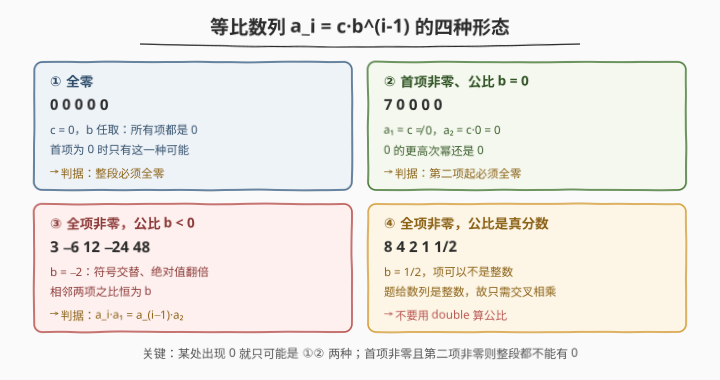
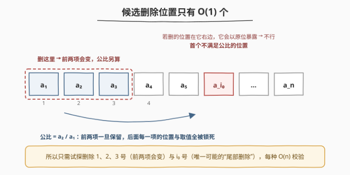
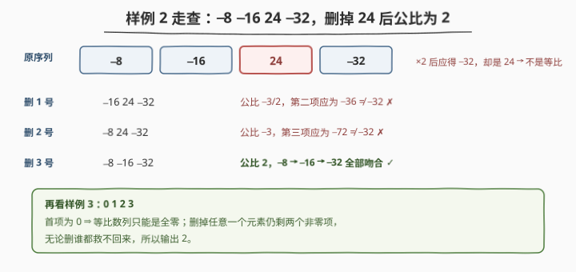

# Codeforces 51D 等比数列删一项 题解

## 1. 题目概述

- **题目链接**：https://codeforces.com/problemset/problem/51/D
- **比赛来源**：Codeforces Beta Round 51 · Problem D（2010-12-29）
- **难度**：2200
- **标签**：实现、数学、等比数列判定、分类讨论
- **评测类型**：普通
- **限制**：时间 1 s / 内存 256 MB

**题意**：给定长度为 $n$ 的整数序列 $a_1, \dots, a_n$。题面把**等比数列**定义为满足 $a_i = c \cdot b^{\,i-1}$（$c, b$ 为任意**实数**）的有限序列，例如 $[2,-4,8]$、$[0,0,0,0]$、$[199]$ 是等比数列，而 $[0,1,2,3]$ 不是。请判断：

- 若原序列已经是等比数列，输出 `0`；
- 否则，若**删掉恰好一个元素**后能变成等比数列，输出 `1`；
- 否则输出 `2`。

**约束**：

- $1 \le n \le 10^5$：$O(n^2)$ 的"枚举删哪个、再 $O(n)$ 校验"是 $10^{10}$，1 s 内绝无可能，必须把候选删除位置压到 $O(1)$ 个。
- $|a_i| \le 10^4$：任意两项乘积不超过 $10^8$，交叉相乘不会溢出；但为了习惯与安全仍用 64 位整数。
- 公比 $b$ 是**实数**：不能用 `double` 求公比（有除零与精度问题），必须用"相邻项交叉相乘相等"这种纯整数判据。
- 允许 $b = 0$、允许 $c = 0$：0 的存在使等比数列的种类变多，必须分类讨论。
- 只有**一组**测试数据，没有 $t$；输出就是一个 0/1/2。

## 2. 示例与观察

官方样例（输入 / 输出原样）：

```text
输入：
4
3 6 12 24

输出：
0
```

```text
输入：
4
-8 -16 24 -32

输出：
1
```

```text
输入：
4
0 1 2 3

输出：
2
```

**样例 1**：$3, 6, 12, 24$，公比 $b = 2$，本身就是等比数列，输出 `0`。

**样例 2**：$a_1 = -8$、$a_2 = -16$，若它是等比数列则公比只能是 $b = 2$，第三项应为 $-32$，实际却是 $24$，所以原序列不是。删掉第三项 $24$ 后得到 $-8, -16, -32$，公比 $2$，成立，输出 `1`。注意三个候选里只有删 $24$ 成功（见 3.4 的图）：删首项得 $-16,24,-32$，公比 $-3/2$，第二项应为 $-36$；删第二项得 $-8,24,-32$，公比 $-3$，第三项应为 $-72$。

**样例 3**：首项是 $0$。按定义 $a_1 = c = 0$，于是所有项都必须是 $0 \cdot b^{\,i-1} = 0$；删掉任意一个元素后仍剩两个非零项，无论删谁都救不回来，输出 `2`。

**观察 1**：等比数列的"形状"极其有限。首项为 $0$ 只能全零；首项非零而第二项为 $0$ 则第二项起必须全零；首项、第二项都非零时公比 $b = a_2/a_1$ 被唯一确定，整段数列随之被锁死。

**观察 2**（本题最容易踩的坑）：删除**中间**元素会让它后面的所有元素**下标减一**，也就是指数整体平移一位。所以"找出唯一的异类并删掉它"并不是正确算法：删掉位置 $k$ 之后，位置 $j > k$ 的元素要满足的是 $a_j = c\,b^{\,j-2}$，而不是原来的 $c\,b^{\,j-1}$。

自造样例（标注"自造"，用来覆盖各种形态）：

| 输入 | 输出 | 说明 |
|------|------|------|
| `1` / `7` | 0 | 单项序列必是等比 |
| `2` / `0 5` | 1 | 首项 $0$、第二项非零，不是等比；删掉 $5$ 剩 `0` |
| `3` / `0 3 -4` | 1 | 不是等比；删掉首项 $0$ 后剩两项非零数，必成等比 |
| `4` / `5 0 0 0` | 0 | $b = 0$ 的合法等比数列 |
| `5` / `0 0 0 0 7` | 1 | 唯一的非零项删掉即可 |
| `4` / `0 1 2 3` | 2 | 首项 $0$ 却有 3 个非零项，删一个不够 |
| `3` / `1 0 0` | 0 | 首项非零、公比 $0$ |
| `3` / `1 0 1` | 1 | 删掉中间的 $0$ 得 `1 1` |
| `5` / `1 2 4 8 16` | 0 | 标准等比 |
| `6` / `3 1 2 4 8 16` | 1 | 删掉首项，公比 $2$ |
| `7` / `1 2 4 9 8 16 32` | 1 | 首个失配在位置 $4$，删 $9$ 后后缀整体前移恰好对齐 |
| `7` / `1 2 4 9 8 16 33` | 2 | 删 $9$ 后尾部 $33 \ne 32$，删别处也不行 |

## 3. 解题思路

### 3.1 朴素做法与瓶颈

先写一个 $O(n)$ 的判定函数 `isGP`（见 3.2 的引理），若原序列通过就输出 `0`。否则枚举删除位置 $k = 1..n$，把剩余 $n-1$ 项拼出来再判一次，复杂度 $O(n^2)$。

$n = 10^5$ 时 $n(n-1) \approx 10^{10}$ 次比较，1 s 时限下差了两个数量级。瓶颈在于"每个删除位置都完整校验一遍"，而没有利用等比数列的刚性：**只要前两项被保留，整段数列就唯一确定**，因此候选删除位置其实只有常数个。

### 3.2 核心观察：等比数列只有四种形态



设序列为 $v_1, \dots, v_L$（$L \ge 1$），按定义存在实数 $c, b$ 使 $v_i = c\,b^{\,i-1}$。分类讨论：

1. **$L \le 1$**：任何单项序列都是等比数列（取 $c = v_1$，$b$ 任意）。
2. **$v_1 = 0$**：此时 $c = 0$，于是 $v_i = 0$ 对一切 $i$ 成立；反过来说，只要全零就一定是等比数列（$c = 0$）。所以"首项为 $0$"等价于"整段全零"。
3. **$v_1 \ne 0,\ v_2 = 0$**：此时 $v_2 = c\,b = 0$ 且 $c \ne 0$，故 $b = 0$，于是 $v_i = c\cdot 0^{\,i-1} = 0$ 对 $i \ge 2$ 成立；反过来"首项非零、第二项起全零"显然取 $c = v_1,\ b = 0$ 即可。
4. **$v_1 \ne 0,\ v_2 \ne 0$**：此时 $b = v_2/v_1 \ne 0$，所有项都非零，且"相邻两项之比恒等于 $b$"与"是等比数列"等价。把它写成不含除法的形式：

$$\frac{v_i}{v_{i-1}} = \frac{v_2}{v_1} \iff v_i \cdot v_1 = v_{i-1} \cdot v_2 \qquad (2 \le i \le L).$$

这就是整数判据：$v_1, v_2$ 非零时，只需逐项检查 $v_i \cdot v_1 = v_{i-1} \cdot v_2$。它完全避开了浮点：即使公比是 $2/3$ 这样的真分数，交叉相乘也是精确的整数比较（$|v_i| \le 10^4$ 时乘积 $\le 10^8$）。

`isGP` 就按这四类实现：$L \le 1$ 直接真；$v_1 = 0$ 时要求全零；$v_2 = 0$ 时要求第二项起全零；否则逐项交叉相乘。

### 3.3 候选删除位置只有常数个



假设原序列 $a$ 不是等比数列，但删掉某个 $a_k$ 之后是等比数列，设剩下的序列为 $v$。

**情形 A：$a_1 = 0$。** 由 3.2 第 2 类，等比数列首项为 $0$ 就必须全零。删掉 $a_k$ 后：

- 若 $k \ge 2$，剩下的序列首项仍是 $0$，于是必须全零，即原序列至多有一个非零项（就是被删的那个）；
- 若 $k = 1$，剩下的序列是 $a_2, \dots, a_n$，需要单独用 `isGP` 判一次。

所以首项为 $0$ 时只需要两种情况：`非零项个数 ≤ 1`，或者 `isGP(a[2..n])`。

**情形 B：$a_1 \ne 0$。** 此时剩下的 $v$ 的前两项决定了它：

- $k = 1$：$v = (a_2, a_3, \dots)$，前两项是 $a_2, a_3$；
- $k = 2$：$v = (a_1, a_3, a_4, \dots)$，前两项是 $a_1, a_3$；
- $k = 3$：$v = (a_1, a_2, a_4, \dots)$，前两项是 $a_1, a_2$；
- $k \ge 4$：$v$ 的前三项就是 $a_1, a_2, a_3$，前两项仍是 $a_1, a_2$，公比被锁死为 $b = a_2/a_1$。

前三种一共只有 $3$ 个候选，逐个 $O(n)$ 校验即可。第四种看起来有 $O(n)$ 个候选，其实最多一个：

- 因为 $a_1, a_2$ 都保留，公比只能是 $b = a_2/a_1$，且第 3 项仍在原位，必须先满足 $a_3 = a_1 b^2$，即 $a_3 \cdot a_1 = a_2^2$；不满足就直接排除这一类。
- 在上面成立的前提下，从位置 $4$ 开始扫，找到**第一个**失配位置 $i_0$（即 $a_{i_0} \cdot a_1 \ne a_{i_0-1} \cdot a_2$）。如果不存在失配，说明原序列本来就是等比数列，与假设矛盾。
- 若 $k > i_0$：$a_{i_0-1}$ 与 $a_{i_0}$ 都没被删除，在 $v$ 里仍然相邻，公比要求 $a_{i_0} \cdot a_1 = a_{i_0-1} \cdot a_2$，与失配矛盾。若 $4 \le k < i_0$：$a_{i_0-1}$ 被左移一位到位置 $i_0-2$、$a_{i_0}$ 被左移到位置 $i_0-1$，两者在 $v$ 里**仍然相邻**，要满足的还是同一条等式 $a_{i_0} \cdot a_1 = a_{i_0-1} \cdot a_2$，同样矛盾（相邻关系被整体平移不变，所以不必再讨论 $b$ 的取值）。所以唯一可能是 $k = i_0$。

于是候选集合是 $\{1, 2, 3\}$ 加上至多一个 $i_0$，共常数个，总复杂度 $O(n)$。

### 3.4 样例走查：样例 2 与样例 3



样例 2 是 $-8, -16, 24, -32$。由前两项得公比 $b = 2$，第三项应为 $-32$ 却是 $24$，原序列不是等比数列。三个候选逐个试：

| 删除位置 | 剩余序列 | 校验 |
|----------|----------|------|
| $1$ | $-16, 24, -32$ | 公比 $-3/2$，第三项应为 $-36 \ne -32$ |
| $2$ | $-8, 24, -32$ | 公比 $-3$，第三项应为 $-72 \ne -32$ |
| $3$ | $-8, -16, -32$ | 公比 $2$，$-8 \to -16 \to -32$ 全部吻合 |

删第 $3$ 个位置成功，输出 `1`。这里第 $3$ 项正好落在候选集 $\{1,2,3\}$ 里，所以不需要用到 $i_0$ 分支。

样例 3 是 $0, 1, 2, 3$：首项为 $0$，非零项有 $3$ 个，删掉任何一个后仍从 $0$ 开始且还有非零项，$k=1$ 分支也只是把 $1,2,3$ 拿去做 `isGP`（公比不恒定，且已非零），于是输出 `2`。

再看自造样例 $1, 2, 4, 9, 8, 16, 32$（$n = 7$）：前两项锁定公比 $2$，第 $3$ 项 $4 = 1 \cdot 2^2$ 吻合，第 $4$ 项应为 $8$ 却是 $9$，所以 $i_0 = 4$。删掉 $9$ 得 $1,2,4,8,16,32$，后缀整体前移一位后恰好落回 $1 \cdot 2^{j-1}$ 的格点上（$8$ 挪到位置 $4$，正好等于 $1\cdot 2^3$），输出 `1`。把末尾的 $32$ 改成 $33$ 后，删 $9$ 得到的序列在最后一项失配，其余候选也都不行，输出 `2`——这说明"删首个失配位置"只是必要候选，仍要真的校验一遍。

## 4. 正确性证明

**引理 1（判定引理）**：对任意整数序列 $v_1, \dots, v_L$，按 3.2 的四类判据得到的结论与"存在实数 $c, b$ 使 $v_i = c\,b^{\,i-1}$"完全等价。

**证明**：

*第 1 类*：$L \le 1$ 时取 $c = v_1$、$b = 0$ 即可。

*第 2 类*：若存在 $c, b$ 且 $v_1 = c = 0$，则 $v_i = 0 \cdot b^{\,i-1} = 0$；反之全零序列取 $c = b = 0$ 即可。

*第 3 类*：$v_1 \ne 0$ 时必有 $c = v_1 \ne 0$。若 $v_2 = 0$，由 $0 = v_2 = c\,b$ 得 $b = 0$，故 $v_i = c \cdot 0^{\,i-1} = 0$（$i \ge 2$）；反之取 $c = v_1, b = 0$ 还原该序列。

*第 4 类*：$v_1 \ne 0,\ v_2 \ne 0$。若存在 $c, b$，则 $b = v_2/v_1 \ne 0$，所有项 $v_i = c\,b^{\,i-1} \ne 0$，且 $v_i v_1 = c\,b^{\,i-1} v_1 = c\,b^{\,i-2} \cdot v_2 = v_{i-1} v_2$。反过来若所有 $i \ge 2$ 满足 $v_i v_1 = v_{i-1} v_2$，令 $b = v_2/v_1$，由 $v_1 \ne 0$ 可归纳得 $v_i = v_1 b^{\,i-1}$（$v_i = v_{i-1} \cdot v_2/v_1 = v_{i-1} b$），即取 $c = v_1$ 即可。∎

**引理 2（候选集完备）**：若删掉一个元素后能得到等比数列，则删除位置属于集合 $C = \{1,2,3\} \cup \{i_0\}$（首项为 $0$ 时按 3.3 情形 A 处理），其中 $i_0$ 的定义见 3.3。

**证明**：设删除位置为 $k$。$a_1 = 0$ 的情形已在情形 A 中穷尽（$k = 1$ 或"至多一个非零项"），下面设 $a_1 \ne 0$。

$k \le 3$ 时 $k \in C$。设 $k \ge 4$。删除后 $v$ 的前三项是 $a_1, a_2, a_3$，前三项都非零（否则由引理 1 的第 2、3 类，$v$ 要么全零、要么从第二项起全零，都与含非零首项矛盾），于是 $v$ 属于第 4 类，公比 $b = a_2/a_1$ 唯一，且必须满足 $a_3 = a_1 b^2$、即 $a_3 a_1 = a_2^2$（这正是分支进入条件）。接着对 $4 \le j < k$，$a_j$ 在 $v$ 中仍处于位置 $j$，必须满足 $a_j a_1 = a_{j-1} a_2$；而 $a_{i_0}$（首个失配位置）不满足该式，若 $i_0 < k$ 就矛盾，故 $i_0 \ge k$。又 $a_{i_0}$ 不满足 $a_{i_0} a_1 = a_{i_0-1}a_2$：若 $i_0 > k$，它在 $v$ 中位置为 $i_0 - 1$，需要的条件是 $a_{i_0} a_1 = a_{i_0-1} a_2$（因为 $a_{i_0-1}$ 与 $a_{i_0}$ 相邻且都平移了同一位），矛盾；若 $i_0 = k$ 则正好。因此 $k = i_0$。∎

**引理 3（候选校验的代价与正确性）**：对每个 $k \in C$，把 $a$ 去掉第 $k$ 项后调用一次 `isGP`，得到的正是"删除第 $k$ 项后是否成为等比数列"的正确答案，单次代价 $O(n)$。

**证明**：构造出的序列就是删除后的序列，`isGP` 由引理 1 正确判定其是否为等比数列。∎

**定理**：算法输出 `0` 当且仅当原序列是等比数列；输出 `1` 当且仅当原序列不是、但删掉恰好一个元素后是；输出 `2` 当且仅当删一个元素仍然不够。

**证明**：若原序列是等比数列，第一行 `isGP` 直接输出 `0`。否则进入删除分支：由引理 2，只要存在一个可行的删除位置，它就落在 $C$ 中；由引理 3，算法会对 $C$ 中每个位置做等价于"真删+判定"的校验。因此只要有解就会被发现（输出 `1`），全部失败才输出 `2`。首项为 $0$ 的分支同样穷尽了所有可能（情形 A），因为删掉非首项时剩余序列首项仍为 $0$，必须全零。∎

## 5. 复杂度分析

- **时间**：$O(n)$。`isGP` 至多被调用 $|C| + 1 \le 5$ 次，每次 $O(n)$；此外候选集构造与序列拼接都是 $O(n)$ 扫描。常数约为 $5$ 次线性扫描。
- **空间**：$O(n)$，用于存原序列和每次拼接出的候选序列（实际实现里只构造 $n-1$ 个元素的临时数组，最多一份）。
- **数值范围**：$|a_i| \le 10^4$，交叉相乘至多 $10^8$，`int` 都装得下；代码用 `long long` 是为了让"乘积"这一步永远安全。
- **与时限的关系**：$n = 10^5$ 时实测端到端 $0.15$ s 左右（含进程启动），1 s 时限余量约 6 倍以上；Python 版同数据约 $0.04 \sim 0.09$ s。

## 6. 参考代码

### C++17

```cpp
#include <bits/stdc++.h>
using namespace std;

// 判定 v 是否为等比数列：存在实数 c,b 使 v[i] = c * b^i
static bool isGP(const vector<int>& v) {
    int L = (int)v.size();
    if (L <= 1) return true;
    if (v[0] == 0) {                     // c = 0，只能全零
        for (int x : v) if (x != 0) return false;
        return true;
    }
    if (v[1] == 0) {                     // b = 0，第二项起必须全零
        for (int i = 1; i < L; i++) if (v[i] != 0) return false;
        return true;
    }
    for (int i = 2; i < L; i++)          // 公比 v[1]/v[0]，交叉相乘避免浮点
        if ((long long)v[i] * v[0] != (long long)v[i - 1] * v[1]) return false;
    return true;
}

int main() {
    ios::sync_with_stdio(false);
    cin.tie(nullptr);
    int n;
    if (!(cin >> n)) return 0;
    vector<int> a(n);
    for (int i = 0; i < n; i++) cin >> a[i];

    if (isGP(a)) { cout << 0 << '\n'; return 0; }

    if (a[0] == 0) {                     // 首项为 0 时，等比数列只能全零
        int nz = 0;
        for (int x : a) if (x != 0) nz++;
        if (nz <= 1) { cout << 1 << '\n'; return 0; }   // 删掉唯一的非零元素
        vector<int> v(a.begin() + 1, a.end());          // 或者删掉开头的 0
        cout << (isGP(v) ? 1 : 2) << '\n';
        return 0;
    }

    set<int> cand;                       // 候选删除位置（1-indexed）
    for (int k = 1; k <= min(3, n); k++) cand.insert(k);
    // 删除位置 >= 4 时前三项原样保留，公比由 a[1],a[2] 确定；首个失配位置只能删自己
    if (n >= 3 && (long long)a[2] * a[0] == (long long)a[1] * a[1]) {
        for (int i = 3; i < n; i++)
            if ((long long)a[i] * a[0] != (long long)a[i - 1] * a[1]) {
                cand.insert(i + 1);
                break;
            }
    }
    for (int k : cand) {
        vector<int> v;
        v.reserve(n - 1);
        for (int i = 0; i < n; i++) if (i != k - 1) v.push_back(a[i]);
        if (isGP(v)) { cout << 1 << '\n'; return 0; }
    }
    cout << 2 << '\n';
    return 0;
}
```

### Python3

```python
import sys


def is_gp(v):
    """v 是否为等比数列：存在实数 c, b 使 v[i] = c * b^i。"""
    L = len(v)
    if L <= 1:
        return True
    if v[0] == 0:                 # c = 0：只能全零
        return all(x == 0 for x in v)
    if v[1] == 0:                 # b = 0：第二项起必须全零
        return all(x == 0 for x in v[1:])
    # 公比 v[1]/v[0] 恒定；交叉相乘，全程整数，无精度问题
    for i in range(2, L):
        if v[i] * v[0] != v[i - 1] * v[1]:
            return False
    return True


def solve(n, a):
    if is_gp(a):
        return 0
    if a[0] == 0:                 # 首项为 0 时等比数列只能全零
        nz = sum(1 for x in a if x)
        if nz <= 1:               # 删掉唯一的非零元素
            return 1
        return 1 if is_gp(a[1:]) else 2   # 或者删掉开头的 0
    cand = set(range(min(3, n)))          # 候选删除下标（0-indexed）
    # 删除下标 >= 3 时前三项原样保留，公比由 a[1], a[2] 确定
    if n >= 3 and a[2] * a[0] == a[1] * a[1]:
        for i in range(3, n):
            if a[i] * a[0] != a[i - 1] * a[1]:
                cand.add(i)       # 首个失配位置只能删它自己
                break
    for k in cand:
        if is_gp(a[:k] + a[k + 1:]):
            return 1
    return 2


def main():
    data = sys.stdin.buffer.read().split()
    if not data:
        return
    n = int(data[0])
    a = [int(x) for x in data[1:1 + n]]
    sys.stdout.write(str(solve(n, a)) + "\n")


main()
```

## 7. 边界情况与易错点

1. **长度 2 不一定是等比数列**：`0 5` 不是（$c = 0$ 时第二项必须是 $0$），答案是 `1` 而不是 `0`。很多写法把"任意两项都能凑出公比"当成结论，直接把长度为 $2$ 的序列判成等比，会在这种数据上错。
2. **首项为 $0$ 时的两个出口**：只能"删掉唯一的非零项"或"删掉开头的 $0$"。只写前者的实现会在 `0 3 -4` 上错（正确答案 `1`：删掉首项后 $-4/3$ 是合法公比）。
3. **删中间项会让后缀平移**：删除位置 $k$ 之后，位置 $j$ 的元素要满足 $a_j = c\,b^{\,j-2}$。只"找异类删掉"的实现会在 `1 2 4 9 8 16 32`（答案 `1`，删第 $4$ 项）这类数据上判错，或反过来在 `1 2 4 9 8 16 33`（答案 `2`）上误判成 `1`。
4. **浮点公比**：用 `double` 算 $a_2/a_1$ 再逐项乘，公比是真分数时会累积误差；$a_1 = 0$ 或 $a_2 = 0$ 还会除零。必须用 $v_i v_1 = v_{i-1} v_2$ 的整数判据。
5. **$b = 0$ 的形态别漏**：`5 0 0 0` 是合法等比数列（$c = 5, b = 0$），输出 `0`；若把"出现 $0$ 就非法"写进判定，会误判成 `2`。
6. **溢出**：$|a_i| \le 10^4$ 时乘积 $\le 10^8$，`int` 不会溢出，但习惯上仍写 `1LL *`；若题目把值域放大到 $10^9$，就必须改用 64 位。
7. **$n = 1$**：任何单项都是等比，输出 `0`；此时候选集截断为 $\{1\}$，`min(3, n)` 不能漏。
8. **输出格式**：只输出一个整数并换行；本题只有一组输入，不要写 `while (cin >> n)` 的多组循环（虽然结果一样，但会掩盖多测漏读的坏习惯）。

## 8. 验证记录

- **编译环境与命令**：本机 `g++` 实为 `Apple clang 21.0.0`（`/usr/bin/g++` 是 clang 的软链，没有 libstdc++），因此用 `clang++ -std=c++17 -O2` 搭配 `codeforces/tools/include/bits/stdc++.h` 兼容头编译（代码只用标准库，可原样提交 GNU C++17）；Python 侧为 `Python 3.9.6`。另外用 `codeforces/tools/verify_solution.py` 对正文代码做了一次编译 + 真实样例校验。
- **官方样例**：3 / 3 通过（`0`、`1`、`2`），C++ 与 Python 输出一致。
- **自造样例**：12 组（见第 2 节表格），C++ 与 Python 全部与预期一致。
- **随机对拍**：独立写了一份基于 `fractions.Fraction` 的实现（直接按定义构造公比并逐项比较，不做任何交叉相乘优化），随机生成 600 组小数据（$n \le 9$，含随机整数、随机等比、等比里改一项、带 0 的形态、$\pm 1$ 交替等 6 种生成方式），逐组与 C++ 程序比对，**全部一致**。
- **全枚举对拍**：在 $n \le 4$、值域 $\{-2,-1,0,1,2\}$ 与 $n = 5,6,7$、值域 $\{-1,0,1\}$ 上穷举全部数列，共 **3939 组**，与 `Fraction` 版逐组比对，**全部一致**（其中 0/1/2 三种输出都大量出现）。
- **最大约束性能**：$n = 10^5$ 的两种极端输入（全为同一个值的等比；前 $n-1$ 项等比、末项取一个破坏值）下，C++ 端到端 $0.15 \sim 0.16$ s（含进程启动），峰值内存约 $2$ MB；1 s 时限余量 6 倍以上。Python 同数据 $0.04 \sim 0.09$ s。
- **复核状态**：verified（样例、自造样例、随机对拍、全枚举、性能、图片与公式校验均实跑通过）。

## 相关题目与扩展

- [Codeforces 51E Pentagon](https://codeforces.com/problemset/problem/51/E)：同场 E 题，也是"先弄清结构再计数"的类型，本题练的是序列结构，那题练的是图里的闭途径分解。
- [Codeforces 51F Caterpillar](https://codeforces.com/problemset/problem/51/F)：同场 F 题，把树收缩成毛毛虫，等价于"选一条最优脊柱"，与本题"用前两项锁定整段"的思路异曲同工：都是先找一个决定性结构。
- [Codeforces 255A Greg's Workout](https://codeforces.com/problemset/problem/255/A)：最基础的"按定义判形态"实现题，适合作为本题的热身。
- [Codeforces 44A Indian Summer](https://codeforces.com/problemset/problem/44/A)：同样是"用结构把候选压到常数个"的实现题。
- [LeetCode 896. 单调数列](https://leetcode.cn/problems/monotonic-array/)：只用一个方向性判据扫描一遍数组，是本题 `isGP` 线性判定的同型练习。

**延伸思考**：

1. **如果允许删两个元素**：候选集不再是常数个——删第一个元素的位置仍只有常数个，但删第二个元素的位置会依赖第一个的删除，最坏要 $O(n)$ 个候选，每个 $O(n)$ 校验，得想别的办法（例如用"最长等比子列"的 DP，或者枚举公比的分母/分子）。
2. **如果值域放大到 $10^9$**：交叉相乘到 $10^{18}$，仍能用 `__int128` 或 `long long` 边界小心处理；若再放大就要用大整数或把公比约分成 $p/q$ 后比较幂次。
3. **如果要求输出具体删除位置**：算法不用改，只要在某个候选成功时输出 $k$ 即可；注意首项为 $0$ 的 `nz <= 1` 分支要输出那个非零元素的位置。
4. **为什么"公比是实数"让判定变简单**：因为实数域上任意两个非零数都能当相邻项，公比不需要是整数或有理数的"好看"形式；一旦题目限制公比为整数，判定就得改成整除性检查，难度完全不同。
