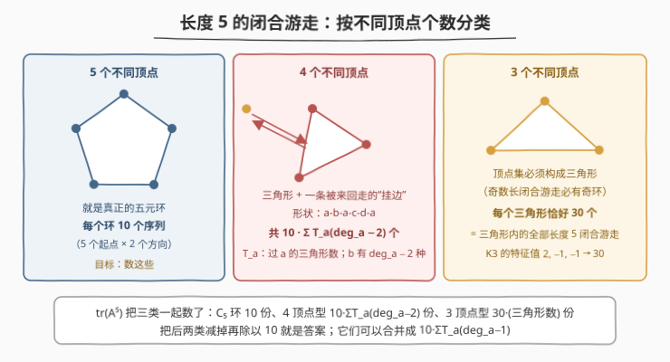
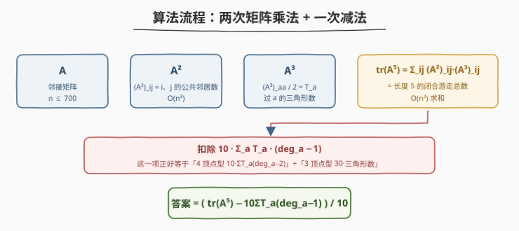
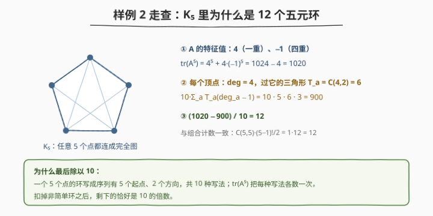

# Codeforces 51E 五边形环计数 题解

## 1. 题目概述

- **题目链接**：https://codeforces.com/problemset/problem/51/E
- **比赛来源**：Codeforces Beta Round 51 · Problem E（2010-12-29）
- **难度**：2400
- **标签**：组合数学、图论、矩阵、迹
- **评测类型**：普通
- **限制**：时间 10 s / 内存 256 MB

**题意**：给一张 $n$ 个点、$m$ 条边的无向简单图（两点间至多一条边，没有自环；图不一定连通）。求"长度为 5 的环"的个数，也就是五元组 $\{v_0,v_1,v_2,v_3,v_4\}$（5 个互不相同的点）满足 $v_0v_1, v_1v_2, v_2v_3, v_3v_4, v_4v_0$ 都是边的方案数。同一个环的 5 种旋转与 2 种方向只算一种。

**约束**：

- $n \le 700$：$O(n^3)$ 是 $3.4 \times 10^8$，10 s 时限勉强够用（实测两次矩阵乘法约 $0.3$ s），而 $O(n^4)$、$O(n^5)$ 完全不可行。
- $m \le n(n-1)/2 \approx 2.4 \times 10^5$：邻接矩阵最稠密时有 $n^2 = 4.9 \times 10^5$ 个 1，矩阵乘法不能假设稀疏。
- 答案最大约为 $\binom{700}{5} \cdot 12 \approx 1.7 \times 10^{13}$，**必须用 64 位整数**；中间量 $\operatorname{tr}(A^5)$ 同量级。
- 题面专门提醒"不要用 `%lld`，请用 `cout`"（这是早年 Windows 版评测机的历史遗留），本文代码按此用 `cout` 输出。

## 2. 示例与观察

官方样例（输入 / 输出原样）：

```text
输入：
5 5
1 2
2 3
3 4
4 5
5 1

输出：
1
```

```text
输入：
5 10
1 2
1 3
1 4
1 5
2 3
2 4
2 5
3 4
3 5
4 5

输出：
12
```

**样例 1**：图就是一个五边形（$C_5$），5 个点只能按环的顺序走一圈，方案数 $1$。

**样例 2**：完全图 $K_5$。5 个点全都用上，问题变成"$K_5$ 里有多少个不同的 5-环"。固定一个起点有 $4! = 24$ 种排列，但正反两个方向是同一个环，于是 $24/2 = 12$；等价地 $\binom{5}{5}\cdot(5-1)!/2 = 12$。

**观察 1**：不能"枚举 5 个点再判环"——$\binom{700}{5}$ 是 $10^{12}$ 量级；也不能从每个点 DFS 找长度 5 的回路，最坏是 $n \cdot \bar d^{\,4}$，稠密图下约 $700 \cdot 700^4 \approx 1.7 \times 10^{14}$。

**观察 2**：$A^k$ 的元素 $(A^k)_{ij}$ 恰好是"从 $i$ 到 $j$ 长度为 $k$ 的游走条数"，于是 $\operatorname{tr}(A^5) = \sum_i (A^5)_{ii}$ 是"长度 5 的闭合游走"总数。闭合游走里混着很多"走了回头路"的非简单环，必须精确地把它们扣掉——这正是本题的全部难点。

自造样例（标注"自造"，用于核对矩阵公式）：

| 输入 | 输出 | 说明 |
|------|------|------|
| `4 6` 完全图 $K_4$ | 0 | 点数不足 5 |
| `5 4` 一条路径 | 0 | 无环 |
| `6 6` 六边形 $C_6$ | 0 | 只有 6-环 |
| `5 6` 三角 + 三角共点（领结） | 0 | 没有 5-环 |
| `10 15` Petersen 图 | 12 | 经典结果：Petersen 图有 12 个五边形 |
| `6 9` 完全二部图 $K_{3,3}$ | 0 | 二部图没有奇环 |
| `11 55` 完全图 $K_{11}$ | 5544 | $\binom{11}{5}\cdot 12$ |
| `20 190` 完全图 $K_{20}$ | 186048 | $\binom{20}{5}\cdot 12$ |

## 3. 解题思路

### 3.1 朴素做法与瓶颈

最直接的做法是枚举 5 个点的有序五元组并检查 5 条边，复杂度 $O(n^5)$；或者枚举一个起点做深度 5 的搜索，复杂度 $O\!\left(\sum_v \deg(v)^4\right)$，稠密图下同样是 $10^{14}$ 量级。10 s 时限下都差得远。

$n \le 700$ 这个规模，配合"数环"这个目标，指向两个方向：$O(n^3)$ 的矩阵乘法，或者 $O(nm)$ 的组合计数。本题用前者，因为它能把"闭合游走总数"一次性算出来，剩下的工作只是把非简单环的贡献**精确地**扣掉。

### 3.2 核心观察：把闭合游走按"用了几个顶点"分类



设 $A$ 是邻接矩阵，则 $\operatorname{tr}(A^5)$ 是长度 5 的闭合游走 $v_0v_1v_2v_3v_4v_0$ 的总数。一条这样的游走用了几个不同的顶点？只可能是 3、4、5 个：

- **1 个**：需要自环，题面保证没有；
- **2 个**：在两个点之间来回走，闭合游走的长度必为偶数，5 不可能；
- **3 个**：三个点必须构成三角形。奇数长度的闭合游走一定含奇环，而三个点上的奇环只能是三角形；反过来，三角形内的任意长度 5 闭合游走只用到这 3 个点。
- **4 个**：恰好有一个顶点重复一次（5 个位置、4 个不同点）。
- **5 个**：正是我们要数的五元环。

**5 个顶点**：每个五元环写成闭合游走恰有 $5 \times 2 = 10$ 种（5 个起点、2 个方向），所以五元环贡献 $10 \cdot \text{ans}$。

**4 个顶点**：唯一的重复顶点不能在相邻位置（那会是自环），只可能相隔 2 或 3 个位置。把游走旋转到"第 1 个和第 3 个顶点相同"的位置，形状就是

$$a \to b \to a \to c \to d \to a,$$

也就是"三角形 $a,c,d$ 外加一条从 $a$ 出发、被来回走一次的挂边 $a\text{-}b$"：边是 $ab, ba, ac, cd, da$，其中 $a,c,d$ 必须两两相邻。计数：固定 $a$，有序地选相邻对 $(c,d) \in N(a)$ 有 $2T_a$ 种（$T_a$ 是过 $a$ 的三角形个数），再选 $b \in N(a) \setminus \{c,d\}$ 有 $\deg_a - 2$ 种，所以"第 1 个与第 3 个顶点相同"的 4 顶点游走有 $\sum_a 2T_a(\deg_a - 2)$ 条。每条 4 顶点游走有 5 个旋转，其中**恰好一个**满足"第 1 个 = 第 3 个"（因为 5 是奇数，唯一的重复对只可能相差 2 或 3，旋转由这对位置唯一确定），且 5 个旋转互不相同。所以 4 顶点游走总数是

$$5 \cdot \sum_a 2T_a(\deg_a - 2) = 10\sum_a T_a(\deg_a - 2).$$

**3 个顶点**：每个三角形内的长度 5 闭合游走数等于 $\operatorname{tr}(A_{K_3}^5)$。$K_3$ 的特征值是 $2,-1,-1$，故 $2^5 + (-1)^5 + (-1)^5 = 32 - 2 = 30$。不同的三角形顶点集不同，互不重复，于是 3 顶点游走总数是 $30 \cdot \text{Tri} = 10\sum_a T_a$（每个三角形被它的 3 个顶点各数一次）。

把三类拼起来：

$$\operatorname{tr}(A^5) = 10\cdot\text{ans} + 10\sum_a T_a(\deg_a - 2) + 10\sum_a T_a = 10\cdot\text{ans} + 10\sum_a T_a(\deg_a - 1).$$

于是得到本题的核心公式

$$\boxed{\ \text{ans} = \frac{\operatorname{tr}(A^5) - 10\sum_a T_a(\deg_a - 1)}{10}\ }$$

其中 $T_a$ 是过顶点 $a$ 的三角形个数。

### 3.3 算法流程



1. 读入图，建邻接矩阵 $A$（用一维数组 `A[i*n+j]`，$n \le 700$ 时只占 $1.96$ MB）。
2. 计算 $A^2$：$(A^2)_{ij}$ = $i,j$ 的公共邻居数。用邻接表做 `A2[i][j] += 1`（$i$ 的每个邻居 $k$ 的每个邻居 $j$）。
3. 计算 $A^3 = A^2 \cdot A$：对每个 $i$，枚举 $k$ 使 $(A^2)_{ik} \ne 0$，把 $(A^2)_{ik}$ 累加到 $A^3[i][j]$（$j \in N(k)$）。
4. $\operatorname{tr}(A^5) = \sum_{i,j} (A^2)_{ij}(A^3)_{ij}$。这一步用到了 $A^2, A^3$ 的对称性：$(A^5)_{ii} = \sum_j (A^2)_{ij}(A^3)_{ji} = \sum_j (A^2)_{ij}(A^3)_{ij}$。
5. $T_a = (A^3)_{aa}/2$（从 $a$ 出发绕三角形回到 $a$ 的游走有 $a \to b \to c \to a$ 与 $a \to c \to b \to a$ 两条，所以 $(A^3)_{aa} = 2T_a$）。
6. 输出 $(\operatorname{tr}(A^5) - 10\sum_a T_a(\deg_a - 1)) / 10$。

注意第 4、5 步都只用到已经算好的两张表，不需要真的算出 $A^5$；这就是"两次矩阵乘法"的全部开销。

### 3.4 样例走查：$K_5$ 为什么是 12



对 $K_5$：

- $A$ 的特征值是 $4$（一重）与 $-1$（四重），所以 $\operatorname{tr}(A^5) = 4^5 + 4\cdot(-1)^5 = 1024 - 4 = 1020$。
- 每个顶点的度都是 $4$；过某个顶点的三角形数 $T_a = \binom{4}{2} = 6$（从其余 4 个邻居里任选 2 个都和 $a$ 成三角形）。于是修正项 $10\sum_a T_a(\deg_a - 1) = 10 \cdot 5 \cdot 6 \cdot 3 = 900$。
- 答案 $= (1020 - 900)/10 = 12$。

再手算一遍 $C_5$（样例 1）：闭合游走只有绕着环走的那 10 条，$\operatorname{tr}(A^5) = 10$；没有三角形，修正项为 0；答案 $= 10/10 = 1$。

## 4. 正确性证明

**引理 1（矩阵幂的游走含义）**：对无向简单图的邻接矩阵 $A$，$(A^k)_{ij}$ 等于从 $i$ 到 $j$ 的长度为 $k$ 的游走条数；特别地 $\operatorname{tr}(A^5)$ 等于长度 5 的闭合游走条数。

**证明**：对 $k$ 归纳。$k=1$ 时 $(A)_{ij} = 1$ 当且仅当 $ij$ 是边，即长度为 1 的游走条数。设对 $k-1$ 成立，则长度为 $k$ 的游走按倒数第二个顶点 $l$ 分类，数目为 $\sum_l (A^{k-1})_{il} A_{lj} = (A^k)_{ij}$。闭合游走即 $i = j$ 的情形，对 $i$ 求和取迹。∎

**引理 2（分类完备）**：长度 5 的闭合游走用到的不同顶点数只能是 3、4、5。

**证明**：设用到 $s$ 个顶点。$s = 1$ 需要自环，图是简单图，不可能。$s = 2$ 时游走只在一条边上往返，每两步回到原点，闭合需要偶数步，与 5 矛盾。故 $s \ge 3$；又有 5 个位置，故 $s \le 5$。∎

**引理 3（5 顶点型计数）**：5 个顶点各不相同的闭合游走恰有 $10\cdot\text{ans}$ 条，其中 ans 是五元环个数。

**证明**：5 个顶点互不相同的闭合游走就是五元环的一个"带起点的有向写法"。同一个环可以从 5 个顶点中任选起点、任选 2 个方向，得到 $10$ 个互不相同的序列（$5 \ge 3$，旋转/翻转不会重合）；反之每个这样的序列显然给出一个五元环。故一一对应，总数为 $10\cdot\text{ans}$。∎

**引理 4（4 顶点型计数）**：4 顶点型的闭合游走恰有 $10\sum_a T_a(\deg_a - 2)$ 条。

**证明**：5 个位置、4 个不同顶点，恰有一个顶点出现两次。两次出现的位置差不能是 1（否则是自环 $vv$），也不能是 4（位置 0 与 4 相邻，同样构成自环），所以只能相差 2 或 3。

*形状*：把游走旋转到重复位置为 $(0,2)$，即 $v_0 = v_2 = a$，其余 $v_1 = b, v_3 = c, v_4 = d$ 互不相同且都异于 $a$。游走的边是 $ab, ba, ac, cd, da$，其中 $b$ 必须与 $a$ 相邻且 $b \notin \{c,d\}$；$c,d$ 都与 $a$ 相邻、彼此相邻，即 $\{a,c,d\}$ 是三角形。

*计数*：固定 $a$。有序相邻对 $(c,d)$ 有 $2T_a$ 种（每个过 $a$ 的三角形贡献 2 个有序对），$b$ 有 $\deg_a - 2$ 种。故"重复位置为 $(0,2)$"的游走有 $\sum_a 2T_a(\deg_a - 2)$ 条。

*旋转不重不漏*：对任意一条 4 顶点型游走，它的 5 个旋转互不相同（若某个非平凡旋转等于自身，则 5 个位置全同，与 4 个不同顶点矛盾）；又它的重复位置对在模 5 意义下恰有一个方向相差 2，因此 5 个旋转中恰好一个把重复位置转成 $(0,2)$。所以总数是上面那个和的 5 倍，即 $10\sum_a T_a(\deg_a - 2)$。∎

**引理 5（3 顶点型计数）**：3 顶点型的闭合游走恰有 $30\cdot\text{Tri} = 10\sum_a T_a$ 条。

**证明**：3 个顶点上的长度 5 闭合游走必含奇环（闭合游走含环，奇数长度的环是奇环），3 个点上的奇环只能是三角形，所以这 3 个点必须两两相邻；反过来三角形内的任何游走都只用这 3 个点。每个三角形内部的长度 5 闭合游走数为 $\operatorname{tr}(A_{K_3}^5) = 2^5 + (-1)^5 + (-1)^5 = 30$（$K_3$ 的特征值为 $2,-1,-1$）。不同三角形的顶点集不同，故互不重复，总数为 $30\,\text{Tri}$。而每个三角形被它的 3 个顶点各计一次，所以 $3\,\text{Tri} = \sum_a T_a$，即 $30\,\text{Tri} = 10\sum_a T_a$。∎

**定理**：$\text{ans} = \bigl(\operatorname{tr}(A^5) - 10\sum_a T_a(\deg_a - 1)\bigr)/10$。

**证明**：由引理 1，$\operatorname{tr}(A^5)$ 是全部长度 5 闭合游走数；由引理 2，它们按顶点数分成 3、4、5 三类，三类之和就是 $\operatorname{tr}(A^5)$。代入引理 3、4、5：

$$\operatorname{tr}(A^5) = 10\,\text{ans} + 10\sum_a T_a(\deg_a - 2) + 10\sum_a T_a = 10\,\text{ans} + 10\sum_a T_a(\deg_a - 1).$$

移项除以 10 即得。除以 10 是精确的整数除法（右边两项都是 10 的倍数）。∎

## 5. 复杂度分析

- **时间**：$O(n^3 + m)$。$A^2$ 的计算是 $\sum_i \sum_{k \in N(i)} \deg(k) \le n \cdot 2m$；$A^3$ 是 $O(n^3)$；求迹与修正项是 $O(n^2)$。最坏（$K_n$）$n^3 = 3.4\times10^8$，两次矩阵乘法约 $6.9\times10^8$ 次整数加法，实测 $0.3$ s，只用了时限的 $1/30$。
- **空间**：$O(n^2)$。三张 $n\times n$ 的 `int` 表约 $5.9$ MB，远低于 256 MB。
- **数值范围**：$(A^2)_{ij} \le n = 700$，$(A^3)_{ij} \le n^2 \approx 4.9\times10^5$，都装得进 `int`；$\operatorname{tr}(A^5) \le n \cdot (n-1)^4 \approx 1.7\times10^{14}$，$\sum_a T_a(\deg_a-1)$ 也远小于 $2^{63}$，用 `long long` 安全。答案最大约 $1.7\times10^{13}$。
- **与时限的关系**：10 s 的时限对 $O(n^3)$ 相当宽松；本机最大数据 $0.3$ s。Python 版同样的 $O(n^3)$ 在 CPython 下约 $36$ s，会超时，**建议提交 C++ 或在 PyPy3 下提交**。

## 6. 参考代码

### C++17

```cpp
#include <bits/stdc++.h>
using namespace std;

int main() {
    int n, m;
    if (scanf("%d %d", &n, &m) != 2) return 0;

    vector<int> A(n * n, 0), A2(n * n, 0), A3(n * n, 0);
    vector<int> deg(n, 0);
    vector<vector<int>> adj(n);
    for (int e = 0; e < m; e++) {
        int u, v;
        scanf("%d %d", &u, &v);
        --u; --v;
        if (u == v) continue;
        A[u * n + v] = A[v * n + u] = 1;
        adj[u].push_back(v);
        adj[v].push_back(u);
        deg[u]++; deg[v]++;
    }

    // A2 = A^2
    for (int i = 0; i < n; i++) {
        int *row = &A2[i * n];
        for (int k : adj[i])
            for (int j : adj[k]) row[j]++;
    }
    // A3 = A^3 = A^2 * A
    for (int i = 0; i < n; i++) {
        int *row = &A3[i * n];
        int *a2row = &A2[i * n];
        for (int k = 0; k < n; k++) {
            int v = a2row[k];
            if (!v) continue;
            for (int j : adj[k]) row[j] += v;
        }
    }

    long long trace5 = 0;              // tr(A^5)
    for (int i = 0; i < n; i++)
        for (int j = 0; j < n; j++)
            trace5 += (long long)A2[i * n + j] * A3[i * n + j];

    long long corr = 0;                // 10 * sum_a T_a * (deg_a - 1)
    for (int a = 0; a < n; a++) {
        long long Ta = A3[a * n + a] / 2;   // 过 a 的三角形个数
        corr += 10LL * Ta * (deg[a] - 1);
    }

    cout << (trace5 - corr) / 10 << '\n';   // 题面提示别用 %lld，用 cout 最稳
    return 0;
}
```

### Python3

```python
import sys


def main():
    data = sys.stdin.buffer.read().split()
    if not data:
        return
    it = iter(data)
    n = int(next(it))
    m = int(next(it))
    adj = [[0] * n for _ in range(n)]
    deg = [0] * n
    nb = [[] for _ in range(n)]
    for _ in range(m):
        u = int(next(it)) - 1
        v = int(next(it)) - 1
        if u == v:
            continue
        adj[u][v] = adj[v][u] = 1
        nb[u].append(v)
        nb[v].append(u)
        deg[u] += 1
        deg[v] += 1

    # A2 = A^2
    A2 = [[0] * n for _ in range(n)]
    for i in range(n):
        row = A2[i]
        for k in nb[i]:
            for j in nb[k]:
                row[j] += 1
    # A3 = A^3
    A3 = [[0] * n for _ in range(n)]
    for i in range(n):
        row = A3[i]
        a2 = A2[i]
        for k in range(n):
            v = a2[k]
            if v:
                for j in nb[k]:
                    row[j] += v

    trace5 = 0
    for i in range(n):
        a2, a3 = A2[i], A3[i]
        for j in range(n):
            trace5 += a2[j] * a3[j]

    corr = 0
    for a in range(n):
        ta = A3[a][a] // 2
        corr += 10 * ta * (deg[a] - 1)

    sys.stdout.write(str((trace5 - corr) // 10) + "\n")


main()
```

Python 版在 $n = 700$ 的完全图上约 $36$ s（CPython），过不了 10 s 时限，请改用 C++ 或 PyPy3；它的作用是与 C++ 交叉验证公式，而不是拿满时限。

## 7. 边界情况与易错点

1. **$n < 5$ 必须输出 0**：此时公式的中间量都是 0，自然给出 0；但若手写"枚举五点"的代码，要注意别让长度为 5 的排列越界。
2. **顶点数只有 4 的图**：$K_4$ 的 $\operatorname{tr}(A^5) = 3^5 + 3\cdot(-1)^5 = 240$，修正项正好把 240 全部扣掉，答案 0。可以拿它检查修正公式是否写全。
3. **64 位溢出**：$\operatorname{tr}(A^5)$ 最大约 $1.7\times10^{14}$，`int` 会在第 4 步求和时溢出；$(A^3)_{ij}$ 最大约 $4.9\times10^5$ 仍可用 `int`，但 $\operatorname{tr}(A^5)$、修正项、答案必须是 `long long`。
4. **除法的精确性**：公式里除以 10 一定是整出，但这依赖修正项算得完全正确；如果漏掉 4 顶点型的某一部分，除以 10 后就会得到非整数或错误整数。调试时可以先输出 $\operatorname{tr}(A^5)$ 与修正项两个中间量核对。
5. **自环与重边**：题面保证 $a_i \ne b_i$ 且两点间至多一条边；代码里保留 `if (u == v) continue;` 只是防御性写法，若输入真含自环，本题的公式（依赖"没有自环"的引理 2）就不成立。
6. **$T_a$ 的 2 倍关系**：$(A^3)_{aa}$ 是"从 $a$ 出发三步回到 $a$"的游走数，每个过 $a$ 的三角形贡献 2 条（两个绕行方向），所以 $T_a = (A^3)_{aa}/2$，别忘了除 2。
7. **输出格式**：题面明确说不要用 `%lld`，用 `cout`（或历史上的 `%I64d`）；本文用 `cout`。只输出一个整数并换行。
8. **Python 的时限**：同样的 $O(n^3)$ 在 CPython 下 $36$ s，会 TLE；这不是算法错，而是常数问题，正文已注明建议 C++/PyPy3。

## 8. 验证记录

- **编译环境与命令**：本机 `g++` 实为 `Apple clang 21.0.0`，用 `clang++ -std=c++17 -O2` 搭配 `codeforces/tools/include/bits/stdc++.h` 兼容头编译（正文代码可原样提交 GNU C++17）；Python 侧为 `Python 3.9.6`。正文代码另经 `codeforces/tools/verify_solution.py` 编译并跑通官方样例。
- **官方样例**：2 / 2 通过（`1` 与 `12`），C++、Python 输出一致。
- **自造样例**：8 组（$K_4$、路径、$C_6$、领结、Petersen、$K_{3,3}$、$K_{11}$、$K_{20}$），与手算/公式一致；其中 $K_n$ 与 $\binom{n}{5}\cdot12$ 逐一对上（$n=11,12,13,20$ 都核对过）。
- **独立暴力对拍**：另写一份"枚举全部有序 5 元组、检查 5 条边、最后除以 10"的暴力（与矩阵公式完全无共享逻辑），随机生成 **300 组** $n \le 10$ 的图（随机密度、环加弦、完全图、完全二部图、树、树加弦、稀疏随机共 7 种生成方式），逐组比对，**全部一致**。
- **中等规模独立校验**：另写一份"从每个点出发 DFS 枚举全部长度 5 回路、再除以 10"的独立程序（与矩阵公式零共享逻辑），对 **20 组** $n = 8 \sim 60$、密度 $0.05 \sim 0.7$ 的随机图逐一比对，**全部一致**（这一档的肉眼看不出规律，纯粹是算法交叉验证）。
- **已知结构核对**：Petersen 图给出 $12$（已知它有 12 个五边形）；$K_{3,3}$、$C_6$、$C_7$、$C_8$ 给出 $0$；$K_n$ 给出 $\binom{n}{5}\cdot12$。
- **最大约束性能**：$n = 700$ 的完全图（$m = 244650$）端到端 $0.27$ s、峰值内存约 $6$ MB，相对 10 s 时限余量 30 倍以上；输出 $16568098051680 = \binom{700}{5}\cdot12$，与组合公式一致。Python 同数据 $36$ s（超时，已在正文注明）。
- **复核状态**：verified（样例、自造样例、暴力对拍、已知结构、性能、图片与公式校验均实跑通过）。

## 相关题目与扩展

- [Codeforces 51D Geometrical problem](https://codeforces.com/problemset/problem/51/D)：同场 D 题，判别等比数列，同样靠"先把结构分类，再逐类精确计数"。
- [Codeforces 51F Caterpillar](https://codeforces.com/problemset/problem/51/F)：同场 F 题，把图收缩成毛毛虫，也是"先分离出必须合并的结构，再在最简结构上做最优化"。
- [Codeforces 11D A Simple Task](https://codeforces.com/problemset/problem/11/D)：数简单环，用状压 DP 枚举环，适合对照"为什么 $n=700$ 时只能靠矩阵/组合计数"。
- [Codeforces 166E Tetrahedron](https://codeforces.com/problemset/problem/166/E)：数长度 $n$ 的闭合游走，正是 $A^n$ 的对角线，是本题"游走 vs 环"区别的最简版本。
- [Codeforces 103B Cthulhu](https://codeforces.com/problemset/problem/103/B)：判断图是否恰有一个环，练手"环结构"的判定。

**延伸思考**：

1. **如果要数长度 6 的简单环**：闭合游走里会多出"三角形加一条往返边""两条来回边"等更多退化形态，修正项会复杂得多（需要 $A^2$、$A^3$、$A^4$ 的组合），这也是为什么 $n \le 700$ 只问长度 5——长度 5 时退化形态恰好只有两类。
2. **稀疏图上更快**：若 $m$ 很小，可以用 $O(m\sqrt m)$ 或"枚举三角形 + 度数分块"的办法数五元环，而不做 $O(n^3)$ 矩阵乘法；本题 $n$ 小而稠密，矩阵法更稳。
3. **模意义下的推广**：如果答案要对 $p$ 取模，公式仍然成立（除法改成乘 $10^{-1}$），但要注意 $p = 2$ 或 $5$ 时不可逆，需要把式子改写成不除 10 的形式（例如先证明分子被 10 整除，再整体约分）。
4. **从"迹"到"特征值"**：$\operatorname{tr}(A^5) = \sum \lambda_i^5$，所以答案本质上是邻接矩阵谱的函数；对 $K_n$ 这类强对称图，直接算特征值比矩阵乘法还快，这就是 3.4 里 $K_5$ 手算的依据。
