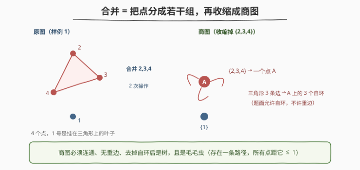
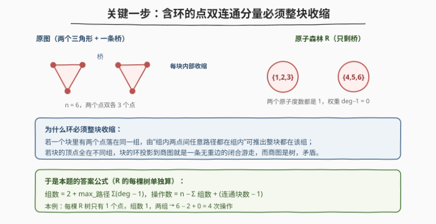
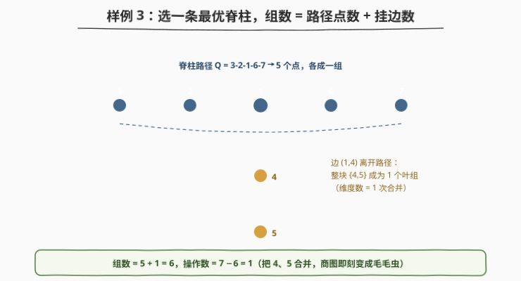

# Codeforces 51F 改造成毛毛虫 题解

## 1. 题目概述

- **题目链接**：https://codeforces.com/problemset/problem/51/F
- **比赛来源**：Codeforces Beta Round 48 · Problem F（UTC 2010-12-28）
- **难度**：2800
- **标签**：DFS 与类似、树形 DP、图论、树、点双连通分量
- **评测类型**：普通
- **限制**：时间 2 s / 内存 256 MB

**题意**：无向图称为**毛毛虫**，如果它连通、无环，且存在一条路径 $p$ 使得每个顶点到 $p$ 的距离都不超过 $1$。毛毛虫可以含**自环**（顶点到自己的边），但不能含多重边。

一次**合并**操作：选两个不同的点 $a, b$，把它们删掉、加入新点 $w$，并把原来与 $a$ 或 $b$ 相连的边都接到 $w$ 上（若原来有边 $ab$，它变成 $w$ 上的自环）。可以连续做任意多次合并。给定一张 $n$ 个点、$m$ 条边的无向简单图（不保证连通），求最少多少次操作能把它变成毛毛虫。

**约束**：

- $n \le 2000$：$O(n^2)$ 甚至 $O(n^3)$ 都有机会，但下面的解法是 $O(n + m)$ 的。
- $m \le 10^5$：邻接表存储即可，点数很小、边数相对多，图里可能有很大的点双连通分量。
- 图不保证连通：最后必须**一个**连通块，所以"把若干个连通块接起来"本身就要花操作。
- 输入是无向简单图（$a_i \ne b_i$、两点间至多一条边），但合并之后允许出现自环与多重边（中间状态）。
- 每次合并让点数恰好减 $1$，所以**最少操作数 $= n - $（最终图的最大可能点数）**。这是整道题的出发点。

## 2. 示例与观察

官方样例（输入 / 输出原样）：

```text
输入：
4 4
1 2
2 3
3 4
4 2

输出：
2
```

```text
输入：
6 3
1 2
3 4
5 6

输出：
2
```

```text
输入：
7 6
1 2
2 3
1 4
4 5
1 6
6 7

输出：
1
```

**样例 1**：三角形 $2\text{-}3\text{-}4$ 加上挂在 $2$ 上的叶子 $1$。三角形里有环，任何"不把三个点并成一个"的方案都会把环留在图里：若三角形中两个点在同一组，由下文的凸性引理整块都得在那一组；若三个点分在三个组，三条边就投影成商图里的一个三角形，商图不是树。所以三角形必须并成一个点（$2$ 次操作），结果是 $\{1\}$、$\{2,3,4\}$ 两个点、一条边加三个自环——正是毛毛虫。答案是 $2$。

**样例 2**：三条互不相连的边（三个连通块）。每条边本身就是毛毛虫，但最终必须连通，所以至少要把三个连通块接起来：把左边一条边的一个端点与中间一条边的一个端点合并，再把中间与右边合并，共 $2$ 次。答案是 $2$。

**样例 3**：一棵树：$1$ 连着 $2,4,6$，而 $2\text{-}3$、$4\text{-}5$、$6\text{-}7$ 是三条长度为 $2$ 的"腿"。它不是毛毛虫（去掉叶子 $3,5,7$ 后剩下以 $1$ 为中心的星形 $1\text{-}2,1\text{-}4,1\text{-}6$，不是一条路径）。只要把 $4$ 与 $5$ 合并（$1$ 次操作），商图就变成路径 $3\text{-}2\text{-}1\text{-}6\text{-}7$ 加挂在 $1$ 上的叶子 $\{4,5\}$，是毛毛虫。答案是 $1$。

**观察 1**：合并的结果只取决于"哪些点被并成了一组"——即点集的一个**划分**。最终图就是商图：组内边变成自环，组间边保留；若同一对组之间有两条原边，商图就出现重边（题面不允许）。所以问题等价于：**找一个点集划分，使商图连通、无重边、去掉自环后是树、且是毛毛虫，并让组数尽量多**。



**观察 2**：既然每次合并只让点数减 $1$，答案就是 $n - $ 最大组数。于是"最少操作"变成了"最多能留下多少组"，这是一个更清晰的极值问题。

**观察 3**：图里的环是最大的障碍——商图必须是树，而收缩边不会消掉环，只有把整个环"并成一点"才行。更准确地说，**每个含环的点双连通分量必须整块落在同一组里**（第 4 节引理 3 证明）。把这类分量全部收缩后，剩下的结构只有桥，也就是一片森林，问题就归约到"树上如何选脊柱"。

**自我检查用的样例**（自造，用于核对公式）：

| 输入 | 答案 | 说明 |
|------|------|------|
| `1 0` | 0 | 单点已是毛毛虫 |
| `3 3` 三角形 | 2 | 整块并成一点 |
| `5 10` 完全图 $K_5$ | 4 | 整图是一个点双，全部并成一点 |
| `5 6` 领结（两三角形共点） | 4 | 共享割点 → 整块并成一点 |
| `6 7` 两个三角形 + 一条桥 | 4 | 每个三角形各并成一点 |
| `5 9` $K_5$ 少一条边 | 4 | 仍是一个点双 |
| `5 4` 路径 | 0 | 路径是毛毛虫 |
| `7 6` 星形 $K_{1,6}$ | 0 | 星形是毛毛虫 |

## 3. 解题思路

### 3.1 朴素做法与瓶颈

可以想象"状态搜索"：每一步枚举一对点合并，BFS 直到图变成毛毛虫。但 $n = 2000$ 时状态数是划分数（Bell 数），完全不可行。

正确的做法是先把结构想清楚。由观察 1、2，我们把目标改写成：**最大化划分的组数 $k$**，约束是商图连通、无重边、去自环后是树、且是毛毛虫。

### 3.2 核心观察：组是"凸"的，含环的块必须整块收缩



**凸性**：若两个点 $u, v$ 在同一组 $S$ 里，那么 $G$ 中**任何**一条 $u$ 到 $v$ 的路径都必须整条落在 $S$ 里。理由：把这条路径投影到商图，得到一条从 $S$ 出发又回到 $S$ 的闭合游走；商图是树，任何正长度的闭合游走必然在某个方向上重复经过同一条边，也就是对应两条不同的原边连接同一对组——商图出现重边，矛盾。

**含环的块整块收缩**：设 $B$ 是一个含环的点双连通分量（即 $|B| \ge 3$ 的块）。

- 若 $B$ 中有两个点在同一个组里，由凸性以及"2-连通图里任给三点 $u,v,x$ 都存在经过 $x$ 的 $u\text{-}v$ 路径"，$B$ 的每个点都必须在这组里；
- 若 $B$ 的点分属不同的组，则 $B$ 里的环投影成商图里的一条闭合游走；由于点→组的映射在 $B$ 上是单射，环上不同的边投影成不同的组对，商图（森林）不可能有这样"无重边的闭合游走"。

所以 $|B| \ge 3$ 的块必须整块并成一组。共享割点的两个环块还会被"拽"到一起（割点同时属于两块，只能属于同一组）。把这些"被强制绑在一起"的点集叫作**原子**。

### 3.3 收缩原子后的森林，以及树上的最优脊柱

把每个原子收缩成一个点后，图里不再有环（所有环都在原子内部），也没有重边（否则两条边连同一对原子会构成一个环，而那环必属于某个块），所以剩下的结构是一片**森林** $R$：$R$ 的点是原子，边恰好是原图的桥。

于是问题变成：**给定森林 $R$（每条边对应一次可选的合并），把每棵树划分成若干连通子树，使每棵树的商是毛毛虫，最大化总组数**。两棵树之间还要再花 $c-1$ 次合并把它们接成一棵（$c$ 是连通块数）。



**单棵树的结论**：设这棵树为 $T$（点权 $w(v) = \deg_T(v) - 1$），则最多组数是

$$V(T) = 2 + \max_{Q \text{ 是 } T \text{ 中的路径}} \sum_{v \in Q} w(v).$$

直观解释：取一条路径 $Q$ 当脊柱，**路径上每个点各成一组**，**$Q$ 之外每个连通块各成一组**；组数 $=$（路径点数）$+$（离开路径的边数）$=|V(Q)| + \delta(Q)$，而

$$|V(Q)| + \delta(Q) = |V(Q)| + \Bigl(\sum_{v \in Q}\deg(v) - 2(|V(Q)|-1)\Bigr) = 2 + \sum_{v \in Q}(\deg(v)-1).$$

第 4 节会证明没有别的划分能得到更多组（关键是不变量"合并不会让 $V$ 变大"）。

### 3.4 算法流程

1. **求点双连通分量**：Tarjan 边栈算法，$O(n+m)$。每个块记录去重后的顶点表。
2. **并查集**：把所有 $|B| \ge 3$ 的块的顶点并成一团；得到原子编号。
3. **建原子森林 $R$**：只把"块大小恰为 2"的边（桥）连到 $R$ 上，连接两个原子的编号。因为每个环块已经收缩，$R$ 里不会出现自环（桥的两个端点必在不同原子）。
4. **对 $R$ 的每棵树算 $V = 2 + $ 最大权路径（点权 = 度数 $- 1$）**：用一次迭代式树形 DP——先 BFS 出父指针与后序，再倒序算 `down[v] = w(v) + max(0, max_child down)`，同时用每个点处"最大两条下行路径 + 自身权重"更新全局最大值。
5. **合并答案**：$\text{ans} = n - \sum_{\text{树}} V_i + (c-1)$，其中 $c$ 是 $R$ 的树棵数（等于原图连通块数）。

关于最后一项：$c$ 个连通块必须被接成一个，至少需要 $c-1$ 次合并；而把各块商图的脊柱端点依次接起来就能做到（每一段都是毛毛虫，脊柱首尾相接后仍是毛毛虫），所以 $c-1$ 恰好够。

### 3.5 样例走查：样例 3

样例 3 的树：$1$ 连着 $2,4,6$，$2\text{-}3$、$4\text{-}5$、$6\text{-}7$。所有块都是桥，所以原子就是 7 个单点，$R$ 就是这棵树本身，点权为 $\deg - 1$：

- 顶点 $1$：$\deg 3 \Rightarrow w = 2$；顶点 $2,4,6$：$\deg 2 \Rightarrow w = 1$；叶子 $3,5,7$：$w = 0$。

最大权路径取 $3\text{-}2\text{-}1\text{-}6\text{-}7$，权重 $0+1+2+1+0 = 4$，于是 $V = 2 + 4 = 6$，答案 $= 7 - 6 + (1-1) = 1$，与样例一致。

注意如果把脊柱取成 $2\text{-}1\text{-}6$（权重 $1+2+1 = 4$）结果一样；取单点 $\{1\}$ 只有 $2 + 2 = 4$ 组，会多花 2 次操作——这正是"为什么要把路径尽量延长"的直观解释。

再核对样例 1、2：样例 1 里三角形是一个原子、叶子 $1$ 是一个原子，$R$ 是两个点一条边，$w \equiv 0$，$V = 2$，答案 $= 4 - 2 = 2$ ✓；样例 2 是三个连通块，每块 $R$ 是一条边，$V_i = 2$，答案 $= 6 - 6 + (3-1) = 2$ ✓。

## 4. 正确性证明

先把题面翻译成划分的语言：

**引理 1（商图判定）**：设 $\{S_1,\dots,S_k\}$ 是 $V$ 的一个划分，商图 $Q$ 由"每对组之间若有原边就连一条"得到（组内有边则在该组上记一个自环）。则用合并操作得到 $Q$ 所需的操作次数恰为 $n-k$，且最终图是毛毛虫当且仅当：$Q$ 连通、任意两组之间至多一条边、去掉自环后 $Q$ 是树、并且这棵树是毛毛虫。

**证明**：合并操作等价于把若干点并成一组，顺序不影响最终图（只是把组内边变成自环、组间边保留），一个组用 $|S|-1$ 次合并即可并成，总次数 $\sum(|S_i|-1) = n-k$。毛毛虫的定义直接给出后四条。∎

**引理 2（组的凸性）**：若 $u, v$ 同属一组 $S$，则 $G$ 中每条 $u\text{-}v$ 路径的顶点都在 $S$ 内。

**证明**：反设某条 $u\text{-}v$ 路径 $P$ 有顶点在 $S$ 外。把 $P$ 的顶点依次投影到组，得到商图中一条从 $S$ 出发、回到 $S$、长度为正的闭合游走。由引理 1，商图去自环后是森林。森林中任何非空闭合游走必然在某一瞬间沿同一条边"走回去"，也就是有两个不同的步骤经过同一对组且方向相反；这两步对应 $G$ 中两条不同的边（$P$ 是简单路径，不会重复用边），于是商图在这对组之间有两条边，违背引理 1 的"至多一条边"。矛盾。∎

**引理 3（含环的块整块同组）**：若块 $B$ 满足 $|B| \ge 3$，则存在一组 $S$ 使 $B \subseteq S$。

**证明**：$|B| \ge 3$ 的块是 2-连通的，含环。

*情形一*：$B$ 中有两个不同点 $u,v$ 同组 $S$。对任意 $x \in B$，2-连通性保证存在一条经过 $x$ 的 $u\text{-}v$ 路径（把 $x$ 与 $u,v$ 一起看，$B - x$ 仍连通，于是存在 $u\text{-}v$ 路径避开 $x$ 之外的点；再用 $x$ 的两条不交"耳朵"可以构造经过 $x$ 的 $u\text{-}v$ 路径），由引理 2 它整条在 $S$ 内，故 $x \in S$。于是 $B \subseteq S$。

*情形二*：$B$ 的顶点分属不同的组。取 $B$ 中的一个环 $v_0v_1\dots v_{t-1}v_0$。由于 $B$ 内点→组的映射是单射，环上每条边投影成不同的组对，于是商图里有一条每条边都不同的闭合游走。但商图是森林：森林中每条边都是桥，任何闭合游走必须重复某条边，矛盾。∎

**引理 4（原子与森林）**：把每个"由共享割点串起来的环块之并"收缩成一点（原子），得到的图 $R$ 是森林；并且 $R$ 的边恰好是原图的桥。

**证明**：任一环都属于某个块，而由引理 3 该块整体在一个原子里，因此收缩后没有环；若两个原子之间有两条原边，这两条边与两个原子内部的路径会构成一个环，这个环属于某个块，而该块整体在一个原子里，与"边跨原子"矛盾。所以 $R$ 无环、无重边，是森林。$R$ 的边就是不属于任何环块的边，即桥。∎

**引理 5（组在 $R$ 里连通）**：设 $S$ 是一组，则 $S$ 在每个连通块内的部分，在 $R$ 中诱导出一个连通子树。

**证明**：$S$ 内的点都是原子，若 $S$ 在 $R$ 中不连通，则存在两个原子 $A, B \subseteq S$ 以及 $R$ 中一条 $A$ 到 $B$ 的路径，其中间原子不在 $S$ 里。这条路径对应 $G$ 中一条从 $A$ 的点到 $B$ 的点的路径，它离开了 $S$ 又回来，违背引理 2。∎

**引理 6（收缩一条边不会让 $V$ 变大）**：设 $T$ 是树，固定点权 $w(v) = \deg_T(v) - 1$，$W(T) = \max_{Q} \sum_{v\in Q} w(v)$（$Q$ 取遍路径，含单点路径），$V(T) = 2 + W(T)$。若 $T'$ 是把 $T$ 中一条边 $(x,y)$ 收缩成点 $z$ 得到的树，则 $V(T') \le V(T)$。

**证明**：只有 $z$ 的权值变了：$w'(z) = \deg_{T'}(z) - 1 = (\deg_T(x)+\deg_T(y)-2) - 1 = w(x)+w(y)-1$，其余点权不变。设 $Q'$ 是 $T'$ 中取到 $W(T')$ 的路径，我们在 $T$ 中构造一条权值不小于 $W(T')$ 的路径。

- 若 $z \notin Q'$：$Q'$ 原样是 $T$ 中的路径，权值相同。
- 若 $Q'$ 只有一个点 $z$：取边 $xy$，权值 $w(x)+w(y) = w'(z)+1 \ge w'(z)$。
- 若 $z$ 是 $Q'$ 的端点，邻居为 $a$：不妨设 $a$ 与 $x$ 相邻。若 $w(y) \le 1$，用 $a\text{-}x$ 替换 $z\text{-}a$，权值变为 $W(T') - w'(z) + w(x) = W(T') + 1 - w(y) \ge W(T')$；若 $w(y) \ge 2$，则 $y$ 在 $T$ 中有邻点 $c \notin \{x,a\}$（$c = a$ 会与边 $ax, xy$ 构成环；且 $c \notin Q'$，否则 $c$ 是 $z$ 在 $Q'$ 中的邻居，只能等于 $a$），取路径 $c\text{-}y\text{-}x\text{-}a\text{-}\cdots$，权值为 $W(T') - w'(z) + w(x)+w(y)+w(c) = W(T') + 1 + w(c) \ge W(T')$（$w(c) \ge -1$）。
- 若 $z$ 是 $Q'$ 的内部点，两侧邻居为 $a,b$：若 $a$ 邻 $x$、$b$ 邻 $y$（或对称），用 $a\text{-}x\text{-}y\text{-}b$ 替换，权值 $W(T')+1$；若 $a,b$ 都与 $x$ 相邻，则当 $w(y)\le 1$ 时用 $a\text{-}x\text{-}b$ 替换（权值 $W(T')+1-w(y)\ge W(T')$），当 $w(y) \ge 2$ 时取 $y$ 的邻点 $c \notin \{x,a,b\}$（同样 $c \notin Q'$）并用 $a\text{-}x\text{-}y\text{-}c$ 替换（权值 $W(T')+1+w(c)\ge W(T')$）。

所有情形都构造出了权值 $\ge W(T')$ 的路径，故 $W(T) \ge W(T')$，即 $V(T)\ge V(T')$。∎

**引理 7（毛毛虫的 $V$ 等于点数）**：若 $T$ 是毛毛虫（$n$ 个点），则 $V(T) = n$。

**证明**：取定义中的脊柱路径 $Q$。$Q$ 外的每个点距 $Q$ 恰好为 $1$（不能为 $0$，否则在 $Q$ 上），且它在 $Q$ 上恰有一个邻居（两个邻居会与 $Q$ 上的路径构成环）。于是 $\delta(Q) = n - |V(Q)|$，故 $V(T) = |V(Q)| + \delta(Q) = n$，即 $V \ge n$。另一方面任何路径都满足 $|V(Q)| + \delta(Q) \le n$（路径外的点每个至多被一条离开路径的边"认领"，而森林里两条离开路径的边不会指向同一个点，否则成环），故 $V \le n$。∎

**引理 8（单树最优组数）**：对树 $T$，任何"划分成连通子树且商图是毛毛虫"的划分，组数 $k \le V(T)$；且存在组数恰为 $V(T)$ 的划分。

**证明**：

*下界（构造）*：取取到 $W(T)$ 的路径 $Q$，划分方式为：$Q$ 上每个点单独成组，$Q$ 外每个连通块整体成组。商图是"路径 + 挂在路径点上的叶子"，是毛毛虫；组数 $= |V(Q)| + \delta(Q) = 2 + \sum_{v\in Q} w(v) = V(T)$。

*上界*：设某个合法划分把 $T$ 分成 $k$ 个连通子树（商图是毛毛虫）。对每个组，在其内部反复收缩边直到缩成一点，共需 $n-k$ 次边收缩，得到的就是商图 $Q$。由引理 6，$V$ 在每次收缩后都不增，所以 $V(T) \ge V(Q)$；由引理 7，$V(Q) = k$。故 $k \le V(T)$。∎

**引理 9（多连通块）**：设原图有 $c$ 个连通块，第 $i$ 块对应 $R$ 中的树 $T_i$。则总组数 $\le \sum_i V(T_i) - (c-1)$，且可达。

**证明**：设第 $i$ 个连通块被分成了 $k_i$ 组，总组数为 $k$。由引理 8（对 $R$ 的树用，原子已收缩）$k_i \le V(T_i)$。一个组若同时含有 $t$ 个连通块的点，就在 $\sum_i k_i - k$ 中贡献 $t-1$；而"连通块相交图"必须连通（最终图连通），故 $\sum_i k_i - k \ge c-1$，即 $k \le \sum V(T_i) - (c-1)$。可达性：把各块最优划分的脊柱路径端点依次合并，脊柱首尾相接仍是毛毛虫，恰好用掉 $c-1$ 次"跨块合并"。∎

**定理**：最少操作次数为

$$\text{ans} = n - \sum_{i} V(T_i) + (c-1),\qquad V(T_i) = 2 + \max_{Q \subseteq T_i}\sum_{v\in Q}\bigl(\deg_{T_i}(v)-1\bigr).$$

**证明**：由引理 1，操作次数 $= n - k$；由引理 4、5，合法划分与"对森林 $R$ 的每棵树做连通子树划分、商图毛毛虫"一一对应（跨连通块的组合由引理 9 处理）；由引理 9，$k$ 的最大值是 $\sum_i V(T_i) - (c-1)$。代入即得。∎

## 5. 复杂度分析

- **时间**：$O(n + m)$。Tarjan 求点双是 $O(n+m)$；并查集近似线性；建 $R$ 与树形 DP 都是 $O(n)$。$n = 2000$、$m = 10^5$ 时总操作量在 $10^5$ 量级。
- **空间**：$O(n + m)$。邻接表 $2m$ 条半边、点双的顶点表总计 $O(n+m)$、$R$ 的邻接表 $O(n)$。
- **数值范围**：$n \le 2000$，答案在 $[0, n-1]$ 内，`int` 都够；代码用 `long long` 只是习惯。
- **与时限的关系**：2 s 时限，实测最大数据（$n = 2000$、$m = 10^5$ 稠密随机图）端到端 $0.01 \sim 0.02$ s，余量上百倍。

## 6. 参考代码

### C++17

```cpp
#include <bits/stdc++.h>
using namespace std;

struct DSU {
    vector<int> p;
    explicit DSU(int n) : p(n) { iota(p.begin(), p.end(), 0); }
    int find(int x) { while (p[x] != x) x = p[x] = p[p[x]]; return x; }
    void unite(int a, int b) { a = find(a); b = find(b); if (a != b) p[a] = b; }
};

int n, m;
vector<vector<pair<int, int>>> adj;   // (邻居, 边编号)
vector<pair<int, int>> edges;
vector<int> tin, low, edgeBlock, estack;
vector<vector<int>> blocks;           // 每个点双连通分量的去重顶点表
int timer_ = 0;

void dfs(int v, int pe) {
    tin[v] = low[v] = ++timer_;
    for (auto [u, e] : adj[v]) {
        if (e == pe) continue;
        if (tin[u] == -1) {
            estack.push_back(e);
            dfs(u, e);
            low[v] = min(low[v], low[u]);
            if (low[u] >= tin[v]) {          // v 是割点（或根），弹出一个点双
                vector<int> be;
                while (true) {
                    int x = estack.back();
                    estack.pop_back();
                    be.push_back(x);
                    if (x == e) break;
                }
                int bid = (int)blocks.size();
                blocks.push_back({});
                for (int x : be) {
                    edgeBlock[x] = bid;
                    blocks[bid].push_back(edges[x].first);
                    blocks[bid].push_back(edges[x].second);
                }
                sort(blocks[bid].begin(), blocks[bid].end());
                blocks[bid].erase(unique(blocks[bid].begin(), blocks[bid].end()), blocks[bid].end());
            }
        } else if (tin[u] < tin[v]) {        // 回边（指向祖先）
            estack.push_back(e);
            low[v] = min(low[v], tin[u]);
        }
    }
}

int main() {
    if (scanf("%d %d", &n, &m) != 2) return 0;
    adj.assign(n, {});
    edges.clear();
    for (int i = 0; i < m; i++) {
        int a, b;
        scanf("%d %d", &a, &b);
        --a; --b;
        edges.push_back({a, b});
        adj[a].push_back({b, i});
        adj[b].push_back({a, i});
    }

    tin.assign(n, -1);
    low.assign(n, 0);
    edgeBlock.assign(m, -1);
    for (int v = 0; v < n; v++)
        if (tin[v] == -1) dfs(v, -1);

    // 1) 含环的点双连通分量内部所有顶点必须并成一团
    DSU dsu(n);
    for (auto& vs : blocks)
        if ((int)vs.size() >= 3) {
            for (int i = 1; i < (int)vs.size(); i++) dsu.unite(vs[0], vs[i]);
        }

    // 2) 原子 = 并查集分量；桥成为原子树上的边
    vector<int> id(n, -1);
    int atoms = 0;
    for (int v = 0; v < n; v++) {
        int r = dsu.find(v);
        if (id[r] == -1) id[r] = atoms++;
        id[v] = id[r];
    }
    vector<vector<int>> tree(atoms);
    for (int e = 0; e < m; e++) {
        if ((int)blocks[edgeBlock[e]].size() != 2) continue;   // 只看桥
        int a = id[edges[e].first], b = id[edges[e].second];
        if (a == b) continue;
        tree[a].push_back(b);
        tree[b].push_back(a);
    }

    // 3) 每个原子树上求「点权 = 度数 - 1」的最大权路径
    vector<char> vis(atoms, 0);
    vector<int> down(atoms, 0);
    long long sumParts = 0;
    int comps = 0;
    for (int s = 0; s < atoms; s++) {
        if (vis[s]) continue;
        comps++;
        // 迭代式后序：先建父指针
        vector<int> order;
        vector<int> par(atoms, -1);
        order.push_back(s);
        vis[s] = 1;
        for (size_t i = 0; i < order.size(); i++) {
            int v = order[i];
            for (int u : tree[v]) if (!vis[u]) { vis[u] = 1; par[u] = v; order.push_back(u); }
        }
        int bestPath = INT_MIN;
        for (int i = (int)order.size() - 1; i >= 0; i--) {
            int v = order[i];
            int w = (int)tree[v].size() - 1;
            int b1 = 0, b2 = 0;                       // 最大的两个「非负」子路径
            for (int u : tree[v]) {
                if (u == par[v]) continue;
                int cand = down[u];
                if (cand > b1) { b2 = b1; b1 = cand; }
                else if (cand > b2) b2 = cand;
            }
            bestPath = max(bestPath, w + b1 + b2);
            down[v] = w + b1;
        }
        sumParts += (long long)bestPath + 2;
    }

    long long answer = (long long)n - sumParts + (comps - 1);
    printf("%lld\n", answer);
    return 0;
}
```

### Python3

```python
import sys


def main():
    sys.setrecursionlimit(300000)
    data = sys.stdin.buffer.read().split()
    if not data:
        return
    it = iter(data)
    n = int(next(it))
    m = int(next(it))
    adj = [[] for _ in range(n)]
    eu = [0] * m
    ev = [0] * m
    for e in range(m):
        a = int(next(it)) - 1
        b = int(next(it)) - 1
        eu[e], ev[e] = a, b
        adj[a].append((b, e))
        adj[b].append((a, e))

    tin = [-1] * n
    low = [0] * n
    edge_block = [-1] * m
    st = []
    blocks = []
    timer = [0]

    def dfs(v, pe):
        timer[0] += 1
        tin[v] = low[v] = timer[0]
        for u, e in adj[v]:
            if e == pe:
                continue
            if tin[u] == -1:
                st.append(e)
                dfs(u, e)
                if low[u] < low[v]:
                    low[v] = low[u]
                if low[u] >= tin[v]:              # 弹出一个点双（边双连通分量）
                    be = []
                    while True:
                        x = st.pop()
                        be.append(x)
                        if x == e:
                            break
                    bid = len(blocks)
                    vs = set()
                    for x in be:
                        edge_block[x] = bid
                        vs.add(eu[x])
                        vs.add(ev[x])
                    blocks.append(vs)
            elif tin[u] < tin[v]:
                st.append(e)
                if tin[u] < low[v]:
                    low[v] = tin[u]

    for v in range(n):
        if tin[v] == -1:
            dfs(v, -1)

    # 1) 含环的点双连通分量内部所有顶点必须并成一团
    parent = list(range(n))

    def find(x):
        while parent[x] != x:
            parent[x] = parent[parent[x]]
            x = parent[x]
        return x

    for vs in blocks:
        if len(vs) >= 3:
            vs = list(vs)
            r0 = find(vs[0])
            for v in vs[1:]:
                r = find(v)
                if r != r0:
                    parent[r] = r0

    # 2) 原子 = 并查集分量；桥成为原子树上的边
    idx = {}
    atom = [0] * n
    for v in range(n):
        r = find(v)
        if r not in idx:
            idx[r] = len(idx)
        atom[v] = idx[r]
    atoms = len(idx)
    tree = [[] for _ in range(atoms)]
    for e in range(m):
        if len(blocks[edge_block[e]]) != 2:        # 只看桥
            continue
        a, b = atom[eu[e]], atom[ev[e]]
        if a != b:
            tree[a].append(b)
            tree[b].append(a)

    # 3) 每个原子树上求「点权 = 度数 - 1」的最大权路径
    vis = [False] * atoms
    down = [0] * atoms
    sum_parts = 0
    comps = 0
    for s in range(atoms):
        if vis[s]:
            continue
        comps += 1
        order = [s]
        vis[s] = True
        par = {s: -1}
        for v in order:
            for u in tree[v]:
                if not vis[u]:
                    vis[u] = True
                    par[u] = v
                    order.append(u)
        best_path = -10 ** 9
        for v in reversed(order):
            w = len(tree[v]) - 1
            b1 = b2 = 0
            pv = par[v]
            for u in tree[v]:
                if u == pv:
                    continue
                c = down[u]
                if c > b1:
                    b1, b2 = c, b1
                elif c > b2:
                    b2 = c
            if w + b1 + b2 > best_path:
                best_path = w + b1 + b2
            down[v] = w + b1
        sum_parts += best_path + 2

    sys.stdout.write(str(n - sum_parts + (comps - 1)) + "\n")


main()
```

Python 版把 Tarjan 写成递归，靠 `setrecursionlimit(300000)` 撑住 $n = 2000$ 的深链；实测最坏（2000 点长路径）$0.03$ s，稠密图 $0.22$ s，可以放心提交（CPython 也够）。

## 7. 边界情况与易错点

1. **$n = 1$、$m = 0$**：单点图已经是毛毛虫（路径取这个点），答案 $0$。此时没有块、没有桥，$R$ 只有一个原子，$w = -1$、$V = 1$，公式给出 $1-1+0 = 0$ ✓。
2. **$m = 0$ 的多个孤立点**：每个点自成一棵 $R$ 树，$V_i = 1$，答案 $n - n + (n-1) = n-1$（全并成一点）✓。
3. **不连通图**：$c-1$ 这一项不能漏。连通块必须真的被"接起来"，否则商图不连通，不是毛毛虫。
4. **含环的块必须整块合并**：只合并环上的一个点或一条边是不够的（商图仍含环或重边）。样例 1 的三角形必须花 2 次操作。
5. **块大小为 2（桥）的处理**：桥不是环，可以保留也可以合并，所以它只是 $R$ 里的一条边（$R$ 的树形 DP 会决定要不要收缩它），绝不能像环块那样强制合并。
6. **孤立原子的点权是 $-1$**：$\deg_R = 0$ 时 $w = -1$，单点树 $V = 1$；DP 里 `b1`、`b2` 初值取 $0$（即"不走子路径"），不能把负的 `down` 值当作延伸。
7. **递归深度**：Tarjan 递归深度可达 $n = 2000$，C++ 默认栈够用；Python 必须 `setrecursionlimit`，否则长链图直接 `RecursionError`。
8. **重边与自环**：输入保证没有，但中间状态允许；代码里判断"桥"用的是"块大小 == 2"，而不是"这条边在不在环上"的其他写法，避免把自环/重边误判。
9. **答案范围**：$0 \le \text{ans} \le n-1$，用 `int` 也不会溢出；但如果把公式写成"合并次数累加"的模拟，反而更容易出错——用 $n - $ 组数最稳。

## 8. 验证记录

- **编译环境与命令**：本机 `g++` 实为 `Apple clang 21.0.0`，用 `clang++ -std=c++17 -O2` 搭配 `codeforces/tools/include/bits/stdc++.h` 兼容头编译（正文代码可原样提交 GNU C++17）；Python 侧为 `Python 3.9.6`。正文代码另经 `codeforces/tools/verify_solution.py` 编译并跑通官方样例。
- **官方样例**：3 / 3 通过（`2`、`2`、`1`），C++ 与 Python 输出一致。
- **自造样例**：8 组（单点、三角形、$K_5$、领结、双三角加桥、$K_5$ 少一边、路径、星形），与手算答案一致。
- **指数级暴力对拍**：另写一份"枚举点的全部集合划分（Bell 数级别）、按题面定义逐条检查商图（无重边、连通、去自环后是树、核是路径）"的独立暴力，与题解程序逐组比较：
  - 随机/结构图 **300 组**（$n \le 7$，9 种生成方式，含树、树加弦、完全图、环加挂树、块共享割点、孤立点等）；
  - **200 组**（$n \le 8$，Bell(8) = 4140 个划分全查）；
  - "团/环为块、块间用桥连接"的块结构图 **120 组**（$n \le 9$）；
  - $n = 9, 10$ 的随机树与随机图 **40 组**（Bell(10) = 115975 个划分全查）。
  合计 **660 组**，**全部一致**；其中 0、1、2、…、$n-1$ 各种答案都出现过。
- **最大约束性能**：$n = 2000$ 的三种极端输入——2000 点长路径（最深递归）、$K_{1,1999}$ 星形、$m = 10^5$ 的稠密随机图——分别为 $0.004$ s、$0.004$ s、$0.01 \sim 0.02$ s（含进程启动）；峰值内存约 $10$ MB。Python 版同数据 $0.03 \sim 0.22$ s。
- **复核状态**：verified（样例、自造样例、枚举暴力、块结构对拍、性能、图片与公式校验均实跑通过）。

## 相关题目与扩展

- [Codeforces 51D Geometrical problem](https://codeforces.com/problemset/problem/51/D)：同场 D 题，等比数列判定，练"把对象的可能形态分类清楚"。
- [Codeforces 51E Pentagon](https://codeforces.com/problemset/problem/51/E)：同场 E 题，数五元环，同样是"先把必须收缩/必须排除的结构分离出来再计数"。
- [Codeforces 103B Cthulhu](https://codeforces.com/problemset/problem/103/B)：判断连通图是否是"恰好一个环的仙人掌"，是点双/环结构的入门题。
- [Codeforces 97E Leaders](https://codeforces.com/problemset/problem/97/E)：路径上奇偶性判定，需要点双连通分量与块树，与本题的块树构造几乎一致。
- [Codeforces 1000E We Need More Bosses](https://codeforces.com/problemset/problem/1000/E)：把边双收缩成树后求直径，和本题"收缩块 + 树上 DP"是同一套动作。
- [Codeforces 1528C Trees of Tranquillity](https://codeforces.com/problemset/problem/1528/C)：树上选点集的 DP，可对照本题的最大权路径 DP。

**延伸思考**：

1. **如果允许多重边**：商图可以保留重边对，那么"块必须整块收缩"的引理 3 就不成立了（闭合游走可以靠来回走两条平行边实现），5-环之类的块可以用 2 条平行边"压扁"，答案会显著变小——这说明本题的难点几乎全部来自"不许多重边"这一条。
2. **如果目标是"仙人掌"而不是毛毛虫**：约束放宽后，块内的环不必全部收缩，答案会变成"每个块最多能保留多少点"的独立子问题，可以逐块贪心。
3. **如果要输出具体方案**：算法本身已经给出了组（脊柱上的单点 + 挂出的连通块），按组把点依次合并即可；注意合并顺序不影响结果，但输出时最好按"块的编号 + 组内编号"稳定排序，避免答案不唯一带来的对拍困难。
4. **复杂度能否做到 $O(n)$**：可以，点双用 Tarjan 是 $O(n+m)$，树形 DP 是 $O(n)$；$m$ 的上界 $10^5$ 只是输入规模，瓶颈在读入。
5. **为什么"最大权路径"而不是"直径"**：点权是 $\deg - 1$ 而不是 $1$，所以高分支的点更"值钱"——这条路径本质上是"能挂最多叶子的脊柱"，与经典直径（边权为 1）的贪心完全不同，必须用带点权的 DP。
