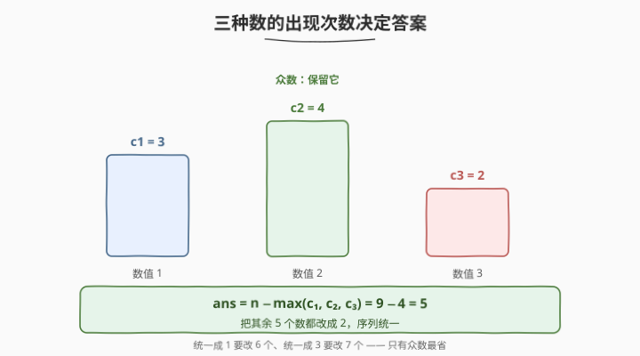
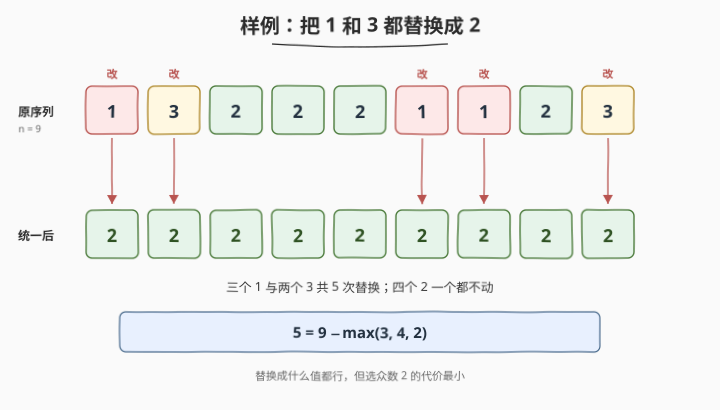

# Codeforces 52A 序列统一的最少替换 题解

## 1. 题目概述

- **题目链接**：https://codeforces.com/problemset/problem/52/A
- **比赛来源**：Codeforces Testing Round 1 · Problem A（UTC 2011-01-04）
- **难度**：900
- **标签**：实现、计数、众数
- **评测类型**：普通
- **限制**：时间 2 s / 内存 256 MB

**题意**：给定长度为 $n$ 的整数序列 $a_1, a_2, \dots, a_n$，其中每个数都是 $1$、$2$ 或 $3$。一次替换可以把任意一个位置的数改成任意整数。求最少替换多少次，才能使整个序列的所有数都相等。

**约束**：

- $1 \le n \le 10^6$：读入本身就是主要开销，必须是 $O(n)$ 的一次扫描；任何带排序或多次扫描的写法都会多出常数。
- 每项只有 $1, 2, 3$ 三种取值：可以用长度 4 的计数数组代替哈希表，$O(1)$ 空间。
- 只有一组数据，没有测试组数 $t$。
- 答案范围 $0 \le \text{ans} \le n - 1$：至少可以保留出现最多的那一类，最多就是把除它以外的全部替换掉。

## 2. 示例与观察

官方样例（输入 / 输出原样）：

```text
输入：
9
1 3 2 2 2 1 1 2 3

输出：
5
```

**样例演算**：统计三种数的出现次数：

| 数值 | 出现次数 |
|------|----------|
| 1 | 3 |
| 2 | 4 |
| 3 | 2 |

如果把最终序列统一成 $2$，需要改掉所有 $1$ 和 $3$，共 $3 + 2 = 5$ 个；统一成 $1$ 要改 $4 + 2 = 6$ 个；统一成 $3$ 要改 $3 + 4 = 7$ 个。最小是 $5$，与样例一致。

自造样例（均已用参考程序跑过）：

| 输入 | 输出 | 说明 |
|------|------|------|
| `1` / `1` | 0 | 只有一个数，本来就已经统一 |
| `4` / `2 2 2 2` | 0 | 全部相等，不需要替换 |
| `4` / `1 2 3 1` | 2 | 众数是 1（出现 2 次），改掉另外两个 |
| `3` / `1 2 3` | 2 | 三种各 1 个，保留任意一种，改 2 个 |
| `6` / `3 3 1 1 2 2` | 4 | 三种各 2 个，保留一种，改 4 个 |
| `5` / `1 1 1 1 3` | 1 | 众数 1 出现 4 次，只需改掉那个 3 |

**观察**：

1. 一旦确定了「最终统一成哪个数」，替换次数就完全确定：所有不等于它的位置都必须改，等于它的位置都不能改（改了反而多花一次）。
2. 因此答案就是 $n$ 减去三种数中出现次数的最大值。
3. 最终值只需要在 $1, 2, 3$ 里挑。统一成其他任何数都要把 $n$ 个位置全部改掉，而选择出现最多的那种数至多改 $n-1$ 个，绝不会更差。

## 3. 解题思路

### 3.1 朴素做法与瓶颈

最直接的做法是枚举最终值 $v$，再扫一遍序列统计有多少个位置不等于 $v$，取最小值。值域只有 $3$，所以这是 $3n$ 次比较，$n = 10^6$ 时约 $3 \times 10^6$ 次操作，本身就能过。

但还有更简单的等价写法：只扫一遍统计每个值出现多少次，答案直接是 $n - \max(\text{cnt})$，连第二遍都不用。对 $n = 10^6$ 来说，这能把读入之外的计算压到可以忽略。

### 3.2 核心观察：保留出现最多的那一类



设三种数的出现次数分别为 $c_1, c_2, c_3$，显然 $c_1 + c_2 + c_3 = n$。若最终统一成 $v$，需要替换 $n - c_v$ 个；要让这个数最小，就要让 $c_v$ 最大。于是

$$\text{ans} = n - \max(c_1, c_2, c_3).$$

注意这里隐含了一个容易忽略的点：被替换的数可以改成任意值，而不只是 $1, 2, 3$；但因为 $c_1 + c_2 + c_3 = n$，三种里必有一种出现次数至少为 $\lceil n/3 \rceil$，所以最优解一定在三种原值中取到，不需要考虑别的目标值。

### 3.3 算法流程

1. 读入 $n$。
2. 读入 $n$ 个数，用 `cnt[1..3]` 累加。
3. 取 `best = max(cnt[1], cnt[2], cnt[3])`。
4. 输出 $n - \text{best}$。

因为 $n \le 10^6$，C++ 用 `scanf` 逐个读入、Python 用 `sys.stdin.buffer.read().split()` 一次读完，都能在几十毫秒内完成。

### 3.4 样例走查



序列是 $1, 3, 2, 2, 2, 1, 1, 2, 3$。计数得到 $c_1 = 3$、$c_2 = 4$、$c_3 = 2$，最大的是 $c_2 = 4$。于是保留全部 $2$，把三个 $1$ 和两个 $3$ 改成 $2$，一共 $5$ 次替换，序列变成九个 $2$。任何其他目标值都需要更多次替换，所以答案是 $5$。

## 4. 正确性证明

**引理 1**：若最终统一成 $v$，则至少需要 $n - c_v$ 次替换，且 $n - c_v$ 次足够。

**证明**：最终所有位置都等于 $v$。原本不等于 $v$ 的 $n - c_v$ 个位置必须被改（每次替换至多改变一个位置），所以下界是 $n - c_v$；反过来，把这 $n - c_v$ 个位置各改一次成 $v$，其余不动，恰好达到，故上界也是 $n - c_v$。∎

**引理 2**：最优的最终值可以取在 $\{1,2,3\}$ 中。

**证明**：若 $v \notin \{1,2,3\}$，则 $c_v = 0$，需要 $n$ 次替换。而取出现次数最多的那个原值 $v^*$，有 $c_{v^*} \ge \lceil n/3 \rceil \ge 1$（$n \ge 1$），需要 $n - c_{v^*} \le n - 1 < n$ 次，严格更优。∎

**定理**：算法输出的 $n - \max(c_1,c_2,c_3)$ 等于最少替换次数。

**证明**：由引理 1，统一成 $v$ 的最小代价是 $n - c_v$；由引理 2 只需在三种原值中比较，取 $c_v$ 最大者即代价最小，正好是 $n - \max(c_1,c_2,c_3)$。∎

## 5. 复杂度分析

- **时间**：$O(n)$。读入 $n$ 个数各一次，计数与取最大值都是常数时间；$n = 10^6$ 时 C++ 实测约 0.05 s（几乎全是读入），Python 约 0.14 s。
- **空间**：$O(1)$。只有长度 4 的计数数组和几个标量，不保存整个序列；即使 $n = 10^6$ 也不需要数组。
- **与时限的关系**：2 s 的时限下有 30 倍以上余量，主要开销是输入输出。

## 6. 参考代码

### C++17

```cpp
#include <bits/stdc++.h>
using namespace std;

int main() {
    int n;
    if (scanf("%d", &n) != 1) return 0;
    long long cnt[4] = {0, 0, 0, 0};
    for (int i = 0; i < n; ++i) {
        int x;
        scanf("%d", &x);
        ++cnt[x];
    }
    // 把所有数改成出现次数最多的那个数，需要替换其余所有元素
    long long best = max(cnt[1], max(cnt[2], cnt[3]));
    printf("%lld\n", (long long)n - best);
    return 0;
}
```

### Python3

```python
import sys


def main() -> None:
    data = sys.stdin.buffer.read().split()
    if not data:
        return
    n = int(data[0])
    cnt = [0, 0, 0, 0]
    for v in data[1:1 + n]:
        cnt[int(v)] += 1
    print(n - max(cnt[1], cnt[2], cnt[3]))


main()
```

两份代码都只用标准库，可以原样提交。

## 7. 边界情况与易错点

1. **$n = 1$**：答案为 $0$，序列已经统一。若把答案写成 $n - \max$ 且 $\max$ 初值为 $0$，会错误地输出 $1$。
2. **全部相等**：答案为 $0$。例如 `4 / 2 2 2 2`，最大计数等于 $n$，差值必须为 $0$。
3. **不要把最终值限制成「改成 1 或 2」**：三种值地位对称，必须比较三者；只尝试改成 $1$ 会漏掉更优的 $2$ 或 $3$（样例中众数就是 $2$）。
4. **替换次数不是「不同值的种数」**：样例里有三种值，但答案是 $5$ 而不是 $2$。必须按出现次数算，而不是按种类数算。
5. **`int` 与 `long long`**：$n \le 10^6$，答案本身不会溢出 `int`；但习惯上用 `long long` 存计数和答案，可以避免把 $n$ 放大后出现隐性溢出，也让代码在同类题中更稳。
6. **读入性能**：$n = 10^6$ 时不要用 `cin` 逐个读（在部分环境下会明显变慢），用 `scanf` 或一次读入整块；Python 用 `sys.stdin.buffer.read().split()`，不要逐行 `input()`。
7. **输入可能跨行**：题面写「第二行包含 $n$ 个整数」，但按 token 读入可以容忍换行位置不同；不要假设恰好一行。
8. **输出格式**：只输出一个整数并换行，不要输出被替换的数值或位置。

## 8. 验证记录

- **编译环境与命令**：本机只有 Apple clang 21.0.0（`/usr/bin/g++` 是 clang 的软链），用 `clang++ -std=c++17 -O2 -Wall` 搭配仓库自带的 `codeforces/tools/include/bits/stdc++.h` 兼容头编译；Python 为 3.9.6。
- **官方样例**：1 / 1 通过（`9` 个数 → `5`），C++ 与 Python 输出一致。
- **额外测试**：$n=1$、全部相等、三种各若干、最大值全为 $3$ 等手写用例全部通过（见第 2 节表格）。
- **独立暴力对拍**：另写 `brute.cpp`，直接枚举最终值 $1$、$2$、$3$，对每个目标值逐个数统计需要改多少个并取最小（完全按题意定义，不用众数公式）。与参考程序随机对拍 **300 组**（$n \le 20$，取值随机 $1..3$），C++、Python、暴力三方输出全部一致。
- **最大约束性能**：$n = 10^6$ 的随机数据，C++ 端到端约 0.05 s，Python 约 0.14 s（含进程启动）；峰值内存约 1.7 MB，相对 2 s / 256 MB 余量充足。
- **图片校验**：两张 SVG（`cf52a_counts.svg`、`cf52a_sample_walk.svg`）均通过 `xml.etree.ElementTree.parse`；用 headless Chrome 实际排版，逐个量出文本块的包围盒，确认没有越出 `viewBox`、没有互相重叠或压到边框。
- **公式校验**：公式经 KaTeX（`throwOnError`）渲染无报错。
- **复核状态**：verified（样例、对拍、性能、图片、公式均已实跑）。

## 相关题目与扩展

- [Codeforces 52B Right Triangles](https://codeforces.com/problemset/problem/52/B)：同场 B 题，在网格上数直角三角形，核心同样是「分类计数 + 乘法原理」。
- [Codeforces 52C Circular RMQ](https://codeforces.com/problemset/problem/52/C)：同场 C 题，环形数组的区间加与区间最小值，需要线段树。
- [LeetCode 169. 多数元素](https://leetcode.cn/problems/majority-element/)：同样围绕「出现次数最多的元素」，但那题要求线性时间常数空间找出众数，是本题计数思路的加强版。
- [Codeforces 43A Football](https://codeforces.com/problemset/problem/43/A)：统计两支球队的得分并输出赢家，属于同一类「数一数、比大小」的实现题。

**延伸思考**：

1. **值域变大**：若 $a_i$ 可以是任意 $10^9$ 内的整数，就把长度 4 的数组换成哈希表（C++ `unordered_map`、Python `Counter`），答案仍是 $n - \max \text{freq}$，期望 $O(n)$。
2. **每次替换有不同代价**：若把 $i$ 改成 $j$ 的代价是 $w(i,j)$，那么「统一成 $v$」的代价变成 $\sum_{i \ne v} w(i,v)$，需要比较 $3$ 个（或值域大小个）带权和，问题仍然是线性的，但不再是简单的众数。
3. **要求最终至少保留 $k$ 种不同的值**：这时不能只保留众数，而要在「替换代价」和「多样性约束」之间权衡，可以用按频次排序后贪心或 DP。
4. **若要求最终序列有序**：问题变成把序列改成非降序列的最少修改次数（保留最长非降子序列），与本题的「全部相等」是两种不同的目标，解法也从计数变成 LIS 类 DP。

