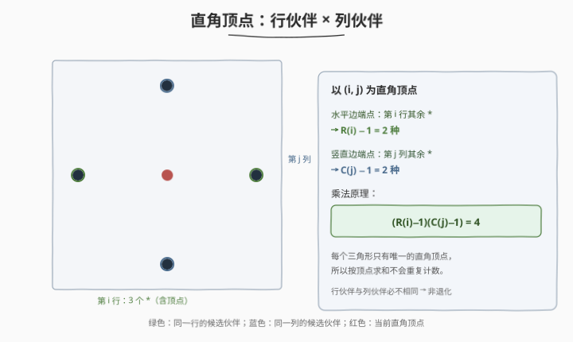
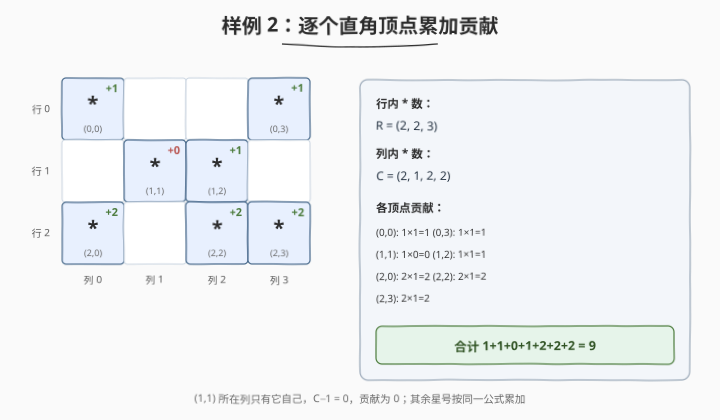

# Codeforces 52B 直角三角形的计数 题解

## 1. 题目概述

- **题目链接**：https://codeforces.com/problemset/problem/52/B
- **比赛来源**：Codeforces Beta Round 52 · Problem B
- **难度**：1600
- **标签**：组合计数、乘法原理、网格
- **评测类型**：普通
- **限制**：时间 2 s / 内存 256 MB

**题意**：给定一个 $n \times m$ 的网格，每个格子是 `.` 或 `*`。三角形的三个顶点都必须取在 `*` 格子的中心，并且三角形要有两条边平行于网格的边（一条水平、一条竖直）。求这样的直角三角形总数。

**约束**：

- $1 \le n, m \le 1000$：网格最多 $10^6$ 格，$O(nm)$ 的扫描可行；$O((nm)^2)$ 及以上的枚举不可行。
- 网格中最多 $10^6$ 个 `*`，答案可能达到 $10^{12}$ 量级（例如全为 `*` 时是 $nm(n-1)(m-1) \approx 9.98 \times 10^{11}$），**必须用 64 位整数**。
- 只有一组数据。
- 输入只有 `.` 和 `*` 两种字符，没有空格。

## 2. 示例与观察

官方样例 1（输入 / 输出原样）：

```text
输入：
2 2
**
*.

输出：
1
```

官方样例 2：

```text
输入：
3 4
*..*
.**.
*.**

输出：
9
```

**样例 1 演算**：三个 `*` 位于 $(0,0)$、$(0,1)$、$(1,0)$。以 $(0,0)$ 为直角顶点，水平边到 $(0,1)$、竖直边到 $(1,0)$，恰好构成一个直角三角形。另外两个 `*` 无法作为直角顶点（$(0,1)$ 所在列只有它自己，$(1,0)$ 所在行只有它自己），所以答案是 1。

**样例 2 演算**：先统计每行、每列的 `*` 数量：

| 位置 | 行内 `*` 数 | 列内 `*` 数 | 贡献 $(\text{row}-1)(\text{col}-1)$ |
|------|-------------|-------------|--------------------------------------|
| $(0,0)$ | 2 | 2 | $1 \times 1 = 1$ |
| $(0,3)$ | 2 | 2 | $1 \times 1 = 1$ |
| $(1,1)$ | 2 | 1 | $1 \times 0 = 0$ |
| $(1,2)$ | 2 | 2 | $1 \times 1 = 1$ |
| $(2,0)$ | 3 | 2 | $2 \times 1 = 2$ |
| $(2,2)$ | 3 | 2 | $2 \times 1 = 2$ |
| $(2,3)$ | 3 | 2 | $2 \times 1 = 2$ |

合计 $1+1+0+1+2+2+2 = 9$，与样例输出一致。

其中行列计数为：行 $0,1,2$ 分别有 $2,2,3$ 个 `*`；列 $0,1,2,3$ 分别有 $2,1,2,2$ 个 `*`。

自造样例（均已用参考程序跑过）：

| 输入 | 输出 | 说明 |
|------|------|------|
| `1 1` / `*` | 0 | 一个点构不成三角形 |
| `1 5` / `*****` | 0 | 只有一行，找不到竖直边 |
| `5 1` / 五个 `*` | 0 | 只有一列，找不到水平边 |
| `2 2` / `**` / `**` | 4 | 四个格子都是 `*`，每个顶点贡献 $1 \times 1$ |
| `3 2` / 全 `*` | 12 | 每个顶点贡献 $1 \times 2 = 2$，共 6 个顶点 |

**观察**：

1. 直角三角形的两条直角边必须一条水平、一条竖直，它们的交点就是**直角顶点**，也一定是某个 `*` 格。
2. 三角形至多有一个直角（内角和 $180^\circ$），所以每个合法三角形有且只有一个直角顶点，按直角顶点分类不会重复计数。
3. 固定直角顶点 $(i,j)$ 后，水平边的另一个端点可以是第 $i$ 行中除它以外的任意 `*`，竖直边的另一个端点可以是第 $j$ 列中除它以外的任意 `*`，两者独立选择，用乘法原理相乘即可。

## 3. 解题思路

### 3.1 朴素做法与瓶颈

最直接的做法是枚举三个 `*` 格子，判断它们是否构成满足条件的直角三角形。设 `*` 的个数为 $S$，复杂度是 $O(S^3)$；$S$ 最大 $10^6$，完全不可行。即使只枚举「同一行的点对 + 同一列的点」这种优化，也仍是 $O(S^2)$ 级别，$10^{12}$ 次枚举同样超时。

正确方向是**按直角顶点分类**：每个三角形只被它唯一的直角顶点统计一次，而每个顶点的贡献可以 $O(1)$ 算出。

### 3.2 核心观察：每个直角顶点的贡献是「行伙伴数 × 列伙伴数」



设第 $i$ 行有 $R_i$ 个 `*`，第 $j$ 列有 $C_j$ 个 `*`。以 $(i,j)$ 为直角顶点时：

- 水平边：从第 $i$ 行的其余 $R_i - 1$ 个 `*` 中任选一个；
- 竖直边：从第 $j$ 列的其余 $C_j - 1$ 个 `*` 中任选一个。

两条边的选择互不影响，所以贡献是

$$(R_i - 1)\,(C_j - 1).$$

把所有 `*` 格子的贡献加起来就是答案：

$$\text{ans} = \sum_{(i,j)\text{ 是 }*} (R_i - 1)(C_j - 1).$$

行伙伴和列伙伴不可能重合：行伙伴与 $(i,j)$ 同一行、不同列；列伙伴与 $(i,j)$ 同一列、不同行。因此两条直角边一定不共线，三角形非退化。

### 3.3 算法流程

1. 读入 $n, m$ 和网格。
2. 统计每行的 `*` 数 $R_i$ 与每列的 `*` 数 $C_j$，一遍 $O(nm)$ 扫描。
3. 再扫一遍网格，遇到 `*` 就把 $(R_i-1)(C_j-1)$ 累加到答案。
4. 输出答案（64 位整数）。

实现上可以只扫两遍（统计 + 累加），也可以在第一遍记录所有 `*` 的坐标再逐个算贡献；前者更省内存。

### 3.4 样例走查



样例 2 的网格如下，七个 `*` 用坐标标出：

```text
列:  0 1 2 3
行0: * . . *
行1: . * * .
行2: * . * *
```

按第 2 节的表格逐个累加：四个角上的 `*`（$(0,0),(0,3),(2,0),(2,3)$）各自贡献 $1$ 或 $2$，中间的 $(1,1)$ 因为所在列只有它自己而贡献 $0$，其余各贡献 $1$ 或 $2$，总和为 $9$。

以 $(2,0)$ 为例：第 2 行有 3 个 `*`（$(2,0),(2,2),(2,3)$），所以水平伙伴有 2 种；第 0 列有 2 个 `*`（$(0,0),(2,0)$），所以竖直伙伴有 1 种；共 $2 \times 1 = 2$ 个三角形：$\{(2,0),(2,2),(0,0)\}$ 与 $\{(2,0),(2,3),(0,0)\}$。

## 4. 正确性证明

**引理 1**：任何满足条件的三角形恰有一个直角顶点，且该顶点是某个 `*` 格。

**证明**：三角形的内角和为 $180^\circ$，直角只能有一个。题面要求有两条边平行于网格边；三角形中不可能有两条互相平行的边（否则退化成两条平行线段加一条截线，不封闭），所以这两条边一条水平、一条竖直，它们的夹角为 $90^\circ$，交点就是唯一的直角顶点。顶点都在 `*` 格中心，故它是 `*` 格。∎

**引理 2**：以 `*` 格 $(i,j)$ 为直角顶点的合法三角形恰有 $(R_i-1)(C_j-1)$ 个。

**证明**：合法三角形由「水平边的另一端点 $P$」与「竖直边的另一端点 $Q$」唯一确定。$P$ 必须与 $(i,j)$ 同一行且是 `*`，且不能是 $(i,j)$ 自己，共 $R_i - 1$ 种；$Q$ 必须与 $(i,j)$ 同一列且是 `*`，且不能是 $(i,j)$ 自己，共 $C_j - 1$ 种。任取一对 $(P,Q)$：$P$ 与 $Q$ 的列不同（$P$ 在列 $j$ 之外）、行也不同（$Q$ 在行 $i$ 之外），所以三点不共线且 $P \ne Q$，构成非退化三角形；它的两条边 $P(i,j)$ 与 $Q(i,j)$ 分别水平、竖直，直角在 $(i,j)$。不同的 $(P,Q)$ 对给出不同的三角形，故恰有 $(R_i-1)(C_j-1)$ 个。∎

**定理**：算法输出等于网格中满足条件的直角三角形总数。

**证明**：由引理 1，每个合法三角形有唯一的直角顶点，因此按直角顶点分类是不重不漏的划分；由引理 2，顶点 $(i,j)$ 贡献 $(R_i-1)(C_j-1)$ 个三角形。把所有 `*` 顶点的贡献相加，恰好每个三角形被数一次，故总和等于总数。∎

## 5. 复杂度分析

- **时间**：$O(nm)$。统计行/列计数一遍，累加答案一遍，每次都是常数操作；$n = m = 1000$ 时约 $2 \times 10^6$ 次操作。
- **空间**：$O(nm)$ 存网格（可优化为逐行处理），另有 $O(n+m)$ 的行列计数。
- **数值范围**：全为 `*` 时答案是 $nm(n-1)(m-1) \approx 9.98 \times 10^{11}$，超过 32 位整数上限，必须用 `long long`（Python 无此问题）。
- **与时限的关系**：2 s 的时限下 C++ 实测不到 10 ms，Python 约 0.24 s，余量充足。

## 6. 参考代码

### C++17

```cpp
#include <bits/stdc++.h>
using namespace std;

int main() {
    int n, m;
    if (scanf("%d %d", &n, &m) != 2) return 0;
    vector<string> g(n);
    vector<char> buf(m + 2);
    for (int i = 0; i < n; ++i) {
        scanf("%s", buf.data());
        g[i].assign(buf.data());
    }

    vector<long long> row(n, 0), col(m, 0);
    for (int i = 0; i < n; ++i)
        for (int j = 0; j < m; ++j)
            if (g[i][j] == '*') { ++row[i]; ++col[j]; }

    // 以每个 '*' 为直角顶点：同一行的另一个 '*' 与同一列的另一个 '*' 各选一个
    long long ans = 0;
    for (int i = 0; i < n; ++i)
        for (int j = 0; j < m; ++j)
            if (g[i][j] == '*')
                ans += (row[i] - 1) * (col[j] - 1);

    printf("%lld\n", ans);
    return 0;
}
```

### Python3

```python
import sys


def main() -> None:
    data = sys.stdin.buffer.read().split()
    if not data:
        return
    n = int(data[0])
    m = int(data[1])
    grid = [data[2 + i].decode() for i in range(n)]

    row = [0] * n
    col = [0] * m
    for i in range(n):
        line = grid[i]
        for j in range(m):
            if line[j] == '*':
                row[i] += 1
                col[j] += 1

    ans = 0
    for i in range(n):
        line = grid[i]
        ri = row[i] - 1
        for j in range(m):
            if line[j] == '*':
                ans += ri * (col[j] - 1)
    print(ans)


main()
```

两份代码都只用标准库，可以原样提交。

## 7. 边界情况与易错点

1. **$1 \times 1$ 网格**：无论是不是 `*`，答案都是 0；`(row-1)(col-1)` 自然给出 0，不会出现负数（因为该格是 `*` 时 $R_i, C_j \ge 1$）。
2. **只有一行或只有一列**：所有顶点的「行伙伴数」或「列伙伴数」必为 0，答案 0。不要写成「只要有两个 `*` 就能构成三角形」。
3. **32 位溢出**：全 `*` 的 $1000 \times 1000$ 网格答案是 $998001000000$，用 `int` 累加会溢出成错误值。行/列计数本身 $\le 1000$，但乘积和总和必须用 `long long`。
4. **每个三角形只数一次**：有人会担心「同一个三角形在三个顶点各被数一次」，但只有直角顶点能提供一条水平边和一条竖直边，另外两个顶点一个只有水平方向的伙伴、一个只有竖直方向的伙伴，不会重复。按直角顶点分类是关键。
5. **跳过非 `*` 格子**：只有 `*` 格中心能作为顶点，`.` 格即使行列计数很大也不能计入。
6. **行伙伴与列伙伴不能是同一个格子**：`(R_i-1)` 与 `(C_j-1)` 已经排除了顶点自身；行伙伴在别的列、列伙伴在别的行，因此两条直角边不会退化成同一条线。
7. **读入方式**：网格是连续 $m$ 个字符，没有空格；用 `scanf("%s")` 或一次读入全部 token 都可以，不要用 `scanf("%c")` 逐字符读而把换行当成格子。
8. **答案输出**：只输出一个整数；题目特别提示 C++ 不要用 `%lld` 读写 64 位整数（这段提示来自旧版评测环境），在现代 CF 上 `cout` 或 `%lld` 都可以，本文用 `printf("%lld")`。

## 8. 验证记录

- **编译环境与命令**：本机只有 Apple clang 21.0.0（`/usr/bin/g++` 是 clang 的软链），用 `clang++ -std=c++17 -O2 -Wall` 搭配仓库自带的 `codeforces/tools/include/bits/stdc++.h` 兼容头编译；Python 为 3.9.6。
- **官方样例**：2 / 2 通过（样例 1 输出 `1`，样例 2 输出 `9`），C++ 与 Python 输出一致。
- **额外测试**：$1\times1$、单行、单列、$2\times2$ 全 `*`、$3\times2$ 全 `*` 等手写用例全部通过（见第 2 节表格）。
- **独立暴力对拍**：另写 `brute.cpp`，枚举所有 `*` 三元组，对每个三元组检查三个顶点分别作为直角顶点、两条直角边交换的 6 种组合，判断是否存在「一个顶点与另一个同行、与第三个同列」的直角结构。与参考程序随机对拍 **300 组**（$n, m \le 5$，`*` 密度随机取 $0.2/0.4/0.6/0.9$），C++、Python、暴力三方输出全部一致。
- **最大约束性能**：$1000 \times 1000$ 全 `*` 数据，C++ 端到端不到 10 ms，Python 约 0.24 s（含进程启动）；峰值内存约 2.8 MB，相对 2 s / 256 MB 余量充足。答案 $998001000000$ 验证了 64 位整数路径。
- **图片校验**：两张 SVG（`cf52b_vertex.svg`、`cf52b_sample2.svg`）均通过 `xml.etree.ElementTree.parse`；用 headless Chrome 实际排版，逐个量出文本块的包围盒，确认没有越出 `viewBox`、没有互相重叠或压到边框。
- **公式校验**：公式经 KaTeX（`throwOnError`）渲染无报错。
- **复核状态**：verified（样例、对拍、性能、图片、公式均已实跑）。

## 相关题目与扩展

- [Codeforces 52A 123-sequence](https://codeforces.com/problemset/problem/52/A)：同场 A 题，计数取众数，是「分类计数」的最简版本。
- [Codeforces 52C Circular RMQ](https://codeforces.com/problemset/problem/52/C)：同场 C 题，环形数组的区间加与最小值，数据结构方向。
- [LeetCode 593. 有效的正方形](https://leetcode.cn/problems/valid-square/)：给定四个点判断能否构成正方形，同样要把几何条件翻译成「距离/坐标关系」的计数与判定。
- [Codeforces 1C Ancient Berland Circus](https://codeforces.com/problemset/problem/1/C)：已知三角形三个顶点求外接多边形，属于坐标几何 + 角度计算，与本题的「按顶点分类」形成对照。

**延伸思考**：

1. **若允许任意方向的直角三角形**：计数会困难得多。轴平行的条件让「直角顶点」把问题拆成两个独立的一维选择；去掉这个条件后，需要对每个点对求垂直方向上的点，通常要按斜率分组或用卷积，复杂度显著上升。
2. **若要求等腰直角三角形**：在本题基础上再加「水平边长 = 竖直边长」，即 $|j' - j| = |i' - i|$。可以对每个直角顶点统计两条对角线上等距的 `*`，用二维前缀和或按对角线哈希做到 $O(nm)$。
3. **带权版本**：如果每个 `*` 格有一个权值，要求所有三角形权值之和（权值定义为三个顶点权值之积），只需把贡献改成 $W_{ij}\big(\sum_{P} W_P\big)\big(\sum_{Q} W_Q\big)$，其中两个和分别是同行、同列的权和，仍是一遍扫描。
4. **高维推广**：在 $d$ 维格点中数「直角边都沿坐标轴」的直角三角形，固定直角顶点后需要对每个维度各选一个伙伴，贡献是 $\prod_{k=1}^{d}(c_k - 1)$，求和即可。

