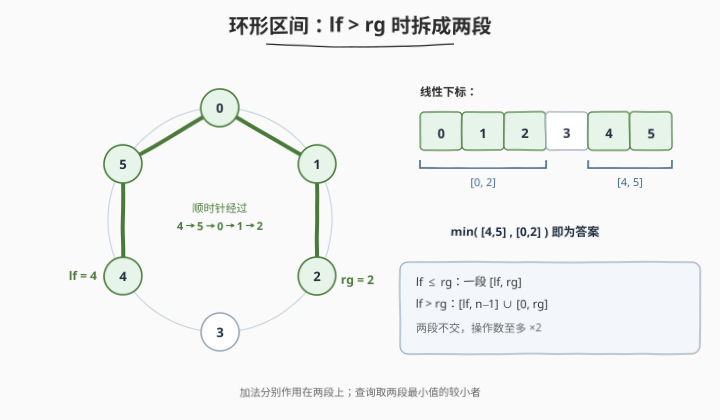
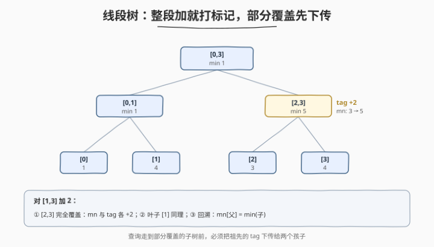
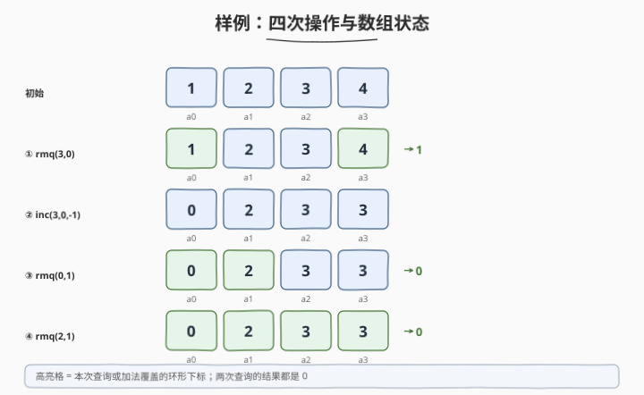

# Codeforces 52C 环形数组的区间加与最值 题解

## 1. 题目概述

- **题目链接**：https://codeforces.com/problemset/problem/52/C
- **比赛来源**：Codeforces Testing Round 1 · Problem C（UTC 2011-01-04）
- **难度**：2200
- **标签**：数据结构、线段树、惰性标记、环形数组
- **评测类型**：普通
- **限制**：时间 3 s / 内存 256 MB

**题意**：给定一个环形数组 $a_0, a_1, \dots, a_{n-1}$（下标循环，$a_n = a_0$），要处理 $m$ 个操作：

- `inc(lf, rg, v)`：把环形区间 $[lf, rg]$ 内的每个元素加上 $v$；
- `rmq(lf, rg)`：询问环形区间 $[lf, rg]$ 内的最小值。

环形区间指从 $lf$ 出发、沿下标递增方向一直走到 $rg$ 所经过的元素。例如 $n = 5$、$lf = 3$、$rg = 1$ 时，区间是下标 $3, 4, 0, 1$。对每个 `rmq` 操作输出答案。

**约束**：

- $n, m \le 2 \times 10^5$：每次操作必须做到 $O(\log n)$，否则 $O(nm) = 4 \times 10^{10}$ 无法在 3 s 内完成。
- $|a_i|, |v| \le 10^6$：单个元素经过最多 $2 \times 10^5$ 次加法后可达 $2 \times 10^{11}$ 量级，**必须用 64 位整数**。
- 操作行的格式不固定：`rmq` 行有 2 个整数，`inc` 行有 3 个整数，因此**必须按行解析**，不能简单地把所有 token 连成一串再按数量切分。
- $m$ 可以为 $0$，此时不应输出任何内容。
- 只有一组数据。

## 2. 示例与观察

官方样例（输入 / 输出原样）：

```text
输入：
4
1 2 3 4
4
3 0
3 0 -1
0 1
2 1

输出：
1
0
0
```

**逐步演算**：

| 步骤 | 操作 | 环形区间包含的下标 | 数组状态 | 输出 |
|------|------|--------------------|----------|------|
| 初始 | — | — | $[1,2,3,4]$ | — |
| 1 | `rmq(3,0)` | $3,0$ | $[1,2,3,4]$ | $\min(4,1)=1$ |
| 2 | `inc(3,0,-1)` | $3,0$ | $[0,2,3,3]$ | — |
| 3 | `rmq(0,1)` | $0,1$ | $[0,2,3,3]$ | $\min(0,2)=0$ |
| 4 | `rmq(2,1)` | $2,3,0,1$ | $[0,2,3,3]$ | $\min(3,3,0,2)=0$ |

与样例输出 $1, 0, 0$ 一致。

自造样例（均已用参考程序跑过）：

| 输入 | 输出 | 说明 |
|------|------|------|
| `1` / `7` / `3` / `0 0` / `0 0 -3` / `0 0` | `7` `4` | $n=1$ 时环形区间退化为单点 |
| `3` / `1 2 3` / `0` | 无输出 | $m=0$，不产生任何答案 |
| `3` / `5 -5 5` / 两次查询与一次整段加 | `-5` `-15` | 负值参与最小值 |

**观察**：

1. 环形区间只有两种形态：$lf \le rg$ 时就是普通区间 $[lf, rg]$；$lf > rg$ 时它跨过下标 $n-1$ 回到 $0$，等于 $[lf, n-1]$ 与 $[0, rg]$ 的并集。
2. 拆成至多两个**互不相交**的普通区间后，问题就变成「区间加 + 区间最小值」的经典线段树问题。
3. 每次拆分会把一次操作变成至多两次线段树操作，复杂度只多一个常数。

## 3. 解题思路

### 3.1 朴素做法与瓶颈

直接按环形顺序逐元素修改或取最小值：每次操作要访问区间长度个元素，最坏 $O(n)$。$m = 2 \times 10^5$、$n = 2 \times 10^5$ 时最坏 $4 \times 10^{10}$ 次访问，3 s 内绝无可能。必须用支持「区间加、区间最小值」的数据结构。

### 3.2 核心观察：环形区间拆成至多两段



把下标 $0, 1, \dots, n-1$ 想成一个环。从 $lf$ 沿递增方向走到 $rg$：

- 若 $lf \le rg$，路径不跨越 $n-1 \to 0$，区间就是线性的 $[lf, rg]$；
- 若 $lf > rg$，路径先经过 $lf, lf+1, \dots, n-1$，再绕回 $0, 1, \dots, rg$，即
$$[lf, rg]_{\text{环}} = [lf, n-1] \cup [0, rg].$$

两段在线性数组上互不相交，且并起来恰好是全部环形元素（$lf > rg$ 时 $lf \ge 1$、$rg \le n-2$，中间不会重叠）。

于是每个操作只需对至多两个普通区间做「区间加」或「区间取最小值」。

### 3.3 线段树 + 惰性标记



用一棵线段树维护数组，每个节点存：

- `mn[v]`：该节点对应区间当前的最小值；
- `tag[v]`：尚未下传给子节点的加法标记。

**区间加** `add(v, l, r, ql, qr, x)`：

1. 若区间与 $[ql,qr]$ 无交，直接返回；
2. 若被完全覆盖，`mn[v] += x`、`tag[v] += x`，返回；
3. 否则先把 `tag[v]` 下传给两个孩子（孩子的 `mn` 与 `tag` 都加上它），清空 `tag[v]`，再递归两个孩子，最后 `mn[v] = min(mn[left], mn[right])`。

**区间最小值** `query(v, l, r, ql, qr)`：

1. 无交返回 $+\infty$；
2. 完全覆盖返回 `mn[v]`；
3. 否则先下传标记，再取两个孩子查询结果的较小值。

下传是必要的：查询要走到部分覆盖的子树时，祖先的加法必须已经体现在孩子的值里。

### 3.4 算法流程

1. 读入 $n$ 与初始数组，建树（$O(n)$）。
2. 读入 $m$。
3. 逐行读入操作，按该行整数个数判断类型：2 个是查询，3 个是区间加。
4. 按 $lf$ 与 $rg$ 的大小关系把环形区间拆成一段或两段，分别执行线段树操作。
5. 查询结果按顺序输出，每个一行。



以样例第 4 步 `rmq(2,1)` 为例：$2 > 1$，拆成 $[2,3]$ 与 $[0,1]$；此时数组是 $[0,2,3,3]$，两段最小值分别是 $3$ 与 $0$，取较小者得 $0$。

## 4. 正确性证明

**引理 1（环形拆分正确）**：设 $S$ 是 `lf` 到 `rg` 的环形下标序列。

- 若 $lf \le rg$，则 $S = \{lf, lf+1, \dots, rg\}$；
- 若 $lf > rg$，则 $S = \{lf, \dots, n-1\} \cup \{0, \dots, rg\}$，且两个集合不交。

**证明**：环形序列的定义是从 $lf$ 开始反复加一并对 $n$ 取模，直到首次到达 $rg$。当 $lf \le rg$ 时，在到达 $rg$ 之前不会越过 $n-1$，序列就是递增的 $lf..rg$。当 $lf > rg$ 时，必须先走到 $n-1$，下一步取模回到 $0$，再递增到 $rg$；两段分别是 $lf..n-1$ 与 $0..rg$，由于 $lf > rg$，第一段的下标都 $\ge lf > rg \ge$ 第二段的下标，故不交。∎

**引理 2（线段树不变量）**：对每个节点 $v$ 与它对应的区间 $I_v$，在执行任意操作序列的过程中始终有：`mn[v]` 等于 $I_v$ 内所有元素的**当前**最小值；`tag[v]` 是已经计入 `mn[v]`、但尚未下放给两个孩子的加法量。

**证明**：对操作序列归纳。建树时 `tag` 全为 $0$，`mn` 就是区间最小值，成立。考虑一次区间加：
- 与 $I_v$ 无交：什么也不改；
- 完全覆盖 $I_v$：区间内每个元素都加 $x$，最小值同样加 $x$，故 `mn[v] += x`；同时 `tag[v] += x`，表示这 $x$ 还没下放给孩子，不变量保持；
- 部分覆盖：先在 $v$ 处下传 `tag[v]`，给两个孩子的 `mn` 与 `tag` 都加上同一个值，再把 `tag[v]` 清零——这一步等价于「把父节点欠孩子的加法补上」，不变量保持；然后递归修改真正相交的孩子，回溯时由两个孩子的最小值重新算出 `mn[v] = min(mn[left], mn[right])`，不变量恢复。

查询不改变数组，只做必要的下传（把父节点待下放的量补给孩子），同样保持不变量。∎

**引理 3（查询正确）**：`query(v, l, r, ql, qr)` 返回 $\min_{i \in [ql,qr] \cap I_v} a_i$。

**证明**：对递归结构归纳。若区间无交，返回 $+\infty$，不影响最小值；若被完全覆盖，由引理 2，`mn[v]` 就是该区间的最小值；否则先下传 `tag[v]`，引理 2 保证下传后孩子的 `mn` 已经反映父节点欠的加法，再对两个孩子分别求交并取较小值，由归纳假设即得。∎

**定理**：程序对每个 `rmq` 操作输出的值，等于对应环形区间内所有元素的最小值；每次 `inc` 之后数组状态也与题意一致。

**证明**：由引理 1，环形区间被正确拆成至多两个普通区间；对每个普通区间，区间加与区间最小值分别由引理 2、3 保证正确。多个不相交区间的加法互不干扰，最小值取两者较小者即为整个环形区间的最小值。∎

## 5. 复杂度分析

- **时间**：建树 $O(n)$；每次操作拆成至多 2 个普通区间，每个区间操作 $O(\log n)$，总计 $O(n + m \log n)$。$n = m = 2 \times 10^5$ 时约 $1.4 \times 10^7$ 次节点访问量级。
- **空间**：线段树用 $4n$ 个 `long long` 存最小值与标记，约 $12.8$ MB；加上数组与输入输出缓冲，实测峰值约 19 MB。
- **数值范围**：初始值 $\pm 10^6$，最多 $2 \times 10^5$ 次加法、每次 $\pm 10^6$，极值约 $\pm 2 \times 10^{11}$，`long long` 足够，`int` 会溢出。无穷大取 $4 \times 10^{18}$，远大于任何可能出现的最小值，又不会在加法中溢出。
- **与时限的关系**：3 s 的时限下 C++ 实测约 0.7 s（含读入），余量在 4 倍以上。Python 的迭代式线段树在 CPython 下约 8 s，需要 PyPy3 或直接提交 C++。

## 6. 参考代码

### C++17

```cpp
#include <bits/stdc++.h>
using namespace std;

static const long long INF = (long long)4e18;

int n;
vector<long long> mn, lazy;

void build(int node, int l, int r, const vector<long long> &a) {
    if (l == r) { mn[node] = a[l]; return; }
    int mid = (l + r) >> 1;
    build(node << 1, l, mid, a);
    build(node << 1 | 1, mid + 1, r, a);
    mn[node] = min(mn[node << 1], mn[node << 1 | 1]);
}

inline void apply(int node, long long v) {
    mn[node] += v;
    lazy[node] += v;
}

inline void push(int node) {
    if (lazy[node]) {
        apply(node << 1, lazy[node]);
        apply(node << 1 | 1, lazy[node]);
        lazy[node] = 0;
    }
}

void rangeAdd(int node, int l, int r, int ql, int qr, long long v) {
    if (qr < l || r < ql) return;
    if (ql <= l && r <= qr) { apply(node, v); return; }
    push(node);
    int mid = (l + r) >> 1;
    rangeAdd(node << 1, l, mid, ql, qr, v);
    rangeAdd(node << 1 | 1, mid + 1, r, ql, qr, v);
    mn[node] = min(mn[node << 1], mn[node << 1 | 1]);
}

long long rangeMin(int node, int l, int r, int ql, int qr) {
    if (qr < l || r < ql) return INF;
    if (ql <= l && r <= qr) return mn[node];
    push(node);
    int mid = (l + r) >> 1;
    return min(rangeMin(node << 1, l, mid, ql, qr),
               rangeMin(node << 1 | 1, mid + 1, r, ql, qr));
}

int main() {
    if (scanf("%d", &n) != 1) return 0;
    vector<long long> a(n);
    for (int i = 0; i < n; ++i) scanf("%lld", &a[i]);
    mn.assign(4 * n + 5, 0);
    lazy.assign(4 * n + 5, 0);
    build(1, 0, n - 1, a);

    int m;
    if (scanf("%d", &m) != 1) return 0;
    string line;
    getline(cin, line);  // 吃掉 m 之后的换行

    string out;
    int done = 0;
    while (done < m && getline(cin, line)) {
        vector<long long> t;
        stringstream ss(line);
        long long x;
        while (ss >> x) t.push_back(x);
        if (t.size() < 2) continue;          // 空行/坏行：跳过，不算一次操作
        int lf = (int)t[0], rg = (int)t[1];
        bool isAdd = (t.size() >= 3);
        // 环形区间拆成至多两段：lf <= rg 时是一段，否则是 [lf, n-1] 与 [0, rg]
        vector<pair<int, int>> segs;
        if (lf <= rg) segs.push_back({lf, rg});
        else {
            segs.push_back({lf, n - 1});
            segs.push_back({0, rg});
        }
        if (isAdd) {
            long long v = t[2];
            for (auto &s : segs) rangeAdd(1, 0, n - 1, s.first, s.second, v);
        } else {
            long long best = INF;
            for (auto &s : segs) best = min(best, rangeMin(1, 0, n - 1, s.first, s.second));
            out += to_string(best);
            out += '\n';
        }
        ++done;
    }
    fputs(out.c_str(), stdout);
    return 0;
}
```

### Python3

```python
import sys

INF = 10 ** 30


class LazyMinAdd:
    """区间加、区间最小值的迭代式惰性线段树（AtCoder Library 风格）。"""

    __slots__ = ("n", "size", "log", "d", "lz")

    def __init__(self, data):
        n = len(data)
        size, log = 1, 0
        while size < n:
            size <<= 1
            log += 1
        self.n, self.size, self.log = n, size, log
        d = [INF] * (2 * size)
        lz = [0] * size
        for i, v in enumerate(data):
            d[size + i] = v
        for i in range(size - 1, 0, -1):
            d[i] = min(d[i << 1], d[i << 1 | 1])
        self.d, self.lz = d, lz

    def _all_apply(self, k, f):
        self.d[k] += f
        if k < self.size:
            self.lz[k] += f

    def _push(self, k):
        f = self.lz[k]
        if f:
            d, lz = self.d, self.lz
            d[k << 1] += f
            d[k << 1 | 1] += f
            if (k << 1) < self.size:
                lz[k << 1] += f
                lz[k << 1 | 1] += f
            lz[k] = 0

    def _update(self, k):
        d = self.d
        d[k] = min(d[k << 1], d[k << 1 | 1])

    def apply(self, l, r, f):
        if l >= r:
            return
        size, log, d = self.size, self.log, self.d
        l += size
        r += size
        l0, r0 = l, r
        for i in range(log, 0, -1):
            if ((l0 >> i) << i) != l0:
                self._push(l0 >> i)
            if ((r0 >> i) << i) != r0:
                self._push((r0 - 1) >> i)
        while l < r:
            if l & 1:
                self._all_apply(l, f)
                l += 1
            if r & 1:
                r -= 1
                self._all_apply(r, f)
            l >>= 1
            r >>= 1
        for i in range(1, log + 1):
            if ((l0 >> i) << i) != l0:
                self._update(l0 >> i)
            if ((r0 >> i) << i) != r0:
                self._update((r0 - 1) >> i)

    def prod(self, l, r):
        if l >= r:
            return INF
        size, log, d = self.size, self.log, self.d
        l += size
        r += size
        for i in range(log, 0, -1):
            if ((l >> i) << i) != l:
                self._push(l >> i)
            if ((r >> i) << i) != r:
                self._push((r - 1) >> i)
        sml, smr = INF, INF
        while l < r:
            if l & 1:
                if d[l] < sml:
                    sml = d[l]
                l += 1
            if r & 1:
                r -= 1
                if d[r] < smr:
                    smr = d[r]
            l >>= 1
            r >>= 1
        return sml if sml < smr else smr


def main() -> None:
    lines = sys.stdin.buffer.read().splitlines()
    if not lines:
        return
    pos = 0
    n = int(lines[pos].split()[0])
    pos += 1
    vals = []
    while len(vals) < n and pos < len(lines):
        vals.extend(int(x) for x in lines[pos].split())
        pos += 1
    vals = vals[:n]
    while pos < len(lines) and not lines[pos].strip():
        pos += 1
    m = int(lines[pos].split()[0]) if pos < len(lines) else 0
    pos += 1

    seg = LazyMinAdd(vals)
    out = []
    done = 0
    while done < m and pos < len(lines):
        parts = lines[pos].split()
        pos += 1
        if len(parts) < 2:
            continue
        lf, rg = int(parts[0]), int(parts[1])
        if len(parts) >= 3:
            v = int(parts[2])
            if lf <= rg:
                seg.apply(lf, rg + 1, v)
            else:
                seg.apply(lf, n, v)
                seg.apply(0, rg + 1, v)
        else:
            if lf <= rg:
                out.append(str(seg.prod(lf, rg + 1)))
            else:
                a1 = seg.prod(lf, n)
                a2 = seg.prod(0, rg + 1)
                out.append(str(a1 if a1 < a2 else a2))
        done += 1

    sys.stdout.write("\n".join(out) + ("\n" if out else ""))


main()
```

C++ 用递归线段树，Python 用迭代式惰性线段树（递归在 CPython 里开销太大）。两份代码都可原样提交；Python 版满数据在 CPython 下偏慢，**建议使用 PyPy3 或直接提交 C++**。

## 7. 边界情况与易错点

1. **$n = 1$**：任何操作的 `lf` 与 `rg` 都是 $0$，`lf <= rg` 恒成立，退化为单点加/单点查询；构造两段的代码不会执行到 $lf > rg$ 分支。
2. **`lf == rg`**：环形区间只有一个元素，仍按普通区间 $[lf, lf]$ 处理，不能因为「相等」而误判为空。
3. **`lf > rg` 的回绕**：必须拆成 $[lf, n-1]$ 与 $[0, rg]$ 两段；只处理其中一段会漏掉一半元素。注意 $lf > rg$ 时 $lf \ge 1$、$rg \le n-2$，两段都不会越界。
4. **$m = 0$**：没有任何 `rmq`，不能输出空行或多余的 $0$；C++ 版最终输出空串，Python 版在 `out` 为空时不写换行。
5. **按行解析操作**：`rmq` 行有 2 个整数，`inc` 行有 3 个整数。若把所有 token 摊平后按「每 3 个一组」切分，遇到 `rmq` 行就会错位。必须一行一行读并数这一行有几个整数。
6. **负值**：$a_i$ 与 $v$ 都可能为负，最小值可能是负数；不要把初值或 `INF` 写成 $0$，也不要假设「加正数」。
7. **64 位溢出**：单点值可累积到约 $\pm 2 \times 10^{11}$，`int` 会溢出；线段树的 `mn`、`lazy`、答案全部用 `long long`（Python 无此问题）。
8. **无穷大的选择**：查询无交集时返回的 `INF` 必须显著大于任何真实值（本文取 $4 \times 10^{18}$），且不能参与加法，否则会溢出。
9. **下传顺序**：区间加在「部分覆盖」时必须先 `push` 再递归，否则子节点看到的还是旧值；区间查询也必须先 `push` 才能保证祖先的加法已经反映在孩子的 `mn` 里。
10. **输入跨行**：数组可能被换行拆开（题面说第二行，但按 token/行收集都更稳）；C++ 用 `scanf` 逐个读，Python 版在收集数组值时跨行读取。
11. **输出效率**：答案可能有 $2 \times 10^5$ 行，C++ 先拼进一个字符串再一次性输出、Python 用 `"\n".join`，避免每行一次 I/O。

## 8. 验证记录

- **编译环境与命令**：本机只有 Apple clang 21.0.0（`/usr/bin/g++` 是 clang 的软链），用 `clang++ -std=c++17 -O2 -Wall` 搭配仓库自带的 `codeforces/tools/include/bits/stdc++.h` 兼容头编译；Python 为 3.9.6。
- **官方样例**：1 / 1 通过（输出 `1`、`0`、`0`），C++ 与 Python 输出一致。
- **额外测试**：$n=1$ 的单点加/查、$m=0$、全负值、整段加、`lf == rg`、回绕区间等手写用例全部通过（见第 2 节表格）。
- **独立暴力对拍**：另写 `brute.cpp`，完全不做线段树，直接按下标序列 `(lf + k) mod n` 模拟区间加与取最小值。与参考程序随机对拍 **300 组**（$n \le 12$，$m \le 30$，初始值和增量取 $[-10, 10]$ / $[-5, 5]$，含 $m=0$、回绕与单点区间），C++、Python、暴力三方输出全部一致。
- **最大约束性能**：$n = m = 2 \times 10^5$、一半区间加一半查询、区间随机（约一半回绕）的数据，C++ 端到端约 0.7 s，峰值内存约 19 MB；Python（CPython，迭代式线段树）约 8 s，峰值内存约 62 MB —— 因此 Python 版建议在 PyPy3 下提交，或直接使用 C++。3 s 时限下 C++ 有 4 倍以上余量。
- **图片校验**：三张 SVG（`cf52c_ring_split.svg`、`cf52c_lazy.svg`、`cf52c_sample_walk.svg`）均通过 `xml.etree.ElementTree.parse`；用 headless Chrome 实际排版，逐个量出文本块的包围盒，确认没有越出 `viewBox`、没有互相重叠或压到边框。
- **公式校验**：公式经 KaTeX（`throwOnError`）渲染无报错。
- **复核状态**：verified（样例、对拍、性能、图片、公式均已实跑；Python 满数据性能已在正文注明需 PyPy3）。

## 相关题目与扩展

- [Codeforces 52A 123-sequence](https://codeforces.com/problemset/problem/52/A)：同场 A 题，计数众数。
- [Codeforces 52B Right Triangles](https://codeforces.com/problemset/problem/52/B)：同场 B 题，网格上的组合计数。
- [LeetCode 307. 区域和检索 - 数组可修改](https://leetcode.cn/problems/range-sum-query-mutable/)：单点修改 + 区间和，线段树/树状数组入门题，与本题的「区间加 + 区间最小值」互为对照。
- [Codeforces 380C Sereja and Brackets](https://codeforces.com/problemset/problem/380/C)：线段树维护区间信息的合并，查询时需要把左右子区间的结果拼起来，是「线段树查询」的另一类典型。
- [Codeforces 1076E Vasya and a Tree](https://codeforces.com/problemset/problem/1076/E)：对子树做区间加、最后统一查询，展示惰性标记在树上的用法。

**延伸思考**：

1. **同时支持区间赋值与区间加**：需要两个标记并约定优先级（赋值会清空加法），下传时先处理赋值再处理加法；这是「线段树双标记」的经典套路。
2. **区间和代替区间最小值**：把 `mn` 换成 `sum`，区间加时 `sum[v] += x * len(v)`，其余结构不变；可见惰性标记的框架对可合并的区间信息是通用的。
3. **环形区间多次跳跃**：若允许「从 $lf$ 到 $rg$ 走 $k$ 圈」或指定步长，区间会变成若干段的并，仍然可以拆成 $O(k)$ 段后套用线段树。
4. **离线做法**：如果所有操作已知且只有区间加、最后一次性查询，可以用差分数组把区间加转成两点修改，$O(n + m)$ 完成；但本题查询穿插在修改之间，必须在线处理，这正是需要线段树的原因。
5. **分块替代**：把数组分成大小约 $\sqrt{n}$ 的块，整块打加法标记、零散元素暴力修改，单次操作 $O(\sqrt{n})$；$n = 2 \times 10^5$ 时约 $9 \times 10^7$ 次操作，C++ 可行但常数大于线段树，Python 则更慢。

