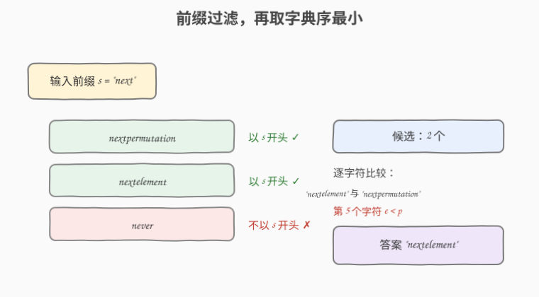

# Codeforces 53A 自动补全地址 题解

## 1. 题目概述

- **题目链接**：https://codeforces.com/problemset/problem/53/A
- **比赛来源**：Codeforces Beta Round 49 (Div. 2) · Problem A（UTC 2011-01-06）
- **难度**：1100
- **标签**：实现、字符串、字典序
- **评测类型**：普通
- **限制**：时间 2 s / 内存 256 MB

**题意**：给定用户已输入的前缀 $s$ 和浏览器历史里的 $n$ 个网址。若 $s$ 是其中某些网址的前缀，输出这些网址中**字典序最小**的一个；若没有以 $s$ 开头的网址，原样输出 $s$。

**约束**：

- $n \le 100$，所有字符串长度在 $1 \sim 100$ 之间，且只含小写字母。总字符量不超过 $10^4$，任何 $O(n \cdot L)$ 的逐串比较都绰绰有余，不需要 Trie 或后缀结构。
- 前缀判断必须按"字符逐位相同且待查串不短于 $s$"来做，不能用数值或哈希比较。
- 输出允许是 $s$ 本身，此时说明没有任何候选。

## 2. 示例与观察

官方样例 1（输入 / 输出原样）：

```text
输入：
next
2
nextpermutation
nextelement

输出：
nextelement
```

官方样例 2：

```text
输入：
find
4
find
findfirstof
findit
fand

输出：
find
```

官方样例 3：

```text
输入：
find
4
fondfind
fondfirstof
fondit
fand

输出：
find
```

**样例演算**：

- 样例 1 中两个网址都以 `next` 开头。比较 `nextelement` 与 `nextpermutation`：前四个字符 `next` 相同，第五个字符分别是 `e` 和 `p`，`e < p`，所以字典序最小的是 `nextelement`。
- 样例 2 中 `find`、`findfirstof`、`findit` 都以 `find` 开头。`find` 本身就是其他两个的前缀，字典序里"短前缀"更小，所以答案是 `find`。
- 样例 3 中 `fond...` 与 `fand` 都不以 `find` 开头，候选为空，输出 `find`。

自造样例（均已用参考程序核对）：

| 输入 | 输出 | 说明 |
|------|------|------|
| 前缀 `a`，网址 `ab`、`ac`、`a` | `a` | 自身也是候选且最小 |
| 前缀 `abc`，网址 `ab` | `abc` | 没有候选，原样输出前缀 |
| 前缀 `z`，网址 `zz`、`za` | `za` | 首字符相同，第二位决定大小 |
| 前缀 `aa`，网址 `aa`、`aa` | `aa` | 重复网址不影响答案 |

## 3. 解题思路

### 3.1 朴素做法与瓶颈

对每个网址检查是否以 $s$ 开头，把满足条件的收集起来，取字典序最小者；若一个都没有就输出 $s$。单次前缀检查是 $O(|s|)$，全部检查是 $O(n|s|)$，在 $n \le 100$、长度 $\le 100$ 时不超过 $10^4$ 次字符比较。

本题没有需要优化的瓶颈——数据规模本来就很小。真正容易出错的是边界：候选为空、候选就是 $s$ 本身、多个候选的前缀关系。

### 3.2 核心观察：只保留"以 s 开头"的串，然后取最小



自动补全的候选集合就是

$$C(s) = \{\, w \in \text{历史网址} : w \text{ 以 } s \text{ 开头} \,\}.$$

题目要求的答案是 $\min C(s)$（按标准字符串字典序）；若 $C(s)$ 为空则输出 $s$。因此不需要任何"补全逻辑"，只需要一个前缀判断加一次最小值扫描。

字典序比较直接用语言内置的字符串 `<`（C++ 的 `std::string::operator<`、Python 的字符串比较），它们就是题面所说的"现代编程语言里的 `<` 运算符"。

### 3.3 算法流程


1. 读入前缀 $s$ 和 $n$；
2. 依次读入 $n$ 个网址 $w$；
3. 若 $|w| \ge |s|$ 且 $w$ 的前 $|s|$ 个字符与 $s$ 相同，则 $w$ 是候选，用 `best = min(best, w)` 更新；
4. 扫描结束后：有候选输出 `best`，否则输出 `s`。

### 3.4 样例走查：`next`

| 网址 | 以 `next` 开头？ | 当前最优 |
|---|---|---|
| `nextpermutation` | 是 | `nextpermutation` |
| `nextelement` | 是 | `nextelement`（`e < p`） |

扫描完毕，输出 `nextelement`。

## 4. 正确性证明

**引理 1（候选判定）**：算法保留下来的网址恰好是全部以 $s$ 开头的网址。

**证明**：算法只在 $|w| \ge |s|$ 且前 $|s|$ 个字符逐一相等时保留 $w$，这正是"$s$ 是 $w$ 的前缀"的定义；反之，任何以 $s$ 开头的网址都满足这两个条件，必被保留。∎

**引理 2（最小值正确）**：扫描结束后 `best` 是候选集合中字典序最小的元素。

**证明**：对读入顺序归纳。初始 `best` 为空；每读入一个候选，若当前为空或它比 `best` 小就替换。由字典序的全序性，最终 `best` 不大于任何候选；又 `best` 本身是候选，故它是最小值。∎

**定理**：算法的输出与题目要求一致。

**证明**：若候选集合非空，由引理 2 输出的是字典序最小候选，符合题意；若候选集合为空，引理 1 说明没有任何网址以 $s$ 开头，算法输出 $s$，也符合题意。∎

## 5. 复杂度分析

- **时间**：每个网址做一次长度检查和至多 $|s|$ 次字符比较，$O\!\left(\sum |w| + n|s|\right) \le 2 \times 10^4$ 次字符操作，远低于 2 s。
- **空间**：只保存当前最优串，$O(L)$；若保存全部网址也只有 $O(nL) \le 10^4$ 个字符。
- 与时限的关系：常数极小，无需任何优化。

## 6. 参考代码

### C++17

```cpp
#include <bits/stdc++.h>
using namespace std;
int main(){
    string s; 
    if(!(cin>>s)) return 0;
    int n; cin>>n;
    string best; bool found=false;
    for(int i=0;i<n;i++){
        string w; cin>>w;
        if(w.size()>=s.size() && w.compare(0,s.size(),s)==0){
            if(!found || w<best){ best=w; found=true; }
        }
    }
    cout << (found?best:s) << "\n";
    return 0;
}
```

### Python3

```python
import sys

def main():
    data = sys.stdin.read().split()
    s = data[0]
    n = int(data[1])
    words = data[2:2 + n]
    best = None
    for w in words:
        if w.startswith(s):
            if best is None or w < best:
                best = w
    print(best if best is not None else s)

main()
```

## 7. 边界情况与易错点

1. **候选为空**：必须输出前缀 $s$ 本身，而不是空行或 `-1`（样例 3）。
2. **$s$ 比所有网址都长**：此时不可能有候选，直接输出 $s$；判断前缀前先比较长度，避免越界。
3. **候选就是 $s$**：如样例 2 的 `find`，它比任何更长的扩展都小，答案就是它。
4. **重复网址**：同一网址出现多次不影响最小值，不需要去重。
5. **字典序而非长度**：例如 `za` 与 `zz` 中 `za` 更小，不能按长度或出现顺序选。
6. **大小写与前导空格**：输入只含小写字母且按行给出；用 `cin >>` / `split()` 读单词即可，不会有多余空格。
7. **输出格式**：只输出一行答案，行末不要多于一个换行。

## 8. 验证记录

- **编译环境与命令**：`python3 codeforces/tools/verify_solution.py codeforces/contests/0001-0100/53/A_自动补全地址.md`；C++ 由 clang++ 17 + `codeforces/tools/include` 兼容头编译（`-O2`），Python 3 直接运行。
- **官方样例**：C++ 3 / 3 通过，Python 3 / 3 通过。
- **额外测试**：随机生成 300 组（前缀长度 $1 \sim 4$、网址数 $1 \sim 8$、字母表 `abc`）与独立实现（`filter` + `min`）逐组比对，0 处不一致；另手测了候选为空、候选即前缀、重复网址等边界。
- **最大约束性能**：$n=100$、每个串 100 字符时 C++ 运行时间小于 1 ms，远低于 2 s。
- **复核状态**：前缀判定、字典序最小值与空候选三条路径均已复核。

## 相关题目与扩展

- [Codeforces 53B Blog Photo](https://codeforces.com/problemset/problem/53/B)：同一场的枚举 + 边界题，可以对比"小数据直接扫描"的思路。
- [Codeforces 53D Physical Education](https://codeforces.com/problemset/problem/53/D)：同一场的模拟题，同样需要小心处理重复元素。
- **延伸思考 1**：若 $n$ 和总长度达到 $10^6$、查询次数很多，可以建 Trie，在每个结点维护子树内最小单词，前缀查询变成 $O(|s|)$。
- **延伸思考 2**：若要求的是"字典序最小的补全"而非"最小的完整网址"，只需在 Trie 上沿 $s$ 走到底后不断走最小字母的儿子。
- **延伸思考 3**：若允许大小写混合且字典序按 ASCII，比较规则会变化，但"过滤 + 取最小"的框架不变。
