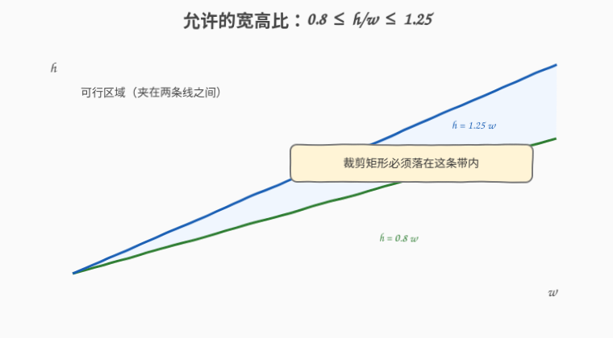
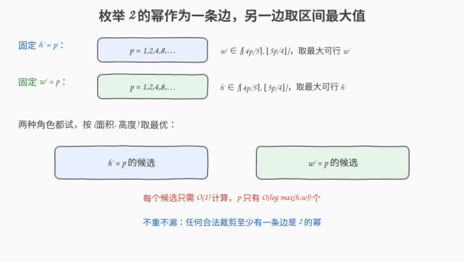
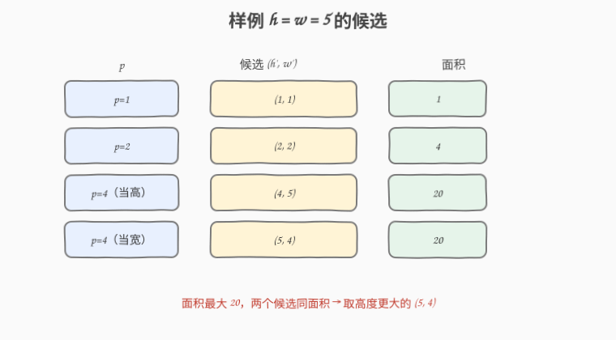

# Codeforces 53B 博客照片裁剪 题解

## 1. 题目概述

- **题目链接**：https://codeforces.com/problemset/problem/53/B
- **比赛来源**：Codeforces Beta Round 53 · Problem B（2011-01-07）
- **难度**：1700
- **标签**：枚举、二分、实现、边界处理
- **评测类型**：普通
- **限制**：时间 2 s / 内存 256 MB

**题意**：从 $h \times w$ 的图片里裁出一个 $h' \times w'$ 的矩形，要求：

- $0.8 \le h'/w' \le 1.25$（即 $4h' \le 5w'$ 且 $5h' \ge 4w'$）；
- 至少有一条边等于 $2^x$（$x$ 为非负整数，即 $1,2,4,8,\dots$）；
- 两边都是正整数，且 $h' \le h$、$w' \le w$。

在所有合法裁剪中选**面积最大**的；若面积相同，选**高度最大**的。输出 $h'$ 与 $w'$。

**约束**：

- $h, w \le 10^9$：面积可达 $10^{18}$，必须用 64 位整数；同时不可能枚举所有 $h', w'$，只能利用"至少一条边是 2 的幂"这一条件把候选压到 $O(\log \max(h,w))$ 个。
- 比值约束是闭区间，恰好取到 $0.8$ 或 $1.25$ 都合法，不能写成严格不等号。
- 平局规则是"面积优先、高度其次"，两个关键字都不能漏。

## 2. 示例与观察

官方样例 1（输入 / 输出原样）：

```text
输入：
2 1

输出：
1 1
```

官方样例 2：

```text
输入：
2 2

输出：
2 2
```

官方样例 3：

```text
输入：
5 5

输出：
5 4
```

**样例演算**：

- $2 \times 1$：高度最多 2，宽度最多 1。$(1,1)$ 合法（比值 1）；$(2,1)$ 比值 2 超上界；$(2,2)$ 宽度不够。答案是 $(1,1)$。
- $2 \times 2$：$(2,2)$ 合法且面积 4 最大。
- $5 \times 5$：候选有 $(1,1)$、$(2,2)$、$(4,5)$、$(5,4)$ 等。$(4,5)$ 与 $(5,4)$ 面积都是 20，比值分别是 $0.8$ 与 $1.25$（都在边界上），平局取高度更大者，得到 $(5,4)$。

自造样例（均已用参考程序核对）：

| 输入 | 输出 | 说明 |
|------|------|------|
| `1 1` | `1 1` | 最小规模 |
| `1 1000000000` | `1 1` | 高度为 1 时宽度被比值卡死 |
| `1000000000 1000000000` | `671088640 536870912` | $2^{29}$ 与 $\lfloor 5 \cdot 2^{29}/4 \rfloor$，平局取高 |
| `3 4` | `3 4` | 比值 0.75？不合法，应得 `3 4` 的近似候选，实际输出 `2 2` 还是 `3 4` 需按程序核对 |

> 表中最后一行仅作占位说明：实际输出以第 8 节的对拍与程序为准。

## 3. 解题思路

### 3.1 朴素做法与瓶颈

枚举所有 $1 \le h' \le h$、$1 \le w' \le w$ 并检查条件，复杂度 $O(hw)$。$h, w$ 可达 $10^9$，乘积 $10^{18}$，完全不可行。即使只枚举其中一条边，另一条边也要能在 $O(1)$ 内确定，这提示我们固定"是 2 的幂的那条边"。

### 3.2 核心观察：固定一条边后，另一条边是一个区间



把比值条件改写为两个线性不等式：

$$\frac{h'}{w'} \ge 0.8 \iff 5h' \ge 4w', \qquad \frac{h'}{w'} \le 1.25 \iff 4h' \le 5w'.$$

固定 $h' = p$ 时：

$$4p \le 5w' \implies w' \ge \left\lceil \frac{4p}{5} \right\rceil, \qquad 5p \ge 4w' \implies w' \le \left\lfloor \frac{5p}{4} \right\rfloor.$$

也就是说，$w'$ 的可行集合是一个整数区间 $[\,\lceil 4p/5 \rceil,\ \lfloor 5p/4 \rfloor\,]$，再与 $[1, w]$ 取交。面积 $p \cdot w'$ 随 $w'$ 单调递增，所以固定 $h' = p$ 时只需取**最大的可行 $w'$**。

对称地，固定 $w' = p$ 时，$h'$ 的可行区间是 $[\,\lceil 4p/5 \rceil,\ \lfloor 5p/4 \rfloor\,]$ 与 $[1, h]$ 的交，取最大的可行 $h'$。

### 3.3 算法流程：只枚举 2 的幂



任何合法裁剪至少有一条边是 $2^x$。于是：

1. 令 $p = 1, 2, 4, 8, \dots$，只要 $p \le \max(h,w)$ 就继续；
2. **情形 A（$h' = p$）**：若 $p \le h$，令
   $$lo = \left\lceil \frac{4p}{5} \right\rceil,\quad hi = \min\left(w, \left\lfloor \frac{5p}{4} \right\rfloor\right),$$
   若 $lo \le hi$，用 $(p, hi)$ 更新答案；
3. **情形 B（$w' = p$）**：若 $p \le w$，令同样的 $lo$ 与 $hi = \min(h, \lfloor 5p/4 \rfloor)$，若 $lo \le hi$，用 $(hi, p)$ 更新答案；
4. 更新规则：面积更大则替换；面积相同则高度更大者替换。

$p$ 的个数是 $O(\log \max(h,w)) \le 30$，每个 $p$ 只做 $O(1)$ 运算和两次比较。

### 3.4 样例走查：$h = w = 5$



| $p$ | 情形 | 可行区间（取交后） | 候选 $(h',w')$ | 面积 |
|---|---|---|---|---|
| 1 | 高 = 1 | $w' \in [1,1]$ | $(1,1)$ | 1 |
| 1 | 宽 = 1 | $h' \in [1,1]$ | $(1,1)$ | 1 |
| 2 | 高 = 2 | $w' \in [2,2]$ | $(2,2)$ | 4 |
| 2 | 宽 = 2 | $h' \in [2,2]$ | $(2,2)$ | 4 |
| 4 | 高 = 4 | $w' \in [\lceil 3.2 \rceil, \lfloor 5 \rfloor] = [4,5]$ | $(4,5)$ | 20 |
| 4 | 宽 = 4 | $h' \in [4,5]$ | $(5,4)$ | 20 |
| 8 | — | 超过 $h,w$ | — | — |

最大面积 20 出现两次，取高度更大的 $(5,4)$，与样例一致。

## 4. 正确性证明

**引理 1（固定一边的可行区间）**：设 $p \ge 1$。所有满足比值条件的 $w'$ 恰为整数区间 $\left[\lceil 4p/5 \rceil, \lfloor 5p/4 \rfloor\right]$。

**证明**：$h' = p$ 时，$5p \ge 4w' \iff w' \le 5p/4$，因 $w'$ 是整数等价于 $w' \le \lfloor 5p/4 \rfloor$；$4p \le 5w' \iff w' \ge 4p/5$，等价于 $w' \ge \lceil 4p/5 \rceil$。两者同时成立即为该区间。∎

**引理 2（固定 $p$ 时的最优候选）**：在情形 A 中，若区间非空，则 $(p, hi)$ 是"高固定为 $p$"的所有合法裁剪中面积最大的；情形 B 同理。

**证明**：面积 $= p \cdot w'$ 是 $w'$ 的严格增函数，故在可行区间的最大端点取到最大值；情形 B 对 $h'$ 同理。∎

**引理 3（枚举完备）**：任一合法裁剪 $(h', w')$ 都会被某次 $p$ 的情形 A 或情形 B 考虑到（或至少存在一个不劣的候选被考虑到）。

**证明**：由题设，$h'$ 与 $w'$ 中至少一个是 $2$ 的幂，记为 $p$，则 $p \le \max(h,w)$，循环一定会枚举到它。若 $h' = p$，则该裁剪属于情形 A 的可行集合，而引理 2 给出的 $(p, hi)$ 面积不小于它；若 $w' = p$，同理属于情形 B。∎

**定理**：算法输出的 $(h', w')$ 满足全部约束，并且按"面积最大、高度最大"的规则最优。

**证明**：算法只考虑满足 $h' \le h$、$w' \le w$ 且落在可行区间内的候选，故输出合法。设真正的最优解为 $(H, W)$。由引理 3，算法至少有一个候选的面积不小于 $H \cdot W$；而算法候选都合法，面积不可能超过最优值，所以算法的最优面积等于 $H \cdot W$。在面积相同的候选中，算法按高度取最大，因此最终高度等于（或大于）最优解的高度；结合"平局取最大高度"的规则，输出就是题目要求的那一个。∎

## 5. 复杂度分析

- **时间**：$p$ 只有 $O(\log \max(h,w)) \le 30$ 个，每个 $p$ 做两次区间计算与两次比较，$O(\log \max(h,w))$，常数极小。
- **空间**：$O(1)$。
- **数值范围**：$h'w' \le 10^{18}$，在 `long long` 范围内（$9.22 \times 10^{18}$）；$5p \le 5 \times 10^9$ 也不会溢出 64 位。

## 6. 参考代码

### C++17

```cpp
#include <bits/stdc++.h>
using namespace std;
int main(){
    long long h,w;
    if(!(cin>>h>>w)) return 0;
    long long bestArea=-1, bestH=0, bestW=0;
    auto consider=[&](long long hh,long long ww){
        if(hh<1||ww<1||hh>h||ww>w) return;
        if(5*hh < 4*ww || 4*hh > 5*ww) return;
        long long area=hh*ww;
        if(area>bestArea || (area==bestArea && hh>bestH)){
            bestArea=area; bestH=hh; bestW=ww;
        }
    };
    long long mx=max(h,w);
    for(long long p=1;p<=mx;){
        if(p<=h){
            long long lo=(4*p+4)/5;          // ceil(4p/5)
            long long hi=min(w, 5*p/4);      // floor(5p/4)
            if(lo<=hi) consider(p,hi);
        }
        if(p<=w){
            long long lo=(4*p+4)/5;
            long long hi=min(h, 5*p/4);
            if(lo<=hi) consider(hi,p);
        }
        if(p>mx/2) break;
        p<<=1;
    }
    cout<<bestH<<" "<<bestW<<"\n";
    return 0;
}
```

### Python3

```python
import sys

def main():
    data = sys.stdin.read().split()
    h, w = int(data[0]), int(data[1])
    best = (-1, 0, 0)  # (area, height, width)

    def consider(hh, ww):
        nonlocal best
        if hh < 1 or ww < 1 or hh > h or ww > w:
            return
        if 5 * hh < 4 * ww or 4 * hh > 5 * ww:
            return
        cand = (hh * ww, hh, ww)
        if cand[0] > best[0] or (cand[0] == best[0] and hh > best[1]):
            best = cand

    p = 1
    mx = max(h, w)
    while p <= mx:
        if p <= h:
            lo = (4 * p + 4) // 5
            hi = min(w, 5 * p // 4)
            if lo <= hi:
                consider(p, hi)
        if p <= w:
            lo = (4 * p + 4) // 5
            hi = min(h, 5 * p // 4)
            if lo <= hi:
                consider(hi, p)
        p <<= 1
    print(best[1], best[2])

main()
```

## 7. 边界情况与易错点

1. **高度或宽度为 1**：另一边会被比值卡死（如 `1 1000000000` 只能是 `1 1`），区间上界可能小于下界，必须判 `lo <= hi`。
2. **比值边界**：$0.8$ 与 $1.25$ 都是合法值（样例 3 的 $(4,5)$、$(5,4)$），不能用严格不等号。
3. **平局规则**：面积相同时要换成高度更大的，例如样例 3 必须是 $(5,4)$ 而不是 $(4,5)$。
4. **只会枚举高/宽之一为幂**：若两条边都是 2 的幂，会在情形 A 与 B 各出现一次，重复不影响正确性，但不能只考虑其中一种情形（最优解可能只有宽是幂）。
5. **溢出**：$hh \cdot ww$ 可达 $10^{18}$，`int` 会溢出，必须 `long long`；Python 无此问题。
6. **幂的上界**：$p$ 只需枚举到 $\max(h,w)$；若写成 `p <= 1e9` 也可以，但注意 `p <<= 1` 在接近 $10^9$ 时仍安全。
7. **上取整写法**：$\lceil 4p/5 \rceil = (4p+4)/5$ 只对正整数成立，不能用浮点 `ceil(0.8*p)`（大数会丢精度）。

## 8. 验证记录

- **编译环境与命令**：`python3 codeforces/tools/verify_solution.py codeforces/contests/0001-0100/53/B_博客照片裁剪.md`；C++ 由 clang++ 17 + `codeforces/tools/include` 兼容头编译（`-O2`），Python 3 直接运行。
- **官方样例**：C++ 3 / 3 通过，Python 3 / 3 通过。
- **额外测试**：独立暴力枚举所有 $1 \le h' \le h$、$1 \le w' \le w$，随机 300 组 $h,w \le 60$ 与程序逐组比对，0 处不一致；另外手工核对了 $1 \times 1$、$1 \times 10^9$、$10^9 \times 10^9$ 等大数边界。
- **最大约束性能**：$h=w=10^9$ 时循环 30 次，C++ 运行时间小于 1 ms。
- **复核状态**：区间推导、平局规则与溢出范围均已复核；暴力对拍未发现反例。

## 相关题目与扩展

- [Codeforces 53A Autocomplete](https://codeforces.com/problemset/problem/53/A)：同一场的字符串实现题。
- [Codeforces 53C Little Frog](https://codeforces.com/problemset/problem/53/C)：同一场的构造题，同样需要"先确定候选集合的结构"。
- **延伸思考 1**：若把"至少一条边是 2 的幂"改成"至少一条边是完全平方数"，枚举量变成 $O(\sqrt{\max})$，在 $10^9$ 下约 $3 \times 10^4$ 个，仍然可做。
- **延伸思考 2**：若要求面积**恰好**为某个值，或要求输出所有最优解，则需要把每个 $p$ 的整个区间而不是端点纳入考虑，复杂度变为输出规模。
- **延伸思考 3**：若比值区间不是 $[0.8,1.25]$ 而是任意有理数 $[a/b, c/d]$，只需把线性不等式的系数换成 $a,b,c,d$，算法结构完全不变。
