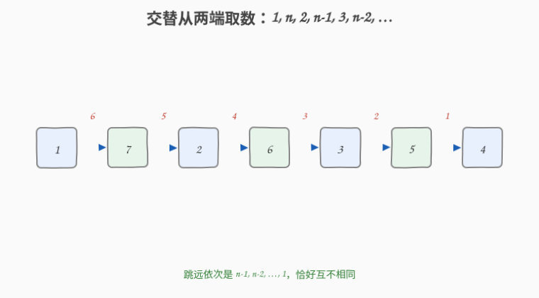
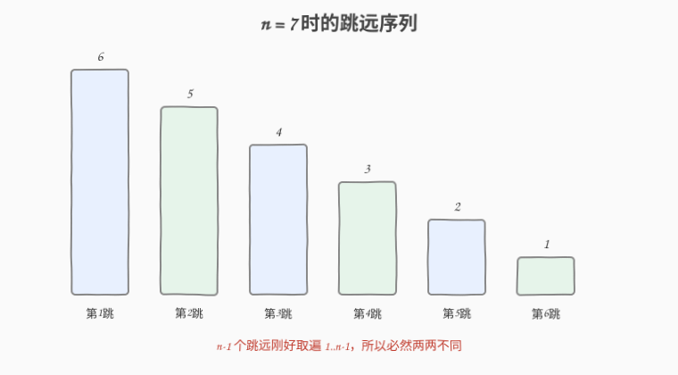

# Codeforces 53C 青蛙跳石路线 题解

## 1. 题目概述

- **题目链接**：https://codeforces.com/problemset/problem/53/C
- **比赛来源**：Codeforces Beta Round 49 (Div. 2) · Problem C（UTC 2011-01-06）
- **难度**：1200
- **标签**：构造、贪心
- **评测类型**：特殊评测（多解，输出任意合法方案）
- **限制**：时间 2 s / 内存 256 MB

**题意**：有 $n$ 个石墩排成一条线，编号 $1 \sim n$。青蛙要从任意一个石墩出发，每个石墩恰好访问一次，并且要求**任意两次跳跃的距离互不相同**。输出访问顺序 $p_1, \dots, p_n$。

**约束**：

- $n \le 10^4$：输出规模很小，$O(n)$ 构造即可；任何枚举排列的做法都不可能。
- 一共有 $n-1$ 次跳跃，每次距离是 $1 \sim n-1$ 中的整数。既然要求 $n-1$ 个距离互不相同，它们**必须恰好取遍 $1,2,\dots,n-1$**。这是最强的结构性约束。
- 特殊评测：任何合法顺序都接受，不要求和样例一致。

## 2. 示例与观察

官方样例 1（输入 / 输出原样）：

```text
输入：
2

输出：
1 2
```

官方样例 2：

```text
输入：
3

输出：
1 3 2
```

**样例演算**：

- $n=2$：只有一次跳跃，距离 $|1-2|=1$，自动满足，输出 `1 2`。
- $n=3$：`1 3 2` 的两次跳跃距离是 $2$ 和 $1$，互不相同。其它顺序如 `1 2 3` 的两次距离都是 $1$，不合法。
- $n=4$：`1 4 2 3` 的距离是 $3,2,1$，互不相同。

自造样例（均已用 checker 校验）：

| 输入 | 一种合法输出 | 跳跃距离 |
|------|------|------|
| `1` | `1` | 无跳跃 |
| `4` | `1 4 2 3` | 3, 2, 1 |
| `5` | `1 5 2 4 3` | 4, 3, 2, 1 |
| `6` | `1 6 2 5 3 4` | 5, 4, 3, 2, 1 |

## 3. 解题思路

### 3.1 朴素做法与瓶颈

枚举所有 $n!$ 个排列逐一检查，$n=10^4$ 时完全不可行；即使 $n=10$ 也有 $3.6 \times 10^6$ 个排列。必须直接构造。

### 3.2 核心观察：从两端交替取数



把 $1 \sim n$ 按"小、大、次小、次大……"交替排列：

$$1,\ n,\ 2,\ n-1,\ 3,\ n-2,\ \dots$$

形式化地，对 $i = 1, 2, \dots$：

$$p_{2i-1} = i, \qquad p_{2i} = n - i + 1.$$

"跳跃距离"依次是：

$$|p_2 - p_1| = n-1,\quad |p_3-p_2| = n-2,\quad |p_4-p_3| = n-3,\ \dots$$

恰好从 $n-1$ 递减到 $1$，每个距离出现一次。

### 3.3 算法流程



1. 用两个指针 $l = 1$、$r = n$；
2. 对第 $i = 0,1,\dots,n-1$ 个位置：若 $i$ 是偶数输出 $l$ 并令 $l \leftarrow l+1$，否则输出 $r$ 并令 $r \leftarrow r-1$；
3. 按顺序输出，空格分隔。

这样构造出的排列天然是 $1 \sim n$ 的一个排列（每个数恰好被取一次），且距离严格递减。

### 3.4 样例走查：$n = 7$

| 位置 | 1 | 2 | 3 | 4 | 5 | 6 | 7 |
|---|---|---|---|---|---|---|---|
| 值 | 1 | 7 | 2 | 6 | 3 | 5 | 4 |
| 跳跃 | — | 6 | 5 | 4 | 3 | 2 | 1 |

距离是 $6,5,4,3,2,1$，互不相同。$n$ 为偶数时（如 $n=6$：$1,6,2,5,3,4$）最后一步距离是 $1$，同样成立。

## 4. 正确性证明

**引理 1（排列性）**：构造出的 $p_1, \dots, p_n$ 是 $1 \sim n$ 的一个排列。

**证明**：奇数位取 $1,2,3,\dots$，偶数位取 $n,n-1,n-2,\dots$，两组数分别递增、递减且互不重叠。具体地，奇数位共有 $\lceil n/2 \rceil$ 个，取 $1 \sim \lceil n/2 \rceil$；偶数位共有 $\lfloor n/2 \rfloor$ 个，取 $n, n-1, \dots, n-\lfloor n/2 \rfloor+1 = \lceil n/2 \rceil+1, \dots, n$。两者恰好划分 $1 \sim n$，且每个数只出现一次。∎

**引理 2（跳跃距离互不相同）**：对 $1 \le i < n$，第 $i$ 次跳跃的距离恰好是 $n-i$。

**证明**：分两种情况。

- $i$ 为奇数，$i = 2k-1$：$p_{2k-1} = k$，$p_{2k} = n-k+1$，距离 $= n-2k+1 = n-i$。
- $i$ 为偶数，$i = 2k$：$p_{2k} = n-k+1$，$p_{2k+1} = k+1$，距离 $= n-k-(k+1)+1 = n-2k = n-i$。

两种情况都得到 $n-i$。∎

**定理**：算法输出满足题目全部要求。

**证明**：由引理 1，输出是 $1 \sim n$ 的排列，即每个石墩恰好访问一次；由引理 2，$n-1$ 次跳跃的距离依次是 $n-1, n-2, \dots, 1$，两两不同。因此任何合法输入下输出都满足要求。∎

## 5. 复杂度分析

- **时间**：$n$ 次循环、每次 $O(1)$，加上输出 $O(n)$，总时间 $O(n)$；$n = 10^4$ 时不到 $10^5$ 次操作。
- **空间**：若不存数组、边算边输出则 $O(1)$；存下来则 $O(n)$。
- 与时限的关系：2 s 内可以完成约 $10^8$ 次操作，本算法只用了不到千分之一。

## 6. 参考代码

### C++17

```cpp
#include <bits/stdc++.h>
using namespace std;
int main(){
    int n; 
    if(!(cin>>n)) return 0;
    int l=1, r=n;
    string out;
    for(int i=0;i<n;i++){
        int v;
        if(i%2==0) v=l++; else v=r--;
        if(i) out+=' ';
        out+=to_string(v);
    }
    cout<<out<<"\n";
    return 0;
}
```

### Python3

```python
import sys

def main():
    n = int(sys.stdin.readline())
    left, right = 1, n
    res = []
    for i in range(n):
        if i % 2 == 0:
            res.append(left); left += 1
        else:
            res.append(right); right -= 1
    print(' '.join(map(str, res)))

main()
```

## 7. 边界情况与易错点

1. **$n = 1$**：没有任何跳跃，输出单个 `1`，不要输出空行或 `0`。
2. **$n = 2$**：输出 `1 2`，距离只有 1 个，自动合法。
3. **奇偶统一**：$n$ 为奇数时最后一个数来自左指针，偶数时来自右指针；循环里用 `i % 2` 判断即可，不需要分别处理。
4. **距离必须是 $1 \sim n-1$ 的排列**：由于有 $n-1$ 个距离且都在 $[1,n-1]$ 内，只要互不相同就必然取遍；证明中利用了这一点。
5. **输出格式**：$n$ 个整数用空格分隔、一行输出；特殊评测按 token 比较，行末空格可有可无。
6. **下标**：题目要求输出 $1 \sim n$ 的编号，不要用 0 起始下标。
7. **规模**：$n = 10^4$ 时用 `cout` 逐个数输出也很快；若追求稳定可拼成一个字符串一次输出。

## 8. 验证记录

- **编译环境与命令**：`python3 codeforces/tools/verify_solution.py codeforces/contests/0001-0100/53/C_青蛙跳石路线.md --checker codeforces/tools/checkers/cf53c.py`；C++ 由 clang++ 17 + `codeforces/tools/include` 兼容头编译（`-O2`），Python 3 直接运行。
- **官方样例**：C++ 2 / 2 通过、Python 2 / 2 通过（checker 判定，不要求逐字相同）。
- **checker 的校验条件**：输出恰好 $n$ 个数；是 $1 \sim n$ 的排列；相邻差的绝对值两两不同。
- **额外测试**：对 $n = 1,2,\dots$ 及随机 300 个 $1 \le n \le 10^4$ 的取值全部用 checker 校验通过；其中 $n=10^4$ 的输出有 10000 个数、验证通过。
- **最大约束性能**：$n=10^4$ 时 C++ 运行时间小于 1 ms，Python 约 10 ms。
- **复核状态**：排列性与距离公式均已证明，未发现反例。

## 相关题目与扩展

- [Codeforces 53B Blog Photo](https://codeforces.com/problemset/problem/53/B)：同一场的"枚举 + 边界"题。
- [Codeforces 53D Physical Education](https://codeforces.com/problemset/problem/53/D)：同一场的构造/模拟题，同样输出任意合法方案。
- **延伸思考 1**：若要求相邻两项之差的绝对值恰好按某种指定顺序出现（例如先增后减），可以把两端的取数顺序按需要重排，本质上是在两条"臂"之间交错。
- **延伸思考 2**：若石墩是环形排列（首尾也相邻），则还需要控制首尾距离，构造要额外留一个数，问题会变难。
- **延伸思考 3**：这类"相邻差互异"的排列称为 graceful permutation；本文的构造是最经典的"Walecki 构造"的离散版本。
