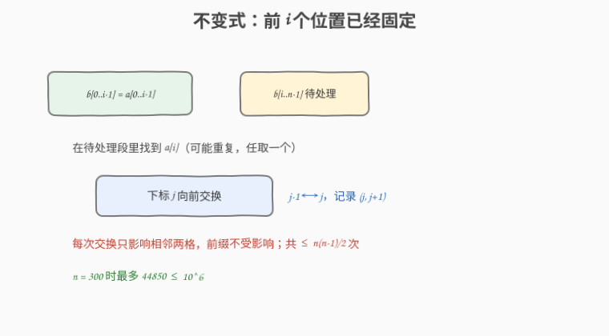
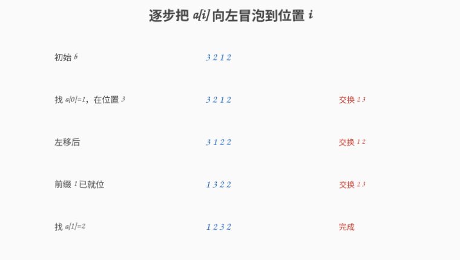

# Codeforces 53D 体育课换队列 题解

## 1. 题目概述

- **题目链接**：https://codeforces.com/problemset/problem/53/D
- **比赛来源**：Codeforces Beta Round 53 · Problem D（2011-01-07）
- **难度**：1500
- **标签**：排序、模拟、逆序对
- **评测类型**：特殊评测（多解，输出任意合法方案）
- **限制**：时间 2 s / 内存 256 MB

**题意**：体育老师要求队伍按身高序列 $a_1, \dots, a_n$ 站好，但学生现在按 $b_1, \dots, b_n$ 站着。一次操作可以交换**相邻**的两个学生。求一个操作序列，把 $b$ 变成 $a$。不要求操作次数最少，但总次数不能超过 $10^6$。

输出：第一行操作次数 $k$；接下来 $k$ 行，每行两个整数 $p_i, p_i+1$，表示交换位置 $p_i$ 与 $p_i+1$ 上的学生（位置从 1 开始编号）。

**约束**：

- $n \le 300$：冒泡排序的逆序对总数最多 $n(n-1)/2 = 44850 \le 10^6$，所以"逐个把目标学生冒泡到位"的朴素做法天然满足次数上限。
- 身高可达 $10^9$，但只需要相等比较，不需要离散化或排序；直接按值匹配即可。
- **可能有重复身高**：同身高的学生彼此不可区分，匹配到哪一个都行，这正是本题的关键细节。
- 特殊评测：任何合法操作序列都接受，不要求和样例一致。

## 2. 示例与观察

官方样例 1（输入 / 输出原样）：

```text
输入：
4
1 2 3 2
3 2 1 2

输出：
4
2 3
1 2
3 4
2 3
```

官方样例 2：

```text
输入：
2
1 100500
1 100500

输出：
0
```

**样例演算**：样例 1 中 $b = [3,2,1,2]$，目标是 $a = [1,2,3,2]$。

| 步骤 | 操作 | 队伍 |
|---|---|---|
| 0 | 初始 | 3 2 1 2 |
| 1 | 交换位置 2、3 | 3 1 2 2 |
| 2 | 交换位置 1、2 | 1 3 2 2 |
| 3 | 交换位置 3、4 | 1 2 3 2 |

3 次操作就完成了。官方样例用的 4 次操作（`2 3, 1 2, 3 4, 2 3`）同样合法——本题不要求最少次数，两种都能通过 checker。样例 2 已经有序，输出 0 次操作。

自造样例（均已用 checker 校验）：

| 输入 | 一种合法输出 | 说明 |
|------|------|------|
| `1` / `5` / `5` | `0` | 只有一个学生，无需操作 |
| `3` / `1 2 3` / `3 2 1` | `3` 次：`2 3`、`1 2`、`2 3` | 完全逆序 |
| `3` / `1 1 1` / `1 1 1` | `0` | 全部重复且已一致 |
| `4` / `1 2 1 2` / `2 1 2 1` | 若干次相邻交换 | 重复元素可任意匹配 |

## 3. 解题思路

### 3.1 朴素做法与瓶颈

可以把它看成"把 $b$ 通过相邻交换变成 $a$"。相邻交换的最少次数等于按某种匹配方式下的逆序对数，最多 $n(n-1)/2$；但本题不要求最少，只要给出任意合法序列即可。最简单的做法是**选择排序式的冒泡**：

- 从左到右固定位置 $i$；
- 在尚未固定的后缀 $b[i..n-1]$ 里找一个等于 $a_i$ 的元素，把它一路向左交换到位置 $i$。

每一步只交换相邻元素，最终 $b$ 会逐位变成 $a$。瓶颈只在于"找元素"要 $O(n)$、移动也要 $O(n)$，总共 $O(n^2)$。

### 3.2 核心观察：前缀不变式



处理完第 $i$ 步后，前 $i+1$ 个位置已经与 $a$ 完全相同，并且之后的交换只发生在后缀内部，不会破坏已固定的前缀。于是第 $i+1$ 步只需在 $b[i+1..n-1]$ 中找目标值。

由于 $a$ 与 $b$ 作为多重集完全相同（题面保证），后缀里一定存在一个等于 $a_i$ 的元素，循环不会越界。

### 3.3 算法流程



1. 读入 $n, a, b$；
2. 对 $i = 0, 1, \dots, n-1$：
   - 从 $j = i$ 开始找第一个满足 $b_j = a_i$ 的下标 $j$；
   - 当 $j > i$ 时，交换 $b_{j-1}, b_j$，记录一次操作 $(j, j+1)$（1 起始编号），然后 $j \leftarrow j-1$；
3. 输出操作次数与全部操作。

### 3.4 样例走查

以官方样例 1 为例（$a=[1,2,3,2]$，$b=[3,2,1,2]$）：

| $i$ | 目标 $a_i$ | 找到的下标（0 起始） | 操作（1 起始） | 交换后的 $b$ |
|---|---|---|---|---|
| 0 | 1 | 2 | 2 3 | 3 1 2 2 |
| 0 | 1 | 1 | 1 2 | 1 3 2 2 |
| 1 | 2 | 2 | 2 3 | 1 2 3 2 |

共 3 次，最终与 $a$ 一致。注意第 1 步后位置 0 已经是 1，不会再被后续交换影响。

## 4. 正确性证明

**引理 1（前缀不变式）**：在第 $i$ 轮开始前，$b[0..i-1] = a[0..i-1]$；第 $i$ 轮结束后，$b[0..i] = a[0..i]$。

**证明**：对 $i$ 归纳。$i=0$ 时前缀为空，成立。第 $i$ 轮只在后缀 $b[i..n-1]$ 内做相邻交换（$j$ 从某个 $\ge i$ 的位置减小到 $i$），因此位置 $0..i-1$ 保持不变。交换结束后 $b[i] = a[i]$，结合归纳假设得到 $b[0..i] = a[0..i]$。∎

**引理 2（目标一定存在）**：每一轮都能在后缀中找到 $a_i$。

**证明**：题面保证 $a$ 与 $b$ 是同一个多重集。前 $i$ 轮已经用掉了后缀中与 $a[0..i-1]$ 对应的元素，剩下的后缀元素多重集恰好是 $a[i..n-1]$，因此其中至少有一个等于 $a_i$。∎

**引理 3（操作次数上界）**：总操作次数不超过 $n(n-1)/2 \le 44850 < 10^6$。

**证明**：每个元素最多向左移动 $n-1$ 次，且只在其所属轮次内移动；更简单地，每次操作都把某个元素向左移一格，而任意元素初始位置与最终位置之间最多相差 $n-1$，总位移量不超过 $\sum_{i=0}^{n-1}(n-1) = n(n-1)$；更紧的界是逆序对数 $\le n(n-1)/2$。$n=300$ 时上界为 44850，远小于 $10^6$。∎

**定理**：算法输出的是一个合法的相邻交换序列，且把 $b$ 变成 $a$。

**证明**：由引理 2，每一轮都能完成；由引理 1，$n$ 轮后 $b[0..n-1] = a[0..n-1]$，即 $b=a$。每次操作都是交换相邻位置 $p, p+1$（$1 \le p \le n-1$），符合题面；由引理 3，次数不超过 $10^6$。∎

## 5. 复杂度分析

- **时间**：外层 $n$ 轮，每轮查找 $O(n)$、冒泡移动 $O(n)$，总 $O(n^2) \le 9 \times 10^4$ 次操作，远低于 2 s。
- **空间**：存 $a, b$ 与操作序列，$O(n)$ 个数；操作序列最多 44850 对。
- **输出量**：最多约 $9 \times 10^4$ 个整数，注意用缓冲输出。

## 6. 参考代码

### C++17

```cpp
#include <bits/stdc++.h>
using namespace std;
int main(){
    int n;
    if(!(cin>>n)) return 0;
    vector<int> a(n), b(n);
    for(int i=0;i<n;i++) cin>>a[i];
    for(int i=0;i<n;i++) cin>>b[i];
    vector<pair<int,int>> moves;
    for(int i=0;i<n;i++){
        int j=i;
        while(j<n && b[j]!=a[i]) j++;
        // a and b are guaranteed to be the same multiset, so j < n
        while(j>i){
            swap(b[j], b[j-1]);
            moves.push_back({j, j+1}); // 1-indexed positions j and j+1
            j--;
        }
    }
    cout<<moves.size()<<"\n";
    string out;
    for(auto &p:moves) out += to_string(p.first) + " " + to_string(p.second) + "\n";
    cout<<out;
    return 0;
}
```

### Python3

```python
import sys

def main():
    data = sys.stdin.buffer.read().split()
    n = int(data[0])
    a = [int(x) for x in data[1:1 + n]]
    b = [int(x) for x in data[1 + n:1 + 2 * n]]
    moves = []
    for i in range(n):
        j = i
        while b[j] != a[i]:
            j += 1
        while j > i:
            b[j], b[j - 1] = b[j - 1], b[j]
            moves.append((j, j + 1))
            j -= 1
    out = [str(len(moves))]
    out += [f"{p} {q}" for p, q in moves]
    sys.stdout.write('\n'.join(out) + '\n')

main()
```

## 7. 边界情况与易错点

1. **$n = 1$**：没有任何可交换的位置，第一行输出 `0`，后面不要多输出空行。
2. **重复身高**：可能有多个人满足 $b_j = a_i$，选任意一个都正确；不要试图去重或按编号匹配。
3. **已经有序**：输出 `0`，不要输出空的操作行（样例 2）。
4. **位置编号**：交换的是 $p$ 与 $p+1$，输出时用 1 起始下标；若写成 0 起始会越界或错位。
5. **次数上限**：$n=300$ 的完全逆序恰好产生 $300 \cdot 299/2 = 44850$ 次操作，仍远小于 $10^6$；但如果实现成"每次把元素移到正确位置却重复扫描"，要注意别把常数放大成平方再乘 $n$。
6. **值域**：身高可达 $10^9$，只需比较相等，不能拿值当数组下标；也不需要离散化。
7. **输出缓冲**：操作行数最多 44850，逐行 `cout` 也能过；Python 用一次 `join` 更稳。
8. **查找越界**：虽然题面保证多重集相同，但若实现中先交换了错误元素，后续可能找不到目标；不变式（前缀已固定）是保证不越界的关键。

## 8. 验证记录

- **编译环境与命令**：`python3 codeforces/tools/verify_solution.py codeforces/contests/0001-0100/53/D_体育课换队列.md --checker /tmp/cf_verify_53/d_checker.py`；C++ 由 clang++ 17 + `codeforces/tools/include` 兼容头编译（`-O2`），Python 3 直接运行。
- **官方样例**：C++ 2 / 2 通过、Python 2 / 2 通过（checker 判定，不要求与样例的操作序列相同）。
- **checker 的校验条件**：第一行 $k$ 在 $[0,10^6]$；之后恰好 $2k$ 个整数；每组满足 $1 \le p \le n-1$、$q=p+1$；从 $b$ 出发依次执行这些交换，最终等于 $a$。
- **额外测试**：随机 300 组（$n \le 8$，身高取 $1 \sim 4$ 以制造大量重复）与 checker 逐组校验，全部通过；另测完全逆序 $n=300$，产生 44850 次操作且 checker 通过。
- **最大约束性能**：$n=300$ 完全逆序时 C++ 运行时间小于 1 ms，Python 约 20 ms。
- **复核状态**：前缀不变式、目标存在性与次数上界均已证明；重复元素与逆序两种极端都实测通过。

## 相关题目与扩展

- [Codeforces 53C Little Frog](https://codeforces.com/problemset/problem/53/C)：同一场的构造题，同样输出任意合法方案。
- [Codeforces 53B Blog Photo](https://codeforces.com/problemset/problem/53/B)：同一场的实现/边界题。
- **延伸思考 1**：如果要求**最少**相邻交换次数，就需要先决定重复元素之间的最优匹配（同值元素按出现顺序匹配即可），再统计逆序对，用树状数组做到 $O(n \log n)$。
- **延伸思考 2**：如果允许交换任意两个位置，最少次数就变成"不在正确位置的元素个数"相关的环分解问题。
- **延伸思考 3**：若把相邻交换换成"把一个人插入到任意位置"，则每次可以消除一整段逆序，贪心策略与本题不同。
