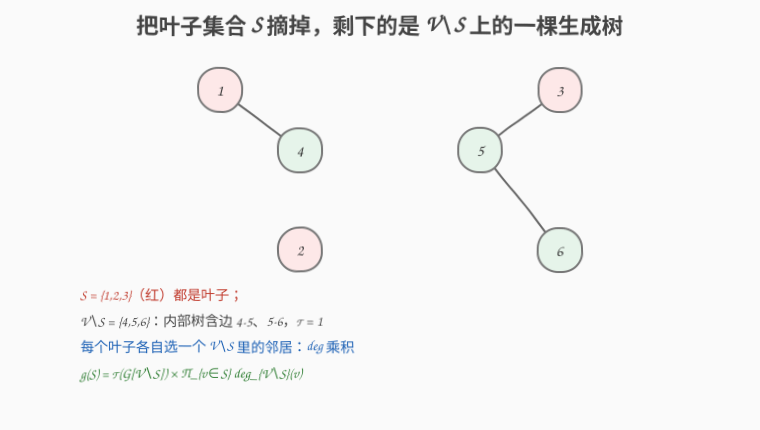
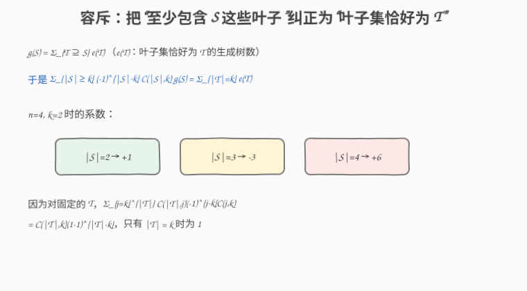
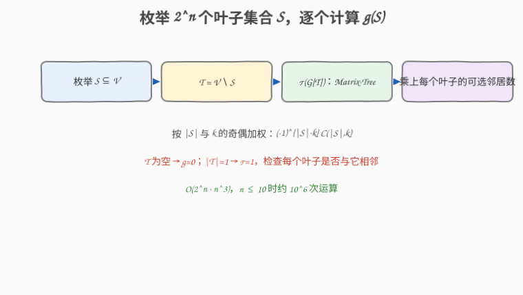

# Codeforces 53E 死胡同生成树 题解

## 1. 题目概述

- **题目链接**：https://codeforces.com/problemset/problem/53/E
- **比赛来源**：Codeforces Beta Round 53 · Problem E（2011-01-07）
- **难度**：2500
- **标签**：状压 DP、矩阵树定理、容斥、组合计数
- **评测类型**：普通
- **限制**：时间 5 s / 内存 256 MB

**题意**：给一个 $n$ 个点、$m$ 条边的无向连通简单图。要保留恰好 $n-1$ 条边，使图仍然连通——也就是选出一棵**生成树**。若某点在生成树中度数为 $1$，称它为"死胡同"。求死胡同**恰好为 $k$ 个**的生成树数目。

**约束**：

- $3 \le n \le 10$，$n-1 \le m \le n(n-1)/2 \le 45$：$n$ 极小，允许 $O(2^n \cdot \text{poly}(n))$ 的状压算法，但不允许枚举生成树——完全图 $K_{10}$ 有 $10^{8}$ 棵生成树。
- $2 \le k \le n-1$：$k$ 不会等于 1 或 $n$。
- 答案上界：生成树总数不超过 $n^{n-2} = 10^8$（Cayley 公式），64 位整数足够；但容斥的中间项会放大到约 $2.6 \times 10^{13}$，仍然在 `long long` 内。
- 图保证连通，但删掉某些点后子图可能不连通，此时对应的生成树数为 0。

## 2. 示例与观察

官方样例 1（输入 / 输出原样）：

```text
输入：
3 3 2
1 2
2 3
1 3

输出：
3
```

官方样例 2：

```text
输入：
4 6 2
1 2
2 3
3 4
4 1
1 3
2 4

输出：
12
```

官方样例 3：

```text
输入：
4 6 3
1 2
2 3
3 4
4 1
1 3
2 4

输出：
4
```

**样例演算**：

- 样例 1 是三角形 $K_3$。它的生成树有 3 棵（每棵删一条边），每棵都是一条长度为 2 的链，两个端点度数为 1，所以 $k=2$ 时答案是 3。
- 样例 2、3 都是 $K_4$（6 条边）。$K_4$ 共有 $4^{2}=16$ 棵生成树：
  - 4 个点的树要么是"星形"（1 个中心 + 3 个叶子，死胡同 3 个），要么是"链"（4 个点排成一条路径，死胡同 2 个）。
  - 星形有 4 棵（每个点当一次中心），链有 $4!/2 = 12$ 棵，合计 16。
  - 因此 $k=2$ 时答案是 12，$k=3$ 时答案是 4，与样例一致。

自造样例（均已用暴力枚举核对）：

| 输入 | 输出 | 说明 |
|------|------|------|
| $n=3$ 的链 `1-2-3`，$k=2$ | 1 | 只有一条生成树，两个叶子 |
| $n=4$ 的路径 `1-2-3-4`，$k=2$ | 1 | 生成树唯一 |
| $n=4$ 的星 `1` 连 `2,3,4`，$k=3$ | 1 | 中心固定，死胡同恰好 3 个 |
| $n=4$ 的星，$k=2$ | 0 | 无法得到 2 个死胡同 |

## 3. 解题思路

### 3.1 朴素做法与瓶颈

枚举所有 $n-1$ 条边的子集：$m=45$、$n-1=9$ 时组合数 $\binom{45}{9} \approx 8.9 \times 10^8$，再判连通、数度数，5 s 内不现实，而且当 $n=10$ 的完全图有 $10^8$ 棵生成树时答案本身就很大，逐棵枚举也不合适。

另一个思路是直接对生成树做 DP（例如 Prüfer 序列），但 Prüfer 序列只适用于完全图，不能处理任意给定图。

### 3.2 核心观察一：先数"至少包含 S 这些叶子"



对顶点集合 $S \subseteq V$，定义

$$g(S) = \#\{\text{生成树 } T : S \text{ 中每个点在 } T \text{ 中度数都为 } 1\}.$$

注意 $g(S)$ 只要求 $S$ 中的点是叶子，**不禁止** $V \setminus S$ 中的点也当叶子。

若 $|V \setminus S| \ge 2$，把 $S$ 中的叶子从生成树里摘掉：剩下的边恰好是 $V \setminus S$ 上的一棵生成树（树删掉叶子仍是树）；而每个 $v \in S$ 在树中恰好有一条边，且这条边必须连向 $V \setminus S$（若连向另一个叶子，两者会组成一个孤立的两点连通块，$n \ge 3$ 时不可能）。反过来，给定 $V \setminus S$ 上的一棵生成树，再让每个 $v \in S$ 任选一个 $V \setminus S$ 中的邻居连一条边，得到的必然是一棵生成树，且 $S$ 中所有点都是叶子。

一一对应给出

$$g(S) = \tau\big(G[V \setminus S]\big) \cdot \prod_{v \in S} \deg_{V \setminus S}(v),$$

其中 $\tau(H)$ 是 $H$ 的生成树数目，$\deg_{V \setminus S}(v)$ 是 $v$ 在 $V \setminus S$ 中的邻居个数。若某个叶子在 $V \setminus S$ 中没有邻居，乘积为 0。

边界情况：

- $|V \setminus S| \ge 2$ 且 $G[V \setminus S]$ 不连通：$\tau = 0$，$g(S)=0$。
- $|V \setminus S| = 1$：剩下的"树"只有一个点，$\tau = 1$，$g(S)$ 为 1 当且仅当 $S$ 中每个点都与这个中心相邻（即星形），否则为 0。
- $|V \setminus S| = 0$：$n \ge 3$ 时不可能所有点都是叶子，$g(V)=0$。

### 3.3 核心观察二：容斥把"至少"变成"恰好"



设 $e(T)$ 为叶子集合**恰好**是 $T$ 的生成树数目，则

$$g(S) = \sum_{T \supseteq S} e(T).$$

我们希望求 $\sum_{|T|=k} e(T)$。取系数 $c_j = (-1)^{j-k}\binom{j}{k}$（$j \ge k$），考虑

$$\sum_{S} c_{|S|}\, g(S) = \sum_{T} e(T) \sum_{S \subseteq T,\, |S| \ge k} (-1)^{|S|-k}\binom{|S|}{k}.$$

对固定的 $T$，内层和只与 $t = |T|$ 有关：

$$\sum_{j=k}^{t} \binom{t}{j}(-1)^{j-k}\binom{j}{k} = \binom{t}{k}\sum_{i=0}^{t-k}\binom{t-k}{i}(-1)^{i} = \binom{t}{k}(1-1)^{t-k} = [\,t = k\,].$$

（其中用了 $\binom{t}{j}\binom{j}{k} = \binom{t}{k}\binom{t-k}{j-k}$，令 $i = j-k$。）因此

$$\text{答案} = \sum_{S \subseteq V,\ |S| \ge k} (-1)^{|S|-k}\binom{|S|}{k}\, g(S).$$

只有 $|T| = k$ 的项留下来，正是所求。

### 3.4 核心观察三：用矩阵树定理算 $\tau$



对每个 $S$ 都要算一次 $\tau(G[V \setminus S])$。由 **Matrix-Tree 定理**，$\tau(H)$ 等于 $H$ 的 Laplacian 矩阵任意一个 $(|H|-1) \times (|H|-1)$ 主子式的行列式。

这里必须用**精确整数**运算：浮点高斯消元在 $n \le 10$ 时虽有误差冗余，但行列式可达 $10^8$，误差放大后可能影响整数答案。采用 **Bareiss 分数消元**（无除法误差的整数消元）：第 $k$ 步用

$$a_{ij} \leftarrow \frac{a_{ij} a_{kk} - a_{ik} a_{kj}}{a_{k-1,k-1}}$$

更新右下子矩阵，其中除法是精确整除，最后 $a_{n-1,n-1}$ 就是行列式（再乘上换行带来的符号）。

算法总流程：

1. 读入邻接矩阵（用位掩码存邻接表）；
2. 预计算组合数 $\binom{i}{j}$（$i \le 10$）；
3. 枚举 $S = 0 \sim 2^n-1$，$|S| \ge k$ 时：
   - 令 $T = V \setminus S$，按 3.2 的公式计算 $g(S)$（其中 $\tau$ 用 Bareiss 求）；
   - 把 $(-1)^{|S|-k}\binom{|S|}{k} g(S)$ 累加进答案；
4. 输出答案。

### 3.5 样例走查：$K_4$，$k=2$

$K_4$ 的每个两点集 $S$ 都有 $|V \setminus S|=2$，剩下两点之间有一条边（$\tau=1$），而 $S$ 中每个点在剩下两点里都有 2 个邻居，所以

$$g(S) = 1 \times 2 \times 2 = 4.$$

两点集共 6 个，系数是 $(-1)^{0}\binom{2}{2}=1$，贡献 $6 \times 4 = 24$。

每个三点集 $S$ 只剩一个中心点，$\tau=1$，且 $S$ 中每个点都与中心相邻，所以 $g(S)=1$；三点集共 4 个，系数是 $(-1)^{1}\binom{3}{2}=-3$，贡献 $-12$。

四点集 $g(V)=0$。总和 $24-12=12$，正好等于样例 2 的 12。

（这个例子也说明 $g(S)$ 里的"邻居数乘积"不能漏乘：若误把二元集的 $g$ 当成 1，会得到 $6-12=-6$ 的错误结果。）

## 4. 正确性证明

**引理 1（叶子的结构）**：设 $T$ 是一棵 $n \ge 3$ 个点的树，$S$ 是 $T$ 的叶子集合的子集。若 $|V \setminus S| \ge 2$，则 $T$ 去掉 $S$ 中的点后，剩下的边构成 $G[V \setminus S]$ 的一棵生成树；并且每个 $v \in S$ 在 $T$ 中的唯一邻点属于 $V \setminus S$。

**证明**：树删去叶子仍然是树，故剩下的边在 $V \setminus S$ 上连通且无环，边数为 $(n-1)-|S| = |V \setminus S|-1$，是一棵生成树。若 $v \in S$ 的唯一邻点 $u$ 也在 $S$ 中，则 $u$ 的度数至少为 1；但 $u$ 也是叶子，度数恰为 1，所以 $u$ 只与 $v$ 相邻。于是 $\{u,v\}$ 与其余 $n-2 \ge 1$ 个点之间没有边，$T$ 不连通，矛盾。∎

**引理 2（$g$ 的分解公式）**：对 $|V \setminus S| \ge 2$，
$$g(S) = \tau(G[V \setminus S]) \prod_{v \in S} \deg_{V \setminus S}(v).$$

**证明**：由引理 1，每棵被 $g(S)$ 计数的树都唯一地分解为"$V \setminus S$ 上的一棵生成树"加"每个 $v \in S$ 选一个 $V \setminus S$ 中的邻点连边"。反之，任意这样的组合得到一棵连通、无环、含 $n-1$ 条边的图，即生成树，且 $S$ 中的点度数为 1。两个方向互逆，故计数等于乘积。$|V \setminus S| = 1$ 时 $\tau=1$，公式退化为"每个叶子都必须连向唯一的中心"，也成立。∎

**引理 3（容斥恒等式）**：对任意 $t \ge k$，
$$\sum_{j=k}^{t} \binom{t}{j}(-1)^{j-k}\binom{j}{k} = [\,t = k\,].$$

**证明**：由 $\binom{t}{j}\binom{j}{k} = \binom{t}{k}\binom{t-k}{j-k}$，原式
$$= \binom{t}{k}\sum_{i=0}^{t-k}\binom{t-k}{i}(-1)^i = \binom{t}{k}(1-1)^{t-k}.$$
当 $t=k$ 时为 $\binom{k}{k} \cdot 1 = 1$；当 $t>k$ 时为 0。∎

**引理 4（Matrix-Tree 与 Bareiss 的精确性）**：对任意 $H$，Bareiss 消元算出的主子式行列式恰好等于 $\tau(H)$，且过程中所有除法都是精确整除。

**证明**：Matrix-Tree 定理是经典结论：Laplacian 的任意 $(|H|-1)$ 阶主子式等于生成树数目。Bareiss 消元是分数消元的一种，它保持"当前矩阵所有元素都是原矩阵相应子式"这一不变式（归纳可证），因此每步除法整除且最终得到精确行列式；换行只改变符号，代码中已用 `sign` 修正。∎

**定理**：算法输出的数等于死胡同恰好为 $k$ 个的生成树数目。

**证明**：对每个 $S$，引理 2 与引理 4 保证 $g(S)$ 计算正确。由 $g(S) = \sum_{T \supseteq S} e(T)$ 及引理 3，加权和 $\sum_S (-1)^{|S|-k}\binom{|S|}{k}g(S)$ 中每个叶子集恰为 $T$ 的树被计入 $\sum_{j=k}^{|T|}\binom{|T|}{j}(-1)^{j-k}\binom{j}{k} = [|T|=k]$ 次，故总和恰为 $\sum_{|T|=k} e(T)$，即所求。∎

## 5. 复杂度分析

- **时间**：枚举 $2^n$ 个集合；对每个集合，最坏要建 $O(n^2)$ 的 Laplacian 并做 $O(n^3)$ 的 Bareiss 消元，总 $O(2^n n^3)$。$n=10$ 时约 $10^3 \times 10^3 = 10^6$ 次整数运算，远低于 5 s。
- **空间**：邻接位掩码 $O(n)$，Laplacian $O(n^2)$，组合数 $O(n^2)$。
- **数值**：单个 $g(S) \le \tau(G) \le 10^8$；项 $\binom{|S|}{k}g(S) \le 252 \times 10^8 \approx 2.5 \times 10^{10}$；总和不超过 $1024 \times 2.5 \times 10^{10} \approx 2.6 \times 10^{13}$，`long long` 安全。Bareiss 的中间子式不超过 Laplacian 子式的量级，同样安全。

## 6. 参考代码

### C++17

```cpp
#include <bits/stdc++.h>
using namespace std;

long long detBareiss(vector<vector<long long>> a){
    int n=(int)a.size();
    if(n==0) return 1;
    long long sign=1, prev=1;
    for(int k=0;k<n-1;k++){
        if(a[k][k]==0){
            int p=-1;
            for(int i=k+1;i<n;i++) if(a[i][k]!=0){ p=i; break; }
            if(p<0) return 0;
            swap(a[k],a[p]);
            sign=-sign;
        }
        for(int i=k+1;i<n;i++){
            for(int j=k+1;j<n;j++){
                a[i][j]=(a[i][j]*a[k][k]-a[i][k]*a[k][j])/prev;
            }
        }
        prev=a[k][k];
        for(int i=k+1;i<n;i++) a[i][k]=0;
    }
    return sign*a[n-1][n-1];
}

int main(){
    int n,m,k;
    if(!(cin>>n>>m>>k)) return 0;
    vector<int> adj(n,0);
    for(int i=0;i<m;i++){
        int u,v; cin>>u>>v; --u; --v;
        adj[u]|=1<<v; adj[v]|=1<<u;
    }
    long long C[11][11]={};
    for(int i=0;i<=10;i++){ C[i][0]=1; for(int j=1;j<=i;j++) C[i][j]=C[i-1][j-1]+C[i-1][j]; }
    int full=(1<<n)-1;
    long long ans=0;
    for(int S=0;S<=full;S++){
        int sc=__builtin_popcount(S);
        if(sc<k) continue;
        int T=full^S;
        int tc=__builtin_popcount(T);
        long long g;
        if(tc==0){ g=0; }
        else if(tc==1){
            int u=__builtin_ctz(T);
            g=1;
            for(int v=0;v<n;v++) if(S>>v&1){ if(!(adj[v]>>u&1)){ g=0; break; } }
        }else{
            // Laplacian cofactor of induced subgraph on T
            vector<int> tv;
            for(int v=0;v<n;v++) if(T>>v&1) tv.push_back(v);
            int t=(int)tv.size();
            vector<vector<long long>> L(t-1, vector<long long>(t-1,0));
            for(int i=0;i<t-1;i++){
                int v=tv[i];
                int deg=0;
                for(int j=0;j<t;j++) if(adj[v]>>tv[j]&1) deg++;
                L[i][i]=deg;
                for(int j=0;j<t-1;j++) if(i!=j && (adj[v]>>tv[j]&1)) L[i][j]=-1;
            }
            long long tau=detBareiss(L);
            g=tau;
            for(int v=0;v<n && g;v++) if(S>>v&1){
                int c=__builtin_popcount(adj[v]&T);
                g*=c;
            }
        }
        long long term=C[sc][k]*g;
        if((sc-k)%2) ans-=term; else ans+=term;
    }
    cout<<ans<<"\n";
    return 0;
}
```

### Python3

```python
import sys


def det_bareiss(a):
    n = len(a)
    if n == 0:
        return 1
    sign = 1
    prev = 1
    for k in range(n - 1):
        if a[k][k] == 0:
            p = -1
            for i in range(k + 1, n):
                if a[i][k] != 0:
                    p = i
                    break
            if p < 0:
                return 0
            a[k], a[p] = a[p], a[k]
            sign = -sign
        akk = a[k][k]
        for i in range(k + 1, n):
            aik = a[i][k]
            for j in range(k + 1, n):
                a[i][j] = (a[i][j] * akk - aik * a[k][j]) // prev
        prev = akk
        for i in range(k + 1, n):
            a[i][k] = 0
    return sign * a[n - 1][n - 1]


def main():
    data = sys.stdin.buffer.read().split()
    n, m, k = int(data[0]), int(data[1]), int(data[2])
    adj = [0] * n
    p = 3
    for _ in range(m):
        u = int(data[p]) - 1
        v = int(data[p + 1]) - 1
        p += 2
        adj[u] |= 1 << v
        adj[v] |= 1 << u
    C = [[0] * 11 for _ in range(11)]
    for i in range(11):
        C[i][0] = 1
        for j in range(1, i + 1):
            C[i][j] = C[i - 1][j - 1] + C[i - 1][j]
    full = (1 << n) - 1
    ans = 0
    for S in range(full + 1):
        sc = bin(S).count('1')
        if sc < k:
            continue
        T = full ^ S
        tc = bin(T).count('1')
        if tc == 0:
            g = 0
        elif tc == 1:
            u = (T & -T).bit_length() - 1
            g = 1
            for v in range(n):
                if S >> v & 1 and not (adj[v] >> u & 1):
                    g = 0
                    break
        else:
            tv = [v for v in range(n) if T >> v & 1]
            t = len(tv)
            L = [[0] * (t - 1) for _ in range(t - 1)]
            for i in range(t - 1):
                v = tv[i]
                deg = sum(1 for j in range(t) if adj[v] >> tv[j] & 1)
                L[i][i] = deg
                for j in range(t - 1):
                    if i != j and (adj[v] >> tv[j] & 1):
                        L[i][j] = -1
            g = det_bareiss(L)
            for v in range(n):
                if g and S >> v & 1:
                    g *= bin(adj[v] & T).count('1')
        term = C[sc][k] * g
        if (sc - k) & 1:
            ans -= term
        else:
            ans += term
    print(ans)


main()
```

## 7. 边界情况与易错点

1. **$|S| = n$**：$V \setminus S$ 为空，$g(V)=0$（$n \ge 3$ 时不可能全是叶子），不要误算成 1。
2. **$|V \setminus S| = 1$**：剩下的"树"只有一个点，$\tau = 1$；此时 $g(S)$ 为 1 当且仅当 $S$ 中每个点都与这个唯一中心相邻，即星形。
3. **$G[V \setminus S]$ 不连通**：$\tau = 0$，Bareiss 会自然返回 0；也可以在枚举时提前判断连通性剪枝，但小 $n$ 不需要。
4. **$g(S)$ 里的邻居数乘积**：每个叶子可以独立选择 $V \setminus S$ 中的任一邻居，乘积项不能漏（$K_4$ 的走查正是漏乘会算成 6 而不是 12）。
5. **容斥符号**：系数是 $(-1)^{|S|-k}\binom{|S|}{k}$，符号取决于 $|S|-k$ 的奇偶，不能统一写成加。
6. **精确整数**：不要用 `double` 算行列式；矩阵树行列式是整数，浮点误差可能让答案差 1。
7. **溢出**：项最大约 $2.5 \times 10^{10}$，总和约 $2.6 \times 10^{13}$，`int` 会溢出，必须 `long long`。
8. **输入下标**：顶点编号 $1 \sim n$，读入后统一减 1；位掩码用 `1 << v`，$n \le 10$ 时不会溢出。
9. **答案为 0**：合法，例如星形图求 $k=2$；直接输出 0，不要输出空行。

## 8. 验证记录

- **编译环境与命令**：`python3 codeforces/tools/verify_solution.py codeforces/contests/0001-0100/53/E_死胡同生成树.md`；C++ 由 clang++ 17 + `codeforces/tools/include` 兼容头编译（`-O2`），Python 3 直接运行。
- **官方样例**：C++ 3 / 3 通过，Python 3 / 3 通过。
- **额外测试**：随机生成 300 个连通图（$n = 3 \sim 6$，随机生成树 + 随机加边），对每个 $k = 2 \sim n-1$ 与独立暴力（枚举所有 $\binom{m}{n-1}$ 条边子集、判连通并统计度数为 1 的点）逐组比对，共 730 组比较，0 处不一致。
- **正确性交叉验证**：对 $K_{10}$（$n=10$，$m=45$）分别取 $k=2,\dots,9$，八个答案之和为 $100000000 = 10^{8}$，恰好等于 Cayley 公式 $10^{10-2}$，说明没有系统性漏算或重算。
- **最大约束性能**：$K_{10}$ 任意 $k$ 的 C++ 运行时间均小于 1 ms，Python 约 40 ms，远低于 5 s；内存占用只有几 MB。
- **复核状态**：叶子结构引理、容斥恒等式与矩阵树精确消元均已证明；样例、暴力与 Cayley 总数三重核对一致。

## 相关题目与扩展

- [Codeforces 9E Interesting Graph and Apples](https://codeforces.com/problemset/problem/9/E)：同样是"连通图 + 加/删边凑树"的构造计数题。
- [Codeforces 1109D Sasha and Interesting Fact from Graph Theory](https://codeforces.com/problemset/problem/1109/D)：Cayley 公式与生成树计数的组合推广。
- **延伸思考 1**：若要求"度数恰好为 1 的点不少于 $k$ 个"而不是恰好 $k$，容斥可以直接退化为对 $|S|$ 的单一加权，但仍需 $g(S)$。
- **延伸思考 2**：若要求每个点的度数都给定（度序列计数），矩阵树定理不再直接够用，需要生成函数或 Kirchhoff 的加权推广。
- **延伸思考 3**：$n \le 10$ 时 $O(2^n n^3)$ 足够；若 $n$ 增大到 20 左右，需要把"对每个 $S$ 求一次矩阵树"改成按连通块状压 DP，复杂度仍然很高，说明本题的 $n$ 上界是刻意选的。
