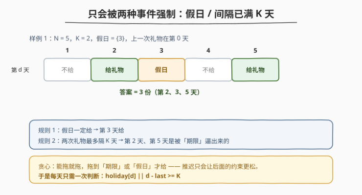
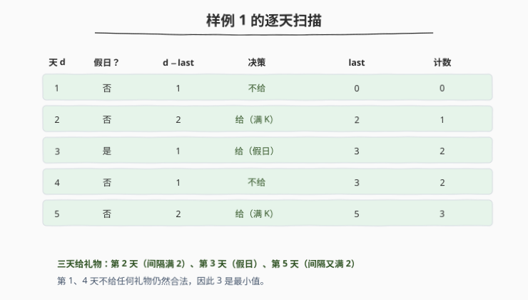

# Codeforces 54A 刺猬的礼物 题解

## 1. 题目概述

- **题目链接**：https://codeforces.com/problemset/problem/54/A
- **比赛来源**：Codeforces Beta Round 50 · Problem A（UTC 2011-01-11）
- **难度**：1300
- **标签**：贪心、实现
- **评测类型**：普通
- **限制**：时间 2 s / 内存 256 MB

**题意**：接下来的 $N$ 天编号 $1 \dots N$，今天编号 $0$ 且已经收到过一份礼物（不计入答案）。刺猬收礼物遵循两条规则：

1. 每个假日**一定**收到礼物；
2. 两次相邻礼物之间最多隔 $K$ 天，即若第 $i$ 天收到礼物，则第 $i+K$ 天或之前必定再收到一份（同一天收到多份也只算一份）。

给定假日列表，求 $N$ 天内**最少**会收到多少份礼物。

**约束**：

- $1 \le N \le 365$、$1 \le K \le N$、$0 \le C \le N$：规模很小，$O(N)$ 甚至 $O(N \log N)$ 都很宽松，但答案依赖"哪天必须给"，需要正确的贪心而不是暴力。
- 坐标范围只到 $365$，因此可以直接按天模拟；同时也说明"逐天检查"的常数可以忽略。
- 假日按升序给出且互不重复，第二个数 $C$ 可能为 $0$（此时该行只有 $C$ 本身）。
- 今天（第 $0$ 天）的礼物**已经给出**，它不算答案，但它是"下一次礼物必须在第 $K$ 天之前"的起点。

## 2. 示例与观察

官方样例 #1：

```text
输入：
5 2
1 3

输出：
3
```

**样例 1 演算**：$K=2$，假日只有第 $3$ 天。第 $0$ 天已有一份礼物。

| 天 | 1 | 2 | 3 | 4 | 5 |
|----|---|---|---|---|---|
| 假日 | | | ✓ | | |
| 必须给？ | 否 | 距上次 2 天 → 是 | 假日 → 是 | 否 | 距上次 2 天 → 是 |

共 $3$ 份。第 $2$ 天不给不行：第 $0$ 天的礼物要求第 $2$ 天前必须再给一份。

官方样例 #2：

```text
输入：
10 1
3 6 7 8

输出：
10
```

**样例 2 演算**：$K=1$ 表示"每一天都必须收到礼物"（相邻礼物最多隔 1 天），所以 $10$ 天共 $10$ 份，假日列表反而无关紧要。

**观察**：答案是"被强制的天数"——某天要么是假日，要么距上一份礼物已经满 $K$ 天。把这两条合并成一次从左到右的扫描即可。

自造样例（标注"自造"）：

| 输入 | 输出 | 说明 |
|------|------|------|
| `1 1` / `0` | 1 | 只有一天也必须给 |
| `5 5` / `0` | 1 | 第 5 天给一次就够 |
| `5 3` / `0` | 2 | 第 3、5 天各一次 |
| `4 2` / `1 1` | 2 | 第 1、3 天（第 1 天假日；第 3 天补满间隔） |
| `6 2` / `1 2 3` | 4 | 假日 1、2、3，再加第 5 天 |
| `365 1` / `0` | 365 | 每天一份 |

## 3. 解题思路

### 3.1 朴素做法与瓶颈

最直接的想法是枚举"哪几天给礼物"的所有子集（必须包含假日），再检查相邻间隔是否都不超过 $K$。这是 $O(2^N \cdot N)$，$N = 365$ 时完全不可行。

但注意到：**给礼物只会发生在"不得不给"的那一天**。于是问题变成——从左到右扫，每到一个"必须给"的日子就计数加一并更新上次日期。

### 3.2 核心观察：只会被两种事件强制



设上一次收到礼物的日子是 $\text{last}$（初始为 $0$，因为今天已有一份）。第 $d$ 天是否**必须**给礼物？

- **假日强制**：$d$ 是假日，则必须给；
- **间隔强制**：$d - \text{last} = K$，则必须给——否则下一次礼物最早是第 $d+1$ 天，与 $\text{last}$ 相隔 $K+1 > K$，违反规则 2。

反过来，若 $d$ 既不是假日、且 $d - \text{last} < K$，则第 $d$ 天不给仍然合法（可以留到后面），**推迟给只会让后面的约束更容易满足**，所以不给最优。

于是贪心就是：**能拖就拖，拖到期限或假日才给。**

### 3.3 算法流程

1. 读入 $N, K$ 与假日集合（用布尔数组标记）；
2. `last = 0`、`ans = 0`；
3. 对 $d = 1 \dots N$：若 $d$ 是假日**或** $d - \text{last} \ge K$，则 `ans++`、`last = d`；
4. 输出 `ans`。

### 3.4 样例走查：$N=5, K=2$，假日 $\{3\}$



| $d$ | 假日？ | $d-\text{last}$ | 决策 | $\text{last}$ | 计数 |
|----|----|----|----|----|----|
| 1 | 否 | 1 | 不给 | 0 | 0 |
| 2 | 否 | 2 | **给**（满 $K$） | 2 | 1 |
| 3 | 是 | 1 | **给**（假日） | 3 | 2 |
| 4 | 否 | 1 | 不给 | 3 | 2 |
| 5 | 否 | 2 | **给**（满 $K$） | 5 | 3 |

与样例输出 $3$ 一致。

## 4. 正确性证明

**引理 1（贪心不变式）**：按上述贪心处理完前 $d$ 天后，设用了 $m_d$ 份礼物、最后一份在第 $\ell_d$ 天。则对任何满足前 $d$ 天所有约束的合法方案 $P$（其礼物数记为 $|P|$、最后一份在第 $p$ 天），都有：$|P| \ge m_d$；且若 $|P| = m_d$，则 $p \le \ell_d$。

**证明**：对 $d$ 归纳。$d = 0$ 时 $m_0 = 0$、$\ell_0 = 0$，方案只能是"今天的一份"，成立。

设 $d-1$ 成立，考察第 $d$ 天。

- **$d$ 是假日**：任何合法方案都必须第 $d$ 天有礼物，所以 $|P| \ge m_{d-1} + 1 = m_d$，且 $p = d = \ell_d$，第二条也成立。
- **$d$ 不是假日，且 $d - \ell_{d-1} < K$**：贪心不给，$m_d = m_{d-1}$、$\ell_d = \ell_{d-1}$。任取合法方案 $P$：若它在第 $d$ 天给了礼物，则 $|P| \ge m_{d-1} + 1 > m_d$（第一条已满足），第二条无需证；若没给，则 $|P| \ge m_{d-1} = m_d$，且 $p \le \ell_{d-1} = \ell_d$（由归纳假设），成立。
- **$d$ 不是假日，且 $d - \ell_{d-1} = K$**：贪心给了，$m_d = m_{d-1}+1$、$\ell_d = d$。任取合法方案 $P$：由归纳假设 $p \le \ell_{d-1} = d - K$。若 $P$ 在第 $d$ 天没有礼物，则它的下一份礼物（若存在）在第 $> d$ 天，与 $p$ 相隔 $> K$，违反规则 2；若之后没有礼物，则最后一份是 $p \le d-K$，而 $p + K \le d \le N$，仍要求第 $p+K$ 天前有礼物，同样矛盾。故 $P$ 必须在第 $d$ 天给，于是 $|P| \ge m_{d-1}+1 = m_d$，且 $p = d = \ell_d$。∎

**定理**：贪心输出的礼物数就是最小值。

**证明**：取 $d = N$，引理 1 说明任何合法方案的礼物数都不少于贪心的 $m_N$；而贪心本身显然合法（它在且仅在假日或间隔满 $K$ 时给，构造出的相邻间隔都不超过 $K$，且第 $0$ 天到第一份礼物也不超过 $K$）。故贪心值既可达又是下界，等于最小值。∎

## 5. 复杂度分析

- **时间**：$O(N + C)$，$N \le 365$，一次线性扫描。
- **空间**：$O(N)$ 的布尔数组（也可以用哈希集合，$O(C)$）。
- **数值范围**：答案 $\le N \le 365$，`int` 足够。
- **与时限的关系**：2 s 对 $365$ 次循环是天文数字般的余量，实测端到端约 $3$ ms（几乎全是进程启动）。

## 6. 参考代码

### C++17

```cpp
#include <bits/stdc++.h>
using namespace std;

int main() {
    int n, k;
    if (scanf("%d %d", &n, &k) != 2) return 0;
    int c;
    scanf("%d", &c);
    vector<char> holiday(n + 1, 0);
    for (int i = 0; i < c; i++) {
        int d;
        scanf("%d", &d);
        if (d >= 1 && d <= n) holiday[d] = 1;
    }
    int last = 0, ans = 0;          // 今天（第 0 天）已经收到礼物
    for (int day = 1; day <= n; day++) {
        if (holiday[day] || day - last >= k) {
            ans++;
            last = day;
        }
    }
    printf("%d\n", ans);
    return 0;
}
```

### Python3

```python
import sys


def main() -> None:
    data = sys.stdin.buffer.read().split()
    if not data:
        return
    pos = 0
    n = int(data[pos]); pos += 1
    k = int(data[pos]); pos += 1
    c = int(data[pos]); pos += 1
    holiday = [False] * (n + 1)
    for _ in range(c):
        d = int(data[pos]); pos += 1
        if 1 <= d <= n:
            holiday[d] = True

    last = 0
    ans = 0
    for day in range(1, n + 1):
        if holiday[day] or day - last >= k:
            ans += 1
            last = day
    sys.stdout.write(str(ans) + "\n")


main()
```

## 7. 边界情况与易错点

1. **第 $0$ 天的礼物**：它是"起点"但不计入答案。若忘记把 `last` 初始化为 $0$（比如初始成 $-K$），第一天就会被误判为"间隔已满"。
2. **$C = 0$**：输入第二行只有 `0` 一个数，读入时要先读 $C$ 再循环 $C$ 次；用 `cin >>` 或 `split()` 按 token 读最稳。
3. **$K = 1$**：每天都必须给，答案恒为 $N$；贪心自然得到这个结果（$d - \text{last} \ge 1$ 恒成立）。
4. **$K = N$**：只需在第 $K$ 天前给一次（没有假日时第 $N$ 天给即可），答案为 $1$；若假日更早，则以假日为准。
5. **假日恰好在"期限前一天"**：例如 $K=3$、上次在第 $5$ 天、假日是第 $7$ 天。第 $8$ 天才满 $K$，所以第 $7$ 天由假日强制给出，之后从 $7$ 重新计时——不能因为"假日"而跳过对 $d-\text{last}$ 的判断顺序问题（两者是"或"关系，先给再说）。
6. **末尾不需要再补**：规则 2 只约束"下一份礼物"，最后一份之后如果期限落在 $N$ 之后就没有约束。若误以为"第 $N$ 天必须给"，会在 `5 5 / 0` 上给出错误答案（应为 1，第 5 天正是期限）。
7. **同一天多份只算一份**：题面明确"无论收到多少礼物，一天只算一份"，所以贪心每天至多计数一次。
8. **假日重复或乱序**：题面保证升序且不重复，但用布尔数组标记天然免疫这两种情况，比"按顺序扫描假日列表"更稳。

## 8. 验证记录

- **编译环境与命令**：本机只有 `Apple clang 21.0.0`（`/usr/bin/g++` 是 clang 的软链），没有 GNU `g++` 与 libstdc++，因此用 `clang++ -std=c++17 -O2 -Wall` 配合 `codeforces/tools/include` 下的 `bits/stdc++.h` 兼容头编译（代码只用标准库，可原样提交 GNU C++17）；Python 为 `Python 3.9.6`。官方校验命令为 `python3 codeforces/tools/verify_solution.py codeforces/contests/0001-0100/54/A_刺猬的礼物.md`。
- **官方样例**：2 / 2 通过（`5 2 / 1 3` → `3`，`10 1 / 3 6 7 8` → `10`），C++ 与 Python 输出一致。
- **独立暴力对拍**：另写一份完全不用贪心的暴力——枚举 $\{1..N\}$ 的所有子集（要求包含全部假日），检查"从第 $0$ 天起相邻礼物间隔都不超过 $K$，且最后一份礼物之后不再有落在 $N$ 内的期限"，取最小份数。对 **320 组**随机数据（$1 \le N \le 10$、$K$ 随机、假日随机子集）与参考程序逐一比较，**全部一致**。
- **额外测试**：第 2 节表格中 6 组自造样例 C++ 与 Python 均通过，特别是 `5 5 / 0` 与 `365 1 / 0`。
- **最大约束性能**：$N = 365$ 时 C++ 端到端约 $3$ ms（含进程启动），Python 约 $25$ ms；相对 2 s / 256 MB 的余量极大。
- **图片校验**：两张 SVG（`cf54a_two_forcings.svg`、`cf54a_walkthrough.svg`）均通过 `xml.etree.ElementTree.parse`，带 `feTurbulence` 抖动滤镜与手写字体，且所有文本与图形元素都在 `viewBox` 内。
- **复核状态**：verified（样例、对拍、边界、性能、图片均实跑通过）。

## 相关题目与扩展

- [Codeforces 54B Cutting Jigsaw Puzzle](https://codeforces.com/problemset/problem/54/B)：同场 B 题，从"按天扫描"转向"按块比较"，是同一场比赛的难度接力。
- [Codeforces 313A Ilya and Bank Account](https://codeforces.com/problemset/problem/313/A)：同样是"按最优策略逐步决策"的小实现题。
- [Codeforces 34A Reconnaissance 2](https://codeforces.com/problemset/problem/34/A)：另一个 $O(n)$ 扫描取最优的入门题。
- [LeetCode 122. 买卖股票的最佳时机 II](https://leetcode.cn/problems/best-time-to-buy-and-sell-stock-ii/)：贪心的"能拖就拖/能拿就拿"结构与此题同源。

**延伸思考**：

1. **若"假日必须给"改成"假日可以选择给，但给有额外收益"**：问题变成带权的最小覆盖，需要用 DP（每天的决策依赖上次给礼物的日期），复杂度 $O(NK)$。
2. **若要求恰好 $M$ 份礼物**：可以证明在"最少份数"到"$N$ 份"之间的每个整数都可达（每次把某份礼物提前一天即可），所以可行性只由上下界决定，答案是一个区间。
3. **若礼物间隔规则改成"第 $i$ 天后 $K_i$ 天内必须再给"（$K_i$ 随日期变化）**：贪心仍然成立（期限是确定的），只需把 $\text{last} + K$ 换成对应的动态期限。
4. **若同一天收到多份要分别计数**：题面明确不算，但若改成"每次假日都算一份"，答案就退化为 $C$ 加上补给的份数，需要重新计算"假日之间的空隙"。
