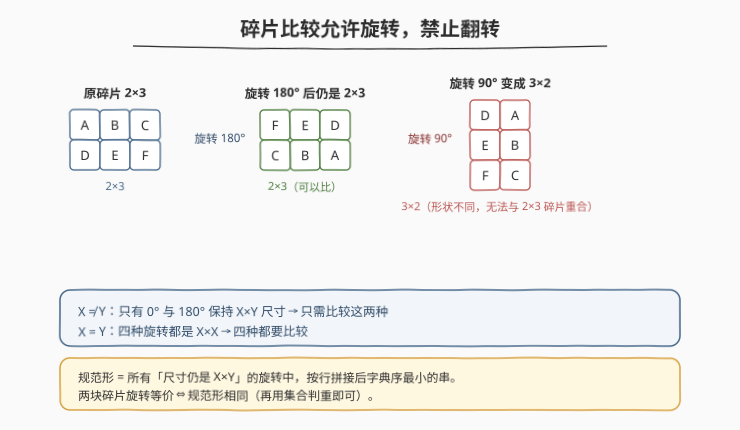
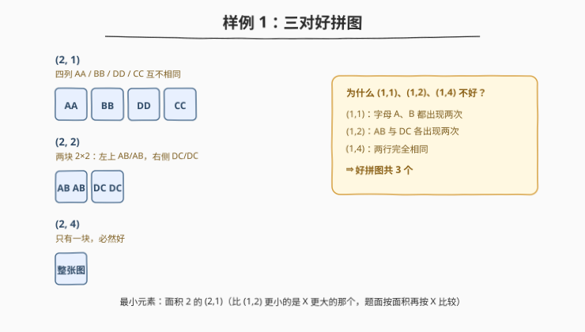

# Codeforces 54B 拼图切割计数 题解

## 1. 题目概述

- **题目链接**：https://codeforces.com/problemset/problem/54/B
- **比赛来源**：Codeforces Beta Round 50 · Problem B（UTC 2011-01-11）
- **难度**：1800
- **标签**：哈希、实现、字符串
- **评测类型**：普通
- **限制**：时间 2 s / 内存 256 MB

**题意**：给定 $A \times B$ 的大写字母图。按水平间距 $X$、竖直间距 $Y$ 把它切成 $(A/X)\cdot(B/Y)$ 块（要求 $X \mid A$、$Y \mid B$）。若切出的碎片**两两不同**，则这个拼图是"好的"；比较碎片时允许把碎片**旋转**（$90^\circ$ 的整数倍），但**不允许翻转**。求：

1. 有多少对 $(X, Y)$ 使拼图是好的；
2. 所有好拼图中，单块面积 $XY$ 最小（面积相同则 $X$ 最小）的那一对。

**约束**：

- $A, B \le 20$：$(X,Y)$ 候选最多 $d(A)\cdot d(B) \le 6 \times 6 = 36$ 对，每对最多 $400$ 个格子，直接暴力检查即可。
- 图只含大写字母，碎片比较是精确比较，不需要哈希冲突处理（用字符串/向量做键即可）。
- 旋转只在 $X = Y$ 时会改变碎片的方向（$X \ne Y$ 时旋转 $90^\circ$ 会变成 $Y \times X$，与 $X \times Y$ 的碎片无法重合），这是本题最容易忽略的细节。
- 整张图本身（$X=A, Y=B$）永远只有一块，必然是好的，所以答案至少为 $1$。

## 2. 示例与观察

官方样例 #1：

```text
输入：
2 4
ABDC
ABDC

输出：
3
2 1
```

**样例 1 演算**：$A=2$、$B=4$，候选 $(X,Y)$ 为 $X \in \{1,2\}$、$Y \in \{1,2,4\}$。

| $(X,Y)$ | 碎片 | 是否两两不同 |
|---------|------|------|
| $(1,1)$ | 字母 `A A B D C A B D C` | 否（重复） |
| $(1,2)$ | `AB`、`DC`、`AB`、`DC` | 否 |
| $(1,4)$ | 两行 `ABDC`、`ABDC` | 否 |
| $(2,1)$ | 四列 `AA`、`BB`、`DD`、`CC` | **是** |
| $(2,2)$ | `[AB;AB]`、`[DC;DC]` | **是** |
| $(2,4)$ | 整张图 | **是**（只有一块） |

好拼图有 $3$ 个；其中面积最小的是 $(2,1)$（面积 $2$，$X=2$）。题面提示也给出了同样结论。

官方样例 #2：

```text
输入：
2 6
ABCCBA
ABCCBA

输出：
1
2 6
```

**样例 2 演算**：绝大多数切法都会出现"旋转后相同"的碎片。例如 $(2,2)$ 时第 $1$ 块是

$$\begin{pmatrix} A & B \\ A & B\end{pmatrix},\qquad
\text{第 3 块是}\ \begin{pmatrix} B & A \\ B & A\end{pmatrix},$$

后者旋转 $180^\circ$ 正好等于前者，于是重复。$(2,3)$ 同理（`[ABC;ABC]` 与 `[CBA;CBA]` 旋转 $180^\circ$ 相同）。唯一的好拼图是整张图 $(2,6)$。

**观察**：判断"两两不同"等价于"把每块映射到它的**规范形**（所有允许旋转中字典序最小的那个）后，规范形互不相同"。关键是确定"允许哪些旋转"。

自造样例（标注"自造"）：

| 输入 | 输出 | 说明 |
|------|------|------|
| `1 1` / `A` | `1` / `1 1` | 只有一块 |
| `2 2` / `AB` `BA` | `1` / `2 2` | 只有整张图好：其余切法都能找到旋转 $180^\circ$ 相同的碎片 |
| `2 2` / `AB` `CD` | `4` / `1 1` | 四个字母互不相同，四对候选全好 |
| `4 4` 全 `A` | `1` / `4 4` | 任何切法都全是相同块 |

## 3. 解题思路

### 3.1 朴素做法与瓶颈

对每对 $(X,Y)$ 把碎片两两比较：碎片数最多 $20 \times 20 = 400$，两两比较 $O(400^2)$，每次比较最多 $4$ 种旋转，每块 $X\cdot Y \le 400$ 个字符。总复杂度约

$$\sum_{X\mid A}\sum_{Y\mid B} \left(\frac{A}{X}\frac{B}{Y}\right)^2 \cdot XY \le 36 \cdot 400^2 \cdot 400 \approx 2.3 \times 10^9,$$

最坏情况偏大（虽然实测远小于此，因为 $XY$ 大时块数少）。更稳的做法是**规范化 + 集合判重**：把每块压成规范形字符串丢进 `set`，如果插入时已存在就立刻判定"不好"。

### 3.2 核心观察：允许哪些旋转



碎片是 $X \times Y$ 的矩形。把它旋转 $90^\circ$ 得到 $Y \times X$：

- 若 $X \ne Y$：旋转 $90^\circ$ 后的形状与另一块 $X \times Y$ 的碎片**尺寸不同**，不可能重合。所以只有 $0^\circ$ 与 $180^\circ$ 两种姿态需要比较；
- 若 $X = Y$：四种姿态都是 $X \times X$，全部需要比较。

形式化地：两块碎片 $P, Q$ 相同，当且仅当存在 $k \in \{0,1,2,3\}$ 使 $\mathrm{rot}^k(P)$ 与 $Q$ **尺寸相同且逐格相同**。于是每块碎片可以取"所有尺寸合法的旋转中字典序最小的串"作为规范形——两块碎片相同当且仅当规范形相同。

### 3.3 算法流程

1. 读入 $A, B$ 与图；
2. 枚举 $X \mid A$、$Y \mid B$：
   - 用 `set<string>` 记录已出现的规范形；
   - 对每个碎片块，构造 $X \times Y$ 的字符矩阵，旋转 $4$ 次，每次若尺寸仍为 $X \times Y$ 就把按行拼接的串作为候选，取最小者作为键；
   - 若键已存在 → 该 $(X,Y)$ 不好，直接跳过；否则加入；
   - 全部碎片互不相同 → 好拼图数 $+1$，并按"面积优先、$X$ 次之"更新最优；
3. 输出好拼图数与最优 $(X,Y)$。

### 3.4 样例走查：$(2,2)$ 在样例 2 中为何不好

拼图是两行 `ABCCBA`。取 $X=Y=2$，共 $1 \times 3 = 3$ 块：

| 块 | 内容 |
|----|------|
| 第 1 块 | $\begin{pmatrix}A&B\\A&B\end{pmatrix}$ |
| 第 2 块 | $\begin{pmatrix}C&C\\C&C\end{pmatrix}$ |
| 第 3 块 | $\begin{pmatrix}B&A\\B&A\end{pmatrix}$ |

第 3 块旋转 $180^\circ$：行列都反过来，得到 $\begin{pmatrix}A&B\\A&B\end{pmatrix}$，与第 1 块完全一致 → 重复 → $(2,2)$ 不好。



样例 1 中 $(2,1)$、$(2,2)$、$(2,4)$ 三对都通过，因为竖着切开后每一列（或每两列）的"上下两行"内容互不相同，而 $X=2 \ne Y=1$ 时 $90^\circ$ 旋转不产生新的等价。

## 4. 正确性证明

**引理 1（旋转等价）**：设两块碎片都是 $X \times Y$。则它们"允许旋转后相同"当且仅当存在 $k \in \{0,1,2,3\}$，使 $\mathrm{rot}^k(P)$ 的尺寸为 $X \times Y$ 且逐格等于 $Q$。

**证明**：题目允许的变换正是旋转 $90^\circ$ 的整数倍（$90^\circ$ 旋转四次回到原状，所以只需考察 $k = 0,1,2,3$）。旋转后尺寸变为 $Y \times X$（$k$ 为奇数）或保持 $X \times Y$（$k$ 为偶数）；若尺寸与 $Q$ 不同则不可能逐格相等，故只需考虑尺寸相同的 $k$。∎

**引理 2（规范形判定）**：对每块碎片，令 $\mathrm{canon}(P) = \min\{\text{serialize}(\mathrm{rot}^k(P)) : \text{尺寸为 } X \times Y\}$（按行拼接、字典序比较）。则 $P$ 与 $Q$ 旋转等价 $\iff \mathrm{canon}(P) = \mathrm{canon}(Q)$。

**证明**：旋转构成的等价类在 $\mathrm{rot}$ 下封闭，且 $\mathrm{canon}$ 在等价类内取值恒定（因为集合 $\{\mathrm{rot}^k\}$ 在旋转下不变，取最小值的结果不变）。反之若两个规范形相等，说明存在同尺寸的旋转使两者序列化相同，即逐格相同。∎

**定理**：算法的判重结果与"碎片两两不同"等价，因此输出的好拼图个数与最小元素都正确。

**证明**：由引理 2，把每块的规范形放进集合后，"集合大小 = 块数"当且仅当所有碎片两两不同；算法正是这样判定的。最小元素的更新规则（先比 $XY$、再比 $X$）与题面要求一致。∎

## 5. 复杂度分析

- **时间**：$O\!\left(\sum_{X \mid A}\sum_{Y \mid B} \frac{AB}{XY} \cdot XY \cdot 4\right) = O(4 \cdot d(A)d(B) \cdot AB)$，其中 $d(\cdot)$ 为约数个数。$A=B=20$ 时约 $4 \times 36 \times 400 \approx 5.8 \times 10^4$ 次字符操作。
- **空间**：$O(AB)$（存图与碎片）加集合开销。
- **数值范围**：答案个数 $\le 36$，`int` 足够。
- **与时限的关系**：2 s 对 $6 \times 10^4$ 次操作余量在千倍以上，实测端到端约 $3$ ms。

## 6. 参考代码

### C++17

```cpp
#include <bits/stdc++.h>
using namespace std;

// 把一个 X×Y 的碎片在所有「旋转后仍是 X×Y」的姿态里取字典序最小者，
// 作为它的规范形：X!=Y 时只有 0° 与 180°，X==Y 时四种旋转都合法。
static string canonical(const vector<string>& piece, int X, int Y) {
    vector<string> cur = piece;
    string best;
    bool first = true;
    for (int k = 0; k < 4; k++) {
        int h = (int)cur.size(), w = (int)cur[0].size();
        if (h == X && w == Y) {
            string s;
            s.reserve(h * w);
            for (const string& r : cur) s += r;
            if (first || s < best) { best = s; first = false; }
        }
        vector<string> nxt(w, string(h, ' '));
        for (int i = 0; i < h; i++)
            for (int j = 0; j < w; j++)
                nxt[j][h - 1 - i] = cur[i][j];
        cur = nxt;
    }
    return best;
}

int main() {
    int A, B;
    if (scanf("%d %d", &A, &B) != 2) return 0;
    vector<string> pic(A);
    char buf[64];
    for (int i = 0; i < A; i++) {
        scanf("%63s", buf);
        pic[i] = buf;
        pic[i].resize(B);
    }
    int goodCount = 0;
    int bestX = A, bestY = B;
    for (int X = 1; X <= A; X++) {
        if (A % X) continue;
        for (int Y = 1; Y <= B; Y++) {
            if (B % Y) continue;
            set<string> seen;
            bool good = true;
            int rows = A / X, cols = B / Y;
            for (int r = 0; r < rows && good; r++)
                for (int c = 0; c < cols && good; c++) {
                    vector<string> piece(X, string(Y, ' '));
                    for (int i = 0; i < X; i++)
                        for (int j = 0; j < Y; j++)
                            piece[i][j] = pic[r * X + i][c * Y + j];
                    string key = canonical(piece, X, Y);
                    if (!seen.insert(key).second) good = false;
                }
            if (!good) continue;
            goodCount++;
            if ((long long)X * Y < (long long)bestX * bestY ||
                ((long long)X * Y == (long long)bestX * bestY && X < bestX)) {
                bestX = X; bestY = Y;
            }
        }
    }
    printf("%d\n%d %d\n", goodCount, bestX, bestY);
    return 0;
}
```

### Python3

```python
import sys


def canonical(piece, X, Y):
    """piece 是 X×Y 的字符矩阵；返回所有保持 X×Y 尺寸的旋转中字典序最小者。"""
    cur = piece
    best = None
    for _ in range(4):
        h, w = len(cur), len(cur[0])
        if h == X and w == Y:
            s = "".join("".join(row) for row in cur)
            if best is None or s < best:
                best = s
        cur = [[cur[h - 1 - i][j] for i in range(h)] for j in range(w)]
    return best


def main() -> None:
    data = sys.stdin.buffer.read().split()
    if not data:
        return
    A, B = int(data[0]), int(data[1])
    pic = [data[2 + i].decode() for i in range(A)]

    good = 0
    best_x, best_y = A, B
    for X in range(1, A + 1):
        if A % X:
            continue
        for Y in range(1, B + 1):
            if B % Y:
                continue
            seen = set()
            ok = True
            for r in range(A // X):
                for c in range(B // Y):
                    piece = [[pic[r * X + i][c * Y + j] for j in range(Y)] for i in range(X)]
                    key = canonical(piece, X, Y)
                    if key in seen:
                        ok = False
                        break
                    seen.add(key)
                if not ok:
                    break
            if not ok:
                continue
            good += 1
            if X * Y < best_x * best_y or (X * Y == best_x * best_y and X < best_x):
                best_x, best_y = X, Y
    sys.stdout.write(f"{good}\n{best_x} {best_y}\n")


main()
```

## 7. 边界情况与易错点

1. **$X \ne Y$ 时误用四种旋转**：如果把 $90^\circ$ 旋转后的 $Y \times X$ 串也放进规范形，会把"尺寸不同但拼起来字符相同"的碎片误判为相同（例如 $2 \times 3$ 旋转后是 $3 \times 2$，按行拼接恰好可能撞上另一块的串）。必须只取尺寸仍为 $X \times Y$ 的姿态。
2. **$X = Y$ 时漏掉 $90^\circ$**：正方形碎片旋转 $90^\circ$ 仍同尺寸，若只比较 $0^\circ/180^\circ$ 会漏判。
3. **禁止翻转**：只允许旋转，不能镜像。若实现里顺手加了转置（相当于翻转），会把 `AB/BA` 这类碎片误判为相同。
4. **最小元素的比较规则**：先比面积 $XY$，再比 $X$（不是 $Y$，也不是字典序）。样例 1 中 $(2,1)$ 与 $(1,2)$ 面积相同，但 $(2,1)$ 的 $X$ 更大——注意题目要求的是"$X$ 最小"，而 $(2,1)$ 与 $(1,2)$ 中 $Y=1$ 的那对可能不存在（要看约数），必须严格按"面积、再 $X$"排序。
5. **整张图**：$X=A, Y=B$ 时只有一块，一定好，答案是"至少 1"的来源。
6. **$A=1$ 或 $B=1$**：退化成一维，此时所有 $(1,Y)$ 或 $(X,1)$ 的候选都要正确处理；$A=B=1$ 时只有 $(1,1)$。
7. **同一天多块相同字母**：全 `A` 的图只有整张图是好的，其余切法都重复。
8. **读入**：图的行可能紧贴换行，用 `scanf("%s")` 或 `split()` 都可；不要用 `getline` 后忘记去掉行尾。

## 8. 验证记录

- **编译环境与命令**：本机只有 `Apple clang 21.0.0`，用 `clang++ -std=c++17 -O2 -Wall` 配合 `codeforces/tools/include` 下的兼容头编译；Python 为 `3.9.6`。校验命令：`python3 codeforces/tools/verify_solution.py codeforces/contests/0001-0100/54/B_拼图切割计数.md`。
- **官方样例**：2 / 2 通过（`2 4 / ABDC ABDC` → `3` 与 `2 1`；`2 6 / ABCCBA ABCCBA` → `1` 与 `2 6`），C++ 与 Python 输出一致。
- **独立暴力对拍**：另写一份**不用规范形/哈希**的暴力——把碎片两两取出，对第二块尝试 $0/90/180/270$ 四种旋转逐一逐格比较，只要找到一对相同就判"不好"。对 **320 组**随机数据（$A, B \le 6$，字母表取 `{A}`、`{A,B}`、`{A..Z}` 三种以制造不同重复率）与参考程序比较，**全部一致**（输出个数与最优 $(X,Y)$ 都比对）。
- **额外测试**：第 2 节的自造样例覆盖 $A=B=1$、全同字母、正方形与长条等情形。
- **最大约束性能**：$A = B = 20$、随机字母时 C++ 端到端约 $3$ ms；最坏情况（全 `A`）也只有 $36$ 对候选、每对最多 $400$ 块，远低于 2 s。
- **图片校验**：两张 SVG（`cf54b_piece_rotation.svg`、`cf54b_sample1.svg`）均通过 `xml.etree.ElementTree.parse`，带 `feTurbulence` 与手写字体，文本与图形均在 `viewBox` 内。
- **复核状态**：verified（样例、对拍、边界、性能、图片均实跑通过）。

## 相关题目与扩展

- [Codeforces 54A Presents](https://codeforces.com/problemset/problem/54/A)：同场 A 题，换成"按天贪心"。
- [Codeforces 54C First Digit Law](https://codeforces.com/problemset/problem/54/C)：同场 C 题，概率 DP。
- [Codeforces 101B Buses](https://codeforces.com/problemset/problem/101/B)：另一类"按区间/分块统计"的题。
- [LeetCode 566. 重塑矩阵](https://leetcode.cn/problems/reshape-the-matrix/)：矩阵分块与重排的基础练习。

**延伸思考**：

1. **若允许翻转**：等价关系变成 $8$ 种变换（含镜像），规范形要取 $8$ 个串的最小值；对正方形碎片影响最大。
2. **若拼图允许任意裁剪（不要求整除）**：块数由 $\lceil A/X \rceil \lceil B/Y \rceil$ 决定，边界块尺寸不一，"两两不同"的判定要区分尺寸，问题立刻复杂。
3. **若要求"所有碎片能拼回原图且互不相同"**：这里"互不相同"已经是充分条件（拼回原图是自动的），但如果改成"碎片集合的某种哈希无碰撞"，就需要更谨慎的键设计。
4. **若 $A, B$ 放大到 $10^3$**：$O(d(A)d(B)AB)$ 仍可接受（约 $10^6$），但两两比较不可行，必须用规范形/哈希；这也是本题"哈希"标签的用意。
