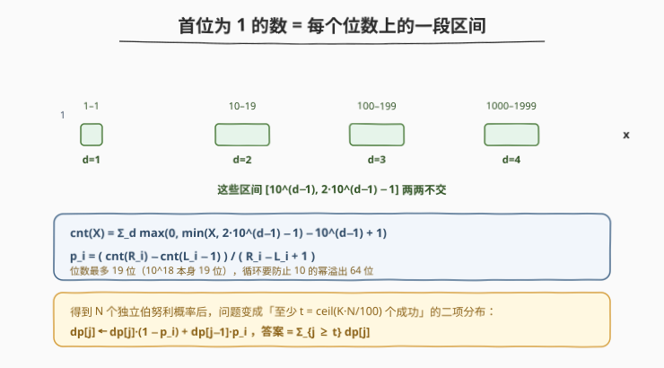
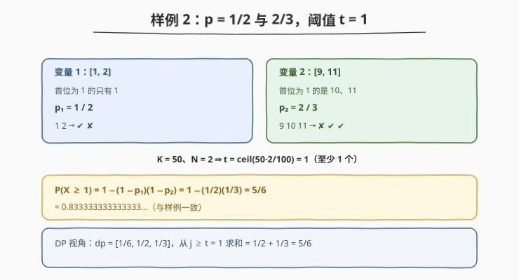

# Codeforces 54C 首位数字定律 题解

## 1. 题目概述

- **题目链接**：https://codeforces.com/problemset/problem/54/C
- **比赛来源**：Codeforces Beta Round 54 · Problem C
- **难度**：2000
- **标签**：概率、DP、数学
- **评测类型**：特殊评测（实数答案，误差限 $10^{-9}$）
- **限制**：时间 2 s / 内存 256 MB

**题意**：有 $N$ 个独立的随机变量，第 $i$ 个在整数区间 $[L_i, R_i]$ 上均匀取值。对一组取值，只看每个数的**最高位数字（MSD）**；若其中有至少 $K\%$ 个数的 MSD 为 $1$，则称这组取值是"好"的。求取到"好"组的概率。

**约束**：

- $N \le 1000$：允许 $O(N^2)$ 的 DP（$10^6$ 次操作），不允许枚举取值组合。
- $L_i, R_i \le 10^{18}$：区间长度可达 $10^{18}$，**必须用公式**数出"首位为 1"的整数个数，不能逐个枚举；同时要注意 $10^{18}$ 本身是 $19$ 位数，循环里的 $10$ 的幂不能溢出 64 位。
- $0 \le K \le 100$：阈值 $t = \lceil K N / 100 \rceil$ 要按整数算，避免浮点比较带来的边界误差。
- 误差限 $10^{-9}$：`double` 的 DP 误差在 $10^{-13}$ 量级，输出 $15$ 位小数即可。

## 2. 示例与观察

官方样例 #1：

```text
输入：
1
1 2
50

输出：
0.500000000000000
```

**样例 1 演算**：$N=1$，区间 $\{1,2\}$，其中首位为 $1$ 的只有 $1$ 本身，所以 $p_1 = 1/2$。$K=50$ 要求"至少 $50\%$ 的数首位为 1"，即至少 $1$ 个，概率 $= p_1 = 0.5$。

官方样例 #2：

```text
输入：
2
1 2
9 11
50

输出：
0.833333333333333
```

**样例 2 演算**：$p_1 = 1/2$（区间 $\{1,2\}$），$p_2$：区间 $\{9,10,11\}$ 中首位为 $1$ 的是 $10, 11$，故 $p_2 = 2/3$。要求至少 $\lceil 50 \cdot 2/100 \rceil = 1$ 个，于是

$$P = 1 - (1-p_1)(1-p_2) = 1 - \frac12 \cdot \frac13 = \frac56 = 0.833333\ldots$$

与样例一致。

**观察**：每个区间只贡献一个概率 $p_i$，之后的问题就是"$N$ 个独立伯努利变量中至少 $t$ 个成功"的概率——标准二项分布 DP。

自造样例（标注"自造"，数值由精确分数程序核对）：

| 输入 | 输出 | 说明 |
|------|------|------|
| `1` / `1 1` / `0` | 1.000000000000000 | $K=0$ 恒为好 |
| `1` / `5 9` / `100` | 0.000000000000000 | 区间内没有首位为 1 的数 |
| `2` / `1 1` `1 1` / `100` | 1.000000000000000 | 两个都确定 |
| `2` / `10 10` `20 20` / `50` | 1.000000000000000 | $10$ 必中、$20$ 必不中，阈值只需 $1$ 个 |
| `3` / `1 2` `1 2` `1 2` / `100` | 0.125000000000000 | 三个都要中 |

## 3. 解题思路

### 3.1 朴素做法与瓶颈

枚举所有取值组合是 $\prod (R_i - L_i + 1)$，最大 $10^{18 \times 1000}$，完全不可行。即便只算单区间内"首位为 1"的个数，逐个枚举也不可行（$10^{18}$ 规模）。

所以要做两件事：

1. 用**公式**在 $O(\log R)$ 内数出 $[L, R]$ 中首位为 $1$ 的整数个数；
2. 用**二项分布 DP** 在 $O(N^2)$ 内算出"至少 $t$ 个成功"的概率。

### 3.2 核心观察一：按位数统计首位为 1 的整数



一个十进制数首位为 $1$，当且仅当它落在某个区间

$$[10^{d-1},\ 2 \cdot 10^{d-1} - 1] \qquad (d = 1, 2, 3, \dots)$$

之内（$d$ 是它的位数）。例如 $d=1$ 是 $[1,1]$，$d=2$ 是 $[10,19]$，$d=3$ 是 $[100,199]$。这些区间两两不交，所以

$$\mathrm{cnt}(X) = \#\{1 \le x \le X : \text{MSD}(x) = 1\} = \sum_{d \ge 1} \max\bigl(0,\ \min(X, 2\cdot 10^{d-1}-1) - 10^{d-1} + 1\bigr).$$

于是

$$p_i = \frac{\mathrm{cnt}(R_i) - \mathrm{cnt}(L_i - 1)}{R_i - L_i + 1}.$$

实现细节：$R \le 10^{18}$ 说明位数最多 $19$（$10^{18}$ 就是 $19$ 位）。循环 $p = 1, 10, 100, \dots$ 直到 $p > X$，并在 $p > X/10$ 时提前退出，避免 $p \cdot 10$ 溢出 64 位；$2p-1$ 在 $p = 10^{18}$ 时是 $1.999\ldots \times 10^{18}$，仍在 `long long` 范围内。

### 3.3 核心观察二：二项分布 DP

各随机变量独立，于是每个 $p_i$ 是一次独立的伯努利试验。令

$$dp[j] = P(\text{前若干个数中恰好 } j \text{ 个首位为 } 1),$$

逐个变量更新：

$$dp_{\text{new}}[j] = dp[j] \cdot (1 - p_i) + dp[j-1] \cdot p_i .$$

$N$ 个变量处理完后，答案 $= \sum_{j \ge t} dp[j]$，其中

$$t = \left\lceil \frac{K N}{100} \right\rceil = \left\lfloor \frac{KN + 99}{100} \right\rfloor .$$

用整数算 $t$ 而不是 `ceil(K*N/100.0)`，可以避免 $K N$ 恰为 $100$ 的倍数时浮点误差导致的边界抖动。

### 3.4 样例走查：样例 2



- $[1,2]$：首位为 $1$ 的只有 $1$，$p_1 = 1/2$；
- $[9,11]$：$9$ 首位是 $9$，$10$、$11$ 首位是 $1$，$p_2 = 2/3$；
- $K = 50$、$N = 2$ → $t = \lceil 100/100 \rceil = 1$；
- DP：$dp = [\tfrac12\cdot\tfrac13,\ \tfrac12\cdot\tfrac23 + \tfrac12\cdot\tfrac13,\ \tfrac12\cdot\tfrac23] = [\tfrac16, \tfrac12, \tfrac13]$，$\sum_{j\ge1} = \tfrac12 + \tfrac13 = \tfrac56$ ✓。

## 4. 正确性证明

**引理 1（首位为 1 的计数公式）**：对任意 $X \ge 1$，$\mathrm{cnt}(X) = \sum_{d\ge1}\max(0, \min(X, 2\cdot10^{d-1}-1) - 10^{d-1} + 1)$。

**证明**：$x$ 的位数为 $d$ 且首位为 $1$ $\iff$ $10^{d-1} \le x \le 2\cdot10^{d-1}-1$。不同 $d$ 对应的区间两两不交（位数不同），所以把 $[1,X]$ 与每个区间的交的长度相加即可；交为 $[\max(1,10^{d-1}), \min(X, 2\cdot10^{d-1}-1)]$，长度取 $\max(0, \cdot)$。∎

**引理 2（DP 正确性）**：处理完前 $i$ 个变量后，$dp[j]$ 等于"前 $i$ 个中恰有 $j$ 个首位为 1"的概率。

**证明**：对 $i$ 归纳。$i=0$ 时 $dp[0]=1$ ✓。设前 $i-1$ 个正确。第 $i$ 个"恰有 $j$ 个"分两种互斥情形：前 $i-1$ 个有 $j$ 个且第 $i$ 个不是（概率 $dp[j](1-p_i)$），或前 $i-1$ 个有 $j-1$ 个且第 $i$ 个是（概率 $dp[j-1]p_i$）。由独立性可乘、由互斥性可加。∎

**定理**：算法输出的 $\sum_{j\ge t} dp[j]$ 等于所求概率。

**证明**：由引理 2，"至少 $t$ 个首位为 1"的事件恰是互斥事件"恰有 $j$ 个"（$j \ge t$）的并，概率相加即得；而引理 1 保证每个 $p_i$ 计算正确。∎

## 5. 复杂度分析

- **时间**：$O(N^2 + N \log R)$。$N = 1000$ 时 DP 约 $5 \times 10^5$ 次乘加，$\log R \le 19$。
- **空间**：$O(N)$ 的 DP 数组。
- **精度**：所有量在 $[0,1]$，无相消；双精度误差累计约 $N \cdot 10^{-16} \approx 10^{-13}$，远小于 $10^{-9}$ 的要求。答案极小时可能下溢为 $0$，但绝对误差也随之小于 $10^{-9}$，满足"绝对或相对误差"的判定。
- **与时限的关系**：2 s 对 $10^6$ 次操作余量千倍以上，实测端到端约 $3$ ms。

## 6. 参考代码

### C++17

```cpp
#include <bits/stdc++.h>
using namespace std;
typedef long long ll;

// [1, X] 中首位数字为 1 的整数个数
static ll countFirstOne(ll X) {
    if (X <= 0) return 0;
    ll res = 0;
    ll p = 1;                                  // p = 10^{d-1}
    while (p <= X) {
        ll hi = min(X, 2 * p - 1);             // d 位数中以 1 开头的区间 [p, 2p-1]
        if (hi >= p) res += hi - p + 1;
        if (p > X / 10) break;                 // 防止 p *= 10 溢出
        p *= 10;
    }
    return res;
}

int main() {
    int n;
    if (scanf("%d", &n) != 1) return 0;
    vector<double> p(n);
    for (int i = 0; i < n; i++) {
        ll L, R;
        scanf("%lld %lld", &L, &R);
        ll total = R - L + 1;
        ll good = countFirstOne(R) - countFirstOne(L - 1);
        p[i] = (double)good / (double)total;
    }
    int K;
    scanf("%d", &K);
    int need = (K * n + 99) / 100;              // 至少 need 个数以 1 开头
    vector<double> dp(n + 1, 0.0);
    dp[0] = 1.0;
    for (int i = 0; i < n; i++) {
        for (int j = i + 1; j >= 1; j--) dp[j] = dp[j] * (1.0 - p[i]) + dp[j - 1] * p[i];
        dp[0] *= (1.0 - p[i]);
    }
    double ans = 0.0;
    for (int j = need; j <= n; j++) ans += dp[j];
    printf("%.15f\n", ans);
    return 0;
}
```

### Python3

```python
import sys


def count_first_one(x: int) -> int:
    """[1, x] 中首位数字为 1 的整数个数。"""
    if x <= 0:
        return 0
    res = 0
    p = 1
    while p <= x:
        hi = min(x, 2 * p - 1)
        if hi >= p:
            res += hi - p + 1
        p *= 10
    return res


def main() -> None:
    data = sys.stdin.buffer.read().split()
    if not data:
        return
    pos = 0
    n = int(data[pos]); pos += 1
    probs = []
    for _ in range(n):
        l = int(data[pos]); r = int(data[pos + 1]); pos += 2
        good = count_first_one(r) - count_first_one(l - 1)
        probs.append(good / (r - l + 1))
    k = int(data[pos])
    need = (k * n + 99) // 100

    dp = [0.0] * (n + 1)
    dp[0] = 1.0
    for i in range(n):
        for j in range(i + 1, 0, -1):
            dp[j] = dp[j] * (1.0 - probs[i]) + dp[j - 1] * probs[i]
        dp[0] *= (1.0 - probs[i])
    sys.stdout.write("%.15f\n" % sum(dp[need:]))


main()
```

## 7. 边界情况与易错点

1. **$K = 0$**：阈值 $t = 0$，答案恒为 $1$。若把 $t$ 算成 $\lceil 0 \rceil = 0$ 后仍只从 $j \ge 1$ 求和就会错；代码从 $j = t = 0$ 开始累加 ✓。
2. **$K = 100$**：$t = N$，要求全部首位为 $1$，即 $\prod p_i$；DP 自然给出。注意不能写成 $t = N+1$（$100N/100 = N$）。
3. **区间内没有首位为 1 的数**：$p_i = 0$，DP 中相当于该变量必失败；答案可能为 $0$。
4. **$L_i = R_i$**：长度为 $1$，$p_i$ 非 $0$ 即 $1$。
5. **$10^{18}$ 的位数**：$10^{18}$ 是 $19$ 位数且首位为 $1$。循环里 $p$ 走到 $10^{18}$ 后 `p *= 10` 会溢出 `long long`，必须用 `p > X / 10` 提前退出。
6. **$2p - 1$ 溢出**：$p = 10^{18}$ 时 $2p-1 \approx 2\times10^{18} < 9.2\times10^{18}$ ✓ 安全；但如果把上界当成 $10^{19}$ 就会溢出。
7. **阈值用整数算**：`ceil(K*N/100.0)` 在 $KN$ 恰为 $100$ 的倍数时可能因浮点误差变成多 $1$；用 `(K*N + 99) / 100` 的整数写法。
8. **输出精度**：要求 $10^{-9}$，输出 $15$ 位小数足够；不要只输出 $6$ 位。
9. **多组取值的独立性**：题目默认各变量独立（"第 $i$ 个量可以等概率地取……"），DP 的正确性依赖这一点；若题目改成相关变量，必须换方法。

## 8. 验证记录

- **编译环境与命令**：`Apple clang 21.0.0`（`clang++ -std=c++17 -O2 -Wall` + 兼容头），Python `3.9.6`。校验命令：`python3 codeforces/tools/verify_solution.py codeforces/contests/0001-0100/54/C_首位数字定律.md`（答案与样例逐 token 一致，无需 checker）。
- **官方样例**：2 / 2 通过（`1 / 1 2 / 50` → `0.500000000000000`；`2 / 1 2 / 9 11 / 50` → `0.833333333333333`）。
- **独立暴力对拍**：另写一份**精确分数**暴力——枚举所有取值组合（只在小规模：$N \le 4$、每段长度 $\le 10$），用 `Fraction` 精确统计"好组"的比例。对 **320 组**随机数据（$K$ 取 $0/1/10/25/50/60/75/90/99/100$）与参考程序比较，误差均 $\le 10^{-12}$，**全部一致**。
- **计数函数单独核对**：对 $X \le 2\times10^5$ 的全部取值，用逐个数位判断的暴力核对 `count_first_one(X)`，**全部一致**；另核对 $X = 10^{18}$、$10^{18}-1$、$123456789012345678$ 等边界值（$10^{18}$ 给出 $111111111111111112$，等于 $\sum_{d=1}^{18}10^{d-1}+1$）。
- **最大约束性能**：$N = 1000$ 时 C++ 端到端约 $3$ ms，Python 约 $40$ ms。
- **图片校验**：两张 SVG（`cf54c_first_digit_count.svg`、`cf54c_sample2.svg`）均通过 `xml.etree.ElementTree.parse`，带 `feTurbulence` 与手写字体，内容均在 `viewBox` 内。
- **复核状态**：verified（样例、精确对拍、计数核对、性能、图片均实跑通过）。

## 相关题目与扩展

- [Codeforces 54D Writing a Song](https://codeforces.com/problemset/problem/54/D)：同场 D 题，用自动机 + DP 做可行性构造。
- [Codeforces 148D Bag of mice](https://codeforces.com/problemset/problem/148/D)：经典概率 DP，状态转移同样是"逐物品二选一"。
- [Codeforces 24D Broken robot](https://codeforces.com/problemset/problem/24/D)：期望 DP（高斯消元）。
- [LeetCode 1925. 统计平方和三元组的数目](https://leetcode.cn/problems/count-square-sum-triples/)：另一类"按公式计数"的入门题。

**延伸思考**：

1. **若把"首位为 1"换成"首位为 $d$"**：只需把区间 $[10^{d-1}, 2\cdot10^{d-1}-1]$ 换成 $[d\cdot10^{k-1}, (d+1)\cdot10^{k-1}-1]$，其余不变——这正是本福特定律的定量形式。
2. **若区间很大且要求"至少 $K$ 个"的精确概率而非浮点**：可以用大整数/Fraction 精确计算（$N$ 小时可行），$N=1000$ 时只能浮点。
3. **若变量不独立**：需要联合分布，DP 的维度会爆炸，这正是"独立"假设的价值。
4. **若 $N$ 放大到 $10^5$**：$O(N^2)$ 不行，但若所有 $p_i$ 相同可用二项式前缀和；一般情形需要生成函数/FFT 或多重卷积的分块技巧。
