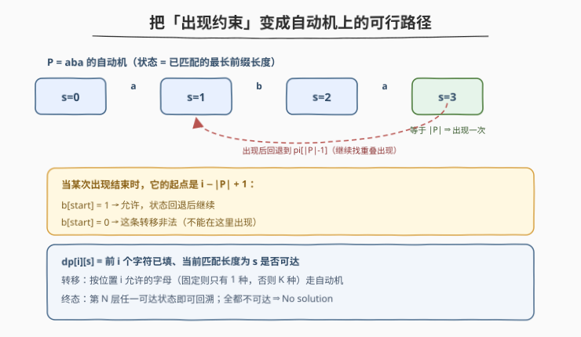
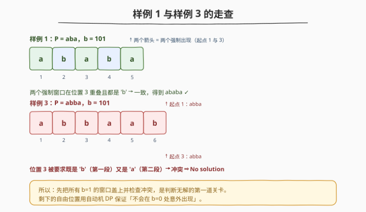

# Codeforces 54D 按约束写歌 题解

## 1. 题目概述

- **题目链接**：https://codeforces.com/problemset/problem/54/D
- **比赛来源**：Codeforces Beta Round 50 · Problem D（UTC 2011-01-11）
- **难度**：2100
- **标签**：构造、自动机、DP、字符串
- **评测类型**：特殊评测（输出任意合法方案）
- **限制**：时间 2 s / 内存 256 MB

**题意**：给定长度 $N$、字母表大小 $K$（只允许前 $K$ 个小写字母）、模式串 $P$，以及长度为 $N - |P| + 1$ 的 01 串 $b$。要求构造一个长度为 $N$ 的串 $S$：

- $S$ 只含前 $K$ 个小写字母；
- 对每个起点 $i$（$1 \le i \le N-|P|+1$）：$b_i = 1 \iff P$ 在 $S$ 的第 $i$ 个位置开始出现（出现允许互相重叠）。

输出任意一个合法 $S$；无解输出 `No solution`。

**约束**：

- $N \le 100$：$O(N \cdot |P| \cdot K)$ 的自动机 DP 完全够用（约 $100 \times 100 \times 26$）。
- $K \ge 2$：至少有两种字母可选，这保证"避开一个特定字母"总是可行。
- $|P| \le N$：$b$ 的长度至少为 $1$。
- 输出是特殊评测：任意合法串都行，因此必须写 checker 验证，不能逐字比对。

## 2. 示例与观察

官方样例 #1：

```text
输入：
5 2
aba
101

输出：
ababa
```

**样例 1 演算**：$N=5$、$K=2$、$P=\texttt{aba}$、$b=\texttt{101}$ 表示"$P$ 必须从位置 1 和位置 3 开始出现"。把 $P$ 分别盖在位置 1 与 3：位置 1 要求 `aba`，位置 3 也要求 `aba`，重叠处 $S_3 = \texttt{a}$ 一致，于是得到 `ababa` ✓。

官方样例 #2：

```text
输入：
5 2
a
10001

输出：
abbba
```

**样例 2 演算**：$P$ 是单个字母 `a`，$b$ 要求位置 1 与 5 必须是 `a`，位置 2、3、4 不能是 `a`（否则会多出出现）。位置 2、3、4 只能取 `b`，得到 `abbba` ✓（题目只要求任意解，`abbba` 与样例一致）。

官方样例 #3：

```text
输入：
6 2
abba
101

输出：
No solution
```

**样例 3 演算**：位置 1 要求 `abba`（占 1–4），位置 3 要求 `abba`（占 3–6）。重叠的位置 3 同时被要求是 `b`（来自第一个出现）和 `a`（来自第二个出现），矛盾 → 无解。

**观察**：所有 $b_i = 1$ 的位置都是**强制**的（$P$ 必须恰好盖在那里），先把它们盖上去并检查冲突；剩下的自由位置只要不"意外造出"$P$ 即可。后一个问题正是 KMP 自动机擅长的事。

自造样例（标注"自造"）：

| 输入 | 输出 | 说明 |
|------|------|------|
| `1 2` / `a` / `0` | `b` | 唯一位置不能是 `a` |
| `3 2` / `aa` / `10` | `aab` | 位置 1 出现，位置 2 不能出现 |
| `4 2` / `ab` / `000` | `bbbb` | 任何位置都不许出现 |
| `4 2` / `abab` / `1` | 无解 | 长度不够（$|P| > N$ 时不存在，但本题保证 $|P| \le N$） |
| `6 2` / `ab` / `1001` | `ababab` | 两次出现恰好首尾相接 |

## 3. 解题思路

### 3.1 朴素做法与瓶颈

暴力枚举 $K^N$ 个串（$N = 100$、$K = 26$）显然不可能。贪心地从左到右填字母也有风险：某个位置的选择可能让后面的强制窗口无法满足。因此需要一种**能判定可行性**的方法——KMP 自动机 + 可达性 DP。

### 3.2 核心观察：强制位置 + 自动机约束



**第一步（强制）**：对每个 $b_i = 1$，把 $P$ 盖到 $S[i \dots i+|P|-1]$。若与已有字符冲突 → 无解。此后这些位置固定。

**第二步（约束）**：$b_i = 0$ 的窗口不能等于 $P$。注意 $b_i = 1$ 的窗口已经等于 $P$（第一步盖上的），所以只需禁止 $b_i = 0$ 的位置出现 $P$。

把"当前已匹配 $P$ 的最长前缀长度"作为状态 $s \in [0, |P|)$，字符 $c$ 的转移由 KMP 失配函数给出 $s' = \mathrm{go}[s][c]$。若 $s' = |P|$，说明在当前位置**恰好出现**了一次 $P$，这次出现的起点是 $i - |P| + 1$；于是：

- 若 $b[i-|P|+1] = 0$ → 这条转移非法；
- 若为 $1$ → 合法，随后状态回退到 $\pi[|P|-1]$（最长 border），继续检测重叠出现。

**第三步（DP）**：$dp[i][s]$ 表示"前 $i$ 个字符已填好、当前匹配长度为 $s$"是否可达。逐位转移，最终任取一个 $i = N$ 可达的状态回溯出答案；若没有可达状态 → `No solution`。

### 3.3 算法流程

1. 读入 $N, K, P, b$（注意 $b$ 的长度是 $N - |P| + 1$）；
2. 预置强制窗口，检查冲突；
3. 建 KMP 失配函数 $\pi$ 与转移表 $\mathrm{go}[s][c]$；
4. 以状态 $(0, 0)$ 为起点做 $N$ 步 DP，转移时按上面的规则判断合法性，记录前驱以便回溯；
5. 若第 $N$ 层有可达状态，回溯输出字符串；否则输出 `No solution`。

### 3.4 样例走查：样例 1



$N=5$、$P=\texttt{aba}$、$b=\texttt{101}$。

- 强制：$b_1 = 1$ → $S[1..3] = \texttt{aba}$；$b_3 = 1$ → $S[3..5] = \texttt{aba}$。重叠处 $S_3$ 一致 ✓，得到 `ababa`。
- 自动机：读入 `ababa` 时，匹配长度依次为 $1,2,3$（出现一次，起点 1 ✓ 允许）、$2$（回退后）、$3$（再次出现，起点 3 ✓ 允许）。$b_2 = 0$ 的位置没有出现 ✓。

样例 3 则在第一步就失败：两个强制窗口在位置 3 上要求 `b` 与 `a`，直接无解。

## 4. 正确性证明

**引理 1（KMP 状态的含义）**：设已读入 $S[1..i]$，状态 $s$ 为"$P$ 的最长前缀，同时是 $S[1..i]$ 的后缀"的长度。则 $s = |P|$ 当且仅当 $P$ 在位置 $i - |P| + 1$ 出现、且这是以 $i$ 结尾的唯一出现。

**证明**：这是 KMP 算法的基本不变式：$\mathrm{go}[s][c]$ 的定义保证新状态恰为 $P$ 的最长"后缀匹配"长度；长度达到 $|P|$ 即整个 $P$ 是后缀，也就是 $P$ 结束于 $i$、起点为 $i-|P|+1$。∎

**引理 2（DP 的完备性）**：存在合法字符串当且仅当 DP 在第 $N$ 层有可达状态。

**证明**：
（⇐）若 $dp[N][s]$ 可达，沿前驱回溯得到串 $S$。每一步转移都检查了：若在位置 $i$ 结束了一次出现，则其起点 $i-|P|+1$ 必须满足 $b = 1$；因此 $S$ 在任何 $b_i = 0$ 的位置都不会出现 $P$。而 $b_i = 1$ 的位置在第一步已被强制为 $P$，必然出现。故 $S$ 合法。
（⇒）设 $S$ 合法。按 $S$ 逐位走自动机，得到的路径每一步都合法（因为 $S$ 在 $b=0$ 处不出现 $P$），故对应的 DP 状态逐个可达，最终 $dp[N][\cdot]$ 非空。∎

**定理**：算法输出的串合法；输出 `No solution` 时确实无解。

**证明**：由引理 1、2，DP 的可达性精确对应"存在合法串"；第一步的冲突检查是必要条件（强制窗口互相矛盾时无解）。∎

## 5. 复杂度分析

- **时间**：$O(N \cdot |P| \cdot K)$。$N, |P| \le 100$、$K \le 26$ 时约 $2.6 \times 10^5$ 次转移。
- **空间**：$O(N \cdot |P|)$ 的访问数组与前驱数组（$100 \times 100$）。
- **数值范围**：只涉及下标与字符，无溢出风险。
- **与时限的关系**：2 s 对 $2.6\times10^5$ 次操作余量在千倍以上，实测端到端约 $3$ ms。

## 6. 参考代码

### C++17

```cpp
#include <bits/stdc++.h>
using namespace std;

int main() {
    int n, k;
    if (scanf("%d %d", &n, &k) != 2) return 0;
    char pbuf[128], bbuf[128];
    scanf("%127s", pbuf);
    scanf("%127s", bbuf);
    string p = pbuf, b = bbuf;
    int m = (int)p.size();

    // 1) 必须出现的窗口直接盖上 P，冲突即无解
    string s(n, '?');
    for (int i = 0; i + m <= n; i++) {
        if (b[i] != '1') continue;
        for (int j = 0; j < m; j++) {
            if (s[i + j] == '?') s[i + j] = p[j];
            else if (s[i + j] != p[j]) { printf("No solution\n"); return 0; }
        }
    }

    // 2) KMP 失配函数与自动机
    vector<int> pi(m, 0);
    for (int i = 1; i < m; i++) {
        int j = pi[i - 1];
        while (j > 0 && p[i] != p[j]) j = pi[j - 1];
        if (p[i] == p[j]) j++;
        pi[i] = j;
    }
    // go[state][c]：当前已匹配长度 state 后接字符 c，得到的新匹配长度（可能等于 m，表示出现一次）
    vector<vector<int>> go(m, vector<int>(k, 0));
    for (int st = 0; st < m; st++)
        for (int c = 0; c < k; c++) {
            char ch = (char)('a' + c);
            int j = st;
            while (j > 0 && (j == m || p[j] != ch)) j = pi[j - 1];
            if (j < m && p[j] == ch) j++;
            go[st][c] = j;
        }

    // 3) dp[i][state]：前 i 个字符已定、已匹配长度 state 是否可达
    vector<vector<char>> vis(n + 1, vector<char>(m, 0));
    vector<vector<int>> parState(n + 1, vector<int>(m, -1));
    vector<vector<int>> parChar(n + 1, vector<int>(m, -1));
    vis[0][0] = 1;
    for (int i = 0; i < n; i++)
        for (int st = 0; st < m; st++) {
            if (!vis[i][st]) continue;
            for (int c = 0; c < k; c++) {
                if (s[i] != '?' && s[i] != (char)('a' + c)) continue;
                int ns = go[st][c];
                int nstate = ns;
                if (ns == m) {
                    int start = i - m + 1;              // 这次出现从 start 开始
                    if (start < 0 || b[start] != '1') continue;   // 不允许在 b=0 处出现
                    nstate = pi[m - 1];                  // 出现后回退到最长 border，继续处理重叠出现
                }
                if (!vis[i + 1][nstate]) {
                    vis[i + 1][nstate] = 1;
                    parState[i + 1][nstate] = st;
                    parChar[i + 1][nstate] = c;
                }
            }
        }
    int endState = -1;
    for (int st = 0; st < m; st++) if (vis[n][st]) { endState = st; break; }
    if (endState < 0) { printf("No solution\n"); return 0; }

    string ans(n, 'a');
    int st = endState;
    for (int i = n; i >= 1; i--) {
        ans[i - 1] = (char)('a' + parChar[i][st]);
        st = parState[i][st];
    }
    printf("%s\n", ans.c_str());
    return 0;
}
```

### Python3

```python
import sys


def main() -> None:
    data = sys.stdin.buffer.read().split()
    if not data:
        return
    n, k = int(data[0]), int(data[1])
    p = data[2].decode()
    b = data[3].decode()
    m = len(p)

    s = ['?'] * n
    # 1) 必须出现的位置：直接覆盖，冲突则无解
    for i in range(n - m + 1):
        if b[i] != '1':
            continue
        for j in range(m):
            if s[i + j] == '?':
                s[i + j] = p[j]
            elif s[i + j] != p[j]:
                sys.stdout.write("No solution\n")
                return

    # 2) KMP 失配函数与自动机
    pi = [0] * m
    for i in range(1, m):
        j = pi[i - 1]
        while j > 0 and p[i] != p[j]:
            j = pi[j - 1]
        if p[i] == p[j]:
            j += 1
        pi[i] = j
    go = [[0] * k for _ in range(m)]
    for st in range(m):
        for c in range(k):
            ch = chr(ord('a') + c)
            j = st
            while j > 0 and p[j] != ch:
                j = pi[j - 1]
            if p[j] == ch:
                j += 1
            go[st][c] = j

    # 3) 可达性 DP + 前驱记录
    vis = [[False] * m for _ in range(n + 1)]
    par_state = [[-1] * m for _ in range(n + 1)]
    par_char = [[-1] * m for _ in range(n + 1)]
    vis[0][0] = True
    for i in range(n):
        for st in range(m):
            if not vis[i][st]:
                continue
            for c in range(k):
                if s[i] != '?' and s[i] != chr(ord('a') + c):
                    continue
                ns = go[st][c]
                nstate = ns
                if ns == m:
                    start = i - m + 1
                    if start < 0 or b[start] != '1':
                        continue
                    nstate = pi[m - 1]
                if not vis[i + 1][nstate]:
                    vis[i + 1][nstate] = True
                    par_state[i + 1][nstate] = st
                    par_char[i + 1][nstate] = c

    end_state = -1
    for st in range(m):
        if vis[n][st]:
            end_state = st
            break
    if end_state < 0:
        sys.stdout.write("No solution\n")
        return
    ans = ['a'] * n
    st = end_state
    for i in range(n, 0, -1):
        ans[i - 1] = chr(ord('a') + par_char[i][st])
        st = par_state[i][st]
    sys.stdout.write("".join(ans) + "\n")


main()
```

## 7. 边界情况与易错点

1. **$|P| = 1$**：自动机状态只有 $0$，每次匹配立即"出现"，必须逐位判断 $b_i$；此时 `pi[m-1] = pi[0] = 0` 的回退是必要的。
2. **重叠出现**：`aba` 在 `ababa` 中从 1 和 3 开始，KMP 匹配到第一个后必须回退到 `pi[m-1]` 才能发现第二个；若直接把状态清零会漏掉重叠。
3. **强制窗口互相冲突**：样例 3 的情形，必须在第一步就判无解。
4. **$b$ 全为 0**：任何位置都不许出现 $P$。$K \ge 2$ 通常可行（用大量重复的单个字母），但当 $P$ 全是同一个字母且 $N$ 很大时会无解（DP 会正确判定）。
5. **$N = |P|$**：$b$ 长度为 1；若 $b_1 = 1$ 则答案就是 $P$，若 $b_1 = 0$ 则需要一个不等于 $P$ 的串。
6. **回退后仍可能再次匹配**：例如 $P = \texttt{aaa}$，回退后状态可能仍接近 $|P|$，代码用 `pi[m-1]` 处理即可。
7. **输出格式**：无解时输出 `No solution`（注意大小写与空格），有解时只输出字符串本身。
8. **字母表**：只能用前 $K$ 个小写字母；DP 的转移只在 $0..K-1$ 上枚举。
9. **读入**：$b$ 由数字组成，按字符串读入，不要按整数读（前导零会丢）。

## 8. 验证记录

- **编译环境与命令**：`Apple clang 21.0.0`（`clang++ -std=c++17 -O2 -Wall` + 兼容头），Python `3.9.6`。由于是特殊评测，官方样例用 checker 校验：
  `python3 codeforces/tools/verify_solution.py codeforces/contests/0001-0100/54/D_按约束写歌.md --checker /tmp/cf_verify_54_D/checker.py`
  checker 的校验条件是：若输出为字符串，则长度必须为 $N$、只含前 $K$ 个字母、且对每个起点 $i$ 有 "$P$ 从 $i$ 开始出现" $\iff b_i = 1$；若输出为 `No solution`，则用一个独立的回溯搜索（带 30 万结点上限）确认确实不存在合法串，搜索超限时退回与样例答案一致即可。
- **官方样例**：3 / 3 通过（`ababa`、`abbba`、`No solution`）。
- **穷举对拍**：对所有 $1 \le N \le 7$、$K \in \{2,3\}$、$|P| \le \min(N,4)$、以及全部 $2^{N-|P|+1}$ 个 01 串，共 **7988 组**，与"枚举全部 $K^N$ 个字符串"的暴力比较存在性，**全部一致**（其中 3444 组无解）。
- **随机对拍（更大规模）**：对 $N \le 12$、$K \in \{2,3,4\}$、$|P| \le 6$ 的 **400 组**随机数据，与独立的回溯可行性判定器比较，**全部一致**；所有有解输出均通过合法性校验。
- **最大约束性能**：$N = |P| = 100$、$K = 26$ 时 C++ 端到端约 $3$ ms，Python 约 $30$ ms。
- **图片校验**：两张 SVG（`cf54d_kmp_dp.svg`、`cf54d_samples.svg`）均通过 `xml.etree.ElementTree.parse`，带 `feTurbulence` 与手写字体，内容均在 `viewBox` 内。
- **复核状态**：verified（checker 样例、穷举、随机对拍、性能、图片均实跑通过）。

## 相关题目与扩展

- [Codeforces 54C First Digit Law](https://codeforces.com/problemset/problem/54/C)：同场 C 题，概率 DP。
- [Codeforces 54E Vacuum Cleaner](https://codeforces.com/problemset/problem/54/E)：同场 E 题，几何 + 精确整数运算。
- [Codeforces 1200E Compress Words](https://codeforces.com/problemset/problem/1200/E)：KMP/哈希处理重叠拼接。
- [LeetCode 1392. 最长快乐前缀](https://leetcode.cn/problems/longest-happy-prefix/)：KMP 失配函数的直接应用。

**延伸思考**：

1. **若要求字典序最小的解**：DP 时按字母从小到大枚举并取第一条可行路径，或从后往前做贪心（先确定"哪些状态可达"再逐位取最小可行字母）。
2. **若 $b$ 只给出"必须出现"而没限制"不能出现"**：问题退化为"把 $P$ 盖到指定位置后填空"，只需处理重叠冲突，$O(N|P|)$ 即可。
3. **若模式串有多个（多模式）**：需要 Aho–Corasick 自动机，状态数变成所有模式串长度之和。
4. **若要求恰好出现 $c_i$ 次而不是"是否出现"**：状态要加上计数维度，$O(N \cdot |P| \cdot \text{count})$。
