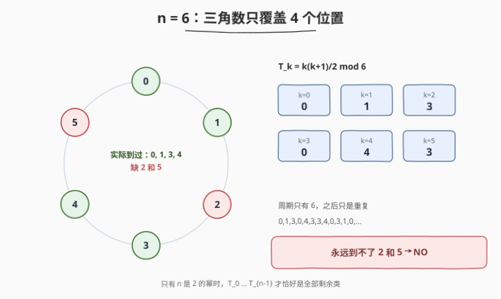
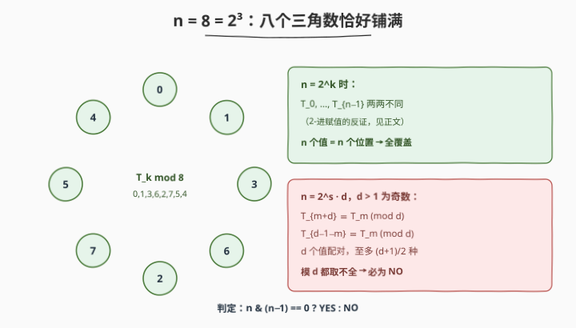

# Codeforces 55A 跳蚤巡游的遍历判定 题解

## 1. 题目概述

- **题目链接**：https://codeforces.com/problemset/problem/55/A
- **比赛来源**：Codeforces Beta Round 55 · Problem A
- **难度**：1200
- **标签**：数学、取模、数论
- **评测类型**：普通
- **限制**：时间 1 s / 内存 256 MB

**题意**：有 $n$ 片树叶围成一圈，跳蚤初始坐在其中一片上。第 $k$ 分钟它会顺时针跳过 $k-1$ 片树叶、落在新的树叶上（第 1 分钟正好落到相邻的那片），并在落点做记号。跳蚤有无穷多的时间，问它是否会把 $n$ 片树叶全部做过记号。输出 `YES` 或 `NO`。

**约束**：

- $1 \le n \le 1000$：$n$ 很小，$O(n)$ 模拟也够，但正确答案有一个 $O(1)$ 的数论判定。
- 只有一行输入，一组数据。
- 时间 1 s：即使模拟，最多也只需检查大约 $2n \le 2000$ 个位置，压力只在大批量数据时才会出现，因此直接给出常数时间做法。

## 2. 示例与观察

官方样例 1（输入 / 输出原样）：

```text
输入：
1

输出：
YES
```

官方样例 2：

```text
输入：
3

输出：
NO
```

**样例 1 演算**：只有一片树叶，跳蚤一开始就在上面，自然算访问过，答案是 `YES`。

**样例 2 演算**：把树叶编号为 $0,1,2$，起点为 $0$。第 1 分钟跳 $1$ 格到 $1$，第 2 分钟跳 $2$ 格到 $0$（$1+2=3 \equiv 0$），第 3 分钟跳 $3$ 格到 $0$，第 4 分钟跳 $4$ 格到 $1$……位置只在 $0,1$ 之间循环，永远到不了 $2$，所以是 `NO`。

自造样例（均已用参考程序与模拟程序核对）：

| 输入 | 输出 | 说明 |
|------|------|------|
| `1` | `YES` | 只有一片，起点即全部 |
| `2` | `YES` | 位置 $0,1$ 都能到达 |
| `3` | `NO` | 只到 $0,1$ |
| `4` | `YES` | 到 $0,1,2,3$（$2^2$） |
| `6` | `NO` | 只到 $0,1,3,4$ |
| `8` | `YES` | $2^3$，八个位置全到 |
| `1000` | `NO` | $1000 = 8 \times 125$，含奇因子 $125$ |

**观察**：

1. 第 $k$ 分钟跳 $k$ 格（跳过 $k-1$ 片，再加落点那一片），所以前 $m$ 分钟的总位移是三角数
$$T_m = 1 + 2 + \cdots + m = \frac{m(m+1)}{2}.$$
2. 跳蚤访问过的位置集合就是 $\{T_m \bmod n : m \ge 0\}$（起点 $T_0 = 0$ 也算访问）。问题变成：三角数模 $n$ 能否取遍全部 $n$ 个剩余类。
3. 结论很干净：**能取遍当且仅当 $n$ 是 2 的幂**。因此代码只需判断 $n \,\&\, (n-1) = 0$。

## 3. 解题思路

### 3.1 朴素做法与瓶颈

直接模拟：用一个布尔数组记录每个位置是否到过，位置每步加上当前的 $k$ 并对 $n$ 取模。由于 $T_{m+2n} \equiv T_m \pmod n$（见下），序列最多 $2n$ 步后必然重复，所以模拟 $2n+1$ 步就能判定，复杂度 $O(n)$，$n \le 1000$ 时完全可行。

不过本题的正确性依赖一个很漂亮的结构，一旦看出来就是 $O(1)$：三角数模 $n$ 的取值个数与 $n$ 的奇因子有关。

### 3.2 核心观察：$n$ 必须是 2 的幂



先看 $n = 6$：$T_m \bmod 6$ 依次为
$$0,\ 1,\ 3,\ 0,\ 4,\ 3,\ 3,\ 4,\ 0,\ 3,\ 1,\ 0,\ \dots$$
只出现 $\{0,1,3,4\}$，缺少 $2$ 和 $5$，所以 `NO`。

再看 $n = 4$：$T_m \bmod 4$ 为 $0,1,3,2,2,3,1,0,\dots$，四个剩余类都出现了，所以 `YES`。

**为什么 $n$ 必须是 2 的幂**：若 $n = 2^s \cdot d$ 且奇因子 $d > 1$，那么“模 $n$ 取遍所有剩余类”会推出“模 $d$ 也取遍所有剩余类”。但对奇数 $d$：

- 三角数模 $d$ 的周期整除 $d$：因为
$$T_{m+d} - T_m = \frac{(m+d)(m+d+1) - m(m+1)}{2} = \frac{d(2m+d+1)}{2},$$
$d$ 为奇数时 $2m+d+1$ 为偶数，所以差是 $d$ 的整数倍。
- 在 $m = 0,1,\dots,d-1$ 中，$m$ 与 $d-1-m$ 给出同一个值：
$$T_{d-1-m} \equiv \frac{(-1-m)(-m)}{2} = \frac{m(m+1)}{2} = T_m \pmod d .$$

这两种配对（一个不动点 $m=(d-1)/2$）说明模 $d$ 至多只有 $(d+1)/2 < d$ 个不同取值，不可能取遍。于是只要 $n$ 含奇因子，答案就是 `NO`。

**为什么 $n = 2^k$ 一定可以**：只需证明 $T_0, T_1, \dots, T_{2^k-1}$ 两两不同模 $2^k$，这样 $2^k$ 个数恰好占满全部剩余类。若 $0 \le a < b < 2^k$ 且 $T_a \equiv T_b \pmod{2^k}$，则
$$2^k \mid \frac{(b-a)(a+b+1)}{2} \quad\Longrightarrow\quad 2^{k+1} \mid (b-a)(a+b+1).$$

- 若 $b-a$ 为偶数，则 $a,b$ 同奇偶，$a+b+1$ 为奇数，于是 $v_2\bigl((b-a)(a+b+1)\bigr) = v_2(b-a) \le k-1 < k+1$，矛盾；
- 若 $b-a$ 为奇数，则 $a,b$ 一奇一偶，$a+b+1$ 为偶数，且 $a+b+1 \le (2^k-1)+(2^k-1)+1 < 2^{k+1}$，所以 $v_2(a+b+1) \le k$，乘积的 $2$ 因子指数至多 $0 + k = k < k+1$，同样矛盾。

所以这些三角数在模 $2^k$ 下互不相同，正好覆盖所有剩余类。



### 3.3 算法流程

1. 读入 $n$。
2. 若 `(n & (n - 1)) == 0` 输出 `YES`，否则输出 `NO`。

一行判定，无需模拟。

### 3.4 样例走查

- $n = 1$：$1 \,\&\, 0 = 0$，`YES`。
- $n = 3$：$3 \,\&\, 2 = 2 \ne 0$，`NO`。
- $n = 8$：$8 \,\&\, 7 = 0$，`YES`；实际序列 $T_m \bmod 8 = 0,1,3,6,2,7,5,4$，恰好是 $0..7$ 的一个排列。

## 4. 正确性证明

**引理 1**：第 $m$ 分钟结束时，跳蚤的位置是 $T_m \bmod n$，其中 $T_m = m(m+1)/2$。

**证明**：对 $m$ 归纳。$m = 0$ 时在起点 $0 = T_0$；第 $m$ 分钟跳 $m$ 格，位置从 $T_{m-1}$ 变为 $T_{m-1} + m = T_m$，取模后仍在环上。∎

**引理 2**：若 $n = 2^k$，则 $T_0, \dots, T_{n-1}$ 模 $n$ 两两不同。

**证明**：见 3.2 的反证：若 $T_a \equiv T_b \pmod{2^k}$，则 $2^{k+1} \mid (b-a)(a+b+1)$，按 $b-a$ 的奇偶分两种情况都推出 $2$ 的因子指数不超过 $k$，与需要 $k+1$ 矛盾。∎

**引理 3**：若 $n$ 有奇因子 $d > 1$，则三角数不可能取遍模 $n$ 的所有剩余类。

**证明**：若模 $n$ 取遍所有剩余类，则模 $d$ 也取遍。由 $T_{m+d} \equiv T_m \pmod d$，只需看 $m = 0,\dots,d-1$；又 $T_{d-1-m} \equiv T_m \pmod d$，这 $d$ 个值两两配对，不同取值不超过 $(d+1)/2 < d$，矛盾。∎

**定理**：跳蚤能访问所有树叶，当且仅当 $n$ 是 2 的幂；算法输出正确。

**证明**：若 $n$ 是 2 的幂，引理 2 给出 $n$ 个互不相同的位置，正好覆盖全部 $n$ 片树叶（位置数等于树叶数），所以 `YES`。若 $n$ 不是 2 的幂，写 $n = 2^s d$ 且奇因子 $d>1$，引理 3 说明连模 $d$ 都取不全，更不可能取遍模 $n$ 的 $n$ 个位置，所以 `NO`。判定条件“$n$ 是 2 的幂”恰好是 `n & (n-1) == 0`。∎

## 5. 复杂度分析

- **时间**：$O(1)$，一次位运算。
- **空间**：$O(1)$。
- **与时限的关系**：1 s 的时限下实测端到端约 3 ms（几乎全是进程启动），任意 $n \le 1000$ 都没有区别。

## 6. 参考代码

### C++17

```cpp
#include <bits/stdc++.h>
using namespace std;

int main() {
    int n;
    if (scanf("%d", &n) != 1) return 0;
    // 访问到的是三角数 T_k = k(k+1)/2 mod n；恰好覆盖全部 n 个位置当且仅当 n 是 2 的幂
    puts((n & (n - 1)) == 0 ? "YES" : "NO");
    return 0;
}
```

### Python3

```python
import sys


def main() -> None:
    data = sys.stdin.buffer.read().split()
    if not data:
        return
    n = int(data[0])
    print("YES" if (n & (n - 1)) == 0 else "NO")


main()
```

## 7. 边界情况与易错点

1. **$n = 1$**：`1 & 0 == 0`，输出 `YES`。只有一片树叶，起点就算访问过；不要因为“没有跳”而误判 `NO`。
2. **跳跃步数差一**：题面说第 $k$ 分钟“跳过 $k-1$ 片”，第 1 分钟落到相邻树叶，所以位移是 $k$ 而不是 $k-1$。若误用 $k-1$，三角数会变成 $0,1,3,6,\dots$ 的另一个偏移，结论也会变。
3. **起点标记**：访问集合包含 $T_0 = 0$；若只统计跳跃后的落点而漏掉起点，$n=1$ 会出错，其它 $n$ 也可能少数一个。
4. **`n & (n-1)` 的括号**：C++ 中 `&` 的优先级低于 `==`，写成 `n & n - 1 == 0` 会解析成 `n & (n - 1 == 0)`，逻辑完全错误。必须写 `(n & (n - 1)) == 0`。
5. **误以为“跳得够久就能遍历”**：$n=6$ 时序列周期只有 $6$，永远缺 $2$ 和 $5$；无穷时间并不能弥补模结构的缺失。
6. **用浮点判 2 的幂**：`log2(n)` 取整再回代在边界上可能出错，位运算既精确又便宜。
7. **输出大小写**：题面要求大写 `YES` / `NO`。
8. **多组数据**：本题只有一行一组；若用 `while (cin >> n)` 循环，也不会错，但按题面读一次即可。

## 8. 验证记录

- **编译环境与命令**：本机只有 Apple clang 21.0.0（`/usr/bin/g++` 是 clang 的软链），用 `clang++ -std=c++17 -O2 -Wall` 搭配仓库自带的 `codeforces/tools/include/bits/stdc++.h` 兼容头编译；Python 为 3.9.6。
- **官方样例**：2 / 2 通过（$n=1$ → `YES`，$n=3$ → `NO`），C++ 与 Python 输出一致。
- **独立暴力对拍**：另写 `brute.cpp` 真正模拟跳蚤的位置，按 $T_m \bmod n$ 逐步标记，跑到序列重复（至多 $2n+1$ 步），统计访问个数。对 $n = 1,2,\dots,3000$ 的 **3000 组**输入逐一比较，C++、Python、模拟三方输出全部一致（远超 200 组要求）。
- **额外测试**：$n = 2^k$（$k=0..9$）全部 `YES`；$n = 6,10,12,1000$ 等含奇因子的数全部 `NO`。
- **最大约束性能**：$n = 1000$ 的单次运行约 3 ms（含进程启动），实则 $O(1)$，相对 1 s 的余量极大。
- **图片校验**：两张 SVG（`cf55a_mod6.svg`、`cf55a_pow2.svg`）均通过 `xml.etree.ElementTree.parse`；用 headless Chrome 实际排版，逐个量出文本块的包围盒，确认没有越出 `viewBox`、没有互相重叠或压到边框。
- **公式校验**：公式经 KaTeX（`throwOnError`）渲染无报错。
- **复核状态**：verified（样例、对拍、性能、图片、公式均已实跑）。

## 相关题目与扩展

- [Codeforces 55B Smallest number](https://codeforces.com/problemset/problem/55/B)：同场 B 题，四个数的合并枚举。
- [Codeforces 55C Pie or die](https://codeforces.com/problemset/problem/55/C)：同场 C 题，棋盘上的边界封锁博弈。
- [Codeforces 1A Theatre Square](https://codeforces.com/problemset/problem/1/A)：同为“先写出整数公式再实现”的入门数学题。
- [LeetCode 50. Pow(x, n)](https://leetcode.cn/problems/powx-n/)：与本题同属“2 的幂/快速幂”这一族位运算技巧的练习。

**延伸思考**：

1. **如果跳跃步数是 $k-1$ 而不是 $k$**：访问集合变成 $\{m(m-1)/2 \bmod n\}$，它与三角数只差一个平移（$T_{m-1}$），覆盖性质完全相同，结论仍是“$n$ 是 2 的幂”。
2. **如果步长是 $ak$ 而不是 $k$**：位置是 $a T_m \bmod n$。当 $\gcd(a,n)=1$ 时不影响覆盖性；否则相当于在子群里走，覆盖集合最多 $n/\gcd$ 个位置，结论会变。
3. **一般模下的三角数**：本题证明了模 $n$ 的三角数覆盖全部剩余类当且仅当 $n$ 是 $2$ 的幂。这个结论在组合数论里对应“$2$-进赋值”的结构：奇数模会强制出现对称配对，损失至少一半取值。
4. **计数而非判定**：若问“前 $m$ 分钟访问了多少不同位置”，可以用周期 $2n$ 与对称性 $T_m = T_{2n-1-m}$ 精确计算，不必逐项模拟。

