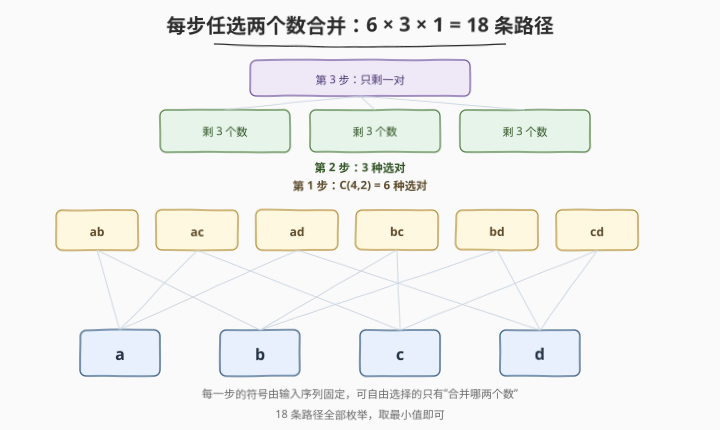
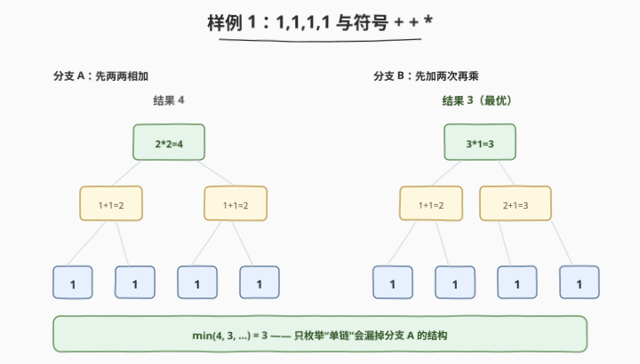

# Codeforces 55B 四数合并的最小结果 题解

## 1. 题目概述

- **题目链接**：https://codeforces.com/problemset/problem/55/B
- **比赛来源**：Codeforces Beta Round 51 · Problem B（UTC 2011-01-14）
- **难度**：1600
- **标签**：暴力枚举、搜索、表达式
- **评测类型**：普通
- **限制**：时间 2 s / 内存 256 MB

**题意**：黑板上写着四个整数 $a,b,c,d$。接下来三分钟，每分钟 Vladimir 会从黑板上任选两个数（不要求相邻），用它们的和或积替换这两个数（符号由他记住的序列给出）。三分钟后黑板上只剩一个数。给定四个初始数与三个运算符（按执行顺序给出），求最终能得到的最小值。

**约束**：

- $0 \le a,b,c,d \le 1000$：结果最大为 $1000^4 = 10^{12}$，必须用 64 位整数。
- 运算符序列固定为三个字符（`+` 或 `*`），顺序不能交换；每一步只能选择「把哪两个数合并」，符号由该步决定。
- 只有一组数据。
- 数据规模与指数极小：第一步 6 种选法、第二步 3 种、第三步 1 种，共 $6 \times 3 \times 1 = 18$ 条路径，直接全枚举即可。

## 2. 示例与观察

官方样例 1（输入 / 输出原样）：

```text
输入：
1 1 1 1
+ + *

输出：
3
```

官方样例 2：

```text
输入：
2 2 2 2
* * +

输出：
8
```

官方样例 3：

```text
输入：
1 2 3 4
* + +

输出：
9
```

**样例 1 演算**：符号依次是 `+`、`+`、`*`。先合并两个 $1$ 得 $2$，黑板剩 $\{2,1,1\}$；再合并两个数，若合并 $2$ 和 $1$ 得 $3$，剩 $\{3,1\}$，最后相乘得 $3$；若第二次合并两个 $1$ 得 $2$，剩 $\{2,2\}$，最后相乘得 $4$。最小是 $3$。

**样例 2 演算**：符号是 `*`、`*`、`+`。第一步合并两个 $2$ 得 $4$；第二步若把剩下的 $2$ 与 $2$ 相乘得 $4$，黑板剩 $\{4,4\}$，最后相加得 $8$；若第二步把 $4$ 与 $2$ 相乘得 $8$，最后加 $2$ 得 $10$。最小是 $8$。

**样例 3 演算**：符号是 `*`、`+`、`+`。若第一步算 $1 \times 2 = 2$，再依次加 $3$、加 $4$，得 $9$；若第一步算 $3 \times 4 = 12$，加 $1$ 加 $2$ 得 $15$；其它组合也都 $\ge 9$。最小是 $9$。

自造样例（均已用参考程序跑过）：

| 输入 | 输出 | 说明 |
|------|------|------|
| `0 0 0 0` / `* * *` | 0 | 全是 0，怎么乘都是 0 |
| `0 5 5 5` / `+ + +` | 15 | 0 加进去不改变和 |
| `0 5 5 5` / `* * *` | 0 | 先乘出 0，最后一定是 0 |
| `1 1 1 1` / `* * *` | 1 | 全乘 |
| `1000 1000 1000 1000` / `* * *` | 1000000000000 | 上界 $10^{12}$ |
| `2 3 4 5` / `+ + *` | 14 | 先加出较大的数再乘会更大，要挑小的先加 |

**观察**：

1. 因为可以任选两个数，黑板上的状态只与「当前还剩哪些数」有关，与它们原来在第几个位置无关。
2. 三个符号的顺序是固定的，所以第 $k$ 步一定执行第 $k$ 个符号，能自由选择的只有「合并哪一对」。
3. 总路径只有 18 条，而且很多路径会得到相同的状态（例如四个数都相等时），直接搜索并取最小值即可。

## 3. 解题思路

### 3.1 朴素做法与瓶颈

如果试图把所有数按某种顺序排成一列、再照从左到右的固定顺序合并（即只考虑 $((a \ op_1 \ b) \ op_2 \ c) \ op_3 \ d$ 这种形式），会漏掉「先分别合并两对、再合并两个结果」的情况。例如符号 `+ + *` 时，$(a+b) \times (c+d)$ 就不是任何单链的结果。

所以不能只枚举排列，必须枚举每步「选哪两个数」。

### 3.2 核心观察：状态只是「当前黑板上的多重集合」



把黑板看成一个多重集合 $S$。第 $k$ 步的做法是：任取 $x, y \in S$，用 $x \ op_k \ y$ 替换它们，得到大小为 $|S|-1$ 的新集合。三步之后 $|S| = 1$，这个数就是一条合法路径的结果。

路径总数：第一步从 4 个数里选 2 个有 $\binom{4}{2}=6$ 种，第二步从 3 个里选 2 个有 $\binom{3}{2}=3$ 种，第三步只剩 1 种，共 $18$ 条。对每条路径计算最终值并取最小，复杂度是常数。

递归写法最自然：`dfs(当前集合, 第几步)`，枚举所有无序对 $(i,j)$，生成新集合并递归；到第 3 步时用当前唯一的数更新答案。

### 3.3 算法流程

1. 读入四个整数与三个运算符（按顺序）。
2. 从第 0 步开始递归：
   - 若已执行 3 步，更新 `best = min(best, 剩下的唯一数)`；
   - 否则枚举当前集合中的所有无序对 $(i,j)$，按第 `step` 个符号计算 $x$，把其余元素与 $x$ 组成新集合，递归到下一步。
3. 输出 `best`。

### 3.4 样例走查



以样例 1（四个 $1$，符号 `+ + *`）为例，搜索树的关键分支：

- 第 1 步必得 $2$，黑板 $\{2,1,1\}$；
- 第 2 步有两种本质不同的选择：
  - 合并 $2$ 与 $1$：得 $3$，黑板 $\{3,1\}$，第 3 步乘得 $\mathbf{3}$；
  - 合并两个 $1$：得 $2$，黑板 $\{2,2\}$，第 3 步乘得 $4$。

取最小为 $3$，与样例一致。注意第二层的两个分支分别来自「合并大数与小数」和「合并两个小数」，只枚举排列是得不到后者的。

## 4. 正确性证明

**引理 1**：执行完第 $k$ 步后，黑板上的多重集合大小为 $4-k$，且递归在深度 $k$ 枚举出的所有集合，恰好是「按前 $k$ 个符号、以某种选对方式」能得到的所有可能集合。

**证明**：对 $k$ 归纳。$k=0$ 时只有初始集合，成立。设深度 $k$ 的集合都恰能被得到；深度 $k+1$ 的每个集合由某个深度 $k$ 的集合 $S$ 选一对 $(x,y)$ 合并而成，按定义这正是第 $k+1$ 步的一种合法操作，故可得到。反过来，任何合法的前 $k+1$ 步操作序列，其前 $k$ 步得到的集合必在深度 $k$ 的枚举中（归纳假设），最后一步的选对也一定被枚举到，所以该集合也在深度 $k+1$ 的枚举中。∎

**引理 2**：对任意一对 $(i,j)$ 与符号，递归生成的新集合与「先合并 $j,i$」得到的新集合相同（加法与乘法都满足交换律），因此枚举无序对不会漏解，也不会因为顺序不同而重复计算不同的结果。

**证明**：新集合只由「删去 $i,j$ 后的其余元素」与「$x \ op \ y$」决定，而 $x \ op \ y = y \ op \ x$。所以 $(i,j)$ 与 $(j,i)$ 产生同一个集合。∎

**定理**：算法输出的 `best` 等于所有合法操作序列能得到的最小最终值。

**证明**：由引理 1，深度 3 枚举到的每个单元素集合都对应至少一条合法操作序列，因此 `best` 不小于真实最小值（每个候选都合法，故是某个合法结果，`best` 是它们的最小值，不会小于真实最小值）。反过来，任取一条合法操作序列，由引理 1 它对应的最终集合一定出现在深度 3 的枚举中，故 `best` 不大于它；对最优序列取等号，`best` 等于真实最小值。∎

## 5. 复杂度分析

- **时间**：$O(1)$。路径数固定为 $6 \times 3 \times 1 = 18$，每条路径常数次运算，与输入数值无关。即使把「四个数」推广到 $n$ 个数，路径数是 $(n-1)!$ 级别的双阶乘，但本题 $n=4$ 完全无需担心。
- **空间**：$O(1)$，递归深度 3，每层保存一个长度不超过 4 的向量。
- **数值范围**：最大 $1000^4 = 10^{12}$，`long long` 足够；`int` 会在乘法处溢出（$10^{12} > 2^{31}$）。
- **与时限的关系**：2 s 时限下实测约 3 ms（几乎全是进程启动）。

## 6. 参考代码

### C++17

```cpp
#include <bits/stdc++.h>
using namespace std;

long long best;
char op[3];

void dfs(vector<long long> v, int step) {
    if (step == 3) {
        best = min(best, v[0]);
        return;
    }
    int k = (int)v.size();
    for (int i = 0; i < k; ++i)
        for (int j = i + 1; j < k; ++j) {
            long long x = (op[step] == '+') ? v[i] + v[j] : v[i] * v[j];
            vector<long long> nv;
            nv.reserve(k - 1);
            for (int t = 0; t < k; ++t)
                if (t != i && t != j) nv.push_back(v[t]);
            nv.push_back(x);
            dfs(nv, step + 1);
        }
}

int main() {
    vector<long long> v(4);
    if (!(cin >> v[0] >> v[1] >> v[2] >> v[3])) return 0;
    for (int i = 0; i < 3; ++i) cin >> op[i];
    best = LLONG_MAX;
    dfs(v, 0);
    cout << best << '\n';
    return 0;
}
```

### Python3

```python
import sys


def main() -> None:
    data = sys.stdin.buffer.read().split()
    if not data:
        return
    nums = [int(x) for x in data[:4]]
    ops = [t.decode() for t in data[4:7]]

    best = [None]

    def dfs(v, step):
        if step == 3:
            if best[0] is None or v[0] < best[0]:
                best[0] = v[0]
            return
        k = len(v)
        for i in range(k):
            for j in range(i + 1, k):
                x = v[i] + v[j] if ops[step] == "+" else v[i] * v[j]
                nv = [v[t] for t in range(k) if t != i and t != j]
                nv.append(x)
                dfs(nv, step + 1)

    dfs(nums, 0)
    print(best[0])


main()
```

## 7. 边界情况与易错点

1. **0 参与乘法**：任何包含 0 的乘法都会把结果变成 0，这往往是最优解。例如 `0 5 5 5` + `* * *` 的答案是 0；不要因为「0 很小」而跳过乘法分支。
2. **运算符顺序不可交换**：`+ + *` 与 `* + +` 是两道不同的题。实现时按输入顺序读取，并严格用第 `step` 个符号，不能先统计「几个加几个乘」再自由排列。
3. **只枚举排列会漏解**：$(a+b)\times(c+d)$ 这类「先分别合并两对」的结构不是任何单链的结果，必须按「每步任选两个数」来枚举。
4. **32 位溢出**：$1000^4 = 10^{12}$ 超过 `int` 上限，必须用 `long long`；`best` 的初值也不能写成 `INT_MAX`，否则比较时会截断。
5. **符号读取**：三个符号之间用空格分隔，用 `cin >> char` 或按 token 读取都行；不要按整行读字符串后假设没有空格。
6. **重复数字**：四个数相等时，不同选对会得到相同集合，搜索会重复计算，但 18 条路径的规模下不影响正确性与效率。
7. **最小值不是最大值**：题目要求最小结果，且初始数非负、运算只有加和乘，结果单调，所以「尽量晚乘」往往更优，但仍需穷举验证。
8. **递归边界**：第三步之后集合大小为 1，直接取 `v[0]`；不要在 size 不为 1 时访问下标。
9. **输出格式**：只输出一个整数；题面特别提到旧版评测不要用 `%lld`，现代环境用 `cout` 或 `%lld` 均可。

## 8. 验证记录

- **编译环境与命令**：本机只有 Apple clang 21.0.0（`/usr/bin/g++` 是 clang 的软链），用 `clang++ -std=c++17 -O2 -Wall` 搭配仓库自带的 `codeforces/tools/include/bits/stdc++.h` 兼容头编译；Python 为 3.9.6。
- **官方样例**：3 / 3 通过（`3`、`8`、`9`），C++ 与 Python 输出一致。
- **独立暴力对拍**：另写 `brute.cpp`，用「状态集合 BFS」而不是递归：每一步把所有当前多重集合按该步符号两两合并，得到下一层集合的集合，最后取所有单元素状态的最小值。与参考程序随机对拍 **300 组**（四个数从 $\{0,1,2,3,5,7,10,100,999,1000\}$ 及随机值中取，三个符号随机），C++、Python、暴力三方输出全部一致。
- **额外测试**：全 0、含 0 的乘法、四个 1000 全乘（$10^{12}$）、全加、混合符号等手写用例全部通过（见第 2 节表格）。
- **最大约束性能**：$1000\ 1000\ 1000\ 1000$ 与 `* * *`，单次约 3 ms（含进程启动），与 2 s 时限相比余量极大。
- **图片校验**：两张 SVG（`cf55b_tree.svg`、`cf55b_sample1.svg`）均通过 `xml.etree.ElementTree.parse`；用 headless Chrome 实际排版，逐个量出文本块的包围盒，确认没有越出 `viewBox`、没有互相重叠或压到边框。
- **公式校验**：公式经 KaTeX（`throwOnError`）渲染无报错。
- **复核状态**：verified（样例、对拍、性能、图片、公式均已实跑）。

## 相关题目与扩展

- [Codeforces 55A Flea travel](https://codeforces.com/problemset/problem/55/A)：同场 A 题，三角数模 $n$ 的覆盖判定。
- [Codeforces 55C Pie or die](https://codeforces.com/problemset/problem/55/C)：同场 C 题，边界封锁博弈。
- [LeetCode 282. 给表达式添加运算符](https://leetcode.cn/problems/expression-add-operators/)：在数字间插入运算符并枚举所有表达式，同样是「穷举 + 取最优」的搜索题，只是规模控制靠剪枝。
- [LeetCode 679. 24 点游戏](https://leetcode.cn/problems/24-game/)：四个数任选两个做四则运算、递归到只剩一个数，和本题的搜索结构几乎一模一样，区别是它要求凑出 24 且允许减法除法。

**延伸思考**：

1. **若符号顺序也可自由排列**：就变成「四个数、三个运算符任意顺序与任意括号」的全枚举，路径数从 18 增加到 $18 \times 3! = 108$（还要考虑运算符分配），仍可暴力。
2. **若数字个数推广到 $n$**：每步任选两个数合并，状态数会迅速膨胀。可以用区间 DP（若要求按原顺序合并）或状压 DP（若只关心集合）来避免重复状态；$n=4$ 时直接搜索最省事。
3. **若允许减法与除法**：最小值可能来自负数或分数，需要记录有理数；而且除法会引入分母，答案不再是整数，题目会变成另一类问题。
4. **若要求输出方案而非最小值**：在递归时记录每步选的下标与运算，回溯即可；由于只有 18 条路径，也可以把所有方案存下来排序。

