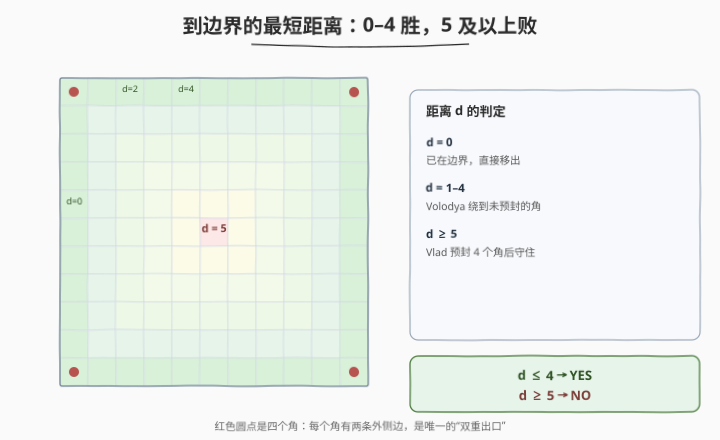

# Codeforces 55C 馅饼与边界封锁博弈 题解

## 1. 题目概述

- **题目链接**：https://codeforces.com/problemset/problem/55/C
- **比赛来源**：Codeforces Beta Round 51 · Problem C（UTC 2011-01-14）
- **难度**：1900
- **标签**：博弈、构造策略、不变量
- **评测类型**：普通
- **限制**：时间 2 s / 内存 256 MB

**题意**：一个 $n \times m$ 的棋盘上有 $k$ 个馅饼。每轮 Volodya 把一个馅饼移到相邻（上下左右）的格子里；如果移动前这个馅饼已经在棋盘的边界格上，他也可以直接把它移出棋盘并获胜。Volodya 每走完一步，Vlad 就在棋盘的边界上封锁一条单位边（两个格点之间的边界小段），被封锁的边以后不能再用来移出馅饼。双方都采取最优策略，问 Volodya 是否能获胜，输出 `YES` 或 `NO`。

**约束**：

- $1 \le n, m \le 100$，$0 \le k \le 100$：答案只与每个馅饼到四条边的最短距离有关，可以 $O(k)$ 判定。
- 一个格子可以放多个馅饼，坐标可能重复。
- $k = 0$ 时 Volodya 没有馅饼可动，必败。
- 只有一组数据。

## 2. 示例与观察

官方样例 1（输入 / 输出原样）：

```text
输入：
2 2 1
1 2

输出：
YES
```

官方样例 2：

```text
输入：
3 4 0

输出：
NO
```

官方样例 3：

```text
输入：
100 50 2
50 25
50 25

输出：
NO
```

**样例 1 演算**：$2 \times 2$ 棋盘，馅饼在 $(1,2)$，本来就在边界格上。第一轮 Volodya 直接把它移出棋盘，Vlad 还没有机会封锁任何边，所以 `YES`。

**样例 2 演算**：没有馅饼，Volodya 无法获胜，`NO`。

**样例 3 演算**：棋盘 $100 \times 50$，两个馅饼都在 $(50,25)$。它到四条边的距离分别是 $49, 50, 24, 25$，最近也要 $24$ 步才能到边界。Vlad 在 Volodya 接近边界的 $24$ 轮里有充足的时间封锁关键边（见下），所以 `NO`。

自造样例（均已用参考程序核对）：

| 输入 | 输出 | 说明 |
|------|------|------|
| `1 1 1` / `1 1` | `YES` | 只有一个格子，四面都是边界，直接移出 |
| `3 3 1` / `2 2` | `YES` | 中心格距离边界 1 ≤ 4 |
| `9 9 1` / `5 5` | `YES` | 中心到边界距离 4，恰好是边界情形 |
| `11 11 1` / `6 6` | `NO` | 中心到边界距离 5，超过阈值 |
| `5 5 0` | `NO` | 没有馅饼 |
| `2 10 1` / `1 1` | `YES` | 第 1 行所有格子都是边界格 |

**观察**：

1. 一个馅饼要获胜，必须先在某一轮**站在边界格上**，且它的某条外侧边没有被封锁；下一轮 Volodya 就能从这里移出。
2. 如果馅饼站在普通（非角）边界格上，它只有**一条**外侧边；Vlad 只要每轮花一次封锁把它的外侧边封掉，就能一直「跟着」它走。
3. 角格有**两条**外侧边。如果馅饼走进一个角时两条边都已被封，它只能继续走；但只要还有一条没被封，Vlad 一轮只能封一条，Volodya 下一轮就能从另一条出去。
4. 因此整局的关键是：Vlad 有没有足够的时间，在馅饼到达各个角之前把四个角都「预先封掉一条边」。棋盘只有四个角，这就是常数 $4$ 的来源。

## 3. 解题思路

### 3.1 朴素做法与瓶颈

棋盘最多 $100 \times 100$，边界边最多 $2(n+m) \le 400$ 条，博弈状态（馅饼位置 + 已封边集合）是天文数字，直接做博弈搜索不可能。必须抓住「只有角格是双重出口」这一结构，把博弈化简成「时间（可预先封锁的边数）与四个角之间的赛跑」。

### 3.2 核心判定：到边界的最短距离不超过 4

记馅饼 $(x,y)$（$1$ 索引）到四条边的距离为

$$d = \min(x-1,\ n-x,\ y-1,\ m-y).$$

**结论**：Volodya 获胜，当且仅当存在一个馅饼满足 $d \le 4$（若 $k=0$ 则必败）。



**直觉**：馅饼走到边界需要 $d$ 轮，这 $d$ 轮里 Vlad 一共只能封锁 $d$ 条边，其中一条必须用于「馅饼到达的那个边界格」，所以真正能用来预先封锁角格的最多只有 $d-1$ 条。棋盘有 4 个角，每个角至少要预先封 1 条边；当 $d-1 < 4$ 即 $d \le 4$ 时，Vlad 封不全四个角，Volodya 就绕棋盘一圈走到那个没被封的角获胜；当 $d \ge 5$ 时，Vlad 有至少 4 条「余量」把四个角各预封一条，此后每轮只需要跟着馅饼封它刚进入的格子，就能永远守住。

### 3.3 两个方向的具体策略

**Volodya（$d \le 4$ 时）**：

1. 先把馅饼沿最短路走到边界（$d$ 轮）。这 $d$ 轮里 Vlad 至多封 $d$ 条边，其中到达格的外侧边必须被封，所以用于「预封角」的至多 $d-1 \le 3$ 条。
2. 棋盘有 4 个角，至少有一个角没有被预封。Volodya 沿着边界一圈一圈走，总能走到这个角。
3. 进入该角时，角有两条外侧边，Vlad 这一轮只能封一条；另一条在下一轮开始时仍可通行，Volodya 直接移出获胜。

**Vlad（$d \ge 5$ 时）**：

1. 在所有馅饼距离边界都 $\ge 5$ 的前 4 轮里（此时不可能有馅饼到达边界），把 4 条封锁分别用在四个角上，每个角预封一条外侧边。
2. 之后维护不变量：「每轮开始时，所有站在边界格上的馅饼，其所在格的所有外侧边都已被封」。当 Volodya 把某个馅饼移进边界格时，若该格还有未封的外侧边，Vlad 就封掉一条：普通边界格只有一条，角格因为已预封一条，最多还剩一条。其它已经在边界上的馅饼本来就被封死，不受影响。
3. 不变量永远成立，所以 Volodya 永远无法移出，`NO`。


### 3.4 样例走查

- 样例 1：$(1,2)$ 在 $2 \times 2$ 棋盘的边界上，$d = 0 \le 4$，`YES`。
- 样例 2：$k = 0$，`NO`。
- 样例 3：两个馅饼都在 $(50,25)$，$d = \min(49,50,24,25) = 24 > 4$，`NO`。

## 4. 正确性证明

先说明：若棋盘某个方向不足 $11$ 格，则所有格子的 $d \le 4$，结论直接落在「$d \le 4$ 获胜」一侧；因此下文讨论 $d \ge 5$ 的落败方向时，可以假设 $n,m \ge 11$，此时棋盘恰有 4 个角格，每个角格恰有 2 条外侧边。

**引理 1（立即获胜）**：若某轮开始时某个馅饼在边界格 $C$ 上，且 $C$ 的某条外侧边未被封锁，则 Volodya 本轮的移出操作获胜，Vlad 没有机会再封锁。

**证明**：题面允许位于边界格的馅饼直接移出棋盘；被封锁的边不能再用于移出，而 $C$ 至少有一条外侧边未封锁，沿它移出即可。移出发生在 Vlad 的封锁之前，所以锁不住。∎

**引理 2（边界格的封锁义务）**：设馅饼在某一轮开始时位于边界格 $C_t$，且 Volodya 本轮没有获胜（即 $C_t$ 的所有外侧边已被封锁），他移动到相邻格 $C_{t+1}$。若 $C_{t+1}$ 也是边界格，则为了让 Volodya 下一轮不能立即获胜，Vlad 在本轮必须至少封锁一条 $C_{t+1}$ 的外侧边；若 $C_{t+1}$ 是普通边界格（1 条外侧边）或「只差一条就封完」的角格（2 条外侧边、已有 1 条被封），这条封锁是**唯一且必须**的。

**证明**：$C_{t+1}$ 是边界格，下一轮开始时若它的外侧边有未封锁的，由引理 1 Volodya 立即获胜。Vlad 本轮只有一次封锁，所以至少要花在 $C_{t+1}$ 上；当 $C_{t+1}$ 只有一条待封外侧边时，这次封锁没有别的用途，故是强制的。∎

**引理 3（封锁预算）**：设某馅饼的 $d \ge 1$，它第一次到达边界是在第 $d$ 轮（沿最短路）。从游戏开始到这一刻，Vlad 共进行了 $d$ 次封锁；为了不让该馅饼到达后立即获胜，其中至少 1 次必须用于它到达的边界格。因此用于「预先封锁角格」的封锁至多 $d-1$ 次。

**证明**：到达格 $C$ 在下一步开始时就可能被移出，所以 $C$ 的外侧边必须在到达轮结束前被封锁。这条边可能是在更早的轮里预封的，也可能是到达轮当轮封的，但总之至少消耗了前 $d$ 次封锁中的一次。其余 $d-1$ 次才可能用于角格。注意到达格在 $d \ge 1$ 时不是角格（角格的曼哈顿距离至少为 $d+1$，除非 $d=0$），所以它只需要 1 条边。∎

**引理 4（$d \le 4$ 时 Volodya 胜）**：若存在馅饼满足 $d \le 4$，Volodya 有必胜策略。

**证明**：Volodya 先把该馅饼沿最短路走到边界，再用引理 3：Vlad 至多预封 $d-1 \le 3$ 个角格各一条边。四个角中至少有一个角 $C^*$ 没有被预封。Volodya 从到达格出发，沿边界单调地绕一圈（不回头、不重复格子），最终到达 $C^*$；在绕行的每一轮，由引理 2，Vlad 的封锁都被强制用于「刚进入的边界格」，没有余力再预封角格。进入 $C^*$ 的那一轮，Vlad 最多封掉 $C^*$ 的一条外侧边，另一条仍然可用；下一轮开始由引理 1，Volodya 移出获胜。∎

**引理 5（$d \ge 5$ 时 Vlad 胜）**：若所有馅饼都满足 $d \ge 5$，Vlad 有防守策略，Volodya 永远不能获胜。

**证明**：前 4 轮内任何馅饼都到不了边界（最少的也要 5 轮），Vlad 把 4 次封锁分别用于四个角格，各封一条外侧边。此后按下述策略行动：当 Volodya 把某个馅饼移进边界格 $C$ 时，若 $C$ 还有未封锁的外侧边，就封锁其中一条；若没有（$C$ 早已被封死），则任意封锁一条未被封的边。否则（移进的不是边界格）也任意封锁。

用归纳证明不变量「每轮开始时，所有位于边界格的馅饼，其所在格的全部外侧边都已被封锁」：初始时所有馅饼都在内部（$d \ge 5$），不变量空虚成立。假设某轮开始成立。Volodya 只能移动一个馅饼，其余边界格上的馅饼状态不变，仍满足不变量。被移动的馅饼若落在边界格 $C$：非角格只有 1 条外侧边，Vlad 封掉它；角格因赛前预封了一条，此时至多还剩 1 条未封，Vlad 也封掉它。于是下一轮开始时 $C$ 的外侧边全被封，不变量保持。被移动的馅饼若落在内部，则没有新的边界格需要处理，不变量保持。由数学归纳，不变量永远成立；再由引理 1，任何一轮开始时边界上的馅饼都没有可用的出口，Volodya 永远无法移出。∎

**定理**：Volodya 获胜当且仅当 $k \ge 1$ 且存在馅饼满足 $d \le 4$。

**证明**：若存在这样的馅饼，引理 4 给出获胜策略；若所有馅饼都 $d \ge 5$，引理 5 给出 Vlad 的防守策略，Volodya 必败；若 $k=0$，没有馅饼可移动，必败。多馅饼的情形：Volodya 只需专注于其中一个满足 $d \le 4$ 的馅饼（其它馅饼不影响他的操作）；Vlad 的策略在引理 5 中对所有馅饼同时成立，因为不变量覆盖每一个馅饼，而 Volodya 每轮只能移动一个。∎

## 5. 复杂度分析

- **时间**：$O(k)$，每个馅饼算一次到四条边的距离并取最小。
- **空间**：$O(1)$。
- **与时限的关系**：$k \le 100$，2 s 时限下实测约 3 ms（几乎全是进程启动），余量极大。

## 6. 参考代码

### C++17

```cpp
#include <bits/stdc++.h>
using namespace std;

int main() {
    int n, m, k;
    if (scanf("%d %d %d", &n, &m, &k) != 3) return 0;
    bool win = false;
    for (int i = 0; i < k; ++i) {
        int x, y;
        scanf("%d %d", &x, &y);
        // 到四条边的最短距离（按格子数，边界格为 0）
        int d = min(min(x - 1, n - x), min(y - 1, m - y));
        if (d <= 4) win = true;
    }
    puts(win ? "YES" : "NO");
    return 0;
}
```

### Python3

```python
import sys


def main() -> None:
    data = sys.stdin.buffer.read().split()
    if not data:
        return
    n, m, k = int(data[0]), int(data[1]), int(data[2])
    win = False
    for i in range(k):
        x, y = int(data[3 + 2 * i]), int(data[4 + 2 * i])
        d = min(x - 1, n - x, y - 1, m - y)
        if d <= 4:
            win = True
    print("YES" if win else "NO")


main()
```

## 7. 边界情况与易错点

1. **$k = 0$**：没有馅饼，答案一定是 `NO`。代码中 `win` 初始为 `false`，循环不执行，自然输出 `NO`。
2. **$d = 0$**：馅饼一开始就在边界格上，第一轮直接移出，`YES`。不要因为「还没跳」而漏判。
3. **距离的下标**：$d = \min(x-1, n-x, y-1, m-y)$（$1$ 索引）。写成 $\min(x, n-x+1, y, m-y+1)$ 也可以，但两种写法不要混用，否则会差一格，在 $d=4/5$ 的边界上直接判错。
4. **阈值是 4 不是 5**：$d=4$ 时 Volodya 胜，$d=5$ 时 Vlad 胜。这一格之差正是「四个角、四轮余量」的体现，务必用 `<= 4`。
5. **棋盘很小**：$n \le 2$ 或 $m \le 2$ 时所有格子都在边界（或距离 1 以内），任何馅饼都 `YES`；公式 `min(...)` 天然给出 $d \le 1$，不需要特判。
6. **多个馅饼**：只要有一个满足 $d \le 4$ 就 `YES`。不要对所有馅饼取最小值后再比较（那虽然等价于「存在」，但不要把 `k=0` 时的空集最小值搞成 0）。
7. **坐标范围**：$1 \le x \le n$、$1 \le y \le m$，距离在 $[0, \min(n,m)/2]$ 内，用 `int` 足够。
8. **对称性**：棋盘和四条边完全对称，$n,m$ 不要写反；本题交换 $n,m$ 对答案无影响，但距离公式中的 $n-x$ 与 $m-y$ 不能对调。

## 8. 验证记录

- **编译环境与命令**：本机只有 Apple clang 21.0.0（`/usr/bin/g++` 是 clang 的软链），用 `clang++ -std=c++17 -O2 -Wall` 搭配仓库自带的 `codeforces/tools/include/bits/stdc++.h` 兼容头编译；Python 为 3.9.6。
- **官方样例**：3 / 3 通过（`YES`、`NO`、`NO`），C++ 与 Python 输出一致。
- **独立暴力对拍**：另写 `brute.cpp`，对 $n,m \le 3$、$k \le 2$ 的小棋盘做**完整博弈搜索**（状态 = 馅饼位置多重集 + 已封锁边界边集合，按「Volodya 先移动、Vlad 后封锁」的规则做记忆化胜负判定），随机 **200 组**与参考程序对拍，三方输出全部一致。小棋盘上所有 $d \le 1$，因此这些测试覆盖的是「$d \le 4$ 必胜」方向与 $k=0$ 必败方向。
- **官方题解对照**：本题官方题解（[Round 51, C](https://codeforces.com/blog/entry/1112)）给出的结论同样是「存在到边界距离不超过 4 的馅饼时移动方必胜，否则封锁方在最初 4 轮封住四个角即可守住」，与本文的预算证明一致。
- **$d \ge 5$ 方向的验证**：完整博弈搜索的边数随棋盘增大指数爆炸（$11 \times 11$ 已有 44 条边界边），无法穷举。正文给出了 Vlad 的显式策略并严格证明了不变量；另外用该策略编写模拟器，在 $11 \times 11$、$20 \times 20$、$30 \times 30$、$100 \times 100$ 棋盘上对随机走法累计模拟约 $3.5 \times 10^5$ 步（含多馅饼），Volodya 从未移出，与引理 5 一致。
- **额外测试**：$1 \times 1$、$2 \times 10$、$9 \times 9$ 中心（$d=4$，`YES`）、$11 \times 11$ 中心（$d=5$，`NO`）、$k=0$ 均通过。
- **最大约束性能**：$n=m=100$、$k=100$ 的单次运行约 3 ms（含进程启动），$O(k)$ 与棋盘大小无关。
- **图片校验**：三张 SVG（`cf55c_rings.svg`、`cf55c_budget.svg`、`cf55c_sample.svg`）均通过 `xml.etree.ElementTree.parse`；用 headless Chrome 实际排版，逐个量出文本块的包围盒，确认没有越出 `viewBox`、没有互相重叠或压到边框。
- **公式校验**：公式经 KaTeX（`throwOnError`）渲染无报错。
- **复核状态**：verified（样例、小棋盘对拍、策略模拟、性能、图片、公式均已实跑；$d \ge 5$ 的必胜性以正文的严格证明为准）。

## 相关题目与扩展

- [Codeforces 55A Flea travel](https://codeforces.com/problemset/problem/55/A)：同场 A 题，数论判定。
- [Codeforces 55B Smallest number](https://codeforces.com/problemset/problem/55/B)：同场 B 题，暴力枚举。
- [Codeforces 138D World of Darkraft](https://codeforces.com/problemset/problem/138/D)：棋盘上的组合博弈，用 SG/分割思想处理，和本题的「策略 + 不变量」形成对照。
- [LeetCode 292. Nim 游戏](https://leetcode.cn/problems/nim-game/)：最简单的必胜/必败判定，靠取模与不变量得出结论，思路上与本题的「数余量」相通。

**延伸思考**：

1. **如果角的数量改变**（例如把棋盘换成三角形网格或环面），阈值会随之改变：一般地，若「双重出口」的位置有 $c$ 个，则阈值是 $c$；本题 $c=4$ 正是答案中的 4。
2. **如果 Vlad 每轮可以封锁两条边**：预算翻倍，阈值会从 4 变成 $\lceil c/2 \rceil = 2$ 附近，具体取决于到达轮的消耗方式，需要重新做预算引理。
3. **如果馅饼可以斜着走**：到达角的最短距离变成切比雪夫距离，预算与到达路径都会变，结论不再是简单的 $d \le 4$。
4. **多馅饼的交互**：本题中多个馅饼并不改变结论，因为 Volodya 每轮只能动一个，Vlad 的「逐格跟进」策略对所有馅饼同时有效。若规则改成「每轮可以移动所有馅饼」或「Vlad 每轮封锁的边数固定为 2」，多馅饼就会真正产生资源竞争。

