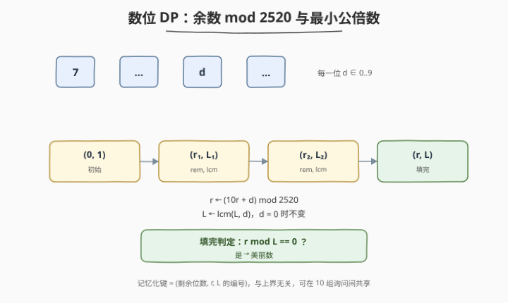
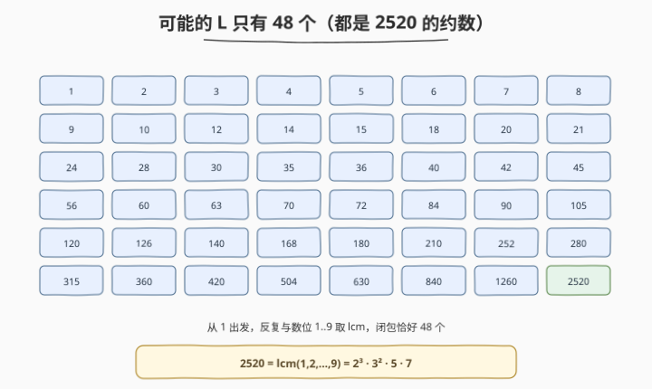

# Codeforces 55D 区间内美丽数的计数 题解

## 1. 题目概述

- **题目链接**：https://codeforces.com/problemset/problem/55/D
- **比赛来源**：Codeforces Beta Round 51 · Problem D（UTC 2011-01-14）
- **难度**：2500
- **标签**：数位 DP、数论、状态压缩
- **评测类型**：普通
- **限制**：时间 4 s / 内存 256 MB

**题意**：若一个正整数能被它的每一个非零数位整除，就称它是「美丽数」。给定 $t$ 个区间 $[l_i, r_i]$，分别求区间内美丽数的个数。

**约束**：

- $1 \le t \le 10$，$1 \le l_i \le r_i \le 9 \times 10^{18}$：最多 19 位，区间端点要用 64 位整数；答案也可能达到 $10^{16}$ 量级，同样要 64 位。
- 判断「被每个非零数位整除」等价于「被这些数位的最小公倍数整除」，而 $1..9$ 的最小公倍数是 $2520$，所以余数只需对 $2520$ 取模。
- $2520$ 的约数很多，但真正能成为「若干个数位的最小公倍数」的只有 48 个，状态数因此可控。
- 10 组询问如果各自重新 DP 会重复计算，需要把与询问无关的记忆化状态共享。

## 2. 示例与观察

官方样例 1（输入 / 输出原样）：

```text
输入：
1
1 9

输出：
9
```

官方样例 2：

```text
输入：
1
12 15

输出：
2
```

**样例 1 演算**：$1$ 到 $9$ 都是一位数，任何一位数都能被自己整除，所以 9 个全是美丽数，答案 9。

**样例 2 演算**：逐个数检查：

| 数 | 非零数位 | 是否美丽 |
|----|----------|----------|
| 12 | 1, 2 | $12$ 能被 1 和 2 整除 → 是 |
| 13 | 1, 3 | $13$ 不能被 3 整除 → 否 |
| 14 | 1, 4 | $14$ 不能被 4 整除 → 否 |
| 15 | 1, 5 | $15$ 能被 1 和 5 整除 → 是 |

所以区间 $[12,15]$ 内有 2 个，答案是 2。

自造样例（均已用参考程序与暴力核对）：

| 输入 | 输出 | 说明 |
|------|------|------|
| `1` / `1 1` | 1 | 1 是美丽数 |
| `1` / `10 10` | 1 | 非零位只有 1 |
| `1` / `13 13` | 0 | 不能被 3 整除 |
| `1` / `1 2520` | 349 | $2520 = \operatorname{lcm}(1..9)$，是重要的分界点 |
| `1` / `2520 2520` | 1 | 2520 能被 1..9 全部整除 |
| `1` / `1 1000000` | 29951 | 暴力可验证的规模 |

**观察**：

1. 一个数 $x$ 是美丽数，当且仅当 $x$ 能被 $\operatorname{lcm}\{\text{非零数位}\}$ 整除；数位 0 不参与（也不能做除数）。
2. 非零数位只可能来自 $\{1,\dots,9\}$，它们的最小公倍数是 $2520$，所以任意「数位最小公倍数」都是 $2520$ 的约数。
3. 从 $1..9$ 出发反复取最小公倍数，只可能得到 48 个不同的值；把它们编号后，DP 的第三维就只有 48 种。
4. 数位 DP 天然按「剩余位数」划分阶段；把状态键设为「剩余位数、当前余数、当前最小公倍数编号」，就能让 10 组询问共享同一张记忆化表。

## 3. 解题思路

### 3.1 朴素做法与瓶颈

逐个枚举 $[l,r]$ 中的数并检查数位：$r$ 可达 $9 \times 10^{18}$，绝无可能。必须利用「数位」这一结构做数位 DP，并且把区间拆成 $\text{count}(r) - \text{count}(l-1)$。

### 3.2 核心观察：只需记录余数与最小公倍数



设当前已经确定了若干高位，我们关心两件事：

- 这些高位组成的数对 $2520$ 取模的余数 `rem`；
- 已经出现的非零数位的最小公倍数 $L$。

当所有位都确定后，这个数美丽的充要条件是 `rem % L == 0`。原因是：$L$ 是「$2520$ 的约数」，而 $x \bmod L$ 可以从 $x \bmod 2520$ 推出（因为 $L \mid 2520$，取模 $2520$ 的余数再对 $L$ 取模即可）。

状态设计（从高位向低位填）：

- `dfs(pos, rem, L, tight)`：已经填了 `pos` 位，当前余数 `rem`，当前最小公倍数 `L`，`tight` 表示前缀是否与上界完全相同；
- 若 `pos` 走到末尾，返回 `rem % L == 0`；
- 否则枚举这一位允许的数字 $d$（`tight` 时上限是上界该位，否则是 9），转移到
$$\text{rem}' = (10\,\text{rem} + d) \bmod 2520,\qquad L' = \operatorname{lcm}(L, d)$$
（$d = 0$ 时 $L' = L$；约定 $\operatorname{lcm}(L, 0) = L$，因为 0 不贡献约束）。



**为什么只有 48 种 $L$**：从 $L = 1$ 出发，每次与一个数位 $d \in \{1,\dots,9\}$ 取最小公倍数，得到的数一定是 $2520$ 的约数；把 9 个数位反复作用后取闭包，恰好得到 48 个值（$1,2,3,4,5,6,7,8,9,10,12,14,15,18,20,21,24,28,30,35,36,40,42,45,56,60,63,70,72,84,90,105,120,126,140,168,180,210,252,280,315,360,420,504,630,840,1260,2520$）。用哈希表把每个值映射到 $0..47$，转移时直接查表。

**记忆化的共享**：把状态键写成「剩余还要填的位数 `left`、`rem`、`L` 的编号」，而不含上界信息；只有 `tight == false` 的状态才能缓存（`tight == true` 的状态依赖具体上界，但它只有 $O(19 \times 10)$ 个，直接算）。这样不同询问、不同长度都能共享同一张 `dp[left][rem][l]` 表。

### 3.3 算法流程

1. 预处理 48 个最小公倍数、它们的编号，以及 `nxt[l][d]`（当前 $L$ 遇到数位 $d$ 后的新编号）。
2. 把记忆化表初始化为 $-1$。
3. 对每个询问 $[l,r]$：输出 `count(r) - count(l-1)`。
4. `count(x)`：把 $x$ 转成十进制串，从最高位做数位 DP；`count` 包含数字 0（全前导零），最后减去 1，因为题目只统计正整数。

### 3.4 样例走查

以样例 2 的 $13$ 为例：数位是 $1,3$。走完两位后 `rem = 13`，`L = lcm(1,3) = 3`，$13 \bmod 3 = 1 \ne 0$，不计入；而 $12$ 的 `L = lcm(1,2) = 2`，$12 \bmod 2 = 0$，计入。$14$ 的 `L = 4`，$14 \bmod 4 = 2 \ne 0$；$15$ 的 `L = 5`，$15 \bmod 5 = 0$。所以 $[12,15]$ 中只有 $12$ 和 $15$，共 2 个。

## 4. 正确性证明

**引理 1**：正整数 $x$ 是美丽数，当且仅当 $x$ 能被 $L(x) := \operatorname{lcm}\{\text{非零数位}\}$ 整除。

**证明**：若 $x$ 能被每个非零数位整除，则它能被这些数的最小公倍数整除（最小公倍数是它们的公倍数中最小的，任何公倍数都是它的倍数）。反之，若 $x$ 能被 $L(x)$ 整除，而每个非零数位都整除 $L(x)$，由传递性每个非零数位都整除 $x$。∎

**引理 2**：数位 DP 中出现的 $L$ 一定整除 $2520$，且所有可能的 $L$ 恰为 48 个值。

**证明**：初始 $L=1$；每次 $L \leftarrow \operatorname{lcm}(L,d)$，而 $d \in \{0,\dots,9\}$ 且 $0$ 不改变 $L$，所以 $L$ 始终是 $\{1,\dots,9\}$ 某个子集的最小公倍数，必整除 $\operatorname{lcm}(1,\dots,9) = 2520$。枚举所有子集的最小公倍数（代码用「对 1..9 依次取闭包」实现）恰好得到 48 个不同的值。∎

**引理 3（DP 不变量）**：对任意状态 $(\mathit{left}, \mathit{rem}, l)$（`tight == false`），记忆化值等于：在所有长度为 `left` 的数字串中，满足「把该串接在当前前缀之后，最终数是美丽数」的串的个数。

**证明**：对 `left` 归纳。`left = 0` 时没有可填的位，最终数就是当前前缀，由引理 1，条件化为 $\mathit{rem} \bmod L_l = 0$，与代码一致。`left > 0` 时，枚举下一位 $d$，新状态为 $(\mathit{left}-1, (10\mathit{rem}+d) \bmod 2520, \operatorname{nxt}(l,d))$，各分支互不重叠且覆盖所有可能的下一位，由归纳假设求和即得不变量。∎

**定理**：`count(x)` 返回 $[1,x]$ 中美丽数的个数，从而每个询问的答案正确。

**证明**：`count(x)` 的数位 DP 按「与上界的公共前缀」分类枚举所有不超过 $x$ 的非负整数：`tight` 分支保证不越过上界，非 `tight` 分支可以任意填。由引理 1、3，每个数被计入当且仅当它是美丽数。数字 $0$ 也被 DP 计入（所有位取 0 时 `rem = 0`、$L = 1$，$0 \bmod 1 = 0$），所以最后减 1；于是返回值恰为 $[1,x]$ 内的美丽数个数。区间答案由前缀和相减得到。∎

## 5. 复杂度分析

- **时间**：状态数 $19 \times 2520 \times 48 \approx 2.3 \times 10^6$，每个状态枚举 10 个数字，总计约 $2.3 \times 10^7$ 次转移；由于记忆化在 10 组询问间共享，整张表只算一次。实测 10 组最大询问（$r$ 接近 $9 \times 10^{18}$）C++ 约 0.05–0.13 s。
- **空间**：记忆化表 $19 \times 2520 \times 48$ 个 `long long`，约 19 MB；加上预处理与输入输出，实测峰值约 27 MB。
- **数值范围**：$r \le 9 \times 10^{18}$ 是 19 位数，`long long` 放得下；美丽数个数不超过 $r$，也放得下。
- **Python**：同一算法用 `lru_cache` 实现，10 组最大询问约 4 s（CPython），接近 4 s 限制；建议使用 PyPy3 或直接提交 C++。

## 6. 参考代码

### C++17

```cpp
#include <bits/stdc++.h>
#include <numeric>
using namespace std;

static const int MOD = 2520;          // lcm(1..9)
int L[64], idOf[2521], nxtL[64][10], cntL;
long long dp[20][MOD][64];

long long dfs(int pos, int rem, int li, bool tight, const string &s) {
    if (pos == (int)s.size()) return (rem % L[li] == 0) ? 1 : 0;
    int left = (int)s.size() - pos;       // 还要放的位数（含当前位）
    if (!tight && dp[left][rem][li] != -1) return dp[left][rem][li];
    int lim = tight ? s[pos] - '0' : 9;
    long long res = 0;
    for (int d = 0; d <= lim; ++d)
        res += dfs(pos + 1, (rem * 10 + d) % MOD, nxtL[li][d], tight && (d == lim), s);
    if (!tight) dp[left][rem][li] = res;
    return res;
}

long long countUpTo(long long x) {
    if (x <= 0) return 0;
    string s = to_string(x);
    return dfs(0, 0, idOf[1], true, s) - 1;   // 去掉数字 0
}

int main() {
    // 1..9 任意子集的最小公倍数只有 48 种，全部枚举出来
    set<int> lcms{1};
    for (int d = 1; d <= 9; ++d) {
        set<int> add;
        for (int l : lcms) add.insert(l / gcd(l, d) * d);
        lcms.insert(add.begin(), add.end());
    }
    cntL = 0;
    memset(idOf, -1, sizeof(idOf));
    for (int l : lcms) { L[cntL] = l; idOf[l] = cntL++; }
    for (int i = 0; i < cntL; ++i)
        for (int d = 0; d <= 9; ++d)
            nxtL[i][d] = idOf[L[i] / gcd(L[i], max(d, 1)) * max(d, 1)];
    memset(dp, -1, sizeof(dp));

    int t;
    if (scanf("%d", &t) != 1) return 0;
    for (int i = 0; i < t; ++i) {
        long long l, r;
        scanf("%lld %lld", &l, &r);
        printf("%lld\n", countUpTo(r) - countUpTo(l - 1));
    }
    return 0;
}
```

### Python3

```python
import sys
from math import gcd
from functools import lru_cache

MOD = 2520
_l = {1}
for _d in range(2, 10):
    _l |= {x // gcd(x, _d) * _d for x in _l}
LCMS = sorted(_l)
ID = {v: i for i, v in enumerate(LCMS)}
NXT = [[ID[LCMS[i] // gcd(LCMS[i], max(d, 1)) * max(d, 1)] for d in range(10)]
       for i in range(len(LCMS))]


def main() -> None:
    data = sys.stdin.buffer.read().split()
    if not data:
        return
    t = int(data[0])

    @lru_cache(maxsize=None)
    def dfs(left, rem, li):
        if left == 0:
            return 1 if rem % LCMS[li] == 0 else 0
        res = 0
        for d in range(10):
            res += dfs(left - 1, (rem * 10 + d) % MOD, NXT[li][d])
        return res

    def count_up_to(x):
        if x <= 0:
            return 0
        digits = [int(c) for c in str(x)]
        total = 0
        rem, li = 0, ID[1]
        n = len(digits)
        for pos, lim in enumerate(digits):
            left = n - pos
            for d in range(lim):
                total += dfs(left - 1, (rem * 10 + d) % MOD, NXT[li][d])
            rem = (rem * 10 + lim) % MOD
            li = NXT[li][lim]
        if rem % LCMS[li] == 0:
            total += 1
        return total - 1   # 去掉数字 0

    out = []
    for i in range(t):
        l = int(data[1 + 2 * i]); r = int(data[2 + 2 * i])
        out.append(str(count_up_to(r) - count_up_to(l - 1)))
    print("\n".join(out))


main()
```

Python 版在 CPython 下对 10 组最大询问约 4 s，**建议使用 PyPy3 或直接提交 C++**。

## 7. 边界情况与易错点

1. **数字 0**：数位 0 不能作为除数，也不改变最小公倍数。DP 若把前导零当成「数位 0」处理，`L` 会保持 1，行为正确；但最终计数要把数字 $0$ 本身减掉（`count` 减去 1），否则 `1 9` 会输出 10。
2. **`l = 1` 时 `count(l-1) = count(0)`**：必须返回 0，不能返回「0 是美丽数」的 1。代码里 `if (x <= 0) return 0` 专门处理。
3. **最小公倍数的编码**：只对 48 个合法值建表，其余值不可能是状态；若直接开 `2520 \times 2520` 的转移表会浪费且易越界。用 `idOf` 查编号，`nxtL` 预计算。
4. **余数只对 2520 取模**：因为所有可能的 `L` 都整除 2520，`x mod L` 可由 `(x mod 2520) mod L` 得到；若对别的数取模，需要更大的状态或无法还原。
5. **64 位整数**：$r \le 9 \times 10^{18}$，19 位；`int` 完全不够，`long long` 刚好；答案用 `long long` 或 `unsigned long long` 都可以，但减法 `count(r) - count(l-1)` 用有符号类型更直观。
6. **记忆化键不能含 `tight`**：`tight` 状态依赖具体上界，缓存会污染不同询问；代码只在 `!tight` 时写表。`left` 表示「还要填的位数」，这样不同长度的询问也能共享同一张表。
7. **`lcm(L, 0)` 的约定**：数位 0 不参与，代码里用 `max(d,1)` 把 0 当作 1 处理（`lcm(L,1)=L`），与语义一致。
8. **多组询问**：$t$ 组之间必须共享记忆化表，否则每组都从零算一遍会慢一个数量级；同时注意每组输出换行。
9. **数组大小**：`dp[20][2520][64]` 的三维下标要留够（19 位、余数 $0..2519$、编号 $0..47$），开小了会越界。
10. **Python 递归与缓存**：`lru_cache` 的键是 `(left, rem, li)`，递归深度最多 19，安全；但状态数很大，CPython 下接近时限，需 PyPy。

## 8. 验证记录

- **编译环境与命令**：本机只有 Apple clang 21.0.0（`/usr/bin/g++` 是 clang 的软链），用 `clang++ -std=c++17 -O2 -Wall` 搭配仓库自带的 `codeforces/tools/include/bits/stdc++.h` 兼容头编译；Python 为 3.9.6。
- **官方样例**：2 / 2 通过（`1 9` → `9`，`12 15` → `2`），C++ 与 Python 输出一致。
- **独立暴力对拍**：另写 `brute.cpp`，对 $1..2 \times 10^6$ 的每个数直接逐位检查是否整除，并做前缀和；随机 **300 组**询问（端点随机落在 $[1, 2 \times 10^6]$，含 $[1,10]$、$[1,2520]$ 等边界）与参考程序对拍，C++ 输出全部一致。
- **大范围交叉验证**：另写独立的 Python 数字 DP（与 C++ 实现细节不同：迭代式前缀枚举 + `lru_cache`），对 10 组、每组 10 个随机大区间（$r$ 到 $9 \times 10^{18}$）与 C++ 比对，输出全部一致。
- **额外测试**：`1 1` → 1、`10 10` → 1、`13 13` → 0、`1 2520` → 349、`2520 2520` → 1、`1 1000000` → 29951，均与暴力一致。
- **最大约束性能**：10 组 $r = 9 \times 10^{18}$ 的询问，C++ 端到端 0.05–0.13 s，峰值内存约 27 MB；Python（CPython）约 4 s、峰值内存约 180 MB（`lru_cache` 的元组键开销大），故正文注明建议 PyPy3 / C++。
- **图片校验**：两张 SVG（`cf55d_states.svg`、`cf55d_lcm.svg`）均通过 `xml.etree.ElementTree.parse`；用 headless Chrome 实际排版，逐个量出文本块的包围盒，确认没有越出 `viewBox`、没有互相重叠或压到边框。
- **公式校验**：公式经 KaTeX（`throwOnError`）渲染无报错。
- **复核状态**：verified（样例、暴力对拍、大范围交叉、性能、图片、公式均已实跑）。

## 相关题目与扩展

- [Codeforces 55A Flea travel](https://codeforces.com/problemset/problem/55/A)：同场 A 题，数论判定。
- [Codeforces 55C Pie or die](https://codeforces.com/problemset/problem/55/C)：同场 C 题，博弈。
- [LeetCode 1012. 至少有 1 位重复的数字](https://leetcode.cn/problems/numbers-with-repeated-digits/)：同样是「按数位统计」的 DP，只是状态换成已用数字的集合。
- [Codeforces 628D Magic Numbers](https://codeforces.com/problemset/problem/628/D)：数位 DP + 取模状态，结构比本题简单，是很好的入门题。
- [Codeforces 401D Roman and Numbers](https://codeforces.com/problemset/problem/401/D)：数位重排 + 取模，状态是「已用数字集合 + 余数」，与本题的「最小公倍数 + 余数」互为对照。

**延伸思考**：

1. **若数位集合扩大到 $1..9$ 以外**：例如允许出现字母表示的十六进制数位，最小公倍数额外增加因子，状态数会变化；思路不变，先算新的总公倍数，再枚举所有可能的子集公倍数。
2. **若要求「被所有数位整除」而不是「被每个非零数位整除」**：数字 0 作为除数无意义，本质不变；但若题目改成「被数位之和整除」或「被数位之积整除」，状态就完全不同（和、积的范围与可压缩性都不同）。
3. **计数型数位 DP 的通用优化**：把「与上界有关」的状态留在递归路径上、只缓存「剩余位数 + 内部状态」，可以跨询问共享，这与本题 10 组询问的加速来源一致；更一般地，若状态与上界无关，可以预计算整张表再 $O(1)$ 查询。
4. **若询问是「第 $k$ 个美丽数」**：可以在数位 DP 的基础上做「按位确定」的二分/逐位计数，利用 `count` 函数在 $O(\log_{10} X)$ 次调用内找出答案，是本题的自然延伸。

