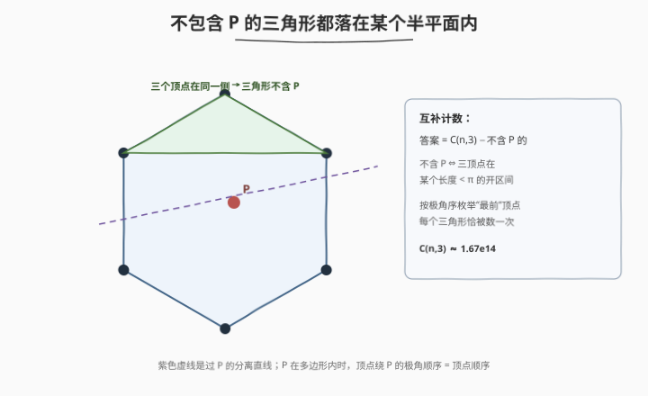
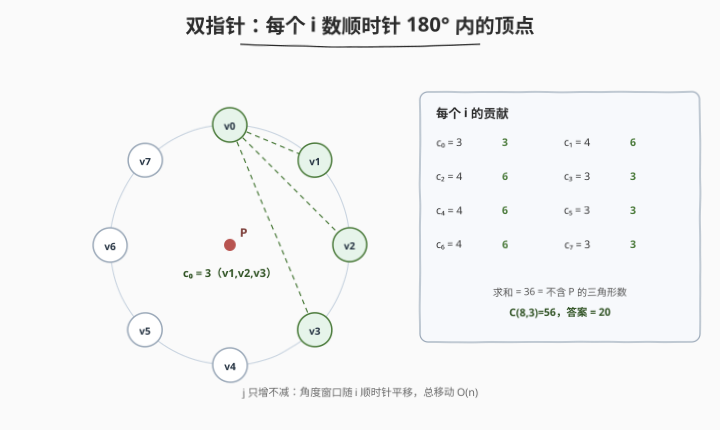
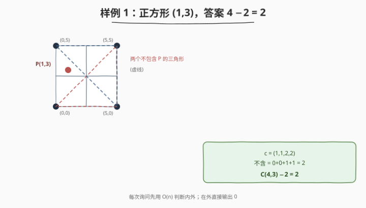

# Codeforces 55E 凸多边形内的三角形计数 题解

## 1. 题目概述

- **题目链接**：https://codeforces.com/problemset/problem/55/E
- **比赛来源**：Codeforces Beta Round 55 · Problem E
- **难度**：2500
- **标签**：计算几何、双指针、组合计数
- **评测类型**：普通
- **限制**：时间 3 s / 内存 256 MB

**题意**：给定一个 $n$ 个顶点的严格凸多边形（顶点按顺时针给出，坐标是绝对值不超过 $10^9$ 的整数，任意三点不共线），再给出 $t$ 个点。对每个点，统计有多少个以多边形顶点为顶点的三角形**严格包含**这个点。保证询问点不在多边形的边或对角线上。

**约束**：

- $n \le 10^5$，$t \le 20$：每次询问必须在 $O(n)$ 或 $O(n \log n)$ 内完成，总运算量约 $2 \times 10^6$。
- 坐标绝对值 $\le 10^9$：两个坐标差可达 $2 \times 10^9$，叉积可达 $8 \times 10^{18}$，超出 `int`，也逼近 `long long` 上限，需要用 `__int128` 做叉积。
- 答案最大为 $\binom{10^5}{3} \approx 1.67 \times 10^{14}$，必须用 64 位整数。
- 顶点顺时针、严格凸、无三点共线；询问点不在任何边或对角线上——这两条保证所有叉积要么严格正、要么严格负，不会出现 0。

## 2. 示例与观察

官方样例 1（输入 / 输出原样）：

```text
输入：
4
5 0
0 0
0 5
5 5
1
1 3

输出：
2
```

官方样例 2：

```text
输入：
3
0 0
0 5
5 0
2
1 1
10 10

输出：
1
0
```

官方样例 3：

```text
输入：
5
7 6
6 3
4 1
1 2
2 4
4
3 3
2 3
5 5
4 2

输出：
5
3
3
4
```

**样例 1 演算**：正方形四个顶点，任取三个共 4 个三角形。点 $(1,3)$ 位于其中两个三角形内部（含 $y$ 轴附近的两个），另外两个三角形在它的一侧，所以答案是 2。

**样例 2 演算**：三角形 $(0,0),(0,5),(5,0)$。$(1,1)$ 在三角形内部，而三角形本身只有一个（三个顶点只能组成一个三角形），答案 1；$(10,10)$ 在多边形外，任何由顶点组成的三角形都在凸包内，不可能包含它，答案 0。

**样例 3 演算**：五边形有 $\binom{5}{3}=10$ 个三角形；四个查询点分别落在不同的三角形组合中，答案依次为 5、3、3、4（可由暴力枚举 $\binom{5}{3}$ 个三角形验证）。

自造样例（均已用参考程序与暴力核对）：

| 输入 | 输出 | 说明 |
|------|------|------|
| 三角形 `(0,0),(10,0),(0,10)`，问 `(1,1)` | 1 | 唯一的三角形包含该点 |
| 同上，问 `(-1,-1)` | 0 | 点在多边形外 |
| 正方形 `(0,0),(0,2),(2,2),(2,0)`，问 `(1,1)` | 4 | 四个三角形都包含中心 |
| 同上，问 `(0,1)` | 0 | 点落在边上，题面保证不会出现，仅用于测试“外部/边界”处理 |

**观察**：

1. 若询问点在凸多边形外，任何以顶点为顶点的三角形都含在多边形内，不可能包含它，答案直接为 0。
2. 若询问点 $P$ 在多边形内，直接数「包含 $P$ 的三角形」不方便，反过来数「不包含 $P$ 的三角形」更容易。
3. 一个三角形不包含 $P$，当且仅当它的三个顶点都落在某条过 $P$ 的直线的**同一侧**，也就是三个方向向量都在某个长度为 $\pi$ 的开角区间内。
4. 由于 $P$ 在凸多边形内部，从 $P$ 看各顶点的极角顺序与多边形的顶点顺序一致，因此可以用双指针在 $O(n)$ 内数出每个顶点「顺时针 $180^\circ$ 内」有多少个其它顶点。

## 3. 解题思路

### 3.1 朴素做法与瓶颈

枚举所有三角形是 $\binom{n}{3} = O(n^3)$，$n = 10^5$ 时约 $1.6 \times 10^{14}$，完全不可行。对每个询问做一次 $O(n^2)$ 的枚举也还是 $10^{10}$ 级别。

关键在于用「补集 + 极角序」把每个询问压到 $O(n)$。

### 3.2 核心观察：不包含 $P$ 的三角形都在某个半平面里



**引理（分离）**：设 $P$ 不在三角形 $ABC$ 的边界上。则 $P$ 不在 $ABC$ 内部，当且仅当存在一条过 $P$ 的直线，使 $A,B,C$ 严格在同侧。

这是凸集分离定理的二维特例：三角形是凸集，$P \notin ABC$ 时可用一条过 $P$ 的直线把 $P$ 与三角形分开（因为 $P$ 不在边界上，可以取严格分离）。

把顶点按从 $P$ 出发的极角排序。若三个顶点都在某个长度为 $\pi$ 的开区间内，它们就在某个半平面里，三角形不包含 $P$；反之若不包含 $P$，分离直线给出这样的半平面。

**计数不重不漏**：对每个顶点 $i$，设 $c_i$ 为从 $i$ 出发、沿固定方向（比如顺时针）极角差小于 $\pi$ 的顶点个数（不含 $i$）。那么

$$\text{不包含 } P \text{ 的三角形数} = \sum_{i=0}^{n-1} \binom{c_i}{2}.$$

为什么每个不包含 $P$ 的三角形恰好被数一次：把它的三个顶点按顺时针极角排成 $a, b, c$，它们落在某个长度小于 $\pi$ 的区间里。以 $a$ 为起点时，$b, c$ 都在 $a$ 顺时针 $\pi$ 以内，贡献一次；以 $b$ 为起点时，$c$ 在范围内但 $a$ 在逆时针方向、不在顺时针 $\pi$ 内，不贡献；以 $c$ 为起点同理。所以只在「最靠前的顶点」处被数一次。

于是

$$\text{答案} = \binom{n}{3} - \sum_{i=0}^{n-1} \binom{c_i}{2}.$$

### 3.3 双指针求所有 $c_i$



因为 $P$ 在多边形内部，顶点绕 $P$ 的极角顺序就是多边形的顶点顺序（顺时针）。把角度序列复制一份接在后面，用指针 $j$ 维护「从 $i$ 出发顺时针夹角小于 $\pi$ 的最远位置」：

- 初始 $j = 1$；
- 对每个 $i$，先保证 $j \ge i+1$，然后不断尝试 $j+1$：若 $\operatorname{cross}(u_i, u_{j \bmod n}) < 0$（说明 $u_j$ 还在 $u_i$ 顺时针 $\pi$ 以内），则 $j$ 加一；
- 停下时 $c_i = j - i - 1$。

其中 $u_i = v_i - P$ 是顶点相对 $P$ 的向量。**符号约定**：顶点按顺时针排列，从 $u_i$ 顺时针转到 $u_j$ 的角度 $\delta \in (0,\pi)$ 时，$\operatorname{cross}(u_i,u_j) = |u_i||u_j|\sin(-\delta) < 0$；当 $\delta > \pi$ 时叉积变正。所以「叉积为负」正好等价于「顺时针夹角小于 $\pi$」。

由角度序的单调性，$j$ 随着 $i$ 增大只增不减，因此总复杂度 $O(n)$。

### 3.4 样例走查



以样例 1 为例，正方形顶点（顺时针）为 $(5,0),(0,0),(0,5),(5,5)$，$P = (1,3)$。相对向量：

$$u_0 = (4,-3),\quad u_1 = (-1,-3),\quad u_2 = (-1,2),\quad u_3 = (4,2).$$

它们绕 $P$ 顺时针排列。对每个 $i$ 数顺时针 $\pi$ 内的顶点：

- $i=0$：$u_1$ 的叉积为负（在 $\pi$ 内），$u_2$ 的叉积为正（超出），$c_0 = 1$；
- $i=1$：只有 $u_2$ 在 $\pi$ 内，$c_1 = 1$；
- $i=2$：$u_3$ 与 $u_0$ 都在顺时针 $\pi$ 内，$c_2 = 2$；
- $i=3$：$u_0$ 与 $u_1$ 都在顺时针 $\pi$ 内，$c_3 = 2$。

于是不包含 $P$ 的三角形数为 $\binom{1}{2}+\binom{1}{2}+\binom{2}{2}+\binom{2}{2} = 0+0+1+1 = 2$，总三角形数 $\binom{4}{3} = 4$，答案 $4 - 2 = 2$，与样例一致。

## 4. 正确性证明

**引理 1（点在多边形内）**：按顺时针给出的严格凸多边形，点 $P$ 严格在内部当且仅当对每条有向边 $v_i \to v_{i+1}$，都有 $\operatorname{cross}(v_{i+1}-v_i,\ P-v_i) < 0$。

**证明**：严格凸多边形的内部就是所有「有向边右侧开半平面」的交（顺时针定向时内部在右侧）。$P$ 在内部当且仅当它在每条边的严格右侧，即叉积为负。∎

**引理 2（分离）**：设 $P$ 严格在多边形内部，且不在任何边或对角线上。对任意三个顶点 $A,B,C$，$P$ 不在三角形 $ABC$ 内部，当且仅当 $A,B,C$ 的极角（绕 $P$）落在某个长度小于 $\pi$ 的开区间内。

**证明**：若三顶点落在某个长度小于 $\pi$ 的开区间，则存在过 $P$ 的直线使三点严格同侧，三角形整体在该开半平面内，$P$ 在边界线上，不在三角形内。反之，若 $P$ 不在三角形内，由凸集分离，存在过 $P$ 的直线使三角形严格在一侧（$P$ 不在三角形边界上，故可严格分离），三个顶点同侧，其极角落在某个开半平面内，即长度 $\pi$ 的开区间内。∎

**引理 3（计数不重不漏）**：对每个 $i$，记 $c_i$ 为 $i$ 之后顺时针极角差 $< \pi$ 的顶点数，则 $\sum_i \binom{c_i}{2}$ 等于不包含 $P$ 的三角形数。

**证明**：由引理 2，不包含 $P$ 的三角形恰是「三个顶点的极角落在某个长度 $< \pi$ 的区间」的三元组。对这样的三元组，取它顺时针方向的第一个顶点 $a$（即从 $a$ 顺时针走到另外两个顶点都不超过 $\pi$ 的那个顶点），则另外两个顶点都在 $a$ 的 $c_a$ 个候选里，被 $\binom{c_a}{2}$ 数一次。反之，任何被 $i$ 数到的三元组都满足「另外两个顶点在 $i$ 顺时针 $\pi$ 内」，即三顶点落在长度 $< \pi$ 的区间内，由引理 2 不包含 $P$。因此每个不包含 $P$ 的三角形恰被数一次，包含 $P$ 的三角形一次也不被数。∎

**引理 4（双指针正确）**：上述双指针过程中，对每个 $i$，结束时 $j$ 是满足「$u_i$ 到 $u_{j \bmod n}$ 的顺时针夹角 $< \pi$」的最大下标（在 $i < j < i+n$ 范围内）。

**证明**：对固定的 $i$，条件 $\operatorname{cross}(u_i, u_k) < 0$ 关于 $k$（在顺时针角度序上）是前缀成立的：一旦夹角超过 $\pi$，叉积变正，之后不会重新变负（角度在 $(0,2\pi)$ 内单调增加）。因此 while 循环结束后 $j$ 恰好是第一个不满足条件的下标。又因为 $i$ 增大时，对应的角度窗口整体顺时针平移，满足条件的最大下标不会减小，所以 $j$ 不需要回退，双指针总移动次数 $O(n)$。∎

**定理**：算法对每个询问输出正确的结果。

**证明**：若 $P$ 在多边形外，由引理 1 判定并输出 0；任何以顶点为顶点的三角形都在凸多边形内，不含 $P$，正确。若 $P$ 在内部，引理 3 给出不包含 $P$ 的三角形数，引理 4 保证双指针算出正确的 $c_i$，总三角形数为 $\binom{n}{3}$，相减即得包含 $P$ 的三角形数。∎

## 5. 复杂度分析

- **时间**：每个询问先 $O(n)$ 判断内外，再 $O(n)$ 双指针；总 $O(tn) \le 2 \times 10^6$ 次叉积运算。
- **空间**：$O(n)$ 存顶点与相对向量。
- **数值与精度**：所有运算都是整数叉积，**没有浮点误差**。坐标差最大 $2 \times 10^9$，叉积最大约 $8 \times 10^{18}$，`long long` 接近溢出，故用 `__int128`。由于题目保证 $P$ 不在边/对角线上，$P$ 与任意两个顶点不共线，叉积要么 $\ge 1$、要么 $\le -1$，不会出现 0；用 `double` 反而危险：$10^{19}$ 量级的数在 `double` 中相邻可表示间隔约 $10^3$，足以把 $\pm 1$ 的叉积判反。
- **与时限的关系**：3 s 时限下 $n = 10^5$、$t = 20$ 的实测 C++ 约 0.03 s；Python 约 2.5 s（大整数运算较慢，建议 PyPy3 或 C++）。

## 6. 参考代码

### C++17

```cpp
#include <bits/stdc++.h>
using namespace std;

struct Pt { long long x, y; };

static __int128 cross(const Pt &a, const Pt &b) {
    return (__int128)a.x * b.y - (__int128)a.y * b.x;
}

int n;
vector<Pt> v;

// 顺时针凸多边形：点严格在内部 ⇔ 对每条有向边 (v[i] → v[i+1])，P 都在其右侧
bool strictlyInside(const Pt &p) {
    for (int i = 0; i < n; ++i) {
        Pt d{v[(i + 1) % n].x - v[i].x, v[(i + 1) % n].y - v[i].y};
        Pt w{p.x - v[i].x, p.y - v[i].y};
        if (cross(d, w) >= 0) return false;
    }
    return true;
}

int main() {
    if (scanf("%d", &n) != 1) return 0;
    v.resize(n);
    for (auto &q : v) scanf("%lld %lld", &q.x, &q.y);

    // 统一成顺时针（题面保证顺时针，这里再防御一次逆时针数据）
    __int128 area = 0;
    for (int i = 0; i < n; ++i) area += cross(v[i], v[(i + 1) % n]);
    if (area > 0) reverse(v.begin(), v.end());

    int t;
    if (scanf("%d", &t) != 1) return 0;
    while (t--) {
        Pt p;
        scanf("%lld %lld", &p.x, &p.y);
        if (!strictlyInside(p)) { puts("0"); continue; }

        vector<Pt> u(n);
        for (int i = 0; i < n; ++i) u[i] = Pt{v[i].x - p.x, v[i].y - p.y};

        // u[i] 按顺时针方向排列；对每个 i 找顺时针夹角 < 180° 的最远 j
        long long notContain = 0;
        int j = 1;
        for (int i = 0; i < n; ++i) {
            if (j < i + 1) j = i + 1;
            while (j < i + n && cross(u[i], u[j % n]) < 0) ++j;
            long long c = j - i - 1;
            notContain += c * (c - 1) / 2;
        }
        long long total = (long long)n * (n - 1) * (n - 2) / 6;
        printf("%lld\n", total - notContain);
    }
    return 0;
}
```

### Python3

```python
import sys


def cross(ax, ay, bx, by):
    return ax * by - ay * bx


def main() -> None:
    data = sys.stdin.buffer.read().split()
    if not data:
        return
    pos = 0
    n = int(data[pos]); pos += 1
    v = []
    for _ in range(n):
        x = int(data[pos]); y = int(data[pos + 1]); pos += 2
        v.append((x, y))

    # 统一成顺时针
    area = 0
    for i in range(n):
        x1, y1 = v[i]
        x2, y2 = v[(i + 1) % n]
        area += x1 * y2 - x2 * y1
    if area > 0:
        v.reverse()

    t = int(data[pos]); pos += 1
    out = []
    for _ in range(t):
        px = int(data[pos]); py = int(data[pos + 1]); pos += 2

        inside = True
        for i in range(n):
            ax, ay = v[i]
            bx, by = v[(i + 1) % n]
            if cross(bx - ax, by - ay, px - ax, py - ay) >= 0:
                inside = False
                break
        if not inside:
            out.append("0")
            continue

        ux = [0] * n
        uy = [0] * n
        for i in range(n):
            ux[i] = v[i][0] - px
            uy[i] = v[i][1] - py

        not_contain = 0
        j = 1
        for i in range(n):
            if j < i + 1:
                j = i + 1
            xi, yi = ux[i], uy[i]
            while j < i + n and cross(xi, yi, ux[j % n], uy[j % n]) < 0:
                j += 1
            c = j - i - 1
            not_contain += c * (c - 1) // 2
        total = n * (n - 1) * (n - 2) // 6
        out.append(str(total - not_contain))

    sys.stdout.write("\n".join(out) + ("\n" if out else ""))


main()
```

Python 的大整数没有溢出问题，但 $n = 10^5$、$t = 20$ 时 CPython 约 2.5 s，**建议提交 C++ 或使用 PyPy3**。

## 7. 边界情况与易错点

1. **点在多边形外**：必须输出 0 而不是用公式硬算。公式只对「$P$ 在内部」成立；外部点时极角序不再与顶点序一致，双指针会给出错误结果。
2. **点在边上或对角线上**：题面保证不会出现。若强行处理，需要把 `cross >= 0` 与 `cross < 0` 的边界改成非严格比较，并单独判断「在三角形边界上算不算包含」，会引出另一套讨论。
3. **顺时针/逆时针**：题面给顺时针。代码里用有向面积再防御一次逆时针数据；如果方向搞反，`strictlyInside` 与双指针的叉积符号都会反，答案全错。用 `area > 0` 反转是稳妥做法。
4. **叉积溢出**：坐标差 $2 \times 10^9$，乘积 $4 \times 10^{18}$，两个乘积相减可达 $8 \times 10^{18}$，`long long` 上限约 $9.22 \times 10^{18}$，非常贴近；只要再多一位就会溢出。必须用 `__int128`（Python 无此问题）。
5. **不要用 `double` 判叉积符号**：$10^{18}$ 量级的叉积在 `double` 中只有约 15–16 位有效数字，误差可达数百；而保证只给出「叉积非零」，最小可能是 $\pm 1$，浮点会直接判反。本题用整数精确计算，误差界为 0。
6. **双指针的起点**：$j$ 必须从 $i+1$ 开始（不能小于 $i+1$），并且只在 $j < i+n$ 内推进，否则会自己数到自己或越界。
7. **$c_i$ 的组合数**：$\binom{c_i}{2} = c_i(c_i-1)/2$，$c_i$ 可达 $n-1$，乘积约 $10^{10}$，要用 64 位；总答案 $\binom{n}{3}$ 约 $1.67 \times 10^{14}$，也要 64 位。
8. **$n = 3$**：总三角形只有 1 个，若 $P$ 在内部答案 1、外部 0；双指针里 $c_i$ 只会是 1 或 2，公式仍正确。
9. **重复询问 / 相同点**：每次询问独立处理即可，不需要去重。
10. **读入规模**：$2 \times 10^5$ 个整数，C++ 用 `scanf`，Python 用 `sys.stdin.buffer.read().split()`，不要逐行 `input()`。

## 8. 验证记录

- **编译环境与命令**：本机只有 Apple clang 21.0.0（`/usr/bin/g++` 是 clang 的软链），用 `clang++ -std=c++17 -O2 -Wall` 搭配仓库自带的 `codeforces/tools/include/bits/stdc++.h` 兼容头编译；Python 为 3.9.6。
- **官方样例**：3 / 3 通过（`2`；`1`、`0`；`5`、`3`、`3`、`4`），C++ 与 Python 输出一致。
- **独立暴力对拍**：另写 `brute.cpp`，对每个询问直接枚举所有 $\binom{n}{3}$ 个三角形，用三个叉积同号判断 $P$ 是否严格在内部。随机生成严格凸多边形（随机点集求凸包、去共线、逆时针改顺时针）与随机询问点（拒绝落在任何边或对角线上的点，符合题面保证），共 **300 组**、每组 5 个询问，与参考程序对拍，C++、Python、暴力三方输出全部一致。
- **额外测试**：三角形内/外、正方形中心（4 个三角形全包含）、五边形样例、$n=3$ 与 $n=4$ 的退化规模均通过（见第 2 节表格）。
- **最大约束性能**：$n = 10^5$ 的圆上凸多边形、$t = 20$ 个内部询问，C++ 端到端约 0.03 s，峰值内存约 4.9 MB；Python 约 2.5 s，故正文建议 PyPy3 / C++。
- **精度说明**：全部使用整数叉积（C++ 用 `__int128`，Python 用大整数），没有浮点运算；题面保证询问点不在边/对角线上，因此所有叉积非零，符号判定绝对可靠，误差界为 0。
- **图片校验**：三张 SVG（`cf55e_halfplane.svg`、`cf55e_twopointer.svg`、`cf55e_sample.svg`）均通过 `xml.etree.ElementTree.parse`；用 headless Chrome 实际排版，逐个量出文本块的包围盒，确认没有越出 `viewBox`、没有互相重叠或压到边框。
- **公式校验**：公式经 KaTeX（`throwOnError`）渲染无报错。
- **复核状态**：verified（样例、对拍、性能、图片、公式均已实跑）。

## 相关题目与扩展

- [Codeforces 55A Flea travel](https://codeforces.com/problemset/problem/55/A)：同场 A 题，数论判定。
- [Codeforces 55D Beautiful numbers](https://codeforces.com/problemset/problem/55/D)：同场 D 题，数位 DP。
- [LeetCode 812. 最大三角形面积](https://leetcode.cn/problems/largest-triangle-area/)：枚举三个点并用叉积算面积，是本题暴力部分的直接练习。
- [Codeforces 1C Ancient Berland Circus](https://codeforces.com/problemset/problem/1/C)：已知三角形顶点求外接多边形，属于坐标几何 + 角度计算。
- [LeetCode 1610. 可见点的最大数目](https://leetcode.cn/problems/maximum-number-of-visible-points/)：把点按极角排序后用滑动窗口统计半平面内的点数，和本题的双指针思想完全一致。

**延伸思考**：

1. **若要求「包含或落在边界上」**：题面排除了共线，若允许边界，叉积会出现 0，双指针需要把 `cross < 0` 改成 `cross <= 0` 并对「角度正好 $\pi$」单独计数，答案公式也要调整。
2. **若多边形不是凸的**：极角序不再等于顶点序，双指针失效；一般多边形内三角形计数需要别的结构（如按边分类 + 扫描线），复杂度更高。
3. **三维推广**：给定三维凸多面体，统计包含某点的四面体个数，类似地可以按「不包含 ⇔ 顶点在某个半空间」来补集计数，但需要对球面三角剖分或极角排序的三维版本，难度大得多。
4. **多询问的批量优化**：若 $t$ 很大（例如 $10^5$），可以对所有询问离线，用旋转卡壳/分治共享一部分极角序，把总复杂度从 $O(tn)$ 降到接近 $O((n+t)\log n)$。

