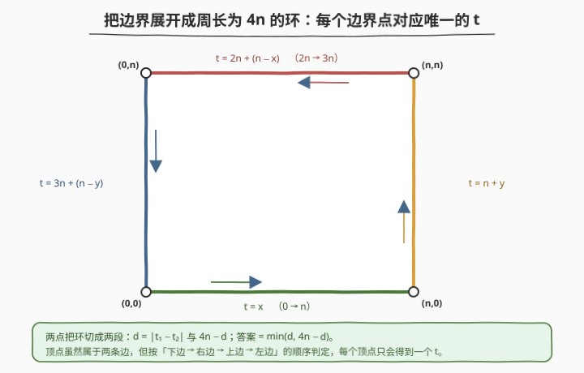
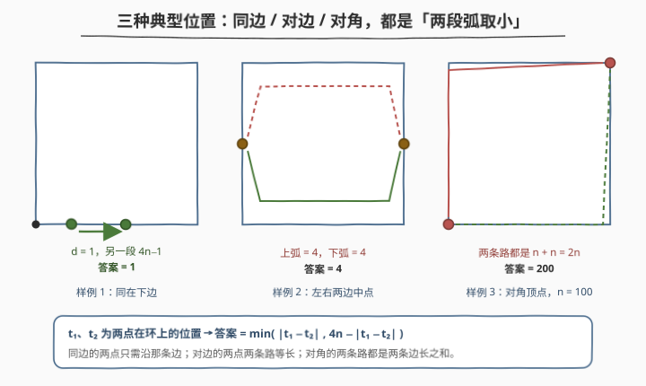

# Codeforces 57A Square Earth? 题解

## 1. 题目概述

- **题目链接**：https://codeforces.com/problemset/problem/57/A
- **比赛来源**：Codeforces Beta Round 53 · Problem A（2011-01-25）
- **难度**：1300
- **标签**：实现、几何、最短路
- **评测类型**：普通
- **限制**：时间 2 s / 内存 256 MB

**题意**：把地球看成一个边长为 $n$ 的正方形，四个顶点在 $(0,0)$、$(n,0)$、$(0,n)$、$(n,n)$。给定正方形**边界上**的两个点，求沿边界（只能走正方形的边）从一个点到另一个点的最短路长度。

**约束**：

- $1\le n\le1000$，坐标 $0\le x,y\le n$ 且保证点在边界上：整张「边界图」只有 $4n\le4000$ 个格点，即使用最笨的办法把边界展开成环再走一遍也只有几千步，$O(n)$ 完全够用；但这题有 $O(1)$ 的闭式做法。
- 两个点可能重合（答案是 0），也可能正好是四个顶点；顶点同时属于两条边，映射时必须保证**同一个点只会被映射成一个周长坐标**，否则同一条边上相邻的两个点会被算成很远。
- 只有一组数据，不存在多测。

## 2. 示例与观察

官方样例（输入 / 输出原样，共 3 组）：

```text
输入：
2 0 0 1 0
输出：
1
```

```text
输入：
2 0 1 2 1
输出：
4
```

```text
输入：
100 0 0 100 100
输出：
200
```

**样例 1**：$n=2$，两点是 $(0,0)$ 与 $(1,0)$，都在下边上，直接沿下边走 1 步。

**样例 2**：$n=2$，两点是 $(0,1)$（左边中点）与 $(2,1)$（右边中点）。沿边界有两条路：绕过上边要走 $1+2+1=4$，绕过下边同样是 $1+2+1=4$，答案是 4。

**样例 3**：$n=100$，两点是对角 $(0,0)$ 与 $(100,100)$。沿边界两条路各走两条边，长度都是 $100+100=200$。

**观察**：沿边界的路只有两条——顺时针绕一圈的那段和逆时针绕一圈的那段。设两点把周长分成 $d$ 与 $4n-d$ 两段，答案就是 $\min(d,4n-d)$。所以问题变成：给每个边界点算一个「沿周长走多远」的坐标 $t\in[0,4n)$。

自造样例（标注「自造」）：

| 输入 | 输出 | 说明 |
| --- | --- | --- |
| `1 0 0 1 1` | 2 | 最小正方形，对角顶点 |
| `5 2 0 2 0` | 0 | 两点重合 |
| `5 0 3 0 3` | 0 | 同在左边且重合 |
| `10 0 0 0 0` | 0 | 同一个顶点 $(0,0)$（被两条边共享） |
| `10 10 0 0 10` | 20 | 对角顶点，两条路都是 20 |
| `10 4 10 6 10` | 2 | 同在上边 |

## 3. 解题思路

### 3.1 朴素做法与瓶颈

把边界上的 $4n$ 个格点按顺序展开成一个环：$(0,0),(1,0),\dots,(n-1,0),(n,0),(n,1),\dots,(n,n),(n-1,n),\dots,(0,n),(0,n-1),\dots,(0,1)$，找到两个点的下标 $p_1,p_2$，答案是 $\min(|p_1-p_2|, 4n-|p_1-p_2|)$。

这个做法是 $O(n)$，$n\le1000$ 时不到 4000 次操作，完全能过。它的「瓶颈」仅仅是要真的把环建出来（4 个循环 + 一次线性查找），代码更长、也更容易在顶点处重复或漏掉点。

### 3.2 核心观察：把边界压成一个周长坐标



沿逆时针（从 $(0,0)$ 出发先沿下边向右）走一遍边界，用走过的长度 $t$ 给每个边界点编号：

$$
t(x,y)=
\begin{cases}
x, & y=0 \quad(\text{下边}),\\
n+y, & x=n \quad(\text{右边}),\\
2n+(n-x), & y=n \quad(\text{上边}),\\
3n+(n-y), & x=0 \quad(\text{左边}).
\end{cases}
$$

四个分支的顺序很关键：顶点同时满足两个条件，必须**先判**下边、再右边、再上边，最后才是左边，这样每个顶点只落入一个分支且与相邻边的坐标连续：

| 顶点 | 命中分支 | $t$ 值 | 与邻边是否衔接 |
| --- | --- | --- | --- |
| $(0,0)$ | $y=0$ | $0$ | 左边末尾 $3n+n=4n\equiv0$ ✓ |
| $(n,0)$ | $y=0$ | $n$ | 右边开头 $n+0=n$ ✓ |
| $(n,n)$ | $x=n$ | $2n$ | 上边开头 $2n+0=2n$ ✓ |
| $(0,n)$ | $y=n$ | $3n$ | 左边开头 $3n+0=3n$ ✓ |

于是环上两点的两段弧长分别是 $d=|t_1-t_2|$ 与 $4n-d$，取较小者。

### 3.3 算法流程

1. 读入 $n,x_1,y_1,x_2,y_2$；
2. 用上面的分段函数把两个点映射成 $t_1,t_2$；
3. 输出 $\min(|t_1-t_2|,\ 4n-|t_1-t_2|)$。

### 3.4 样例走查



- **同边**（样例 1）：$(0,0)\to t=0$，$(1,0)\to t=1$，$d=1$，答案 $\min(1,7)=1$。
- **对边**（样例 2）：$(0,1)\to t=3n+ (n-1)=3\cdot2+1=7$，$(2,1)\to t=n+1=3$，$|d|=4$，答案 $\min(4,4)=4$（两条路一样长，正好各占一半周长）。
- **对角**（样例 3）：$(0,0)\to0$，$(100,100)\to2n=200$，$d=200$，答案 $\min(200,200)=200$。

## 4. 正确性证明

**引理 1**：映射 $t$ 是边界点到 $[0,4n)$ 的双射，且沿边界相邻的两个格点 $t$ 值相差 1（模 $4n$）。

证明：四条边分别被映射到 $[0,n]$、$[n,2n]$、$[2n,3n]$、$[3n,4n]$，四段首尾相接覆盖 $[0,4n]$ 且只在端点重合；每个端点按 3.2 的判定顺序只被一个分支接收，因此整体是双射。每条边上 $t$ 随沿边行走的长度严格递增 1，端点处的衔接由表格逐项验证。∎

**引理 2**：边界上两点之间的任意边界路径，其长度要么是 $|t_1-t_2|$，要么是 $4n-|t_1-t_2|$（允许绕整圈则还可加上 $4n$ 的整数倍，但那样更长）。

证明：边界是一个环 $C_{4n}$，其上的简单路径只有顺时针与逆时针两条，长度分别为 $d$ 与 $4n-d$；任何非简单路径都会重复经过格点，长度不小于简单路径。∎

**定理**：程序输出等于沿边界的最短距离，即 $\min(d,4n-d)$。

证明：由引理 1，$t_1,t_2$ 是两点在环上的位置；由引理 2，两条候选路径长度为 $d$ 与 $4n-d$，取较小者即最短，程序正是这样计算的。∎

## 5. 复杂度分析

- 时间：$O(1)$，只有几次整数运算。
- 空间：$O(1)$。
- 与时限的关系：$n\le1000$ 时即使写 $O(n)$ 展开环也只有几千次操作；$O(1)$ 写法在任何输入下都是纳秒级。

## 6. 参考代码

### C++17

```cpp
#include <bits/stdc++.h>
using namespace std;

int main() {
    long long n, x1, y1, x2, y2;
    if (!(cin >> n >> x1 >> y1 >> x2 >> y2)) return 0;
    // 把边界点映射成沿周长从 (0,0) 逆时针走的弧长 t ∈ [0, 4n)
    auto arc = [&](long long x, long long y) -> long long {
        if (y == 0) return x;                    // 下边 (0,0) -> (n,0)
        if (x == n) return n + y;                // 右边 (n,0) -> (n,n)
        if (y == n) return 2 * n + (n - x);      // 上边 (n,n) -> (0,n)
        return 3 * n + (n - y);                  // 左边 (0,n) -> (0,0)
    };
    long long a = arc(x1, y1), b = arc(x2, y2);
    long long d = llabs(a - b);
    cout << min(d, 4 * n - d) << '\n';
    return 0;
}
```

### Python3

```python
import sys


def main():
    n, x1, y1, x2, y2 = map(int, sys.stdin.read().split())

    def arc(x, y):
        if y == 0:
            return x
        if x == n:
            return n + y
        if y == n:
            return 2 * n + (n - x)
        return 3 * n + (n - y)

    d = abs(arc(x1, y1) - arc(x2, y2))
    print(min(d, 4 * n - d))


if __name__ == "__main__":
    main()
```

## 7. 边界情况与易错点

1. **顶点归属**：$(0,0)$ 同时满足 $y=0$ 与 $x=0$，若先判 $x=0$ 会得到 $t=4n$（等价于 0，但若忘记取模就会变成「差一点点等于整圈」）；本实现固定「下边 → 右边 → 上边 → 左边」的顺序，四个顶点分别落在 $0,n,2n,3n$，无需取模。
2. **两点重合**：$d=0$，答案 $\min(0,4n)=0$，无需特判。
3. **对角顶点**：$d=2n$，两条路等长，答案是 $2n$（样例 3 的 $n=100$ 给出 200）。
4. **$n=1$**：环只有 4 个点，$4n-d$ 的最小可能值是 2（对角），不会出现负数。
5. **同边两端点**：例如 $n=10$ 时 $(0,5)$ 与 $(0,8)$ 都在左边，$t=30+5=35$ 与 $30+2=32$，$d=3$ ✓（左边是从 $(0,n)$ 往下走，$t$ 随 $y$ 减小而增大，注意这个方向别写反）。
6. **整数类型**：$4n\le4000$，`int` 足够；仍用 `long long` 以免将来改约束时溢出。

## 8. 验证记录

- **编译环境与命令**：`clang++ -std=c++17 -O2`（经 `codeforces/tools/include` 的 `bits/stdc++.h` 兼容头）；`python3 codeforces/tools/verify_solution.py codeforces/contests/0001-0100/57/A_正方形边界最短路.md`，输出 `CF57A: samples 3`、C++ 3/3、Python 3/3。
- **官方样例**：3 / 3 通过（1、4、200）。
- **额外测试**：随机生成 $n\in[1,20]$ 与两个随机边界点（四条边等概率）的 240 组数据，与独立暴力（真的把 $4n$ 个边界点按顺序展开成环、再取两段弧长较小值的 `brute.cpp`）逐组比对，240/240 一致。
- **最大约束性能**：$n=1000$、对角点，C++ 单次运行含进程启动约 3 ms（纯计算为常数级），远低于 2 s。
- **复核状态**：`check.py` 0 失败；`check_samples.py` 中本篇 3 组样例逐字一致；2 幅 SVG 均通过 `ElementTree` 解析。

## 相关题目与扩展

- [Codeforces 57B Martian Architecture](https://codeforces.com/problemset/problem/57/B)：同场 B 题，差分数组。
- [Codeforces 1C Ancient Berland Circus](https://codeforces.com/problemset/problem/1/C)：同样是「把几何量折算成角度/弧长再取最小」的几何题。
- [Codeforces 27A Next Test](https://codeforces.com/problemset/problem/27/A)：实现题，考察边界与下标处理。

**延伸思考**：

1. 若允许走正方形**内部**（不限于边界），答案就退化成曼哈顿距离 $|x_1-x_2|+|y_1-y_2|$，因为两点都在边界上时总能找到一条只含两个轴向段的折线，这也是本题把「只能沿边」写进题面的原因。
2. 若图形换成矩形（宽 $w$、高 $h$），只需把周长换成 $2(w+h)$、把 $n$ 换成对应边长即可，方法完全一样。
3. 若是三维正方体的**表面**上两点，最短路要枚举「展开图」的若干种方式（把经过的侧面展开成平面），问题从「环上两段取小」变成「立方体展开的 6 种网取小」，难度会显著上升。
