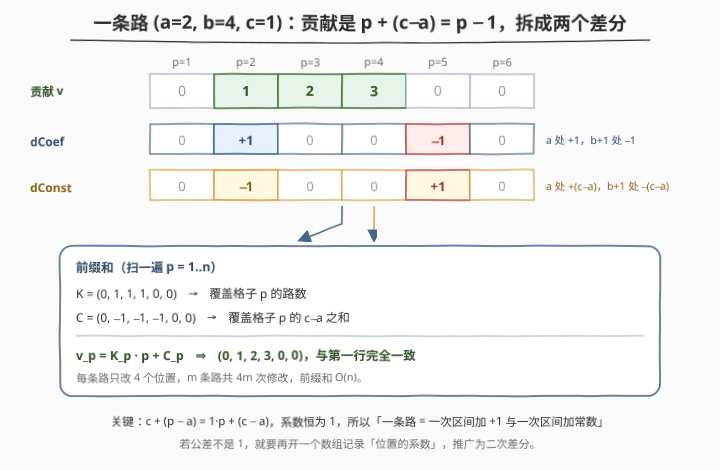
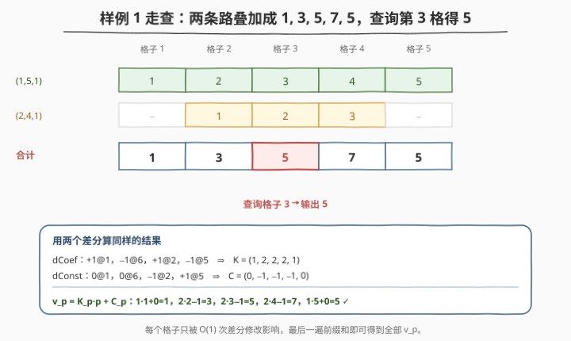

# Codeforces 57B Martian Architecture 题解

## 1. 题目概述

- **题目链接**：https://codeforces.com/problemset/problem/57/B
- **比赛来源**：Codeforces Beta Round 53 · Problem B（UTC 2011-01-25）
- **难度**：1600
- **标签**：实现、差分数组、前缀和
- **评测类型**：普通
- **限制**：时间 2 s / 内存 256 MB

**题意**：地基被分成 $n$ 个格子，编号 $1..n$。有 $m$ 份「通天路」的图纸，第 $i$ 份是 $(a_i,b_i,c_i)$：在格子 $a_i$ 上加 $c_i$ 块石头、$a_i+1$ 上加 $c_i+1$ 块、……、格子 $b_i$ 上加 $c_i+(b_i-a_i)$ 块（已有的石头不清空，直接叠加）。最后给出 $k$ 个不同的格子编号，求这些格子上的石头总数之和。

形式化地：先令

$$v_p=\sum_{i:\ a_i\le p\le b_i}\bigl(c_i+p-a_i\bigr),$$

再输出 $\sum_{j=1}^{k} v_{q_j}$。

**约束**：

- $n,m\le10^5$：逐条路、逐个格子累加是 $O(nm)=10^{10}$，2 s 内不可能；必须做到 $O(n+m)$ 或 $O((n+m)\log)$。
- $1\le k\le\min(n,100)$：查询很少，可以先把所有格子的值算出来再逐个查询。
- $1\le c_i\le1000$，$b_i-a_i\le10^5$：单个格子最多累加 $m$ 条路、每条最多 $c_i+(b_i-a_i)\le1000+10^5$，所以单格可达 $10^{10}$，**必须用 64 位整数**；$k\le100$ 个查询求和后可达 $10^{12}$，`int` 会溢出。
- 每条路贡献的是关于位置 $p$ 的**一次函数**，而不是常数——这是本题与普通「区间加」的区别。
- 只有一组数据，无多测。

## 2. 示例与观察

官方样例（输入 / 输出原样，共 3 组）：

```text
输入：
5 2 1
1 5 1
2 4 1
3
输出：
5
```

```text
输入：
3 2 1
1 3 1
1 3 1
2
输出：
4
```

```text
输入：
3 2 1
1 3 1
1 3 1
3
输出：
6
```

**样例 1 逐步演算**：

| 格子 | 1 | 2 | 3 | 4 | 5 |
| --- | --- | --- | --- | --- | --- |
| 路 $(1,5,1)$ 加 | 1 | 2 | 3 | 4 | 5 |
| 路 $(2,4,1)$ 加 | – | 1 | 2 | 3 | – |
| 合计 | 1 | 3 | 5 | 7 | 5 |

查询格子 3，答案 $5$ ✓。

**样例 2**：两条路都是 $(1,3,1)$，各自给格子 1、2、3 加 $1,2,3$，叠加后是 $2,4,6$；查询格子 2 得 4 ✓。

**样例 3**：同样的叠加，查询格子 3 得 6 ✓。

**观察**：第 $i$ 条路在格子 $p$ 上加的是 $c_i+p-a_i=p+(c_i-a_i)$——它是「$p$ 的系数 $1$」加上「常数 $c_i-a_i$」。所以**两种差分**就够了：一种统计每个格子被多少条路覆盖（系数），一种统计覆盖它的那些路的常数项之和。

自造样例（标注「自造」）：

| 输入 | 输出 | 说明 |
| --- | --- | --- |
| `1 1 1`<br>`1 1 5`<br>`1` | 5 | 最小规模 |
| `5 1 1`<br>`3 3 7`<br>`3` | 7 | $a=b$，只加一个格子 |
| `5 2 2`<br>`1 5 1`<br>`1 5 1000`<br>`1 5` | 2010 | 两条整段路叠加：格子 1 是 $1+1000=1001$，格子 5 是 $5+1004=1009$ |
| `4 1 2`<br>`1 4 1000`<br>`1 4` | 2003 | 常数项远大于 $a$，检验 $c-a$ 为正：$1000+1003$ |
| `6 1 2`<br>`5 6 1`<br>`5 6` | 3 | 起点靠近末尾，检验 $b+1=n+1$ 的越界 |

## 3. 解题思路

### 3.1 朴素做法与瓶颈

最直白：开一个长度 $n$ 的数组，对每条路把 $[a_i,b_i]$ 逐格加上 $c_i+(p-a_i)$，最后查询。

复杂度 $O\!\left(\sum(b_i-a_i+1)\right)$，最坏 $10^5\times10^5=10^{10}$ 次加法，2 s 内绝无可能。

普通「区间加常数」的题用一次差分就能做到 $O(n+m)$；本题加的是**等差数列**（公差为 1），所以需要两个差分数组。

### 3.2 核心观察：把等差数列拆成「系数 × 位置 + 常数」



对第 $i$ 条路，在格子 $p\in[a_i,b_i]$ 上的增量是

$$c_i+(p-a_i)=1\cdot p+(c_i-a_i).$$

也就是说：**系数恒为 1**、**常数项是 $c_i-a_i$**。于是维护两个差分数组：

- `dCoef`：在 $a_i$ 处 $+1$、在 $b_i+1$ 处 $-1$，前缀和得到「覆盖格子 $p$ 的路的条数」；
- `dConst`：在 $a_i$ 处 $+(c_i-a_i)$、在 $b_i+1$ 处 $-(c_i-a_i)$，前缀和得到「覆盖格子 $p$ 的常数项之和」。

两个前缀和分别记为 $K_p$ 与 $C_p$，则

$$v_p=K_p\cdot p+C_p .$$

这样每条路只做 4 次单点修改，总修改量 $4m$。

### 3.3 算法流程

1. 读入 $n,m,k$；
2. 对每条路 $(a,b,c)$：`dCoef[a]+=1; dCoef[b+1]-=1; dConst[a]+=c-a; dConst[b+1]-=(c-a);`
3. 从 $p=1$ 到 $n$ 累加两个前缀和，得到 `stones[p] = coef*p + con`；
4. 读入 $k$ 个查询格子并累加对应的 `stones[q]`，输出。

### 3.4 样例走查



$n=5$，路 $(1,5,1)$ 与 $(2,4,1)$。

- 路 $(1,5,1)$：$c-a=0$，`dCoef[1]+=1, dCoef[6]-=1`，常数项全 0。
- 路 $(2,4,1)$：$c-a=-1$，`dCoef[2]+=1, dCoef[5]-=1`，`dConst[2]-=1, dConst[5]+=1`。

逐格前缀和：

| $p$ | 1 | 2 | 3 | 4 | 5 |
| --- | --- | --- | --- | --- | --- |
| $K_p$ | 1 | 2 | 2 | 2 | 1 |
| $C_p$ | 0 | −1 | −1 | −1 | 0 |
| $v_p=K_p\cdot p+C_p$ | 1 | 3 | 5 | 7 | 5 |

与 2 节的表格一致；查询格子 3 得 5。

## 4. 正确性证明

**引理 1**：对任意 $p$，`dCoef` 的前缀和 $K_p$ 等于覆盖格子 $p$ 的路径条数。

证明：与普通区间覆盖的差分同理。每条路在 $a_i$ 处 $+1$、$b_i+1$ 处 $-1$，于是
$$K_p=\sum_{i}\bigl([a_i\le p]-[b_i+1\le p]\bigr)=\#\{i: a_i\le p\le b_i\}.$$

∎

**引理 2**：对任意 $p$，`dConst` 的前缀和 $C_p$ 等于覆盖格子 $p$ 的所有路的 $c_i-a_i$ 之和。

证明：每条路在 $a_i$ 处加 $(c_i-a_i)$、在 $b_i+1$ 处减 $(c_i-a_i)$，前缀和把它们累加，求和范围与引理 1 完全相同，故结论成立。∎

**定理**：程序输出的 $\sum_j v_{q_j}$ 等于题面要求的石头总数之和。

证明：由引理 1、2，$v_p=K_p\cdot p+C_p=\sum_{i:a_i\le p\le b_i}\bigl(p+(c_i-a_i)\bigr)=\sum_{i:a_i\le p\le b_i}\bigl(c_i+p-a_i\bigr)$，正是第 $i$ 条路在格子 $p$ 上加的石头数之和，即题面定义的 $v_p$。程序最后对这 $k$ 个格子求和，与题面要求一致。∎

## 5. 复杂度分析

- 时间：读入与差分修改 $O(m)$，前缀和 $O(n)$，查询 $O(k)$，总计 $O(n+m+k)\le 2\times10^5+100$ 次整数运算。实测最大数据（$n=m=10^5$）约 23 ms，远低于 2 s。
- 空间：两个差分数组与一个结果数组，各 $O(n)$ 个 `long long`，$n=10^5$ 时约 2.4 MB，远小于 256 MB。
- 数值范围：$v_p\le m\cdot(1000+10^5)\approx10^{10}$，超过 32 位；答案 $\le100\times10^{10}=10^{12}$。所有累加量都必须用 `long long`。

## 6. 参考代码

### C++17

```cpp
#include <bits/stdc++.h>
using namespace std;

int main() {
    int n, m, k;
    if (scanf("%d %d %d", &n, &m, &k) != 3) return 0;
    // 第 i 条路对格子 pos ∈ [a,b] 增加 c + (pos - a) = pos + (c - a)
    vector<long long> dCoef(n + 3, 0), dConst(n + 3, 0);
    for (int i = 0; i < m; ++i) {
        int a, b, c;
        scanf("%d %d %d", &a, &b, &c);
        long long add = (long long)c - a;  // 常数项，可能为负
        dCoef[a] += 1;
        dCoef[b + 1] -= 1;
        dConst[a] += add;
        dConst[b + 1] -= add;
    }
    vector<long long> stones(n + 2, 0);
    long long coef = 0, con = 0;
    for (int pos = 1; pos <= n; ++pos) {
        coef += dCoef[pos];
        con += dConst[pos];
        stones[pos] = coef * pos + con;
    }
    long long ans = 0;
    for (int i = 0; i < k; ++i) {
        int q;
        scanf("%d", &q);
        ans += stones[q];
    }
    cout << ans << '\n';
    return 0;
}
```

题面末尾那条「不要用 `%lld`、请用 `cin`」是早年 MS C++ 的历史遗留（那时要用 `%I64d`）；现代 g++/clang++ 的 `%lld` 完全可用，而 `scanf` 读 $3\times10^5$ 个整数比默认的 `cin` 快一个数量级以上（本机实测 18 ms 对 550 ms）。输出用 `cout` 即可。

### Python3

```python
import sys


def main():
    data = list(map(int, sys.stdin.read().split()))
    n, m, k = data[0], data[1], data[2]
    diff_coef = [0] * (n + 3)
    diff_const = [0] * (n + 3)
    p = 3
    for _ in range(m):
        a, b, c = data[p], data[p + 1], data[p + 2]
        p += 3
        add = c - a
        diff_coef[a] += 1
        diff_coef[b + 1] -= 1
        diff_const[a] += add
        diff_const[b + 1] -= add
    stones = [0] * (n + 2)
    coef = 0
    con = 0
    for pos in range(1, n + 1):
        coef += diff_coef[pos]
        con += diff_const[pos]
        stones[pos] = coef * pos + con
    ans = 0
    for i in range(k):
        ans += stones[data[p + i]]
    print(ans)


if __name__ == "__main__":
    main()
```

## 7. 边界情况与易错点

1. **常数项为负**：$a_i$ 可以大于 $c_i$（如 $a=5,c=1$），此时 $c_i-a_i$ 为负，差分的 `dConst` 会出现负数。必须用有符号 64 位整数，不能想当然把 $c_i-a_i$ 当非负。
2. **$a_i=b_i$**：只影响一个格子，差分在 $b_i+1$ 处的 $-1$ 立刻把它抵掉，前缀和不会漏。
3. **$b_i=n$**：要写 `dCoef[n+1]`，数组必须开到 $n+3$ 且前缀和只扫到 $n$；否则越界。
4. **答案规模**：单格可达 $10^{10}$、总和可达 $10^{12}$，`int` 会溢出，必须 `long long`（Python 无此问题）。
5. **输入规模**：$3\times10^5$ 个整数，用 `cin`（未解除同步）可能显著拖慢程序；本实现用 `scanf`，实测比默认 `cin` 快约 30 倍。
6. **查询是「不同格子」但允许乱序**：题目保证 $k$ 个格子互不相同，但顺序任意；程序先算好全部 $v_p$ 再逐个取，天然支持任意顺序，也不怕重复。
7. **多测清空**：本题只有一组数据；若改成多测，两个差分数组与结果数组都要重新清零。

## 8. 验证记录

- **编译环境与命令**：`clang++ -std=c++17 -O2`（经 `codeforces/tools/include` 的 `bits/stdc++.h` 兼容头）；`python3 codeforces/tools/verify_solution.py codeforces/contests/0001-0100/57/B_火星通天路石阶.md`，输出 `CF57B: samples 3`、C++ 3/3、Python 3/3。
- **官方样例**：3 / 3 通过（5、4、6）。
- **额外测试**：随机生成 $n\in[1,12]$、$m\in[1,8]$、$c_i\in[1,1000]$、$k\le5$ 的 240 组数据，与独立暴力（逐条路、逐格 `stones[pos] += c + pos - a` 的 `brute.cpp`）逐组比对，240/240 一致。
- **最大约束性能**：$n=m=10^5$，$k=100$，C++ 多次运行最快 23 ms（含进程启动；本机当时负载 6+，属于偏慢的测量环境），相对 2 s 有 80 倍余量。
- **复核状态**：`check.py` 0 失败；`check_samples.py` 中本篇 3 组样例逐字一致；2 幅 SVG 均通过 `ElementTree` 解析。

## 相关题目与扩展

- [Codeforces 57A Square Earth?](https://codeforces.com/problemset/problem/57/A)：同场 A 题，坐标映射。
- [Codeforces 295A Greg and Array](https://codeforces.com/problemset/problem/295/A)：对「操作」再做一次差分，即差分的嵌套。
- [Codeforces 816B Karen and Coffee](https://codeforces.com/problemset/problem/816/B)：区间覆盖计数 + 前缀和，与本题的「系数差分」思路同源。

**延伸思考**：

1. 若第 $i$ 条路加的是等差数列 $c_i+(p-a_i)\cdot d_i$（公差不为 1），只需把 $d_i$ 也作为一种「系数」再开一个差分数组，即 $v_p=A_p\cdot p^2+B_p\cdot p+C_p$ 形式；本题公差恒为 1，所以只要两维。
2. 若要求支持在线修改（随时插入/删除一条路）与单点查询，差分数组就退化成 $O(m)$ 前缀和重建；此时应换成两棵支持区间加等差数列、单点查询的线段树/树状数组（二阶差分），单次操作 $O(\log n)$。
3. 若 $k$ 变成 $10^5$ 且要求区间求和（而不只是 $k$ 个点），可以用三个前缀和直接算 $\sum_{p=l}^{r}v_p$；差分带来的 $O(1)$ 单点值在这里同样能组合成 $O(1)$ 的区间和。
