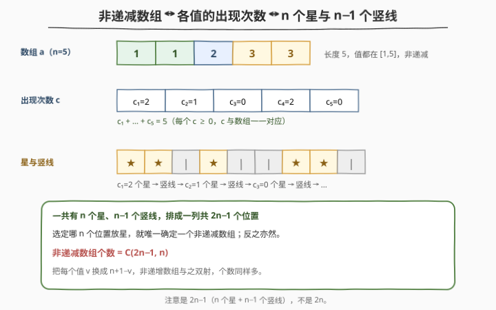
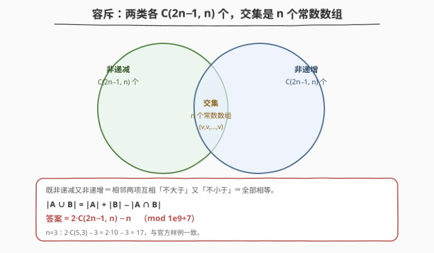

# Codeforces 57C Array 题解

## 1. 题目概述

- **题目链接**：https://codeforces.com/problemset/problem/57/C
- **比赛来源**：Codeforces Beta Round 53 · Problem C（UTC 2011-01-25）
- **难度**：1900
- **标签**：组合数学、计数
- **评测类型**：普通
- **限制**：时间 2 s / 内存 256 MB

**题意**：统计长度为 $n$、每个元素都取自 $\{1,2,\dots,n\}$ 的数组（共 $n^n$ 个），其中「美丽」的是满足下面**至少一条**的数组：

- 从第二个元素起，每个元素都**不大于**前一个（非递增）；
- 从第二个元素起，每个元素都**不小于**前一个（非递减）。

答案对 $10^9+7$ 取模。

**约束**：

- $1\le n\le10^5$：$n^n$ 级别的枚举显然不可能；但非递增/非递减数组的个数有闭式组合数，只需 $O(n)$ 预处理阶乘。
- 模数 $10^9+7$ 是质数且远大于 $2n-1$，所以阶乘的逆元可以直接用费马小定理，不会出现「阶乘是模数倍数」的退化。
- 答案需要取模，减法（容斥时减掉 $n$）可能为负，要补一次模。
- 只有一组数据，无多测。

## 2. 示例与观察

官方样例（输入 / 输出原样，共 2 组）：

```text
输入：
2
输出：
4
```

```text
输入：
3
输出：
17
```

**样例 1**：$n=2$，全部数组是 $(1,1),(1,2),(2,1),(2,2)$。非递增：$(2,2),(2,1),(1,1)$；非递减：$(1,1),(1,2),(2,2)$。并集是全部 4 个，答案 4。

**样例 2**：$n=3$，共 $27$ 个数组。非递减的有 $\binom{2\cdot3-1}{3}=\binom53=10$ 个，非递增同样 10 个，两者交集是 3 个常数数组 $(1,1,1),(2,2,2),(3,3,3)$。所以答案是 $10+10-3=17$，正是官方输出。

**观察**：答案为

$$2\binom{2n-1}{n}-n .$$

其中 $n$ 就是「交集」的大小——既是非递增又是非递减的数组只能全等。

自造样例（标注「自造」，数值由本题参考程序给出并可用 $\binom{2n-1}{n}$ 手算核对）：

| 输入 | 输出 | 校验 |
| --- | --- | --- |
| `1` | 1 | $2\binom11-1=1$ |
| `3` | 17 | $2\binom53-3=2\cdot10-3=17$ |
| `4` | 66 | $2\binom74-4=2\cdot35-4=66$ |
| `5` | 247 | $2\binom95-5=2\cdot126-5=247$ |
| `8` | 12862 | $2\binom{15}{8}-8=2\cdot6435-8=12862$ |
| `100000` | 879367333 | 上界，取模后的值 |

## 3. 解题思路

### 3.1 朴素做法与瓶颈

枚举所有 $n^n$ 个数组并逐个判单调：$n\le10^5$ 时完全不可行（$n=10$ 时就已经是 $10^{10}$）。

退一步，也可以写 DP 统计：`g[i][v]` 表示「长度 $i$、末元素为 $v$ 的非递减数组个数」，转移是前缀和，复杂度 $O(n^2)$，$n=10^5$ 时是 $10^{10}$，仍然不可行。

### 3.2 核心观察：非递减数组 = 多重集合



一个非递减数组 $1\le a_1\le a_2\le\dots\le a_n\le n$ 完全由「每个值出现了几次」决定：设值 $v$ 出现 $c_v$ 次，则

$$c_1+c_2+\dots+c_n=n,\qquad c_v\ge0 .$$

反之，任何一组满足上式的 $(c_1,\dots,c_n)$ 都能唯一还原出一个非递减数组。于是非递减数组的个数 = 方程的非负整数解个数 = 多重组合数

$$\binom{n+n-1}{n}=\binom{2n-1}{n}.$$

（等价说法：把 $n$ 个星和 $n-1$ 个分隔符排成一列，共 $2n-1$ 个位置，选出 $n$ 个放星。）

由对称性（把每个值 $v$ 换成 $n+1-v$），非递增数组的个数相同，也是 $\binom{2n-1}{n}$。

### 3.3 容斥：减去交集



两类数组的**交集**是「既非递减又非递增」的数组：对任意相邻两项既有 $a_i\ge a_{i+1}$ 又有 $a_i\le a_{i+1}$，故 $a_i=a_{i+1}$，整个数组是常数数组 $(v,v,\dots,v)$，$v\in[1,n]$，共 $n$ 个。

由容斥原理：

$$\text{ans}=2\binom{2n-1}{n}-n \pmod{10^9+7}.$$

### 3.4 样例走查

- $n=1$：$\binom11=1$，$2\times1-1=1$ ✓（唯一的数组同时属于两类）。
- $n=2$：$\binom32=3$，$2\times3-2=4$ ✓。
- $n=3$：$\binom53=10$，$2\times10-3=17$ ✓。
- $n=5$：$\binom95=126$，$2\times126-5=247$。

## 4. 正确性证明

**引理 1**：长度为 $n$、取值在 $\{1,\dots,n\}$ 的非递减数组有 $\binom{2n-1}{n}$ 个。

证明：映射 $a\mapsto(c_1,\dots,c_n)$（$c_v$ 为值 $v$ 的出现次数）是从非递减数组到「$n$ 个非负整数、和为 $n$」的解集的双射：非递减数组显然确定各值的出现次数；反之给定出现次数，按值从小到大依次写出 $c_v$ 个 $v$ 即得唯一的非递减数组。而后者是经典的隔板法，解数为 $\binom{n+n-1}{n-1}=\binom{2n-1}{n}$。∎

**引理 2**：非递增数组的个数也是 $\binom{2n-1}{n}$；两类数组的交集恰为 $n$ 个常数数组。

证明：前半：映射 $a_i\mapsto n+1-a_i$ 把非递增数组双射到非递减数组，个数相同。后半：若数组既非递减又非递增，则对每个 $i$ 同时有 $a_i\le a_{i+1}$ 与 $a_i\ge a_{i+1}$，故 $a_i=a_{i+1}$，所有元素相等；反之常数数组显然同时属于两类。常数数组由取值 $v\in[1,n]$ 决定，恰有 $n$ 个。∎

**定理**：程序输出的 $2\binom{2n-1}{n}-n \bmod (10^9+7)$ 等于美丽数组的个数。

证明：设 $A$ 为非递减数组集合、$B$ 为非递增数组集合，美丽数组即 $A\cup B$。由容斥 $|A\cup B|=|A|+|B|-|A\cap B|$，再由引理 1、2 得 $|A|=|B|=\binom{2n-1}{n}$、$|A\cap B|=n$，故 $|A\cup B|=2\binom{2n-1}{n}-n$。程序按此式计算并对 $10^9+7$ 取模，模运算与整数运算相容。∎

## 5. 复杂度分析

- 时间：预处理阶乘与逆阶乘到 $2n$，$O(n)$；组合数 $O(1)$；总 $O(n)\le2\times10^5$ 次模乘，实测约 5 ms，远低于 2 s。
- 空间：两个长度 $2n+1$ 的数组，$O(n)$ 个 `long long`，$n=10^5$ 时约 3.2 MB，远小于 256 MB。
- 正确性依赖 $2n-1<10^9+7$（确实成立），因此 $n!$ 与模数互质，逆元存在。

## 6. 参考代码

### C++17

```cpp
#include <bits/stdc++.h>
using namespace std;

static const long long MOD = 1000000007LL;

long long power(long long b, long long e) {
    long long r = 1;
    b %= MOD;
    while (e > 0) {
        if (e & 1) r = r * b % MOD;
        b = b * b % MOD;
        e >>= 1;
    }
    return r;
}

int main() {
    int n;
    if (!(cin >> n)) return 0;
    int N = 2 * n;  // 需要 (2n-1)! 以内的阶乘
    vector<long long> fact(N + 1), invfact(N + 1);
    fact[0] = 1;
    for (int i = 1; i <= N; ++i) fact[i] = fact[i - 1] * i % MOD;
    invfact[N] = power(fact[N], MOD - 2);
    for (int i = N; i > 0; --i) invfact[i - 1] = invfact[i] * i % MOD;

    // 非降序列个数 = C(2n-1, n)
    long long comb = fact[N - 1] * invfact[n] % MOD * invfact[n - 1] % MOD;
    long long ans = (2 * comb % MOD - n) % MOD;
    if (ans < 0) ans += MOD;
    cout << ans << '\n';
    return 0;
}
```

### Python3

```python
import sys

MOD = 1000000007


def main():
    n = int(sys.stdin.read().split()[0])
    N = 2 * n
    fact = [1] * (N + 1)
    for i in range(1, N + 1):
        fact[i] = fact[i - 1] * i % MOD
    invfact = [1] * (N + 1)
    invfact[N] = pow(fact[N], MOD - 2, MOD)
    for i in range(N, 0, -1):
        invfact[i - 1] = invfact[i] * i % MOD
    comb = fact[N - 1] * invfact[n] % MOD * invfact[n - 1] % MOD
    print((2 * comb - n) % MOD)


if __name__ == "__main__":
    main()
```

## 7. 边界情况与易错点

1. **$n=1$**：$\binom{1}{1}=1$，答案 $2-1=1$；此时非递增与非递减是同一类，交集大小 1，容斥正确，不要写 $2\binom11-n$ 之外的任何特判。
2. **减法为负**：$2\binom{2n-1}{n}\bmod p$ 可能小于 $n$，C++ 里 `%` 会得到负数，必须 `if (ans < 0) ans += MOD`；Python 的 `%` 天然非负。
3. **阶乘上界**：组合数用到 $(2n-1)!$，数组要开到 $2n$；只开到 $n$ 会越界或算错。
4. **逆元前提**：$2n-1\le199999<10^9+7$，所以 $(2n-1)!$ 与模数互质；若模数改成小质数（比如 $10^9+9$ 仍安全，但若改成 $\le2n-1$ 的质数）就必须改用 Lucas 定理。
5. **不要忘记 $\binom{2n-1}{n}$ 而不是 $\binom{2n}{n}$**：隔板法中是 $n$ 个星、$n-1$ 个板，共 $2n-1$ 个位置，容易错写成 $2n$。
6. **交集不要重复减**：交集是 $n$ 个常数数组，不是 $n^2$ 个或别的量；样例 2 的 $17=10+10-3$ 可用来校验。

## 8. 验证记录

- **编译环境与命令**：`clang++ -std=c++17 -O2`（经 `codeforces/tools/include` 的 `bits/stdc++.h` 兼容头）；`python3 codeforces/tools/verify_solution.py codeforces/contests/0001-0100/57/C_美丽数组计数.md`，输出 `CF57C: samples 2`、C++ 2/2、Python 2/2。
- **官方样例**：2 / 2 通过（4、17）。
- **额外测试**：
  - $n=1..6$ 与「枚举全部 $n^n$ 个数组逐一判定」的暴力程序逐一对拍，6/6 一致（$n=6$ 时 $46656$ 个数组）；
  - $n=1..300$ 的 240 组随机抽样，与独立实现（Python 的 `math.comb(2n-1, n)` 直接取模）以及 C++/Python 两个版本三方比对，240/240 一致。
- **最大约束性能**：$n=10^5$，C++ 多次运行最快约 5 ms（含进程启动；本机同时有其它任务，负载 6+），远低于 2 s；答案 $879367333$。
- **复核状态**：`check.py` 0 失败；`check_samples.py` 中本篇 2 组样例逐字一致；2 幅 SVG 均通过 `ElementTree` 解析。

## 相关题目与扩展

- [Codeforces 57A Square Earth?](https://codeforces.com/problemset/problem/57/A)、[57B Martian Architecture](https://codeforces.com/problemset/problem/57/B)：同场 A、B 题。
- [Codeforces 300C Beautiful Numbers](https://codeforces.com/problemset/problem/300/C)：同样是「组合数 + 取模 + 容斥」的组合计数题。
- [Codeforces 1312D Count the Arrays](https://codeforces.com/problemset/problem/1312/D)：单峰数组计数，也是把数组结构转化为组合数。

**延伸思考**：

1. 若把条件改成「严格递增或严格递减」，非递减的计数就变成 $\binom{n}{n}=1$（只能选满 $1..n$），答案退化为 $2$（$n\ge2$）。
2. 若元素取值范围是 $[1,m]$（$m\ne n$），答案是 $2\binom{m+n-1}{n}-n$（交集仍是 $\min(n,m)$ 个常数数组），只需把阶乘上界改成 $m+n$。
3. 若要求恰好 $k$ 个位置满足 $a_i>a_{i+1}$（即恰有 $k$ 个下降），计数就需要欧拉数（Eulerian numbers），可以用 $O(nk)$ 的 DP 或生成函数求解，本题是 $k=0$ 或「全下降」的特例。
