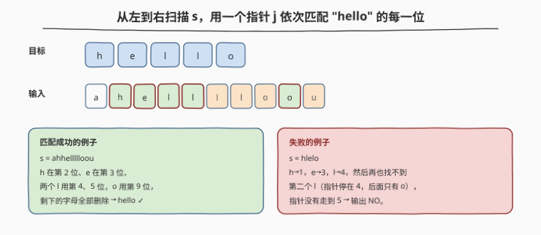
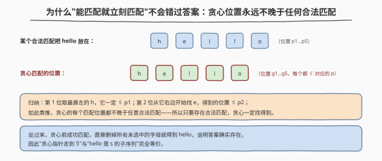

# Codeforces 58A 聊天室问候判定 题解

## 1. 题目概述

- **题目链接**：https://codeforces.com/problemset/problem/58/A
- **比赛来源**：Codeforces Beta Round 54 (Div. 2) · Problem A（UTC 2011-01-31）
- **难度**：1000
- **标签**：贪心、字符串
- **评测类型**：普通
- **限制**：时间 1 s / 内存 256 MB

**题意**：Vasya 在聊天室输入了一个只含小写字母的单词 $s$。如果从 $s$ 中删除若干个字母（可以一个都不删）后能得到 "hello"，就认为他成功打了招呼，输出 `YES`；否则输出 `NO`。

**约束**：

- $1 \le |s| \le 100$：长度很小，$O(|s|)$ 的扫描是标准做法。
- 只能删除、不能交换或替换字母：所以问题本质是「"hello" 是否为 $s$ 的子序列」。
- 目标串固定为 5 个字母，判定只需一个 $0 \sim 5$ 的指针。
- 单组输入、只含小写字母。

## 2. 示例与观察

官方样例 1（输入 / 输出原样）：

```text
输入：
ahhellllloou

输出：
YES
```

**演算**：依次匹配——`a` 跳过；`h` 匹配第 1 个字母；`e` 匹配；接着两个 `l` 用连续的两个 `l`；最后在末尾找到 `o`。五个字母全部按顺序匹配成功，删除多余字母后得到 "hello" ✓。

官方样例 2（输入 / 输出原样）：

```text
输入：
hlelo

输出：
NO
```

**演算**：`h`（位置 1）、`e`（位置 3）、`l`（位置 4）之后，指针需要再找一个 `l`，但后面只剩 `o`，匹配失败 → `NO` ✓。

**观察**：

1. 删除字母不改变剩余字母的相对顺序，因此「删除后得到 hello」等价于「hello 是 $s$ 的子序列」。
2. 子序列匹配有一个天然的贪心：从左往右扫描 $s$，只要当前字符等于目标串中"下一个待匹配"的字母，就立刻匹配它并把指针后移。
3. 匹配到第 5 个字母时立刻可以判定成功，后面的字符无需再看。



## 3. 解题思路

### 3.1 朴素做法与瓶颈

最直接的做法是枚举 $s$ 的所有子序列，检查有没有等于 "hello" 的。$s$ 长度 $100$ 时有 $2^{100}$ 个子序列，完全不可行。

即使只枚举"选 5 个位置"的组合，也有 $\binom{100}{5} \approx 7.5\times10^7$ 种，虽然勉强能过，但没有必要——顺序匹配只需要扫一遍。

### 3.2 核心观察：贪心指针

维护指针 $j$（$0 \le j \le 5$）表示 "hello" 的前 $j$ 个字母已经匹配。从左到右扫描 $s$ 的每个字符 $c$：

- 若 $j < 5$ 且 $c = \text{hello}[j]$，则令 $j \leftarrow j + 1$；
- 否则跳过 $c$。

扫描结束后 $j = 5$ 就输出 `YES`，否则 `NO`。这个贪心为什么不会错过答案，见第 4 节的归纳论证。

### 3.3 算法流程

1. 读入字符串 $s$；
2. 令 $j = 0$，遍历 $s$ 的每个字符；
3. 命中目标字母则 $j$ 加一；
4. 输出 $j = 5$ 时为 `YES`，否则 `NO`。

### 3.4 样例走查



样例 1 的匹配位置是 $2,3,4,5,9$（1 起），中间所有的 `l`、`o`、`u` 都被安全跳过；样例 2 在找第二个 `l` 时失败。两张图对照可以看出：贪心只是"尽量早地匹配"，而早匹配不会让后面的选择变少。

## 4. 正确性证明

**引理 1（贪心位置不晚）**：设存在一种把 "hello" 作为子序列的匹配，其 5 个位置为 $p_1 < p_2 < \dots < p_5$。则贪心算法匹配到的位置 $g_1 < g_2 < \dots < g_5$ 满足 $g_t \le p_t$（对每个 $t$）。

**证明**：对 $t$ 归纳。$t = 1$：贪心取的是 $s$ 中最靠左的 `h`，而 $p_1$ 也是某个 `h`，故 $g_1 \le p_1$。设 $g_{t-1} \le p_{t-1}$，贪心从 $g_{t-1}$ 之后找第一个目标字母 $\text{hello}[t-1]$，而 $p_t > p_{t-1} \ge g_{t-1}$ 且 $s[p_t]$ 正是该字母，所以贪心找到的位置不会晚于 $p_t$，即 $g_t \le p_t$。∎

**引理 2（贪心成功 ⇔ 存在匹配）**：贪心指针能走到 5，当且仅当 "hello" 是 $s$ 的子序列。

**证明**：若贪心走到 5，则 $g_1 < \dots < g_5$ 就是一组合法匹配，把其余字母删除即得 "hello"，所以存在匹配。反之若存在匹配，由引理 1 贪心的每个位置都不晚于对应位置，因此贪心一定也能走完 5 步。∎

**定理**：算法输出的 `YES`/`NO` 与题目要求一致。

**证明**：由引理 2，输出 `YES` 当且仅当存在删除方案得到 "hello"，这正是题目对"成功打招呼"的定义。∎

## 5. 复杂度分析

- **时间**：扫描一遍 $s$，$O(|s|) \le 100$ 次比较。
- **空间**：只存目标串与常数个变量，$O(1)$。
- **与时限的关系**：1 s 时限下是微秒级。

## 6. 参考代码

### C++17

```cpp
#include <bits/stdc++.h>
using namespace std;
int main() {
    ios::sync_with_stdio(false);
    cin.tie(nullptr);
    string s;
    if (!(cin >> s)) return 0;
    const string target = "hello";
    size_t j = 0;
    for (char c : s) {
        if (j < target.size() && c == target[j]) j++;
    }
    cout << (j == target.size() ? "YES" : "NO") << "\n";
    return 0;
}
```

### Python3

```python
import sys

def main():
    s = sys.stdin.readline().strip()
    j = 0
    target = "hello"
    for c in s:
        if j < len(target) and c == target[j]:
            j += 1
    print("YES" if j == len(target) else "NO")

main()
```

## 7. 边界情况与易错点

1. **$|s| < 5$**：不可能包含 5 个字符的子序列，直接输出 `NO`；代码中指针走不到 5，天然正确。
2. **$s$ 恰好是 "hello"**：五个字母逐个命中，输出 `YES`。
3. **重复字母**：如 "hheel lloo" 之类，连续相同的字母只应匹配目标串需要的那几个，多出来的跳过即可——指针写法不会重复计数。
4. **顺序错误**：如 "hlelo"、"oll eh"，必须严格按 hello 的顺序匹配，不能只统计各字母出现次数。
5. **大小写**：题目保证只有小写字母，不要画蛇添足地转大写；若转成大写再与 "hello" 比较反而会错。
6. **读到空行**：用 `cin >> s` 或 `readline().strip()` 读入，避免把换行符算进字符串。

## 8. 验证记录

- **编译环境与命令**：`g++ -std=c++17 -O2`（本机 clang++ + 兼容头，`verify_solution.py` 自动处理）；Python 3.12。
- **官方样例**：2 / 2 通过（`CF58A: samples 2 / C++ 编译 OK, 样例 2/2 / Python 语法 OK, 样例 2/2`）。
- **额外测试**：随机对拍 $300$ 组（长度 $1 \sim 14$，字母表为 `hello` 加干扰字母），与"枚举所有 5 元位置组合"的独立暴力逐组比对，C++ 与 Python 全部一致。
- **最大约束性能**：$|s| = 100$ 时整程序 $< 3$ ms（含进程启动）。
- **复核状态**：`check.py` 0 失败；样例与 `.cf-meta/statements/CF58A.json` 逐字一致。

## 相关题目与扩展

- [Codeforces 58B 硬币](https://codeforces.com/problemset/problem/58/B)：同样考查"按某种顺序逐步构造/判断"的贪心。
- [Codeforces 3A 最短路径](https://codeforces.com/problemset/problem/3/A)：字符串按位比较的入门题。

**延伸思考**：

1. 如果目标串不是 "hello" 而是任意模式 $p$，同一个贪心仍然成立，复杂度 $O(|s| + |p|)$——这正是子序列判定的标准算法。
2. 如果允许替换一个字母（而不是只删除），问题变成"编辑距离为 1 的判定"，需要同时考虑删除、插入、替换，简单的单指针贪心不再够用。
3. 如果要求"删除后得到的 hello 出现次数最多"，问题变成统计不同匹配数，需要 DP（$O(5|s|)$）。
