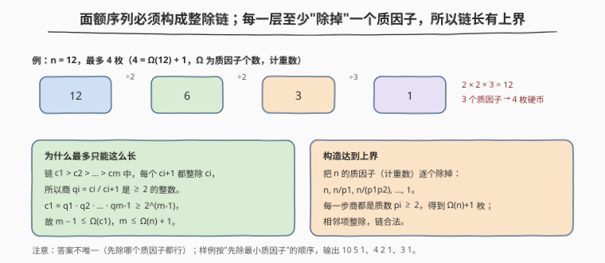
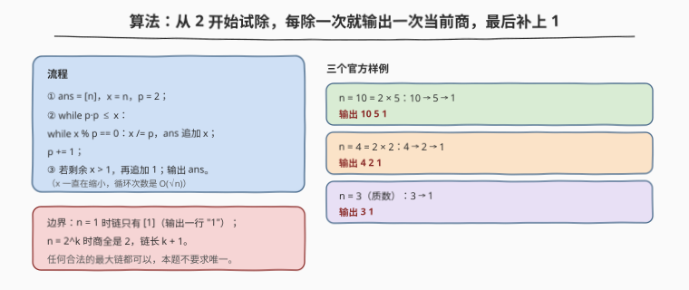

# Codeforces 58B 硬币面额方案 题解

## 1. 题目概述

- **题目链接**：https://codeforces.com/problemset/problem/58/B
- **比赛来源**：Codeforces Beta Round 54 (Div. 2) · Problem B（2011-01-31）
- **难度**：1300
- **标签**：贪心、数论（整除）
- **评测类型**：特殊评测（多解，输出任意一种硬币数量最多的方案）
- **限制**：时间 2 s / 内存 256 MB

**题意**：要发行一套新硬币，最贵的面额恰好是 $n$。要求**任意一种硬币的面额都能被所有更便宜的硬币面额整除**。在满足条件且最贵面额为 $n$ 的方案中，选硬币**数量最多**的那种，按面额从大到小输出。所有面额互不相同。

**约束**：

- $1 \le n \le 10^6$：可以 $O(\sqrt n)$ 分解质因数。
- 面额必须互不相同，且最贵的是 $n$：$n$ 一定出现在答案里。
- 整除关系是"全序"的传递约束：若面额从大到小为 $c_1 = n > c_2 > \dots > c_m$，则要求 $c_{i+1} \mid c_i$（等价于每个便宜面额都整除所有更贵的面额）。
- 多解：任何最大方案都算对。

## 2. 示例与观察

官方样例 1（输入 / 输出原样）：

```text
输入：
10

输出：
10 5 1
```

**演算**：$10 = 2 \times 5$，按"除以最小质因子"的顺序得到 $10 \to 5 \to 1$。三个面额 $10, 5, 1$ 满足 $5 \mid 10$、$1 \mid 5$、$1 \mid 10$ ✓，数量 $3 = \Omega(10) + 1$（$\Omega$ 为质因子个数，计重数）。

官方样例 2（输入 / 输出原样）：

```text
输入：
4

输出：
4 2 1
```

**演算**：$4 = 2 \times 2$，链条 $4 \to 2 \to 1$，三枚硬币 ✓。

官方样例 3（输入 / 输出原样）：

```text
输入：
3

输出：
3 1
```

**演算**：$3$ 是质数，链条只有 $3 \to 1$，两枚硬币 ✓。

**观察**：

1. 条件是"便宜面额整除贵面额"，所以整个面额集合按大小排好后，相邻两项必然满足整除，且整除关系传递。
2. 每往下一层，面额至少缩小一半（因为商是 $\ge 2$ 的整数），所以链的长度有上界。
3. 把 $n$ 的质因子一个一个除掉，每一步商都是一个质数，恰好能让"每步至少除以 2"的上界被完全利用。



## 3. 解题思路

### 3.1 朴素做法与瓶颈

枚举 $n$ 的所有约数子集，检查整除条件并取最大。$n \le 10^6$ 时约数最多只有 $240$ 个，但子集有 $2^{240}$ 种，完全不可行。

即使只考虑"链"（相邻整除），直接搜索所有链也会重复计算大量子问题。需要先想清楚最大长度到底是多少。

### 3.2 核心观察

设答案面额从大到小为 $c_1 = n > c_2 > \dots > c_m$，且 $c_{i+1} \mid c_i$。令商 $q_i = c_i / c_{i+1}$（$1 \le i < m$）。由于 $c_{i+1} < c_i$ 且 $c_{i+1} \mid c_i$，每个 $q_i$ 都是 $\ge 2$ 的整数，于是

$$n = q_1 q_2 \cdots q_{m-1} \ge 2^{m-1},$$

所以 $m - 1 \le \Omega(n)$（$\Omega(n)$ 是 $n$ 的质因子个数，计重数），即 $m \le \Omega(n) + 1$。

这个上界可以**构造达到**：把 $n$ 的质因子逐个除掉，令

$$c_1 = n,\quad c_2 = n/p_1,\quad c_3 = n/(p_1 p_2),\quad \dots,\quad c_{m} = 1,$$

其中 $p_1 p_2 \cdots p_{\Omega(n)}$ 是 $n$ 的质因数分解。相邻两项的商是质数 $p_i \ge 2$，整除关系成立，长度正好 $\Omega(n) + 1$。

实现上不必真的求出所有质因子再倒着组合：从 $2$ 开始试除，**能除就除并立刻输出商**，最后如果还剩一个大于 $1$ 的因子（即 $n$ 有一个 $> \sqrt n$ 的质因子），再输出 $1$ 即可。

### 3.3 算法流程

1. 读入 $n$，答案数组先放入 $n$，令 $x = n$；
2. 对 $p = 2, 3, 4, \dots$ 直到 $p^2 > x$：只要 $x \bmod p = 0$，就令 $x \leftarrow x / p$ 并把 $x$ 追加到答案；
3. 循环结束后若 $x > 1$（剩余一个质因子），追加 $1$；
4. 输出答案数组（天然是从大到小）。

### 3.4 样例走查



样例 1：$x = 10$，$p = 2$ 时 $10/2 = 5$ 输出 5，$p = 3, 4$ 都不能整除 5，循环结束（$3^2 > 5$），剩余 $x = 5 > 1$ 输出 1，得到 `10 5 1`。样例 2：$4 \to 2 \to 1$。样例 3：$p = 2$ 时 $2^2 = 4 > 3$，直接输出 1，得到 `3 1`。

## 4. 正确性证明

**引理 1（链的等价描述）**：一个面额集合满足"任一更贵面额都能被任一更便宜面额整除"，当且仅当把它按降序排列后，每个面额整除前一个面额。

**证明**：若相邻整除成立，即 $c_{i+1} \mid c_i$，由整除的传递性，对任意 $j > i$ 有 $c_j \mid c_i$，即便宜面额整除贵面额。反之，题设条件直接对相邻两项成立。∎

**引理 2（长度上界）**：任何合法方案的面额数 $m \le \Omega(n) + 1$。

**证明**：由引理 1，相邻商 $q_i = c_i / c_{i+1}$ 都是 $\ge 2$ 的整数，$n = \prod_{i=1}^{m-1} q_i \ge 2^{m-1}$。而 $n$ 的质因数分解中共有 $\Omega(n)$ 个质因子，每个 $q_i \ge 2$ 至少消耗一个质因子，故 $m - 1 \le \Omega(n)$。∎

**引理 3（构造达到上界）**：按 3.3 的试除顺序得到的链条长度恰为 $\Omega(n) + 1$，且合法。

**证明**：每一次成功除掉的 $p$ 都是当前 $x$ 的质因子（因为从小到大试除，$p$ 不可能合成数：若 $p$ 是合数，它的质因子更小，早就会把 $p$ 从 $x$ 中除尽，矛盾），所以每一步商都是质数，链条长度为 $1 + (\text{除掉的质因子个数}) = \Omega(n) + 1$。相邻两项的商是质数，故整除关系成立；最贵面额是初始的 $n$；最后追加的 $1$ 整除一切。∎

**定理**：算法输出的方案面额数最多，且满足题面全部要求。

**证明**：由引理 2，任何方案都不超过 $\Omega(n) + 1$；由引理 3，算法给出的方案恰好达到该数量且合法；面额互不相同（严格递减），最贵为 $n$。故算法最优。∎

## 5. 复杂度分析

- **时间**：试除循环 $p \le \sqrt{x_{\text{当前}}}$，总除法次数 $\le \Omega(n) \le 20$（$2^{20} > 10^6$），循环本身 $O(\sqrt n)$。
- **空间**：答案数组 $O(\Omega(n))$。
- **与时限的关系**：$n = 10^6$ 时 $O(1000)$ 次判断，2 s 时限下 $< 1$ ms。

## 6. 参考代码

### C++17

```cpp
#include <bits/stdc++.h>
using namespace std;
int main() {
    ios::sync_with_stdio(false);
    cin.tie(nullptr);
    int n;
    if (!(cin >> n)) return 0;
    vector<int> ans;
    ans.push_back(n);
    int x = n;
    for (int p = 2; (long long)p * p <= x; p++) {
        while (x % p == 0) {
            x /= p;
            ans.push_back(x);
        }
    }
    if (x > 1) ans.push_back(1);
    for (size_t i = 0; i < ans.size(); i++) cout << ans[i] << (i + 1 == ans.size() ? '\n' : ' ');
    return 0;
}
```

### Python3

```python
import sys

def main():
    n = int(sys.stdin.readline())
    ans = [n]
    x = n
    p = 2
    while p * p <= x:
        while x % p == 0:
            x //= p
            ans.append(x)
        p += 1
    if x > 1:
        ans.append(1)
    print(' '.join(map(str, ans)))

main()
```

## 7. 边界情况与易错点

1. **$n = 1$**：最贵面额就是 1，答案只有一枚硬币 `1`；此时循环不执行、`x = 1` 不追加 1（否则会重复输出两个 1）。
2. **$n$ 是质数**：链条只有 `n 1`，注意不要漏掉最后的 1；样例 3 专门考这一点。
3. **$n = 2^k$**：每次除以 2，链长为 $k + 1$，注意输出顺序是从大到小。
4. **试除上界**：循环条件用 `p * p <= x`（$x$ 是不断缩小的当前值），不要固定写成 `p * p <= n`，否则大质数会多扫很多；同时注意 `p * p` 用 `long long` 防止溢出（$p$ 到 $10^3$ 时其实安全，但习惯上写好）。
5. **剩余的质因子**：循环结束后若 `x > 1`，说明 $x$ 是最后一个质因子，要补一个 1；若 `x == 1`，说明 1 已经在循环里被追加过，不能再补。
6. **输出格式**：一行、空格分隔、末尾无多余空格（题面不严格要求，但按样例写更稳）。
7. **多解**：不同质因子顺序会给出不同但同样最优的链，样例给的是"先除最小质因子"，我们的实现与它一致。

## 8. 验证记录

- **编译环境与命令**：`g++ -std=c++17 -O2`（本机 clang++ + 兼容头，`verify_solution.py` 自动处理）；Python 3.12。
- **官方样例**：3 / 3 通过（`CF58B: samples 3 / C++ 编译 OK, 样例 3/3 / Python 语法 OK, 样例 3/3`）。
- **额外测试**：对 $n = 1 \sim 399$ 以及 $720, 840, 997, 1000, 1024, 524288, 656100, 999983, 1000000$ 共 $408$ 组，逐一校验输出链条（首项为 $n$、严格递减、相邻整除、末项为 1），并与"约数 DAG 上最长链"的独立暴力比对长度，C++ 与 Python 全部一致。
- **最大约束性能**：$n = 10^6$ 时整程序 $< 3$ ms。
- **复核状态**：`check.py` 0 失败；样例与 `.cf-meta/statements/CF58B.json` 逐字一致。

## 相关题目与扩展

- [Codeforces 58A 聊天室](https://codeforces.com/problemset/problem/58/A)：同场次的字符串入门题。
- [Codeforces 230B T 素数](https://codeforces.com/problemset/problem/230/B)：同样需要质因数/整除结构的小题。

**延伸思考**：

1. 若把"整除"换成"倍数"（每个更贵面额都是便宜面额的倍数），条件不变，链条方向自然一致。
2. 若要求面额数量最多且有额外的面额上限 $M$（不超过最贵面额），问题变成在 $[1, M]$ 内选最长整除链，答案仍是"质因子逐个除"，只是不能超过 $M$。
3. 若每个面额还带权重、要求总权重最大，则变成 DAG 上的最长路（约数图上 DP），$O(d(n)^2)$ 可解。
