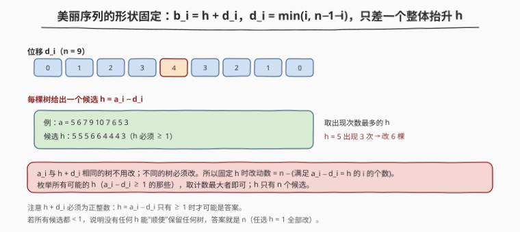
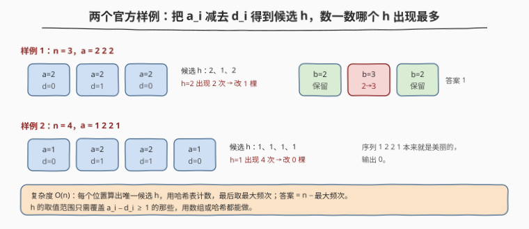

# Codeforces 58C 最少改动树高 题解

## 1. 题目概述

- **题目链接**：https://codeforces.com/problemset/problem/58/C
- **比赛来源**：Codeforces Beta Round 54 (Div. 2) · Problem C（UTC 2011-01-31）
- **难度**：1800
- **标签**：暴力枚举、计数
- **评测类型**：普通
- **限制**：时间 2 s / 内存 256 MB

**题意**：$n$ 棵树排成一排，第 $i$ 棵高 $a_i$。要把它们改成"美丽序列"：第 $1$ 棵与第 $n$ 棵等高，第 $2$ 棵与第 $n-1$ 棵等高，且每往中间走一格高度增加 $1$。每次操作可以把任意一棵树改成任意正整数。求最少的改动次数。

**约束**：

- $n \le 10^5$：$O(n \log n)$ 或 $O(n)$ 都可以，$O(n^2)$ 不行。
- $a_i \le 10^5$：高度不大，但改后的高度可以更大（例如全部改成很高的值）。
- 改后高度必须是**正整数**：美丽序列的"底" $h \ge 1$。
- 单组输入，输出一个整数。

## 2. 示例与观察

官方样例 1（输入 / 输出原样）：

```text
输入：
3
2 2 2

输出：
1
```

**演算**：$n = 3$ 时美丽序列形如 $(h, h+1, h)$。取 $h = 2$ 得 $(2, 3, 2)$，只需把中间那棵从 $2$ 改成 $3$，改动 $1$ 次；取 $h = 1$ 得 $(1,2,1)$ 要改两棵。最小是 $1$ ✓。

官方样例 2（输入 / 输出原样）：

```text
输入：
4
1 2 2 1

输出：
0
```

**演算**：$n = 4$ 时美丽序列是 $(h, h+1, h+1, h)$。输入正好是 $h = 1$ 的情形，一棵都不用改 ✓。

**观察**：

1. 美丽序列的形状是固定的：给定"最低高度" $h$，第 $i$ 棵的高度必须是 $h + d_i$，其中 $d_i = \min(i-1,\, n-i)$ 是它到最近一端的距离（$0$ 起算）。
2. 因此整个序列只由一个参数 $h$ 决定，且 $h \ge 1$。
3. 固定 $h$ 后，第 $i$ 棵树不用改当且仅当 $a_i = h + d_i$，即 $h = a_i - d_i$。所以每棵树只"支持"一个候选 $h$，答案就是 $n$ 减去出现次数最多的那个候选 $h$ 的频次。



## 3. 解题思路

### 3.1 朴素做法与瓶颈

枚举 $h$ 从 $1$ 到某个上界（比如 $\max a_i + n$），对每个 $h$ 扫一遍数组统计相同位置数，取最大。

上界内最多约 $2\times10^5$ 个 $h$，每个 $h$ 扫 $10^5$ 个位置，总计 $2\times10^{10}$ 次比较，2 s 内不可能完成。

### 3.2 核心观察：每棵树只支持一个 h

对位置 $i$（$0$ 起），它到最近一端的距离是 $d_i = \min(i, n-1-i)$。美丽序列要求第 $i$ 棵的高度为 $h + d_i$。于是：

- 若 $a_i - d_i \ge 1$，那么只有当 $h = a_i - d_i$ 时这棵树不用改；
- 若 $a_i - d_i < 1$，那么任何合法 $h \ge 1$ 都无法让它保持不变（因为 $h + d_i > a_i$），这棵树必须改。

所以每棵树至多给一个候选 $h$ 投票。用哈希表统计每个候选 $h$ 的票数，取最大票数 $best$，答案就是 $n - best$。若没有任何合法候选（所有 $a_i - d_i < 1$），则 $best = 0$，答案为 $n$（取 $h=1$ 把每棵都改成不低于原高度的合法值即可，注意"改高度"可以把树改高，所以总能做到）。

### 3.3 算法流程

1. 读入 $n$ 与数组 $a$；
2. 对每个 $i$：$d = \min(i, n-1-i)$，$h = a_i - d$；若 $h \ge 1$，哈希表 `cnt[h]++`；
3. $best = \max$ 频次（$h$ 的取值最多 $n$ 种），输出 $n - best$。

### 3.4 样例走查



样例 1：$d = (0,1,0)$，候选 $h = (2,1,2)$，$h=2$ 得 2 票，答案 $3-2=1$。样例 2：$d = (0,1,1,0)$，候选 $h = (1,1,1,1)$，4 票，答案 $4-4=0$。

## 4. 正确性证明

**引理 1（美丽序列的参数化）**：一个长度为 $n$ 的正整数序列 $b$ 是美丽序列，当且仅当存在整数 $h \ge 1$ 使 $b_i = h + \min(i-1, n-i)$ 对每个 $1 \le i \le n$ 成立。

**证明**：题设"两端相同、每往中间一格加 1、$i$ 与 $n+1-i$ 相同"意味着 $b_i$ 只依赖于到最近一端的距离；设 $b_1 = h$，则沿左端向右每格加 1，沿右端向左每格加 1，于是 $b_i = h + \min(i-1, n-i)$。反之该公式显然满足全部条件，且 $h \ge 1$ 保证正整数。∎

**引理 2（固定 $h$ 的改动数）**：固定 $h \ge 1$ 时，第 $i$ 棵树不改当且仅当 $a_i = h + d_i$，其中 $d_i = \min(i-1, n-i)$；改动数等于 $n - \#\{i : a_i - d_i = h\}$。

**证明**：由引理 1，目标高度唯一确定为 $h + d_i$；不改等价于原高度等于目标高度。∎

**定理**：算法输出的 $n - best$ 是最少改动次数。

**证明**：任一合法方案对应某个 $h \ge 1$（引理 1），其改动数由引理 2 给出为 $n - \text{cnt}(h)$，其中 $\text{cnt}(h)$ 是满足 $a_i - d_i = h$ 的位置数。算法枚举了所有可能被"支持"的 $h$（只有这些 $\text{cnt}(h) > 0$，其余 $h$ 给出 $n$ 次改动，不会更优），取 $\text{cnt}$ 最大者，故改动数最小。∎

## 5. 复杂度分析

- **时间**：一遍扫描，$O(n)$ 次哈希操作，期望 $O(n)$。
- **空间**：哈希表最多存 $n$ 个不同的 $h$，$O(n)$。
- **与时限的关系**：$n = 10^5$ 时 $< 10$ ms（含 I/O），2 s 时限余量充足。

## 6. 参考代码

### C++17

```cpp
#include <bits/stdc++.h>
using namespace std;
int main() {
    ios::sync_with_stdio(false);
    cin.tie(nullptr);
    int n;
    if (!(cin >> n)) return 0;
    vector<int> a(n);
    for (auto& x : a) cin >> x;
    unordered_map<int, int> cnt;
    cnt.reserve(n * 2);
    int best = 0;
    for (int i = 0; i < n; i++) {
        int d = min(i, n - 1 - i);
        int h = a[i] - d;
        if (h >= 1) {
            int c = ++cnt[h];
            if (c > best) best = c;
        }
    }
    cout << n - best << "\n";
    return 0;
}
```

### Python3

```python
import sys

def main():
    data = list(map(int, sys.stdin.buffer.read().split()))
    n = data[0]
    a = data[1:1 + n]
    cnt = {}
    best = 0
    for i, v in enumerate(a):
        d = min(i, n - 1 - i)
        h = v - d
        if h >= 1:
            c = cnt.get(h, 0) + 1
            cnt[h] = c
            if c > best:
                best = c
    print(n - best)

main()
```

## 7. 边界情况与易错点

1. **$n = 1$**：$d_1 = 0$，美丽序列就是任意一个正整数，原高度已经合法，答案 0（只要 $a_1 \ge 1$，题目保证）。
2. **候选 $h < 1$**：必须跳过，不能把 $h = 0$ 或负数当作候选——美丽序列的底必须是正整数。
3. **所有候选都非法**：$best = 0$，输出 $n$；这是"必须全部改"的情形，不要错误地输出 0。
4. **$h$ 的上界**：不需要预先枚举 $h$ 的范围，直接用 $a_i - d_i$ 作为键，天然覆盖所有可能。
5. **下标与距离**：$d_i = \min(i, n-1-i)$ 用的是 0 起下标；若用 1 起下标，公式变成 $\min(i-1, n-i)$，两种写法不要混用。
6. **"改成任意正整数"**：可以改大也可以改小，所以没有"只能增高"的额外约束；答案只看相等位置的个数。
7. **哈希退化**：C++ 若担心 `unordered_map` 被卡，可换 `map` 或读入后排序，$O(n\log n)$ 同样安全。

## 8. 验证记录

- **编译环境与命令**：`g++ -std=c++17 -O2`（本机 clang++ + 兼容头，`verify_solution.py` 自动处理）；Python 3.12。
- **官方样例**：2 / 2 通过（`CF58C: samples 2 / C++ 编译 OK, 样例 2/2 / Python 语法 OK, 样例 2/2`）。
- **额外测试**：随机对拍 $400$ 组（$n \le 12$，$a_i \le 8$），与"枚举 $h = 1 \sim \max a + n$、逐个构造美丽序列并计数"的独立暴力逐组比对，C++ 与 Python 全部一致。
- **最大约束性能**：$n = 10^5$ 时整程序约 $10$ ms。
- **复核状态**：`check.py` 0 失败；样例与 `.cf-meta/statements/CF58C.json` 逐字一致。

## 相关题目与扩展

- [Codeforces 58B 硬币](https://codeforces.com/problemset/problem/58/B)：同样是"先确定结构、再数最优参数"的计数题。
- [Codeforces 53C 小青蛙](https://codeforces.com/problemset/problem/53/C)：按固定模式构造序列的入门题。

**延伸思考**：

1. 若美丽序列改成"每往中间一格增加 $k$"（而不是 1），只需把 $d_i$ 换成 $k \cdot \min(i-1,n-i)$，算法完全不变。
2. 若要求"改动幅度之和最小"而不是"改动棵树最少"，每条候选 $h$ 的代价变成 $\sum |a_i - (h+d_i)|$，可以对 $a_i - d_i$ 取中位数求解。
3. 若允许把某些树改成非正整数之外的限制（如高度上限 $H$），候选 $h$ 需要满足 $h + d_i \le H$，仍是枚举候选 + 计数。
