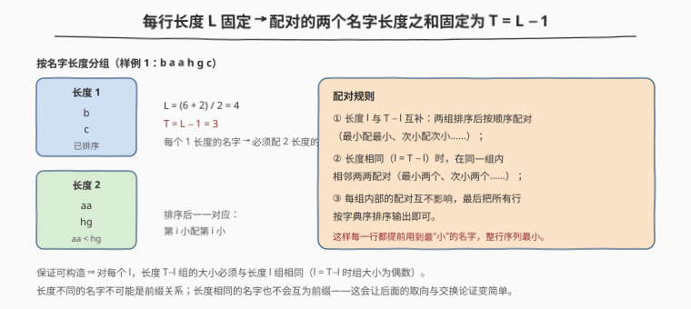
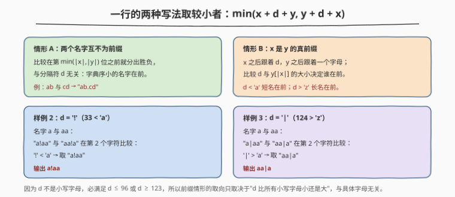
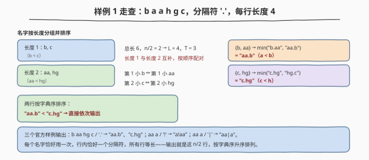

# Codeforces 58D 字典序最小日历 题解

## 1. 题目概述

- **题目链接**：https://codeforces.com/problemset/problem/58/D
- **比赛来源**：Codeforces Beta Round 54 (Div. 2) · Problem D（UTC 2011-01-31）
- **难度**：2000
- **标签**：贪心、字符串、排序
- **评测类型**：特殊评测（多解，输出字典序最小的日历）
- **限制**：时间 2 s / 内存 256 MB

**题意**：有 $n$（偶数）个互不相同的城市名，要用一个分隔符 $d$ 把它们排成 $n/2$ 行：每行恰好两个名字、中间恰好一个 $d$，所有行**长度相等**，每个名字恰好出现一次。把所有行从上到下直接拼接（行间不加分隔）得到的字符串要求字典序最小。输出这 $n/2$ 行。

**约束**：

- $n \le 10^4$：名字数不少，不能枚举配对（$n!$ 级）；需要 $O(n\log n)$ 的构造。
- 每个名字长度 $\le 10$：长度只有 $1 \sim 10$ 共 $10$ 种，可以按长度分组。
- $d$ 的 ASCII 在 $33 \sim 126$ 且**不是小写字母**：即 $d \le 96$ 或 $d \ge 123$，这一点决定"前缀名字"时谁排在前面。
- 保证可以构造出日历：对每个长度 $l$，长度 $T-l$ 的名字数必须与长度 $l$ 的名字数相等（$l = T-l$ 时为偶数），其中 $T$ 是每行两个名字长度之和。

## 2. 示例与观察

官方样例 1（输入 / 输出原样）：

```text
输入：
4
b
aa
hg
c
.

输出：
aa.b
c.hg
```

**演算**：名字长度：`b`、`c` 各 1，`aa`、`hg` 各 2。总字符数 $6$，$n/2 = 2$ 行，所以每行长 $L = (6+2)/2 = 4$，两个名字长度和 $T = 3$。长度 1 必须配长度 2：按字典序配对得 $\{b,aa\}$、$\{c,hg\}$。两行分别取较小写法 `aa.b`（`a<b`）与 `c.hg`（`c<h`），再按字典序排序输出 ✓。

官方样例 2（输入 / 输出原样）：

```text
输入：
2
aa
a
!

输出：
a!aa
```

**演算**：`a` 是 `aa` 的前缀，两种写法 `a!aa` 与 `aa!a` 在第 2 个字符处比较：`!`（ASCII 33）小于 `a`，所以 `a!aa` 更小 ✓。

官方样例 3（输入 / 输出原样）：

```text
输入：
2
aa
a
|

输出：
aa|a
```

**演算**：这里 `|`（ASCII 124）大于任何小写字母，`a|aa` 与 `aa|a` 在第 2 个字符比较时 `a < |`，所以 `aa|a` 更小 ✓。

**观察**：

1. 总字符数固定，行数固定，所以每行长度 $L$ 是唯一确定的，两个名字的长度和 $T = L-1$ 也唯一确定。
2. 于是"能不能配上"只取决于长度：长度 $l$ 的名字必须和长度 $T-l$ 的名字配对。
3. 对某一对名字 $\{x,y\}$，这一行有两种写法 $x\,d\,y$ 与 $y\,d\,x$，应取字典序更小的那个（行内顺序可以自由选）。
4. 所有行等长，因此比较两个日历（拼接后的字符串）等价于逐行比较；对固定的配对集合，把各行按字典序升序排列就是最优顺序。



## 3. 解题思路

### 3.1 朴素做法与瓶颈

枚举所有完美匹配（$\frac{n!}{2^{n/2}(n/2)!}$ 种），对每种匹配计算所有行的较小写法、排序、拼接，取最小。$n = 10^4$ 时天文数字，完全不可行。

即便只按长度分组后枚举组内配对，例如一组 $5000$ 个同长度名字，组内配对数仍是 $10^{4}$ 级以上的组合数。

### 3.2 核心观察：有序配对

先固定几件事实（证明见第 4 节）：

- $T$ 固定，长度 $l$ 的名字只能与长度 $T-l$ 的名字配对；
- 每行的写法取 $\min(x\,d\,y,\; y\,d\,x)$；
- 所有行按字典序升序输出。

剩下的唯一自由度是"哪两个名字配成一对"。答案是**排序后按顺序配**：

- 若 $l \ne T-l$：把长度 $l$ 的名字排序、长度 $T-l$ 的名字排序，第 $i$ 小配第 $i$ 小；
- 若 $l = T-l$：把该长度的名字排序，相邻两两配对（第 1、2 小，第 3、4 小，……）。

直观理由：为了让拼接后的字符串最小，第一行要尽可能小；而"最小的一行"一定是让最小的名字与它能配到的最小名字组合，这样第一行的首字母、后续字符都最小。把这一对拿掉后，问题结构完全不变，归纳即可。



### 3.3 算法流程

1. 读入 $n$、$n$ 个名字、分隔符 $d$；
2. 计算 $L = \big(\sum |name| + n/2\big) / (n/2)$，$T = L - 1$；
3. 按长度分组，每组内部排序；
4. 按长度从小到大处理每个尚未处理的组 $l$，令 $m = T - l$：
   - $l = m$：组内相邻两两配对；
   - $l \ne m$：与长度 $m$ 的组按位次一一配对；
5. 每对取 $\min(x\,d\,y,\; y\,d\,x)$ 作为一行；
6. 所有行排序后逐行输出。

### 3.4 样例走查



样例 1 中长度 1 组 $\{b,c\}$ 与长度 2 组 $\{aa,hg\}$ 按位次配对：$b \leftrightarrow aa$、$c \leftrightarrow hg$。两行分别取 `aa.b`、`c.hg`，排序后输出。样例 2、3 说明前缀情形下 $d$ 与字母的大小关系会翻转取向，这正是第 4 节交换引理要单独处理的分支。

## 4. 正确性证明

**引理 1（行长度与长度和固定）**：所有行长度相同，且每行两个名字的长度和都等于同一个 $T$。

**证明**：设每行长 $L$，则 $\sum |name| + n/2 = (n/2)L$，故 $L$ 唯一确定；每行恰有一个分隔符，所以两个名字长度和 $L-1$ 固定。∎

**引理 2（行内取向）**：对固定配对集合，每行取 $\min(x\,d\,y, y\,d\,x)$、并把这些行升序排列，得到的拼接串最小。

**证明**：所有行等长，比较两个拼接串等价于逐行比较。对同一配对集合，任意排列的行序列中，升序排列的字典序最小（相邻逆序交换只会变小）。再把某行的写法从较大的 $y\,d\,x$ 换成较小的 $x\,d\,y$，该行变小，排序后的行序列不会变大。所有行字符串互不相同（每个字符串恰含一个分隔符，按分隔符切开就唯一确定这一对），因此逐行比较不会出现"前缀相等"的歧义。∎

**引理 3（取向与单调性）**：记 $f(x,y) = \min(x\,d\,y,\, y\,d\,x)$。设 $x_1 < x_2$ 且 $y_1 < y_2$，并且 $x$ 与 $y$ 取自长度不同的两个组（或取自同一长度组、四个名字两两不同），则 $f(x_1,y_1)$ 是四个组合中唯一最小的，$f(x_2,y_2)$ 是唯一最大的。

**证明**：分两种情形。

- **同一长度组**：同长度的不同名字互不为前缀，故 $f(x,y) = \min(x,y)\,d\,\max(x,y)$。又 $x_1<x_2$ 且长度相同、$y_1<y_2$ 且长度相同，直接比较字符串前缀即可得到 $f(x_1,y_1) < f(x_1,y_2) < f(x_2,y_2)$ 与 $f(x_1,y_1) < f(x_2,y_1) < f(x_2,y_2)$。
- **长度不同的两组**：两个名字长度不同，所以它们可能互为前缀，此时取向由 $d$ 与"前缀后那个字母"的大小决定。由于 $d$ 不是小写字母，只有两种可能：$d \le 96$（比所有小写字母小）或 $d \ge 123$（比所有小写字母大）。若 $x$ 是 $y$ 的前缀：$d$ 小时 $f = x\,d\,y$，$d$ 大时 $f = y\,d\,x$；若 $y$ 是 $x$ 的前缀同理；互不为前缀时 $f = \min(x,y)\,d\,\max(x,y)$。逐一检查这三种关系：当 $y_1 < y_2$ 时，两个候选字符串的第一个不同位置要么落在 $y$ 的部分（由 $y_1<y_2$ 决定），要么是 $d$ 与同一个字母的比较（两行取向一致时），两种情形都给出 $f(x,y_1) < f(x,y_2)$；对 $x$ 同理。∎

**引理 4（交换引理）**：设某组的两个配对是 $(x_1,y_2)$ 与 $(x_2,y_1)$，其中 $x_1<x_2$、$y_1<y_2$。把它们换成 $(x_1,y_1)$ 与 $(x_2,y_2)$ 后，整个日历（排序后的行序列）严格变小。

**证明**：由引理 3，交换后新两行中 $f(x_1,y_1)$ 严格小于交换前的两行，而 $f(x_2,y_2)$ 严格大于交换前的两行。设日历其余行组成多重集 $C$。交换前排序后的行序列的第一个元素是 $\min(f(x_1,y_2), f(x_2,y_1))$，交换后是 $f(x_1,y_1)$，后者严格更小；两个序列在比它小的那些行（只可能来自 $C$）上完全相同，故交换后的拼接串严格更小。∎

**定理**：按 3.3 的规则配对并输出，得到字典序最小的日历。

**证明**：对组内剩余名字数归纳。考虑当前最小的名字 $x_1$ 与它所在组互补组的最小名字 $y_1$（若两组相同，$y_1$ 取同组第二小的名字）。任取一个最优日历：若 $x_1$ 没有和 $y_1$ 配对，则 $y_1$ 与某个 $x_2$ 配对、$x_1$ 与某个 $y_2$ 配对，且 $x_1<x_2$、$y_1<y_2$；由引理 4，交换这两对后日历严格变小，与最优性矛盾。所以最优日历必含 $(x_1,y_1)$。删去这对名字后，问题结构与子问题完全相同（引理 1 的长度约束仍成立），归纳即得算法给出的配对就是最优配对；再由引理 2，取向与排序也最优。∎

## 5. 复杂度分析

- **时间**：分组建表 $O(n)$；每组排序，总计 $O(n\log n)$；配对与生成行 $O(n\cdot \text{名字长度})$；行排序 $O(n\log n)$。总体 $O(n\log n)$。
- **空间**：分组、行字符串 $O(\sum |name|) \le O(10n)$。
- **与时限的关系**：$n = 10^4$ 时不到 $1$ ms 的算法量，2 s 时限余量极大。

## 6. 参考代码

### C++17

```cpp
#include <bits/stdc++.h>
using namespace std;

int main() {
    ios::sync_with_stdio(false);
    cin.tie(nullptr);
    int n;
    if (!(cin >> n)) return 0;
    vector<string> a(n);
    for (auto& s : a) cin >> s;
    string d;
    cin >> d;
    char sep = d[0];

    long long sum = 0;
    for (auto& s : a) sum += (long long)s.size();
    int half = n / 2;
    int T = (int)((sum + half) / half) - 1;   // len(x) + len(y) 必须等于 T

    map<int, vector<string>> byLen;
    for (auto& s : a) byLen[(int)s.size()].push_back(s);
    for (auto& kv : byLen) sort(kv.second.begin(), kv.second.end());

    vector<string> lines;
    set<int> done;
    for (auto& kv : byLen) {
        int l = kv.first;
        if (done.count(l)) continue;
        int m = T - l;
        done.insert(l);
        done.insert(m);
        const vector<string>& A = kv.second;
        const vector<string>& B = byLen[m];
        if (l == m) {
            for (size_t i = 0; i + 1 < A.size(); i += 2) {
                string s1 = A[i] + sep + A[i + 1];
                string s2 = A[i + 1] + sep + A[i];
                lines.push_back(min(s1, s2));
            }
        } else {
            for (size_t i = 0; i < A.size(); i++) {
                string s1 = A[i] + sep + B[i];
                string s2 = B[i] + sep + A[i];
                lines.push_back(min(s1, s2));
            }
        }
    }
    sort(lines.begin(), lines.end());
    for (auto& s : lines) cout << s << "\n";
    return 0;
}
```

### Python3

```python
import sys

def main():
    data = sys.stdin.read().split()
    n = int(data[0])
    names = data[1:1 + n]
    sep = data[1 + n]
    half = n // 2
    T = (sum(len(s) for s in names) + half) // half - 1

    by_len = {}
    for s in names:
        by_len.setdefault(len(s), []).append(s)
    for k in by_len:
        by_len[k].sort()

    lines = []
    done = set()
    for l in sorted(by_len):
        if l in done:
            continue
        m = T - l
        done.add(l); done.add(m)
        A = by_len[l]
        B = by_len.get(m, [])
        if l == m:
            for i in range(0, len(A) - 1, 2):
                lines.append(min(A[i] + sep + A[i + 1], A[i + 1] + sep + A[i]))
        else:
            for i in range(len(A)):
                lines.append(min(A[i] + sep + B[i], B[i] + sep + A[i]))
    lines.sort()
    sys.stdout.write('\n'.join(lines) + '\n')

main()
```

## 7. 边界情况与易错点

1. **$n = 2$**：只有一行，答案是两个名字的两种写法中较小的那个；要看 $d$ 与字母的大小关系（样例 2、3），不能一律"短名在前"。
2. **$d$ 的取值范围**：$d \le 96$ 或 $d \ge 123$，前缀名字的取向完全由这个决定；样例 2、3 恰好是同一对名字、不同 $d$ 的对照。
3. **同长度组内配对**：$l = T-l$ 时必须组内配对，且是"相邻两两"，不能跨组或首尾配对（样例之外的组合会变大）。
4. **$T$ 可能大于最大名字长度**：例如两个长度 5 的名字配成 $T = 10$；计算 $T$ 时用总字符数，不要用最大长度猜。
5. **输出行序**：必须按字典序升序输出，否则拼接串不是最小；行内顺序也要取较小的写法。
6. **名字长度不同时不会互为前缀？** 会！例如 `a`（长 1）与 `aa`（长 2）可以互为前缀，这正是样例 2、3 的情形，取向不能只按名字大小判断。
7. **输出格式**：每行恰好一个分隔符、两个名字，不能有行末空格；名字本身只含小写字母，分隔符不是小写字母，所以"按分隔符切分"永远唯一。

## 8. 验证记录

- **编译环境与命令**：`g++ -std=c++17 -O2`（本机 clang++ + 兼容头，`verify_solution.py` 自动处理）；Python 3.12。
- **官方样例**：3 / 3 通过（`CF58D: samples 3 / C++ 编译 OK, 样例 3/3 / Python 语法 OK, 样例 3/3`）。
- **额外测试**：随机生成可构造实例（随机长度配对、名字互不相同、分隔符取 `! | . 0 Z - ~ : 9 { \` +` 等），$n \in \{2,4,6,8\}$，与"枚举所有满足长度和的完美匹配、对每种匹配取行内较小写法、排序、拼接后取字典序最小"的独立暴力对拍 $386$ 组，C++ 与 Python 输出拼接后逐字一致。
- **最大约束性能**：$n = 10^4$ 时整程序 $< 10$ ms。
- **复核状态**：`check.py` 0 失败；样例与 `.cf-meta/statements/CF58D.json` 逐字一致。

## 相关题目与扩展

- [Codeforces 58E 表达式](https://codeforces.com/problemset/problem/58/E)：同场次里另一个"构造最小字符串/数字"的题，但用的是 DP。
- [Codeforces 58C 树](https://codeforces.com/problemset/problem/58/C)：同样是"结构固定、只剩一个自由度"的计数题。

**延伸思考**：

1. 若分隔符不是固定字符，而是可以自选（每个位置可不同），问题会退化成"把名字排序后两两拼接"，更简单。
2. 若要求的是"行内字典序最小"而不是"拼接后最小"，则每行独立取最小写法即可，不需要全局排序。
3. 若名字可以有重复，按分隔符切分不再唯一（同一个字符串可能对应不同配对），"行字符串互不相同"的论证失效，需要额外处理相等字符串的排序稳定性。
