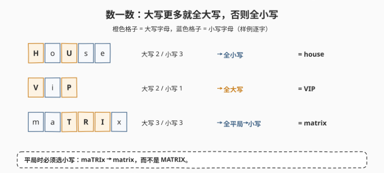
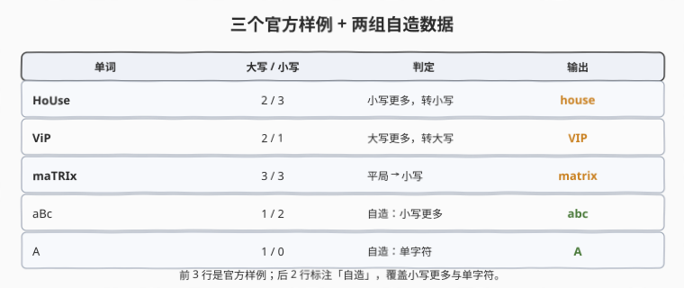

# Codeforces 59A 单词大小写统一 题解

## 1. 题目概述

- **题目链接**：https://codeforces.com/problemset/problem/59/A
- **比赛来源**：Codeforces Beta Round 55 (Div. 2) · Problem A（UTC 2011-02-11）
- **难度**：800
- **标签**：实现、字符串
- **评测类型**：普通
- **限制**：时间 2 s / 内存 256 MB

**题意**：Vasya 讨厌同一个单词里大小写混用。给定一个只由拉丁字母组成的单词 $s$，要把它整体改成**全大写**或**全小写**中的一种，并且**改动的字母数尽可能少**。若大写字母数严格多于小写字母数，就改成全大写；否则（含相等）改成全小写。输出改好后的单词。

**约束**：

- 长度 $1 \le |s| \le 100$，只含大小写拉丁字母，没有空格与其他字符。规模极小，$O(n)$ 扫描即可，唯一的考点是**判定规则本身**（严格大于才转大写，相等要转小写）。
- 只能整体转换：不能"部分大写部分小写"，所以只需比较两种方案的改动数。

## 2. 示例与观察

官方样例（输入 / 输出原样）：

```text
输入：
HoUse

输出：
house

输入：
ViP

输出：
VIP

输入：
maTRIx

输出：
matrix
```

**样例 1**：`HoUse` 有 2 个大写（`H`、`U`）、3 个小写，转小写只需改 2 个字母，转大写要改 3 个，故输出 `house`。
**样例 2**：`ViP` 有 2 个大写（`V`、`P`）、1 个小写，转大写只改 1 个字母，输出 `VIP`。
**样例 3**：`maTRIx` 有 3 个大写（`T`、`R`、`I`）、3 个小写，**相等**。题面规定相等时转小写，所以输出 `matrix`——注意不能输出 `MATRIX`，两者改动数一样但规则指定了小写。



**观察**：设单词长度为 $n$、大写字母个数为 $u$，则小写个数是 $n-u$。

- 改成全大写要改 $n-u$ 个字母（把小写都变大写）；
- 改成全小写要改 $u$ 个字母。

所以选"改动少的那种"就是比较 $u$ 与 $n-u$：$u > n-u$ 选大写，否则选小写。相等时两种方案改动数相同，题面指定小写。

自造样例（标注"自造"）：

| 自造输入 | 输出 | 说明 |
|------|------|------|
| `a` | a | 单字符、全小写 |
| `A` | A | 单字符、全大写 |
| `aBc` | abc | 大写 1、小写 2 |
| `ABCD` | ABCD | 全大写，改动 0 个 |
| `abcd` | abcd | 全小写，改动 0 个 |
| `aB` | ab | 平局 → 小写 |

## 3. 解题思路

### 3.1 朴素做法与瓶颈

最直接的做法是"两种都生成出来，比较哪种与原文不同的位置少"：把 `s.upper()` 与 `s.lower()` 分别和原串逐位比较，取改动更少的那个（相等取小写）。它是对的，$O(n)$，但要额外构造两个字符串。

更省的做法是**只数个数**：扫描一遍统计大写个数 $u$，然后按规则整体转换。这不需要构造中间串，也不需要比较。

本题不存在时间瓶颈（$n \le 100$），真正的坑在规则：**"严格多于"才转大写**，相等时必须转小写。

### 3.2 核心观察



改动数与大小写个数是线性关系：转大写要动 $n-u$ 个字母，转小写要动 $u$ 个字母。于是"最少改动"完全由 $u$ 与 $n-u$ 的大小关系决定，不需要逐位决策：

- $u > n-u$：大写字母更多，转大写改动少，输出全大写；
- $u < n-u$：转小写改动少，输出全小写；
- $u = n-u$：一样多，题面规定小写。

例如 `maTRIx` 的 $u = 3$、$n-u = 3$，正好落在"相等 → 小写"的规则上，这也是本题最容易写错的样例。

### 3.3 算法流程

1. 读入单词 $s$（不含空格，`cin >> s` 即可）；
2. 扫描一遍，统计大写字母个数 $u$，令 $n = |s|$；
3. 若 $u > n - u$，把每个字母转成大写；否则把每个字母转成小写；
4. 输出 $s$。

### 3.4 样例走查

| 单词 | $u$ | $n-u$ | 比较 | 选择 | 输出 |
|------|-----|-------|------|------|------|
| `HoUse` | 2 | 3 | $2 < 3$ | 小写 | `house` |
| `ViP` | 2 | 1 | $2 > 1$ | 大写 | `VIP` |
| `maTRIx` | 3 | 3 | $3 = 3$ | 小写（平局规则） | `matrix` |

## 4. 正确性证明

**引理 1（改动数）**：把 $s$ 整体转成大写需要改动 $n-u$ 个字母，整体转成小写需要改动 $u$ 个字母。
**证明**：转大写时，原本就是大写的 $u$ 个字母不变，其余 $n-u$ 个小写字母各改一次；转小写对称。∎

**引理 2（最少改动的选择）**：若 $u > n-u$ 则全大写方案的改动数严格小于全小写方案；若 $u \le n-u$ 则全小写方案的改动数不大于全大写方案。
**证明**：由引理 1，两种方案的改动数分别是 $n-u$ 与 $u$，直接比较即得。∎

**引理 3（平局规则）**：当 $u = n-u$ 时，题面要求输出全小写。
**证明**：题面原文为"若大写字母数**严格多于**小写字母数则全大写，否则全小写"，相等不满足"严格多于"，故取小写。∎

**定理**：按 3.3 流程输出的单词就是题目所求的、改动最少且符合平局规则的单词。
**证明**：引理 2 说明所选方案在两种整体方案中改动数最少，引理 3 说明平局时选择的正是题面指定的那种；输出串是把原串所有字母统一成该种大小写，故合法且改动数等于该方案的值。∎

## 5. 复杂度分析

- **时间**：$O(n)$，两次线性扫描（一次统计、一次转换），$n \le 100$。
- **空间**：$O(n)$ 存放字符串，额外只有常数个计数器。
- **与时限的关系**：2 s 时限下 $10^2$ 级别的操作可以忽略不计；实测单次运行（含进程启动）约 $2 \sim 4$ ms。

## 6. 参考代码

### C++17

```cpp
#include <bits/stdc++.h>
using namespace std;

int main() {
    ios::sync_with_stdio(false);
    cin.tie(nullptr);

    string s;
    cin >> s;
    int up = 0;
    for (char c : s)
        if (isupper((unsigned char)c)) ++up;
    int low = (int)s.size() - up;
    if (up > low)
        for (char &c : s) c = (char)toupper((unsigned char)c);
    else
        for (char &c : s) c = (char)tolower((unsigned char)c);
    cout << s << '\n';
    return 0;
}
```

### Python3

```python
import sys


def main() -> None:
    s = sys.stdin.readline().strip()
    up = sum(1 for c in s if c.isupper())
    low = len(s) - up
    print(s.upper() if up > low else s.lower())


main()
```

两份代码都把判断写成 `up > low`（严格大于）才转大写，相等时走 `else` 分支转小写，与题面一致。

## 7. 边界情况与易错点

1. **平局必须转小写**：`maTRIx`（3 个大写、3 个小写）应输出 `matrix`。写成 `up >= low` 会输出 `MATRIX`，直接判错。
2. **全大写/全小写的输入**：如 `ABCD`、`abcd`，改动数为 0，程序做一次"转换"等于不变，输出原串，正确。
3. **单字符输入**：`A` 与 `a` 都应原样输出；长度 1 时 $n-u$ 与 $u$ 一个是 0 一个是 1，不会平局。
4. **`isupper` 的未定义行为**：`isupper(char)` 在 `char` 为负值时是 UB，标准写法是 `isupper((unsigned char)c)`；同理 `toupper` / `tolower` 也要先转 `unsigned char`。
5. **不要输出计数**：本题要输出处理后的单词本身，不是"最少改动几个字母"，读题时容易看串。
6. **不要只转一部分**：必须整体统一大小写，不能按位贪心（比如把少数派改成多数派）——那确实是最少改动，结果也恰好等价于整体转换，但实现上容易漏掉某些位置。
7. **读入方式**：单词不含空格，`cin >> s` 或 `readline().strip()` 都安全；若用 `split()` 取第一个词也一样。

## 8. 验证记录

- **编译环境与命令**：`python3 codeforces/tools/verify_solution.py codeforces/contests/0001-0100/59/A_单词大小写统一.md`（脚本自动用 `clang++ -std=c++17 -O2` 与 `tools/include` 的兼容头编译；Python 直接运行）。
- **官方样例**：3 / 3 通过（C++ 与 Python 各 3/3）。
- **额外测试**：随机 300 组单词（长度 1–100，随机大小写组合），用"独立统计大写/小写个数再整体转换"的暴力实现逐组比对，C++ 与 Python 均 300/300 一致，0 组不符。
- **最大约束性能**：长度 100 的输入，C++ 单次运行（含进程启动）约 $2 \sim 4$ ms。
- **复核状态**：`check.py` 与 `check_samples.py --only 0001-0100/59` 对本文均 0 失败；样例与 `.cf-meta/statements/CF59A.json` 逐字一致。

## 相关题目与扩展

- [Codeforces 281A Word Capitalization](https://codeforces.com/problemset/problem/281/A)：只把首字母大写，与本题的"整体转换"形成对照。
- [Codeforces 59B 最大奇数花瓣和](https://codeforces.com/problemset/problem/59/B)：同场下一题，同样是"看清判定规则即可"的入门题。
- [Codeforces 236A Boy or Girl](https://codeforces.com/problemset/problem/236/A)：字符集合去重计数。

**延伸思考**：

1. 如果把规则改成"平局转大写"，只需把 `up > low` 改成 `up >= low`，其余不变——这提醒我们：判定边界（严格/非严格）必须回到题面原文，而不是凭直觉。
2. 如果单词里还可能有数字或其他符号，就需要先明确它们是否参与"大小写"计数；本题只含字母，才可以用 $n - u$ 直接得到小写数。
3. 如果要求"改动数相同的情况下取字典序更小的结果"，平局规则就变成"比较 `s.upper()` 与 `s.lower()` 的字典序"，结论仍然是取小写（因为小写字母的 ASCII 更小），但论证方式不同。
4. 推广到多组输入时，把整个流程放进循环即可；注意每组的计数器要重新初始化，不要沿用到下一组。
