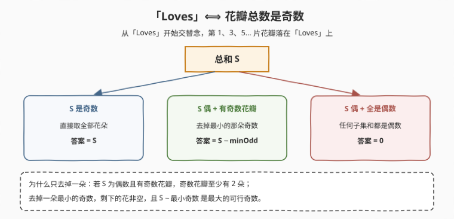
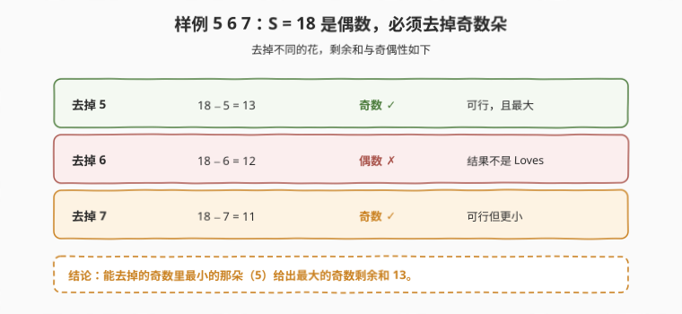
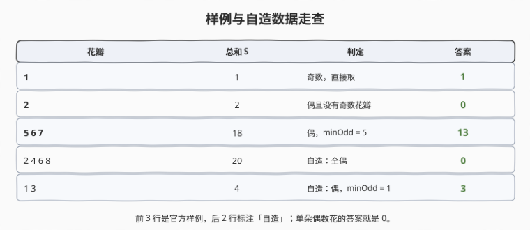

# Codeforces 59B 最大奇数花瓣和 题解

## 1. 题目概述

- **题目链接**：https://codeforces.com/problemset/problem/59/B
- **比赛来源**：Codeforces Beta Round 55 (Div. 2) · Problem B（UTC 2011-02-11）
- **难度**：1200
- **标签**：数学、数论
- **评测类型**：普通
- **限制**：时间 2 s / 内存 256 MB

**题意**：有 $n$ 朵甘菊，第 $i$ 朵有 $a_i$ 片花瓣。Marina 挑一束花（**至少一朵**），一片一片地掰花瓣，同时交替念 "Loves"、"Doesn't love"，**第一片念 "Loves"**。她希望最后一句是 "Loves"，并让花束的花瓣总数尽可能大。求这个最大的花瓣总数；若不存在这样的花束，输出 $0$。

**约束**：

- $1 \le n \le 100$，$1 \le a_i \le 100$，总和不超过 $10^4$，`int` 足够。
- 花束必须非空（"one or several camomiles"），所以不能输出"空集的 0"当作答案；输出 0 表示**无解**。

## 2. 示例与观察

官方样例（输入 / 输出原样）：

```text
输入：
1
1

输出：
1

输入：
1
2

输出：
0

输入：
3
5 6 7

输出：
13
```

**样例 1**：只有 1 片花瓣。第 1 片念 "Loves"，结束，答案 1。
**样例 2**：2 片花瓣，第 1 片 "Loves"、第 2 片 "Doesn't love"，结束在 "Doesn't love"；只有这一朵花，任何非空花束都不行，输出 0。
**样例 3**：$5+6+7 = 18$，是偶数，全取不行。去掉 6 得 12（仍偶）；去掉 5 得 13（奇）；去掉 7 得 11（奇但更小）。最大是 13。



**观察 1**：从 "Loves" 开始交替念，第 $1, 3, 5, \dots$ 片落在 "Loves" 上，第 $2, 4, 6, \dots$ 片落在 "Doesn't love" 上。所以

$$\text{结果} = \text{Loves} \iff \text{花瓣总数是奇数}.$$

**观察 2**：若全部花的花瓣总和 $S$ 是奇数，直接全取就是最大（任何子集的和都 $\le S$）。
**观察 3**：若 $S$ 是偶数，就得从"全取"里去掉一些花，使剩下的和变成奇数——也就是**去掉的花瓣总数必须是奇数**。去掉得越少，剩下越大；而"奇数和的集合"里最小可能值就是一**朵最小的奇数花瓣**。所以答案是 $S - \min\{a_i : a_i \text{ 为奇数}\}$。
**观察 4**：如果**所有花瓣都是偶数**，任何子集的和都是偶数（偶数之和仍为偶数），此时无解，输出 0。

自造样例（标注"自造"）：

| 自造输入 | 输出 | 说明 |
|------|------|------|
| `2` / `1 1` | 1 | 总和 2 偶；去掉一朵 1，剩 1 |
| `3` / `2 4 6` | 0 | 全偶，任何子集和为偶 → 无解 |
| `2` / `1 3` | 3 | 总和 4 偶；去掉 1 得 3，去掉 3 得 1，最大 3 |
| `1` / `3` | 3 | 总和为奇，直接全取 |
| `4` / `2 3 3 2` | 7 | 总和 10 偶；去掉一个 3 得 7 |
| `3` / `1 2 4` | 7 | 总和 7 奇，直接全取 |

## 3. 解题思路

### 3.1 朴素做法与瓶颈

最朴素的做法是枚举所有非空子集，取"和为奇数"的最大值。$n \le 100$ 时有 $2^{100}$ 个子集，完全不可行。

次朴素的做法是"从全取开始，尝试去掉最小的若干朵花使和变奇"——方向对，但要想清楚：去掉的总和必须是奇数，而**去掉一朵最小的奇数**一定是最优的，不需要尝试去掉两朵或更多。

### 3.2 核心观察



由观察 1–4，答案只有三种可能：

$$\text{ans} = \begin{cases} S, & S \text{ 为奇数},\\ S - m, & S \text{ 为偶数且存在奇数花瓣},\\ 0, & \text{所有花瓣都是偶数}, \end{cases}$$

其中 $m = \min\{a_i : a_i \text{ 为奇数}\}$。

为什么 $S$ 为偶数时"去掉最小奇数"是最优的：

- 要使剩下的和是奇数，去掉的部分之和必须是奇数；
- 任何"和为奇数的子集"其和都 $\ge m$（$m$ 是最小奇数花瓣，而奇数和的集合至少要含一个奇数元素）；
- 所以剩下的和 $\le S - m$，而"全取去掉 $m$ 那一朵"恰好达到 $S - m$，且剩余非空（$S$ 偶且有奇数花瓣 $\Rightarrow$ 奇数花瓣至少两朵）。

### 3.3 算法流程

1. 读入 $n$ 与 $a_1..a_n$，求总和 $S$ 与最小奇数花瓣 $m$（没有奇数时令 $m = +\infty$）；
2. 若 $S$ 是奇数：输出 $S$；
3. 否则若 $m$ 不存在：输出 `0`；
4. 否则输出 $S - m$。

注意判定顺序：先看 $S$ 的奇偶，再看有没有奇数花瓣；两者顺序不能交换（例如 `1 1` 的 $S=2$ 偶、$m=1$，答案是 1 而不是 0）。

### 3.4 样例走查



| 输入 | $S$ | 最小奇数 $m$ | 判定 | 答案 |
|------|-----|--------------|------|------|
| `1` / `1` | 1 | 1 | $S$ 奇，全取 | 1 |
| `1` / `2` | 2 | 无 | 偶且全偶 | 0 |
| `3` / `5 6 7` | 18 | 5 | 偶，去掉 5 | 13 |
| `3` / `2 4 6`（自造） | 12 | 无 | 偶且全偶 | 0 |
| `2` / `1 3`（自造） | 4 | 1 | 偶，去掉 1 | 3 |

样例 3 的细节：$5+6+7=18$；去掉 5 得 13（奇，最大）；去掉 7 得 11（也奇，但更小）；去掉 6 得 12（偶，不行）。所以 13 正确。

## 4. 正确性证明

**引理 1（Loves 判定）**：花束的结果是 "Loves" 当且仅当花瓣总数是奇数。
**证明**：第 $k$ 片花瓣对应第 $k$ 句，奇数句是 "Loves"、偶数句是 "Doesn't love"。最后一片是第 $P$ 片，故结果为 "Loves" $\iff P$ 为奇数。∎

**引理 2（总和为奇时全取最优）**：若 $S$ 为奇数，则取全部花是合法的且花瓣数最大。
**证明**：全部花非空（$n \ge 1$），且任何花束的花瓣数是某个子集之和 $\le S$；全取达到 $S$，由引理 1 结果为 "Loves"。∎

**引理 3（总和为偶且有奇数花瓣）**：此时最优值是 $S - m$，其中 $m$ 是最小奇数花瓣。
**证明**：设某个非空花束的花瓣和为 $T$ 且 $T$ 为奇数，令 $D = S - T$ 为"没被选中的花"的花瓣和。$S$ 偶、$T$ 奇 $\Rightarrow D$ 奇，故 $D$ 中至少含一朵奇数花瓣，从而 $D \ge m$，于是 $T = S - D \le S - m$。另一方面，去掉那朵 $m$ 后剩余花的花瓣和恰为 $S - m$（奇），且剩余非空：$S$ 偶而 $m$ 奇说明奇数花瓣不止一朵，故至少还剩一朵。由引理 1，该花束结果为 "Loves"，达到上界。∎

**引理 4（全偶时无解）**：若所有 $a_i$ 都是偶数，则任何非空子集的和都是偶数，结果为 "Doesn't love"。
**证明**：偶数之和为偶数。∎

**定理**：按 3.3 输出的数就是题目要求的最大花瓣总数（无解时为 0）。
**证明**：分三种情况，分别由引理 2、引理 3、引理 4 得到最优值与可达性：$S$ 奇时答案 $=S$；$S$ 偶且有奇数时答案 $=S-m$；全偶时无解、输出 0。三种情况互斥且穷尽。∎

## 5. 复杂度分析

- **时间**：$O(n)$，一次扫描求总和与最小奇数。
- **空间**：$O(1)$（不必存数组，边读边统计）。
- **与时限的关系**：$n \le 100$，2 s 时限下毫无压力；实测单次运行（含进程启动）约 $2 \sim 4$ ms。

## 6. 参考代码

### C++17

```cpp
#include <bits/stdc++.h>
using namespace std;

int main() {
    ios::sync_with_stdio(false);
    cin.tie(nullptr);

    int n;
    cin >> n;
    long long sum = 0;
    int minOdd = INT_MAX;
    for (int i = 0; i < n; ++i) {
        int x;
        cin >> x;
        sum += x;
        if (x % 2 == 1) minOdd = min(minOdd, x);
    }
    if (sum % 2 == 1) cout << sum << '\n';
    else if (minOdd == INT_MAX) cout << 0 << '\n';
    else cout << sum - minOdd << '\n';
    return 0;
}
```

### Python3

```python
import sys


def main() -> None:
    data = sys.stdin.read().split()
    n = int(data[0])
    a = [int(x) for x in data[1:1 + n]]
    total = sum(a)
    if total % 2 == 1:
        print(total)
    else:
        odds = [x for x in a if x % 2 == 1]
        print(total - min(odds) if odds else 0)


main()
```

## 7. 边界情况与易错点

1. **$n=1$ 且花瓣为偶数**：如 `1 / 2`，没有别的花可去掉，答案只能是 0。不能输出 $-2$ 或空集。
2. **$n=1$ 且花瓣为奇数**：答案就是那朵花的花瓣数，不要多减。
3. **所有花都是偶数**：任何子集和都是偶数，输出 0；不要误以为"去掉一朵偶数就能变奇"。
4. **$S$ 偶但只有一朵奇数花瓣**：不可能发生（$S$ 偶 + 奇数花瓣数为偶），所以"去掉最小奇数后剩余非空"总是成立，但代码里仍要保证不输出负数。
5. **判断顺序**：必须先判 $S$ 的奇偶，再判有无奇数花瓣；顺序写反会把 `1 1` 这类"$S$ 偶但可解"的情况误判为 0。
6. **花束非空**：题目允许"一朵花"的花束，但不允许空花束；把答案写成"空集的 0"只在全偶时才对。
7. **`int` 范围**：$S \le 100 \times 100 = 10^4$，`int` 足够；但若 $a_i$ 上限变大，就用 `long long` 更稳妥。

## 8. 验证记录

- **编译环境与命令**：`python3 codeforces/tools/verify_solution.py codeforces/contests/0001-0100/59/B_最大奇数花瓣和.md`。
- **官方样例**：3 / 3 通过（C++ 与 Python 各 3/3）。
- **额外测试**：随机 300 组（$n \le 8$、$a_i \le 100$），用"枚举全部非空子集取最大奇数和"的独立暴力逐组比对，C++ 与 Python 均 300/300 一致，0 组不符。全偶、单朵、平局等边界都由随机数据覆盖。
- **最大约束性能**：$n = 100$、$a_i = 100$，单次运行（含进程启动）约 $2 \sim 4$ ms。
- **复核状态**：`check.py` 与 `check_samples.py --only 0001-0100/59` 均 0 失败；样例与 `.cf-meta/statements/CF59B.json` 逐字一致。

## 相关题目与扩展

- [Codeforces 1030A In Search of an Easy Problem](https://codeforces.com/problemset/problem/1030/A)：布尔判定题，练习"规则优先于直觉"。
- [Codeforces 59C 字典序最小回文标题](https://codeforces.com/problemset/problem/59/C)：同场下一题，贪心与回文约束。
- [Codeforces 110A Nearly Lucky Number](https://codeforces.com/problemset/problem/110/A)：按位统计。

**延伸思考**：

1. 如果允许空花束，答案会变成 0 恒成立，题目就失去意义——"必须至少一朵"是这道题的关键约束。
2. 如果改成"结果必须是 Doesn't love"（即和为偶数），那么当总和为偶数时直接全取，否则去掉最小奇数，与本题完全对称。
3. 如果限制花束最多 $k$ 朵，问题就变成"在至多 $k$ 朵里选奇数和最大"，需要先排序再 DP 或分类讨论，难度上一个台阶。
4. 如果花瓣数可以很大（比如 $10^9$），本题的 $O(n)$ 结论不变，但要注意用 64 位整数存总和。
