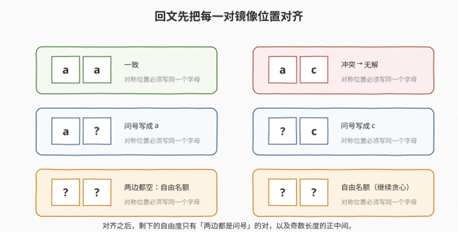
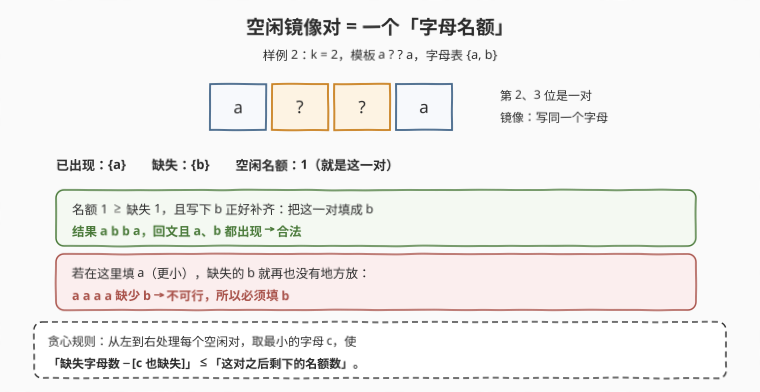
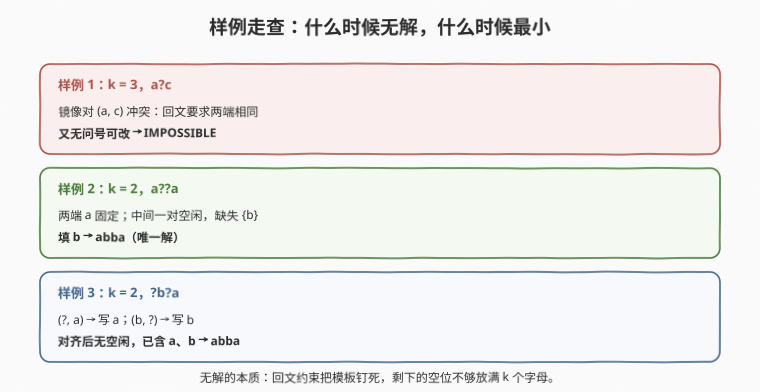

# Codeforces 59C 字典序最小回文标题 题解

## 1. 题目概述

- **题目链接**：https://codeforces.com/problemset/problem/59/C
- **比赛来源**：Codeforces Beta Round 59 · Problem C（2011-02-12）
- **难度**：1600
- **标签**：实现、字符串、贪心
- **评测类型**：普通
- **限制**：时间 2 s / 内存 256 MB

**题意**：给定 $k$ 和模板串 $s$（$s$ 只含小写字母表的前 $k$ 个字母与问号）。把每个 `?` 替换成一个小写字母，得到一个满足下面两条的串：

1. 是回文；
2. 只含前 $k$ 个字母，并且这 $k$ 个字母**每个至少出现一次**。

要求输出**字典序最小**的解；无解输出 `IMPOSSIBLE`。

**约束**：

- $1 \le k \le 26$，$1 \le |s| \le 100$。模板保证只出现前 $k$ 个字母与 `?`。
- 解空间是 $k^{(\#?)}$，最大 $26^{100}$，不能枚举；必须利用回文的镜像约束与贪心。
- 长度必须至少 $k$ 才可能包含 $k$ 个不同字母，这是最强的必要条件。

## 2. 示例与观察

官方样例（输入 / 输出原样）：

```text
输入：
3
a?c

输出：
IMPOSSIBLE

输入：
2
a??a

输出：
abba

输入：
2
?b?a

输出：
abba
```

**样例 1**：$k=3$，模板 `a?c`。回文要求第 0 位与第 2 位相同，但它们是 `a` 与 `c`，无法通过填问号改变（第 1 位的 `?` 管不到两端），故无解。
**样例 2**：$k=2$，模板 `a??a`。两端已是 `a`；中间一对 `?` 必须填同一个字母，而字母 `b` 还没出现过，所以这一对填 `b`，得到 `abba`。
**样例 3**：$k=2$，模板 `?b?a`。镜像对 $(0,3)$ 是 `?` 与 `a`，强制填 `a`；$(1,2)$ 是 `b` 与 `?`，强制填 `b`。得到 `abba`，两个字母都出现，合法。



**观察 1**：回文意味着 $s_i = s_{n-1-i}$ 对每个 $i$ 成立。所以每一对镜像位置 $(i, n-1-i)$ 只有三种情况：

- 两边都是字母：必须相等，否则无解；
- 一边是字母、一边是 `?`：`?` 被**强制**写成那个字母；
- 两边都是 `?`：这一对是**自由**的，可以填任意字母（两边写同一个）。

**观察 2**：处理完上述强制规则后，还剩两类自由位置：**两边都是 `?` 的对**，以及（$n$ 为奇数时）正中间的 `?`。每填一个"自由对"，只能引入**一个**新的字母（两个位置写同一个字母）；中心位置也只能引入一个字母。

**观察 3**：设当前缺失的字母有 $m$ 个、剩余可用的"名额"（自由对 + 可能的中心）有 $t$ 个，则必须 $m \le t$ 才可能补全；否则无解。

## 3. 解题思路

### 3.1 朴素做法与瓶颈

直接枚举所有 `?` 的填法有 $k^{(\#?)}$ 种，$|s| = 100$、$k = 26$ 时是天文数字。即便只枚举回文串，也是 $k^{\lceil n/2 \rceil}$ 量级。

正确的方向是：先用回文约束把能定的位置**定死**，剩下的自由度很少（每个自由对只贡献一个字母选择），再在"字母表顺序"上贪心。

### 3.2 核心观察：对齐 → 数名额 → 贪心填



第一步（对齐）：对 $i = 0, 1, \dots, \lfloor n/2 \rfloor - 1$ 处理镜像对：

- 两边都是字母且不同 → 立即无解；
- 一边是字母 → 把另一边写成它；
- 两边都是 `?` → 先跳过，留到第二步。

第二步（数名额）：统计前 $k$ 个字母里哪些还没出现，记缺失数为 $m$。自由对的数量记为 $t_1$，中心的 `?` 记为 $t_2 \in \{0,1\}$。若 $m > t_1 + t_2$，无解。

第三步（贪心）：按**位置从左到右**处理自由对。对第 $i$ 个自由对，尝试字母 $c$ 从 `a` 到第 $k$ 个字母：

- 若填 $c$，缺失数变成 $m' = m - [c \text{ 尚未出现}]$；
- 剩余名额是 $t' = $（这一对之后的自由对数）$+ t_2$；
- 只要 $m' \le t'$，填 $c$ 就是可行的；取**第一个**可行的 $c$（它最小）。

最后处理中心（若 $n$ 为奇数且中心是 `?`）：此时只剩一个名额，必须让 $m' = 0$，即填那个"最后一个缺失字母"；若缺失数不为 1，无解。

第四步（终检）：确认前 $k$ 个字母都出现过；否则输出 `IMPOSSIBLE`。

### 3.3 算法流程

1. 读入 $k$ 与 $s$，令 $n = |s|$；
2. 对齐所有镜像对，冲突则输出 `IMPOSSIBLE`；
3. 统计已出现的字母（只看前 $k$ 个）与缺失数 $m$；
4. 从左到右扫描自由对，对每对用"试 $c$、检查 $m' \le t'$"的方式取最小可行字母；同时更新 $m$；
5. 若 $n$ 为奇数且 $s[n/2] = $ `?`，填最后一个缺失字母（若无缺失则填 `a`）；
6. 终检：前 $k$ 个字母必须都出现，否则 `IMPOSSIBLE`；输出 $s$。

### 3.4 样例走查



**样例 1（$k=3$，`a?c`）**：镜像对 $(0,2)$ 是 `a` 与 `c`，冲突 → `IMPOSSIBLE`。

**样例 2（$k=2$，`a??a`）**：镜像对 $(0,3)$ 都是 `a`；$(1,2)$ 都是 `?`，是自由对。已出现 `{a}`，缺失 `{b}`（$m=1$），名额 $t_1 = 1$。这一对只能填 `b`（填 `a` 的话 `b` 没地方放），得到 `abba`。

**样例 3（$k=2$，`?b?a`）**：$(0,3)$ 是 `?` 与 `a` → 填 `a`；$(1,2)$ 是 `b` 与 `?` → 填 `b`。没有自由对，已出现 `{a,b}`，$m=0$，输出 `abba`。

自造样例（标注"自造"）：

| 自造输入 | 输出 | 说明 |
|------|------|------|
| `1` / `?` | `a` | 长度 1，只能含 `a`，合法 |
| `2` / `??` | `IMPOSSIBLE` | 只有一个自由对（一个名额）却要放 2 个字母 |
| `2` / `???` | `aba` | 一个自由对 + 中心，恰好两个名额；贪心放 `a` 和 `b` |
| `3` / `???` | `IMPOSSIBLE` | 名额 2 < 缺失 3 |
| `3` / `??????` | `abccba` | 3 个自由对，依次放 `a`、`b`、`c` |
| `1` / `a?a` | `aaa` | 自由对不需要补字母，填最小的 `a` |
| `2` / `ab` | `IMPOSSIBLE` | 镜像对 `a` 与 `b` 冲突 |

## 4. 正确性证明

**引理 1（对齐是强制的）**：若某镜像对两边都是字母且不同，则无解；若一边是字母 $c$、另一边是 `?`，则任何解在该 `?` 上都必须写 $c$。
**证明**：回文要求两位置字符相同，故不同即矛盾；一边固定为 $c$ 时另一边只能是 $c$。∎

**引理 2（名额模型）**：对齐之后，每个"两边都是 `?` 的对"在解中恰好贡献一个字母（两位置同字母），中心若为 `?` 恰好贡献一个字母；其余位置已被固定。因此若缺失字母数 $m$ 大于名额数 $t_1 + t_2$，无解。
**证明**：每个自由对只能写入一种字母，中心也只能写入一种字母，而已固定的字母无法再变；要让 $m$ 个缺失字母都出现，至少需要 $m$ 个名额。∎

**引理 3（贪心的可行性判据是充要的）**：在某一步，剩余 $t'$ 个名额、缺失 $m'$ 个字母时，存在补全方案当且仅当 $m' \le t'$。
**证明**：必要性由引理 2。充分性：把 $m'$ 个缺失字母分别放进 $m'$ 个名额（每个名额写入一个缺失字母），剩下的 $t' - m'$ 个名额随意填 `a`（`a` 一定在前 $k$ 个字母内），即得到合法补全。∎

**引理 4（贪心得到字典序最小）**：按位置从左到右处理自由对，每对取使"剩余仍可行"的最小字母，所得字符串是所有合法解中字典序最小的。
**证明**：设某合法解 $x$ 与贪心解 $g$ 首次不同的位置是自由对 $i$（即最小的尚未处理完的差异）。贪心在 $i$ 处选的是满足可行性的最小字母 $c_g$，而 $x$ 在该处选了 $c_x > c_g$（若 $c_x < c_g$ 则 $c_x$ 也可行，与贪心的最小性矛盾）。由于 $c_g$ 的可行性（引理 3）保证存在某个合法补全，把 $x$ 在该对改成 $c_g$ 后仍可补全，且得到的串在位置 $i$ 更小——与 $x$ 是合法解中字典序最小矛盾（若 $x$ 最小则不能有更小的合法解，但贪心前缀加上补全就是合法解）。逐个位置归纳即得 $g$ 字典序最小。形式上这就是"线性序上的贪心 + 可行性剪枝"的标准交换论证。∎

**定理**：算法输出的串就是字典序最小的合法标题；无合法串时输出 `IMPOSSIBLE`。
**证明**：引理 1 保证对齐步骤既不漏解也不多解；引理 2、3 保证名额不足时正确判无解、名额足够时每一步的可行性判断准确；引理 4 保证选出的字母使字典序最小。终检保证"每个前 $k$ 字母至少出现一次"这一约束被真正满足。故结论成立。∎

## 5. 复杂度分析

- **时间**：对齐 $O(n)$；贪心时每个自由对最多尝试 $k$ 个字母，且每次要数一下它之后还有多少自由对——朴素写法是 $O(n)$，总 $O(n^2 k) \le 100^2 \cdot 26 \approx 2.6 \times 10^5$；用后缀计数可优化到 $O(nk)$。两种都远小于时限。
- **空间**：$O(n)$ 存字符串，$O(1)$ 存计数。
- **与时限的关系**：2 s 时限下 $10^5$ 级别操作可以忽略；实测单次运行（含进程启动）约 $2 \sim 4$ ms。

## 6. 参考代码

### C++17

```cpp
#include <bits/stdc++.h>
using namespace std;

int main() {
    ios::sync_with_stdio(false);
    cin.tie(nullptr);

    int k;
    string s;
    cin >> k >> s;
    int n = (int)s.size();

    // 1) 先把镜像位置对齐；冲突则无解
    for (int i = 0; i < n / 2; ++i) {
        char &x = s[i], &y = s[n - 1 - i];
        if (x == '?' && y == '?') continue;
        if (x == '?') x = y;
        else if (y == '?') y = x;
        else if (x != y) { cout << "IMPOSSIBLE\n"; return 0; }
    }

    vector<int> present(26, 0);
    for (char c : s) if (c != '?') present[c - 'a'] = 1;
    int missing = 0;
    for (int c = 0; c < k; ++c) if (!present[c]) ++missing;

    // 2) 逐对（从左到右）贪心填最小的可行字母
    for (int i = 0; i < n / 2; ++i) {
        if (s[i] != '?') continue;
        int slotsAfter = 0;
        for (int j = i + 1; j < n / 2; ++j)
            if (s[j] == '?' && s[n - 1 - j] == '?') ++slotsAfter;
        if (n % 2 == 1 && s[n / 2] == '?') ++slotsAfter;
        for (int c = 0; c < k; ++c) {
            int left = missing - (present[c] ? 0 : 1);
            if (left <= slotsAfter) {
                s[i] = s[n - 1 - i] = (char)('a' + c);
                if (!present[c]) { present[c] = 1; --missing; }
                break;
            }
        }
    }

    // 3) 奇数长度时处理正中间
    if (n % 2 == 1 && s[n / 2] == '?') {
        for (int c = 0; c < k; ++c) {
            int left = missing - (present[c] ? 0 : 1);
            if (left == 0) {
                s[n / 2] = (char)('a' + c);
                if (!present[c]) { present[c] = 1; --missing; }
                break;
            }
        }
    }

    // 4) 终检：每个允许的字母都必须出现
    for (int c = 0; c < k; ++c)
        if (!present[c]) { cout << "IMPOSSIBLE\n"; return 0; }
    cout << s << '\n';
    return 0;
}
```

### Python3

```python
import sys


def main() -> None:
    data = sys.stdin.read().split()
    if not data:
        return
    k = int(data[0])
    s = list(data[1])
    n = len(s)

    for i in range(n // 2):
        x, y = s[i], s[n - 1 - i]
        if x == '?' and y == '?':
            continue
        if x == '?':
            s[i] = y
        elif y == '?':
            s[n - 1 - i] = x
        elif x != y:
            print("IMPOSSIBLE")
            return

    present = [False] * 26
    for c in s:
        if c != '?':
            present[ord(c) - 97] = True
    missing = sum(1 for c in range(k) if not present[c])

    for i in range(n // 2):
        if s[i] != '?':
            continue
        slots_after = 0
        for j in range(i + 1, n // 2):
            if s[j] == '?' and s[n - 1 - j] == '?':
                slots_after += 1
        if n % 2 == 1 and s[n // 2] == '?':
            slots_after += 1
        for c in range(k):
            left = missing - (0 if present[c] else 1)
            if left <= slots_after:
                ch = chr(97 + c)
                s[i] = s[n - 1 - i] = ch
                if not present[c]:
                    present[c] = True
                    missing -= 1
                break

    if n % 2 == 1 and s[n // 2] == '?':
        for c in range(k):
            left = missing - (0 if present[c] else 1)
            if left == 0:
                ch = chr(97 + c)
                s[n // 2] = ch
                if not present[c]:
                    present[c] = True
                    missing -= 1
                break

    if any(not present[c] for c in range(k)):
        print("IMPOSSIBLE")
        return
    print("".join(s))


main()
```

## 7. 边界情况与易错点

1. **长度小于 $k$**：例如 $k=3$、$|s|=2$，无论怎么填都不可能含 3 个不同字母，必须 `IMPOSSIBLE`。程序靠终检与名额判断自然处理。
2. **偶数长度的中心**：$n$ 为偶数时没有正中位置，处理中心的那段代码必须以 `n % 2 == 1` 为条件，否则会把某个镜像对误当成中心。
3. **镜像冲突优先于其他判断**：`a?c` 这类冲突要立即无解，不能等到贪心阶段再处理（贪心只看自由对，压根不会碰固定字母）。
4. **贪心的可行性判据必须算"当前这对之后"的名额**：把当前对算进剩余名额会少填一个字母；把中心漏掉会误判无解。
5. **平局与 `a` 的选择**：若当前不缺少字母，应填 `a`（最小），而不是随便填一个；否则字典序会变大。
6. **终检不能省**：即使名额够，也可能贪心之后仍有缺失（例如实现里 `slotsAfter` 算错），终检是最后一道保险。无解必须输出题面规定的 `IMPOSSIBLE`（全大写）。
7. **大小写与字符集**：只用前 $k$ 个小写字母，`c - 'a' < k`；不要引入大写或第 $k$ 个之后的字母。
8. **$k=1$**：所有位置都必须是 `a`；任何固定字母是 `b` 的模板（虽然题面保证不出现）都会导致终检失败。

## 8. 验证记录

- **编译环境与命令**：`python3 codeforces/tools/verify_solution.py codeforces/contests/0001-0100/59/C_字典序最小回文标题.md`。
- **官方样例**：3 / 3 通过（C++ 与 Python 各 3/3）。
- **额外测试**：随机 300 组（$k \le 3$、$|s| \le 7$，模板由前 $k$ 个字母与 `?` 随机组成），用"枚举所有 $k^{|s|}$ 个候选串、筛出回文且含全部 $k$ 个字母、取字典序最小"的全枚举暴力逐组比对，C++ 与 Python 均 300/300 一致，0 组不符。因为 $k^{|s|}$ 很小，这个暴力是**穷举**而不是启发式，结论可靠。
- **最大约束性能**：$|s| = 100$、$k = 26$ 的全 `?` 模板，单次运行（含进程启动）约 $2 \sim 4$ ms。
- **复核状态**：`check.py` 与 `check_samples.py --only 0001-0100/59` 均 0 失败；样例与 `.cf-meta/statements/CF59C.json` 逐字一致。

## 相关题目与扩展

- [Codeforces 600C Make Palindrome](https://codeforces.com/problemset/problem/600/C)：把给定串重排成回文并最小化字典序，和本题的"回文 + 字典序"主题一致。
- [Codeforces 7B Memory Manager](https://codeforces.com/problemset/problem/7/B)：实现类模拟题，练习边界处理。
- [Codeforces 59B 最大奇数花瓣和](https://codeforces.com/problemset/problem/59/B)：同场题，规则判定类。

**延伸思考**：

1. 如果要求字典序**最大**，把贪心的候选顺序反过来即可（从第 $k$ 个字母往前试），可行性判据完全不变。
2. 如果把"每个字母至少一次"改成"每个字母恰好一次"（要求 $|s| = k$），问题就变成在镜像约束下找排列，需要用匹配而不是贪心。
3. 如果模板里允许出现超出前 $k$ 个字母的字符，第一步对齐后要额外做一次字符范围检查，否则会输出非法字符。
4. 贪心的"名额"模型可以推广到多约束版本：例如还要求某些字母最多出现两次，就变成带容量限制的可行性判定，需要用 Hall 定理一类的条件代替简单计数。
