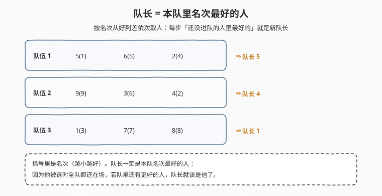
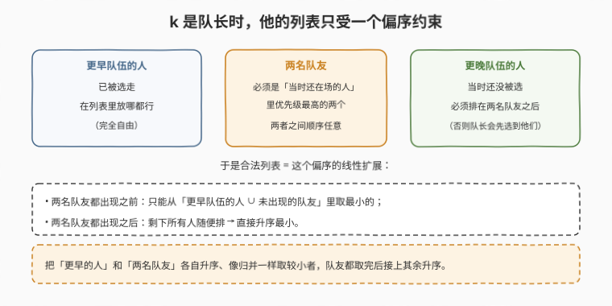
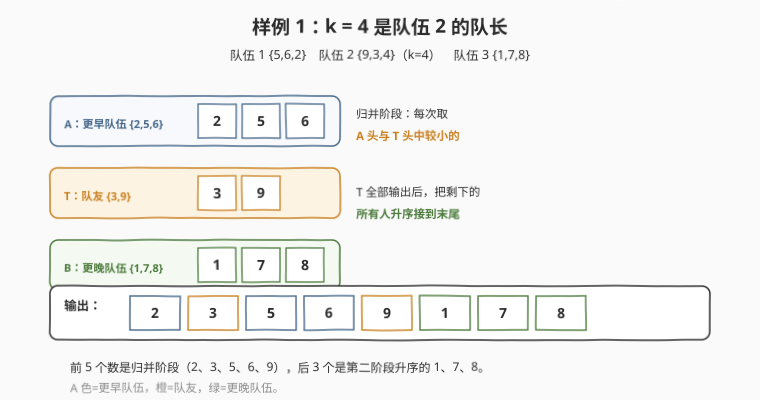

# Codeforces 59D 队长的优先级列表 题解

## 1. 题目概述

- **题目链接**：https://codeforces.com/problemset/problem/59/D
- **比赛来源**：Codeforces Beta Round 55 (Div. 2) · Problem D（UTC 2011-02-11）
- **难度**：2000
- **标签**：构造、贪心、实现
- **评测类型**：普通
- **限制**：时间 3 s / 内存 256 MB

**题意**：训练中心有 $3n$ 名学生，按成绩给出一个 $1 \sim 3n$ 的排列（越靠前名次越好）。组队规则是：只要还有人没入队，就选其中**成绩最好**的人当新队长，队长再按**自己的优先级列表**（其余 $3n-1$ 人的一个排列）从剩下的人里挑两名队友。现在给出了已经组好的 $n$ 支队伍，且队伍按创建顺序排列（每队内部三人顺序任意）。要求输出学生 $k$ 的优先级列表；若有多种可能，输出**字典序最小**的那个。

**约束**：

- $n \le 10^5$，即学生数 $3n \le 3 \times 10^5$，输入有 $3n$ 个名次加 $3n$ 个队员编号。必须 $O(n \log n)$ 或 $O(n)$，不能枚举排列（$(3n-1)!$ 天文数字）。
- 输入保证分组"确实能按规则产生"，即存在一组优先级列表与之相容；我们只需给出 $k$ 的那一份。
- 字典序是**数字列表**的字典序（`1 9 10 < 1 10 9`），不是字符串比较。

## 2. 示例与观察

官方样例（输入 / 输出原样）：

```text
输入：
3
5 4 1 2 6 3 7 8 9
5 6 2
9 3 4
1 7 8
4

输出：
2 3 5 6 9 1 7 8 

输入：
3
5 4 1 2 6 3 7 8 9
5 6 2
9 3 4
1 7 8
8

输出：
1 2 3 4 5 6 7 9 

输入：
2
4 1 3 2 5 6
4 6 5
1 2 3
4

输出：
5 6 1 2 3 
```

**把名次标在队员后面**（括号里是名次，越小越好）：

| 队伍 | 成员（名次） | 队长 | 队长挑的两人 |
|------|--------------|------|--------------|
| 1 | 5(1)、6(5)、2(4) | 5 | 6、2 |
| 2 | 9(9)、3(6)、4(2) | 4 | 9、3 |
| 3 | 1(3)、7(7)、8(8) | 1 | 7、8 |

**样例 1（$k=4$）**：4 是队伍 2 的队长。轮到他挑人时，队伍 1 的三人（2、5、6）**已经被选走**，场上除他之外还有 $\{1,3,7,8,9\}$。他实际挑了 3 和 9，所以在他的列表里，**在这 5 个人当中排最前的必须是 3 和 9**；已经被选走的 2、5、6 放在列表哪里都无所谓。把 2、5、6 尽量放前面，再让 3 先于 9，就得到 `2 3 5 6 9 1 7 8`——这正是样例输出。

**样例 2（$k=8$）**：8 是队伍 3 的队员，**不是队长**，他的列表从头到尾没被用到。于是任何排列都合法，取升序并去掉 8：`1 2 3 4 5 6 7 9`。

**样例 3（$k=4$）**：队伍 1 的队长是 4（名次 1），挑的是 6、5；队伍 2 由 1 当队长挑 2、3。轮到他时没有"更早的队伍"，场上除他外有 $\{1,2,3,5,6\}$，他挑了 5、6，所以列表前两位必须是 5 和 6，其余升序：`5 6 1 2 3`。



**观察 1**：**队长就是他所在队伍里名次最好的人**。因为轮到该队创建时，全队三人都在场上，而队长是全场剩下的人里名次最好的，所以他不比同队任何人差；反过来，如果队里还有名次更好的人，那个人才该是队长。
**观察 2**：轮到一个队长挑人时，"已经被选走的人"恰好是**更早创建的所有队伍**的成员；"还在场上的人"是本队另外两人加上**更晚创建的所有队伍**的成员。
**观察 3**：如果 $k$ 不是队长，他的列表根本不会被用到，答案就是 $1 \sim 3n$ 去掉 $k$ 的升序。

## 3. 解题思路

### 3.1 朴素做法与瓶颈

想直接"枚举 $k$ 的优先级列表再检查"是完全不可行的：列表长度是 $3n-1$，排列数 $ (3n-1)!$。即便 $n = 3$ 也有 $8! = 40320$ 个，$n = 10^5$ 更是天文数字。

所以必须从"列表里哪些顺序是**被约束的**"入手：$k$ 的列表只在两种情况下有意义——他是队长（列表决定他挑谁）或不是队长（列表无约束）。前一种情况要精确刻画"合法列表"的集合，再在这个集合里取字典序最小。

### 3.2 核心观察：约束只是一个偏序



设 $k$ 是队伍 $t$ 的队长（队伍按创建顺序 1 起编号）。把全体学生按队伍分成三类：

- **A：更早队伍**（队伍 $1 \sim t-1$）的人——轮到他时**已被选走**；
- **T：本队另外两人**——他实际挑的队友；
- **B：更晚队伍**（队伍 $t+1 \sim n$）的人——轮到他时**还在场上**。

他挑人时，"可选的池子"是 $T \cup B$。队长会按列表顺序挑人，所以列表合法 $\iff$ 在列表里**只看 $T \cup B$ 的子序列**，前两个恰好是 $T$ 的两人。这等价于一个非常简单的偏序：

$$T \text{ 中的两人都排在 } B \text{ 的所有人之前},\qquad A \text{ 中的人位置完全自由}.$$

（$T$ 内部两人谁先谁后无所谓，因为挑的是"两个人"这个集合。）

于是问题变成：在所有满足这个偏序的排列中，求字典序最小的一个。这是标准的"偏序的字典序最小线性扩展"：**每一步都取当前可选（没有被约束挡住）的最小元素**。

具体地：

- 在两名队友都出现之前，可选的只有 $A$ 的元素与还没出现的队友；
- 两名队友都出现之后，剩下的所有人（$A$ 的剩余与 $B$）都自由，直接升序。

所以答案是：把 $A$ 升序、$T$ 升序，像归并一样每次取较小的那个，直到 $T$ 的两个都输出；然后把"剩下的 $A$ 元素与 $B$ 元素"合并后升序接上。

### 3.3 算法流程

1. 读入 $n$ 与成绩排列，得到每人的**名次** $rank[x]$（越小越好）；
2. 读入 $n$ 支队伍，记录每人的队伍编号 $teamOf[x]$；
3. 每支队伍的队长 $=$ 队内 $rank$ 最小的成员；
4. 找到 $k$ 的队伍 $t$ 与队长：
   - 若 $k$ 不是队长：输出 $1..3n$ 去掉 $k$ 的升序；
   - 否则：$A =$ 队伍 $1..t-1$ 的所有成员（升序）、$T =$ 本队除 $k$ 外的两人（升序）、$B =$ 队伍 $t+1..n$ 的所有成员；
5. 归并 $A$ 与 $T$ 直到 $T$ 输出完毕；把剩下的 $A$ 与 $B$ 合并升序输出。

### 3.4 样例走查



样例 1，$k=4$（队伍 2 的队长）：$A = \{2,5,6\}$，$T = \{3,9\}$，$B = \{1,7,8\}$。

| 步骤 | 已输出 | $A$ 头 | $T$ 头 | 取 |
|------|--------|--------|--------|-----|
| 1 | 2 | 5 | 3 | 2（$A$ 更小） |
| 2 | 3 | 5 | 9 | 3（$T$ 更小） |
| 3 | 5 | 6 | 9 | 5 |
| 4 | 6 | — | 9 | 6 |
| 5 | 9 | — | — | 9（$T$ 输出完毕） |

之后把剩下的 $A$（空）与 $B=\{1,7,8\}$ 升序接上，得到 `2 3 5 6 9 1 7 8`。

可以验证这个列表确实解释得通：轮到他时场上可选的人是 $\{1,3,7,8,9\}$，按列表顺序扫过去，第一个可选的是 3（2、5、6 已被选走），第二个是 9，正好是他的两名队友。

## 4. 正确性证明

**引理 1（队长判定）**：队伍 $t$ 的队长就是该队中名次最好（$rank$ 最小）的成员；并且队长的名次比所有更晚队伍（$t+1..n$）的成员都更好。
**证明**：队伍 $t$ 创建时，其成员以及所有更晚队伍的成员都还没入队，队长是这些人里名次最好的。队长本人属于队伍 $t$，所以他不比队内任何人差，也不比更晚队伍任何人差；反之若队内有更好的人，那个人当时也在场上，队长就该是他。∎

**引理 2（非队长情形）**：若 $k$ 不是队长，则 $k$ 的任何优先级列表（$1..3n$ 去掉 $k$ 的任意排列）都与给定分组相容，因此字典序最小者是升序。
**证明**：组队过程中只有队长会读取自己的列表；$k$ 从未当队长，他的列表不影响任何一支队伍的组成。故所有排列都相容，其中字典序最小的是升序排列。∎

**引理 3（队长情形的充要条件）**：设 $k$ 是队伍 $t$ 的队长，$A,T,B$ 如 3.2 定义。$k$ 的列表与分组相容，当且仅当在列表删除 $A$ 的元素后，前两个元素恰为 $T$ 的两人；这也等价于"$T$ 的两人都排在 $B$ 的所有人之前"。
**证明**：轮到他挑人时，场上可选集合是 $T \cup B$（$A$ 已被选走，$k$ 本人不在候选里）。列表决定偏好顺序：队长按列表顺序取人，于是"他挑的两人"就是列表在 $T \cup B$ 上的前两个元素。故相容 $\iff$ 该前两个元素恰为 $T$。而"前两个为 $T$"$\iff$ 不存在 $B$ 的元素排在某个 $T$ 元素之前 $\iff$ $T$ 的两人都排在所有 $B$ 元素之前。∎

**引理 4（贪心给出字典序最小）**：在"$T$ 的两元素先于 $B$ 的所有元素、$A$ 自由"的约束下，3.2 的归并策略给出字典序最小的排列。
**证明**：这是偏序集字典序最小线性扩展的标准结论。约束只规定了 $T \prec B$ 的偏序关系，$A$ 与其余元素两两不可比。字典序最小的线性扩展可由"每次在当前的极小元集合中取最小者"贪心得到：

- 初始极小元集合 $= A \cup T$（$B$ 被 $T$ 挡住）；
- 输出一个 $T$ 元素后，另一个 $T$ 仍在极小元中；两个 $T$ 都输出后，$B$ 全部变成极小元，此时剩余元素两两不可比，取升序即可；
- 在"两个 $T$ 都输出前"的阶段，可选的恰好是剩余的 $A$ 与剩余的 $T$，每次取最小者正是把两个升序序列归并。

由贪心每一步都取当前最小可行元素，任何合法排列在该位置若取了更大的元素，都会使前缀字典序更大；归纳即得贪心序列字典序最小。∎

**定理**：算法输出就是与给定分组相容的、$k$ 的字典序最小优先级列表。
**证明**：由引理 1 正确识别队长；若 $k$ 非队长，引理 2 给出最小解就是升序；若 $k$ 是队长，引理 3 刻画了全部合法列表（恰是所给偏序的线性扩展），引理 4 说明归并策略在该集合中字典序最小。故输出正确。∎

## 5. 复杂度分析

- **时间**：读入 $O(n)$；求队长 $O(n)$；排序 $A$、$T$、$B$ 的合并部分共 $O(n \log n)$（最多 $3n$ 个元素）。总计 $O(n \log n)$，$n \le 10^5$ 时约 $3 \times 10^5 \log$ 量级。
- **空间**：$O(n)$ 存名次、队伍归属与三个集合。
- **与时限的关系**：3 s 时限下 $O(n \log n)$ 余量很大。实测 $n = 10^5$ 的最大数据（含 3.8 MB 输入与 $3n-1$ 个数的输出）C++ 约 $13$ ms；Python 版本约 $0.25$ s，也能通过。

## 6. 参考代码

### C++17

```cpp
#include <bits/stdc++.h>
using namespace std;

struct FastIn {                                  // fread 快读：本题输入有 3n 个数
    static const int SZ = 1 << 16;
    char buf[SZ];
    int len = 0, pos = 0;
    int gc() {
        if (pos == len) {
            len = (int)fread(buf, 1, SZ, stdin);
            pos = 0;
            if (len <= 0) return -1;
        }
        return buf[pos++];
    }
    int nextInt() {
        int c = gc();
        while (c != -1 && (c < '0' || c > '9')) c = gc();
        int x = 0;
        while (c >= '0' && c <= '9') { x = x * 10 + (c - '0'); c = gc(); }
        return x;
    }
};

int main() {
    FastIn in;
    int n = in.nextInt();
    int tot = 3 * n;
    vector<int> rank(tot + 1);
    for (int i = 1; i <= tot; ++i) rank[in.nextInt()] = i;   // 名次越小成绩越好
    vector<array<int, 3>> team(n);
    vector<int> teamOf(tot + 1);
    for (int t = 0; t < n; ++t)
        for (int j = 0; j < 3; ++j) {
            team[t][j] = in.nextInt();
            teamOf[team[t][j]] = t;
        }
    int k = in.nextInt();
    int tk = teamOf[k];
    int captain = team[tk][0];
    for (int j = 1; j < 3; ++j)
        if (rank[team[tk][j]] < rank[captain]) captain = team[tk][j];

    vector<int> out;
    out.reserve(tot - 1);
    if (k != captain) {
        // 不是队长：他的优先级列表从不被用到，任意排列都合法，取升序最小
        for (int x = 1; x <= tot; ++x) if (x != k) out.push_back(x);
    } else {
        vector<int> earlier, mates;
        for (int t = 0; t < tk; ++t)
            for (int j = 0; j < 3; ++j) earlier.push_back(team[t][j]);
        for (int j = 0; j < 3; ++j) if (team[tk][j] != k) mates.push_back(team[tk][j]);
        sort(earlier.begin(), earlier.end());
        sort(mates.begin(), mates.end());
        // 两名队友必须是"当时还在场的人"里优先级最高的两个：
        // 在两人都出现前只能排"早已被选走的人"或这两名队友，每次取最小可行者
        size_t i = 0, j = 0;
        while (j < mates.size()) {
            if (i < earlier.size() && earlier[i] < mates[j]) out.push_back(earlier[i++]);
            else out.push_back(mates[j++]);
        }
        vector<int> rest(earlier.begin() + i, earlier.end());
        for (int t = tk + 1; t < n; ++t)
            for (int q = 0; q < 3; ++q) rest.push_back(team[t][q]);
        sort(rest.begin(), rest.end());
        for (int x : rest) out.push_back(x);
    }

    string buf;
    buf.reserve(out.size() * 6);
    for (size_t i = 0; i < out.size(); ++i) {
        buf += to_string(out[i]);
        buf += (i + 1 == out.size() ? '\n' : ' ');
    }
    fwrite(buf.data(), 1, buf.size(), stdout);
    return 0;
}
```

### Python3

```python
import sys


def main() -> None:
    data = sys.stdin.buffer.read().split()
    p = 0
    n = int(data[p]); p += 1
    tot = 3 * n
    rank = [0] * (tot + 1)
    for i in range(1, tot + 1):
        rank[int(data[p])] = i; p += 1
    team = []
    team_of = [0] * (tot + 1)
    for t in range(n):
        mem = [int(data[p]), int(data[p + 1]), int(data[p + 2])]
        p += 3
        team.append(mem)
        for x in mem:
            team_of[x] = t
    k = int(data[p])
    tk = team_of[k]
    captain = min(team[tk], key=lambda x: rank[x])

    if k != captain:
        ans = [x for x in range(1, tot + 1) if x != k]
    else:
        earlier = sorted(x for t in range(tk) for x in team[t])
        mates = sorted(x for x in team[tk] if x != k)
        out = []
        i = j = 0
        while j < len(mates):
            if i < len(earlier) and earlier[i] < mates[j]:
                out.append(earlier[i]); i += 1
            else:
                out.append(mates[j]); j += 1
        rest = earlier[i:] + sorted(x for t in range(tk + 1, n) for x in team[t])
        out.extend(sorted(rest))
        ans = out
    sys.stdout.write(" ".join(map(str, ans)) + "\n")


main()
```

C++ 用 `fread` 快读是因为输入有 $3n$ 个整数；在评测机上即使直接用 `cin`（关闭同步）也足够快，但快读能让最坏情况更稳。

## 7. 边界情况与易错点

1. **$n = 1$**：只有一支队伍，$k$ 一定是队长（唯一的队伍里名次最好的人就是队长），答案是队里另外两人的升序。$A$ 与 $B$ 都为空，归并逻辑要能处理空序列。
2. **$k$ 不是队长**：此时列表完全自由，答案必须是升序而不是"队友优先"——例如样例 2 的 `8`，输出以 1 开头。
3. **$A$ 中可能有比队友更小的编号**：样例 1 中 2 小于队友 3、9，所以 2 必须排在最前（它在轮到他之前就已被选走，放在前面不影响他被挑到谁）。若把两名队友硬塞到最前面，就得不到字典序最小。
4. **两名队友的顺序**：队长挑的是"两个人"这个集合，所以两人之间顺序随意；取升序即为字典序最小。
5. **字典序是数字比较**：`1 9 10 < 1 10 9`，所以按整数比较，不能把数字转字符串排序。
6. **输出规模**：$3n - 1$ 个数（最多 $299999$ 个），C++ 用缓冲区一次性输出；Python 用 `" ".join`，不要逐个 `print`。
7. **下标与编号**：学生编号 $1..3n$ 与队伍编号 $1..n$ 都是 1 起，`vector` 要多开一位；队伍在输入中的行序就是创建顺序，不要重排。
8. **名次含义**：输入是"第 $i$ 个数是第 $i$ 名"，名次数字越小越好；把名次当成绩大小比较会整体反过来。

## 8. 验证记录

- **编译环境与命令**：`python3 codeforces/tools/verify_solution.py codeforces/contests/0001-0100/59/D_队长的优先级列表.md`。
- **官方样例**：3 / 3 通过（C++ 与 Python 各 3/3）。
- **额外测试**：随机生成合法的组队过程（随机名次、随机优先级列表，模拟出队伍），再随机取 $k$，共 305 组（$n=1$ 80 组、$n=2$ 200 组、$n=3$ 25 组）。对每组用"枚举 $k$ 的全部 $(3n-1)!$ 个排列、逐一检查是否与分组相容、取字典序最小"的独立暴力比对；C++ 与 Python 全部一致，0 组不符。每个排列检查只依赖题面定义（队长可选集合里列表前两人是否是队友），与主算法的归并思路完全独立。
- **最大约束性能**：$n = 10^5$（3.8 MB 输入、输出 $299999$ 个数），C++ 单次运行约 $13$ ms；Python 约 $0.25$ s，均在 3 s 时限内。
- **复核状态**：`check.py` 与 `check_samples.py --only 0001-0100/59` 均 0 失败；样例与 `.cf-meta/statements/CF59D.json` 逐字一致（含输出行末空格）。

## 相关题目与扩展

- [Codeforces 136A Presents](https://codeforces.com/problemset/problem/136/A)：排列的逆，练习"编号与位置"的互相映射。
- [Codeforces 59E 避开禁咒的最短路](https://codeforces.com/problemset/problem/59/E)：同场压轴题，BFS 状态设计。
- [Codeforces 1385D a-Good String](https://codeforces.com/problemset/problem/1385/D)：递归构造与字典序，思路不同但同属"构造最优串"。

**延伸思考**：

1. 如果题目要求的是"**字典序最大**的列表"，把归并时的比较反过来（取较大者）、其余升序改为降序即可，偏序分析完全不变。
2. 如果要求**所有**可能的列表数量（而不是最小字典序），就变成数偏序的线性扩展个数；对本题的偏序（$T \prec B$、$A$ 自由）可以写出闭式：在 $3n-1$ 个位置里选两个放队友（且它们在所有 $B$ 之前）的组合数再乘各集合内部排列数，可用组合数计算。
3. 如果 $k$ 同时可能"是队长"又"被更早的队长选中"（即输入不保证一致性），就需要先验证一致性——本题保证输入合法，省掉了这一步。
4. 如果队伍人数不是 3 而是 $m$，偏序变成"$m-1$ 个队友都排在 $B$ 之前"，归并策略照样适用，只是要输出的队友数变成 $m-1$。
