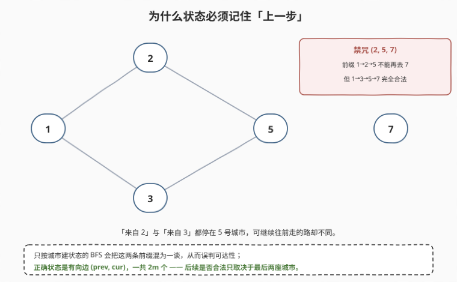
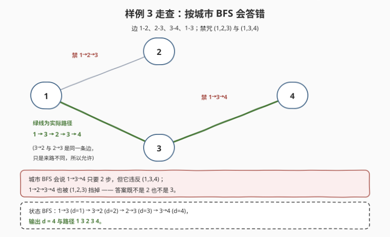

# Codeforces 59E 避开禁咒的最短路 题解

## 1. 题目概述

- **题目链接**：https://codeforces.com/problemset/problem/59/E
- **比赛来源**：Codeforces Beta Round 55 (Div. 2) · Problem E（UTC 2011-02-11）
- **难度**：2000
- **标签**：图论、最短路、BFS
- **评测类型**：特殊评测（任意一条最短路径均可）
- **限制**：时间 3 s / 内存 256 MB

**题意**：有 $n$ 座城市、$m$ 条长度都为 1 的双向道路。另有 $k$ 条"禁咒"：若旅行者**连续**经过（中间不经过别的城市）$a_i, b_i, c_i$ 这三座城市，就会遭灾。三元组是**有序**的——$(a,b,c)$ 被禁止，并不代表 $(c,b,a)$ 也被禁止。求从城市 1 到城市 $n$ 的最短路长度 $d$，并输出一条这样的路径（$d+1$ 个城市，从 1 开始、到 $n$ 结束）；若不可达输出 `-1`。

**约束**：

- $n \le 3000$，$m \le 20000$，$k \le 10^5$。图没有自环、没有重边；禁咒三元组互不相同，三个城市两两不同。
- 路径**可以重复经过城市与道路**（样例 3 就重复了），所以不能假设路径是简单路径。
- 最核心的难点是：路径的合法性与**最近两步**有关，普通的"按城市分层"的 BFS 不够用。

## 2. 示例与观察

官方样例（输入 / 输出原样）：

```text
输入：
4 4 1
1 2
2 3
3 4
1 3
1 4 3

输出：
2
1 3 4

输入：
3 1 0
1 2

输出：
-1

输入：
4 4 2
1 2
2 3
3 4
1 3
1 2 3
1 3 4

输出：
4
1 3 2 3 4
```

**样例 1**：道路是 $1-2-3-4$ 加一条 $1-3$。禁咒是 $(1,4,3)$。最短路径是 $1 \to 3 \to 4$，长度 2；它产生的连续三元组只有 $(1,3,4)$，不在禁咒里。直接 $1 \to 4$ 没有道路。

**样例 2**：只有道路 $1-2$，城市 3 与 1 不连通，输出 `-1`。

**样例 3**：禁咒是 $(1,2,3)$ 与 $(1,3,4)$。如果忽略禁咒，$1 \to 3 \to 4$ 只要 2 步，但它含 $(1,3,4)$，被禁止；$1 \to 2 \to 3 \to 4$ 含 $(1,2,3)$，也被禁止。唯一可行的最短路径要绕一下：$1 \to 3 \to 2 \to 3 \to 4$，长度 4。注意它重复经过了 $3$ 与道路 $2-3$。



**观察 1**：一条路径是否"下一步还能走"，只取决于**最后两座城市**。例如样例 3 中，"从 1 走到 3"和"从 2 走到 3"都停在 3，但前者不能直接去 4，后者可以。

**观察 2**：把"当前所在城市 + 上一步来自哪座城市"作为状态，状态数就是**有向边**的条数：每条无向道路贡献两个方向，共 $2m$ 个。转移 $(u,v) \to (v,w)$ 合法当且仅当 $v-w$ 有路且 $(u,v,w)$ 不在禁咒里。

**观察 3**：所有边长度都是 1，所以在这个"状态图"上做 BFS，第一次到达终点状态的层数就是最短路长度。

## 3. 解题思路

### 3.1 朴素做法与瓶颈

最直接的想法是对城市做 BFS，记录 $dist[v]$ = 到 $v$ 的最少步数，然后按父指针还原路径。它在样例 3 上会输出 2（$1 \to 3 \to 4$），但这条路径不合法——**同一个城市可能对应多条到达路径，它们的"上一步"不同，后续可达性也不同**。只记 $dist[v]$ 会把不同来路的状态混在一起，既可能误判可达，也可能得到不合法的路径。

如果给每个城市保留所有可能的前驱，本质上就是 3.2 的状态图；所以正确做法是把状态显式建出来。

### 3.2 核心观察：状态 = 有向边


把每条无向道路 $x-y$ 拆成两条有向边：$x \to y$ 与 $y \to x$，总共 $2m$ 条。状态就是"我刚沿着某条有向边走到 $v$"：

- 状态 $(u \to v)$ 表示：路径的最后一步是 $u \to v$（上一步在 $u$，现在在 $v$）；
- 转移：对 $v$ 的每个邻居 $w$，若三元组 $(u,v,w)$ 不是禁咒，就可以转到状态 $(v \to w)$，距离 +1；
- 起点：所有形如 $(1 \to w)$ 的状态距离为 1（第一步没有"上一步"，因此第一步永远合法）；
- 终点：任何形如 $(u \to n)$ 的状态；答案取这些状态里距离的最小值。

状态数 $2m \le 40000$，完全可控。BFS 的复杂度是"所有被访问状态的出边数之和"，即 $\sum_v \deg(v)^2$ 的量级（因为每个状态 $(u \to v)$ 要枚举 $v$ 的所有邻居），在 $m \le 2 \times 10^4$ 时最坏约 $5.4 \times 10^7$ 次判断，3 s 内富余。

### 3.3 实现细节：把禁咒挂到有向边上

朴素地在转移时用哈希表查 $(u,v,w)$ 是否被禁，每次转移一次哈希，$5 \times 10^7$ 次哈希太慢。可以这样优化：

1. 给每条有向边编号：第 $i$ 条无向边 $x-y$ 拆成编号 $2i$（$x \to y$）与 $2i+1$（$y \to x$）；
2. 用哈希表把有序对 $(a,b)$ 映射到有向边编号，对每条禁咒 $(a,b,c)$，把 $c$ 挂到编号为 $(a \to b)$ 的有向边的"禁去列表"里（若 $(a,b)$ 不是道路，这条禁咒永远不会被触发，直接忽略）；
3. BFS 扩展状态 $(u \to v)$ 时，先把它的"禁去列表"里的城市在一个 `mark[]` 数组里打上"当前时间戳"，然后枚举 $v$ 的邻居 $w$：若 `mark[w]` 是当前时间戳就跳过，否则是合法转移。这样每次判断是 $O(1)$ 的数组比较，而打标记的总代价只有 $O(k)$（每条禁咒只属于一条有向边）。

还原路径：BFS 时记录 `par[状态]`，从终点状态沿父指针回溯，把每条有向边的终点依次收集起来，最后在前面补上起点 1。

### 3.4 样例走查



样例 3：道路 $1-2, 2-3, 3-4, 1-3$，禁咒 $(1,2,3)$、$(1,3,4)$。

- 初始状态：$(1 \to 2)$、$(1 \to 3)$，距离都是 1。
- 扩展 $(1 \to 3)$：邻居 $w \in \{2, 4\}$。$(1,3,4)$ 是禁咒，所以只能去 2：得到 $(3 \to 2)$，距离 2。注意 $4$ 就在眼前却去不了。
- 扩展 $(1 \to 2)$：邻居只有 3，但 $(1,2,3)$ 是禁咒，走不通。
- 扩展 $(3 \to 2)$：邻居 1、3。$(3,2,1)$ 不在禁咒里 → $(2 \to 1)$ 距离 3；$(3,2,3)$ 也不在 → $(2 \to 3)$ 距离 3。
- 扩展 $(2 \to 3)$：邻居 $w \in \{2, 4\}$。$(2,3,2)$ 允许，$(2,3,4)$ 允许 → $(3 \to 4)$ 距离 4。
- 扩展 $(3 \to 4)$：到达城市 4（终点），距离 4。

路径回溯：$(1 \to 3) \to (3 \to 2) \to (2 \to 3) \to (3 \to 4)$，收集终点得 $3,2,3,4$，前面补 1，即 `1 3 2 3 4`，长度 4。

## 4. 正确性证明

**引理 1（状态充分性）**：一条路径的后续合法性只由"当前城市 $v$ 与上一步城市 $u$"决定。
**证明**：下一步经过 $w$ 时，唯一新增的连续三元组是 $(u,v,w)$，它只涉及 $u,v,w$；更早的城市不影响任何新的三元组。∎

**引理 2（状态转移与合法路径一一对应）**：状态图（顶点为有向边）中从任一"起点状态" $(1 \to w)$ 出发的每条路径，都对应一条从 1 出发、除第一步外每步都合法的城市路径；反之亦然，且长度相同。
**证明**：状态转移 $(u \to v) \to (v \to w)$ 要求 $v-w$ 是道路且 $(u,v,w)$ 不是禁咒，恰好就是城市路径"从 $u$ 到 $v$ 再到 $w$"的合法条件。起点状态对应城市 1 迈出的第一步（没有上一步，恒合法）。按状态序列把有向边的终点依次串起来即得城市路径。∎

**引理 3（BFS 的正确性）**：状态图是无权图，BFS 第一次弹出终点状态 $(u \to n)$ 时的距离，等于从城市 1 到 $n$ 的最短合法路径长度。
**证明**：由引理 2，合法路径与"起点状态到终点状态的路径"一一对应且长度相同，所以最短路长度相等。BFS 在无权图上按层扩展，第一次到达某个状态时其距离就是最短距离，故第一次弹出终点状态的距离就是最小距离。∎

**定理**：程序输出的 $d$ 与路径就是最短合法路径（不存在时输出 `-1`）。
**证明**：引理 3 保证 $d$ 正确；路径由父指针回溯得到，是 BFS 中真实走过的状态序列，由引理 2 它对应一条合法城市路径且长度等于 $d$；若 BFS 没有到达任何终点状态，则不存在合法路径，输出 `-1` 正确。∎

## 5. 复杂度分析

- **时间**：建图与读入 $O(n + m + k)$；BFS 的转移总数是 $\sum_{v} \deg(v)^2$（每个状态 $(u\to v)$ 枚举 $v$ 的邻居）。在 $m \le 2\times10^4$ 时最坏约 $5.4 \times 10^7$ 次判断（把度数尽量集中在少数几个顶点上可得），加上 $O(k)$ 的打标记，总复杂度 $O\bigl(m + k + \sum_v \deg(v)^2\bigr)$。
- **空间**：邻接表 $O(m)$、有向边数组 $O(m)$、`dist`/`par` 各 $O(m)$、禁咒的挂载共 $O(k)$，合计约几 MB，远小于 256 MB。
- **与时限的关系**：3 s 时限下，最坏数据（$n=3000$、$m=20000$、$k=10^5$，且终点不可达迫使 BFS 搜完全部状态）实测 C++ 约 $55$ ms，余量在 50 倍以上。

## 6. 参考代码

### C++17

```cpp
#include <bits/stdc++.h>
using namespace std;

struct FastIn {                                  // fread 快读：k 最大 1e5，共约 4e5 个整数
    static const int SZ = 1 << 16;
    char buf[SZ];
    int len = 0, pos = 0;
    int gc() {
        if (pos == len) {
            len = (int)fread(buf, 1, SZ, stdin);
            pos = 0;
            if (len <= 0) return -1;
        }
        return buf[pos++];
    }
    int nextInt() {
        int c = gc();
        while (c != -1 && (c < '0' || c > '9')) c = gc();
        int x = 0;
        while (c >= '0' && c <= '9') { x = x * 10 + (c - '0'); c = gc(); }
        return x;
    }
};

int main() {
    FastIn in;
    int n = in.nextInt(), m = in.nextInt(), k = in.nextInt();
    if (n < 0) return 0;

    // 每条无向边拆成两条有向边：2i 是 (x->y)，2i+1 是 (y->x)
    vector<vector<pair<int, int>>> adj(n + 1);   // {邻居, 该方向上的有向边编号}
    vector<pair<int, int>> dir(2 * m);           // 有向边编号 -> {from, to}
    unordered_map<long long, int> edgeId;
    edgeId.reserve(2 * m * 2);
    for (int i = 0; i < m; ++i) {
        int x = in.nextInt(), y = in.nextInt();
        int a = 2 * i, b = 2 * i + 1;
        dir[a] = {x, y};
        dir[b] = {y, x};
        adj[x].push_back({y, a});
        adj[y].push_back({x, b});
        edgeId[(long long)x * (n + 1) + y] = a;
        edgeId[(long long)y * (n + 1) + x] = b;
    }
    // 把禁咒三元组挂到"前两个城市"对应的有向边上
    vector<vector<int>> forbid(2 * m);
    for (int i = 0; i < k; ++i) {
        int a = in.nextInt(), b = in.nextInt(), c = in.nextInt();
        auto it = edgeId.find((long long)a * (n + 1) + b);
        if (it != edgeId.end()) forbid[it->second].push_back(c);
    }

    vector<int> dist(2 * m, -1), par(2 * m, -1);
    vector<int> mark(n + 1, 0);
    int stamp = 0;
    deque<int> q;
    // 起点：从 1 出发走到邻居，状态 (1, w) 的距离为 1
    for (auto &pr : adj[1]) {
        int w = pr.first, eid = pr.second;
        if (dist[eid] == -1) {
            dist[eid] = 1;
            q.push_back(eid);
        }
    }
    int best = -1;
    while (!q.empty()) {
        int sid = q.front();
        q.pop_front();
        int u = dir[sid].first, v = dir[sid].second;
        if (v == n) {                              // 第一次弹出的一定是最短路
            best = sid;
            break;
        }
        ++stamp;
        for (int c : forbid[sid]) mark[c] = stamp;
        for (auto &pr : adj[v]) {
            int w = pr.first, eid = pr.second;
            if (mark[w] == stamp) continue;        // (u, v, w) 是禁咒三元组
            if (dist[eid] != -1) continue;
            dist[eid] = dist[sid] + 1;
            par[eid] = sid;
            q.push_back(eid);
        }
    }

    if (best == -1) {
        cout << -1 << '\n';
        return 0;
    }
    vector<int> path;
    for (int cur = best; cur != -1; cur = par[cur]) path.push_back(dir[cur].second);
    reverse(path.begin(), path.end());
    cout << dist[best] << '\n';
    cout << 1;
    for (int v : path) cout << ' ' << v;
    cout << '\n';
    return 0;
}
```

### Python3

```python
import sys
from collections import deque


def main() -> None:
    data = sys.stdin.buffer.read().split()
    if not data:
        return
    p = 0
    n = int(data[p]); m = int(data[p + 1]); k = int(data[p + 2]); p += 3
    adj = [[] for _ in range(n + 1)]          # (邻居, 有向边编号)
    dir_from = [0] * (2 * m)
    dir_to = [0] * (2 * m)
    edge_id = {}
    for i in range(m):
        x = int(data[p]); y = int(data[p + 1]); p += 2
        a, b = 2 * i, 2 * i + 1
        dir_from[a], dir_to[a] = x, y
        dir_from[b], dir_to[b] = y, x
        adj[x].append((y, a))
        adj[y].append((x, b))
        edge_id[(x, y)] = a
        edge_id[(y, x)] = b
    forbid = [[] for _ in range(2 * m)]
    for _ in range(k):
        a = int(data[p]); b = int(data[p + 1]); c = int(data[p + 2]); p += 3
        eid = edge_id.get((a, b))
        if eid is not None:
            forbid[eid].append(c)

    dist = [-1] * (2 * m)
    par = [-1] * (2 * m)
    q = deque()
    for (w, eid) in adj[1]:
        if dist[eid] == -1:
            dist[eid] = 1
            q.append(eid)
    best = -1
    while q:
        sid = q.popleft()
        u, v = dir_from[sid], dir_to[sid]
        if v == n:
            best = sid
            break
        bad = set(forbid[sid])
        for (w, eid) in adj[v]:
            if w in bad:
                continue
            if dist[eid] != -1:
                continue
            dist[eid] = dist[sid] + 1
            par[eid] = sid
            q.append(eid)

    if best == -1:
        print(-1)
        return
    path = []
    cur = best
    while cur != -1:
        path.append(dir_to[cur])
        cur = par[cur]
    path.reverse()
    sys.stdout.write(str(dist[best]) + "\n" + " ".join(map(str, [1] + path)) + "\n")


main()
```

Python 版本在最坏数据上较慢（状态转移总数可达 $5 \times 10^7$），建议提交 PyPy3 或直接用 C++。

## 7. 边界情况与易错点

1. **$k = 0$**：没有任何禁咒，退化成普通 BFS；程序里 `forbid` 全为空，转移全部允许。
2. **$1$ 与 $n$ 直接相邻**：状态 $(1 \to n)$ 距离为 1，BFS 第一次弹出即结束；输出 `1` 与 `1 n`。
3. **终点不可达**：可能因为图不连通，也可能因为禁咒把路全堵死；两种都输出 `-1`，且不能输出路径行。
4. **路径可以重复城市与边**：样例 3 的 `1 3 2 3 4` 重复了城市 3，也把道路 $2-3$ 来回走了两次；不要假设路径简单，也不要用"访问过的城市"去重。
5. **禁咒是有序的**：$(a,b,c)$ 被禁不代表 $(c,b,a)$ 被禁。程序只按给定顺序挂到有向边 $(a \to b)$ 上。
6. **三元组的两个城市可能不构成道路**：例如 $(a,b)$ 之间没有边，这条禁咒永远不会被触发；把它挂到不存在的有向边上会出错，程序用哈希表查不到就忽略。
7. **状态数与边数**：有向边数是 $2m$，`dist`/`par` 要开 $2m$，不要只开 $m$；起点状态是 $(1 \to w)$ 而不是"城市 1"。
8. **输出格式**：先输出 $d$，再输出 $d+1$ 个城市（以空格分隔）；`-1` 时只输出一行。
9. **超时风险**：不要在每次转移时做哈希查禁咒（$5 \times 10^7$ 次哈希会超时），要用"按有向边分组 + 时间戳标记"的 $O(1)$ 写法。

## 8. 验证记录

- **编译环境与命令**：`python3 codeforces/tools/verify_solution.py codeforces/contests/0001-0100/59/E_避开禁咒的最短路.md --checker codeforces/tools/checkers/cf59e.py`。checker 校验：① 输出格式（`-1` 或 $d$ + $d+1$ 个城市）；② 路径从 1 开始、到 $n$ 结束；③ 相邻两点之间确有道路；④ 不存在连续的禁咒三元组；⑤ $d$ 等于期望的最短路长度（样例中由官方输出给出）。
- **官方样例**：3 / 3 通过（checker 判定合法且长度最短；C++ 与 Python 各 3/3）。
- **额外测试**：随机 300 组小图（$n \le 7$、$m \le 10$、禁咒 $\le 10$），用**独立实现**的 BFS（以 `(prev, cur)` 元组为状态、用 Python 集合查禁咒）求出最短路长度，与程序输出的第一行比对；再用 checker 校验程序给出的整条路径合法、且长度等于独立 BFS 的最短路。300 组全部一致，0 组不符。
- **最大约束性能**：$n = 3000$、$m = 20000$、$k = 10^5$，并把城市 $n$ 孤立以迫使 BFS 搜完全部 $40000$ 个状态（转移约 $5.4 \times 10^7$ 次），C++ 单次运行约 $55$ ms。
- **复核状态**：`check.py` 与 `check_samples.py --only 0001-0100/59` 均 0 失败；样例与 `.cf-meta/statements/CF59E.json` 逐字一致。

## 相关题目与扩展

- [Codeforces 601A The Two Routes](https://codeforces.com/problemset/problem/601/A)：两种交通方式互补的 BFS 最短路，与本题同属"改造图后 BFS"。
- [Codeforces 242C King's Path](https://codeforces.com/problemset/problem/242/C)：坐标范围很大但可走点很少，用哈希表建隐式图做 BFS。
- [Codeforces 59D 队长的优先级列表](https://codeforces.com/problemset/problem/59/D)：同场题，构造与偏序。

**延伸思考**：

1. 如果禁咒是**无序**三元组（$(a,b,c)$ 与 $(c,b,a)$ 都禁），只需在建禁咒时把两个方向都挂上，状态与 BFS 都不用改。
2. 如果禁咒涉及更长的序列（比如禁止连续 4 个城市），状态就要记最近 3 个城市，状态数变成 $O(m \cdot \Delta)$ 量级，需要重新估计复杂度。
3. 如果边权不是 1，就得改用 Dijkstra，状态图仍然适用；复杂度从 BFS 的 $O(m + \sum \deg^2)$ 变成带堆的版本。
4. 如果要求输出**字典序最小**的最短路（按城市编号序列比较），BFS 的层数不变，但同层内要按编号顺序扩展并用"路径比较"打破平局，可以用逐层排序或记录最优前驱实现。
