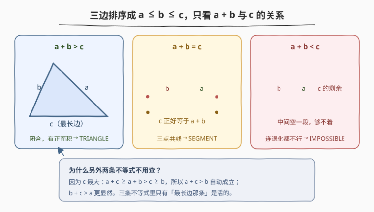
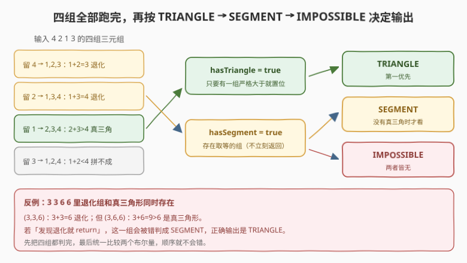
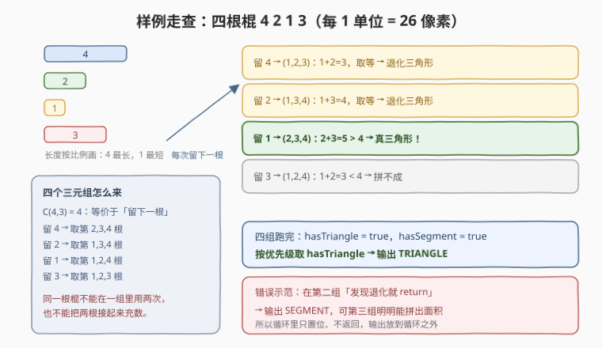

# Codeforces 6A 四根木棍拼三角形 题解

## 1. 题目概述

- **题目链接**：https://codeforces.com/problemset/problem/6/A
- **比赛来源**：Codeforces Beta Round 6 (Div. 2 Only) · Problem A
- **难度**：900
- **标签**：暴力、几何、排序
- **评测类型**：普通
- **限制**：时间 2 s / 内存 64 MB

**题意**：给出四根木棍的长度，从中**选出三根**（不能折断、不能只用一部分长度，自然也不能重复使用同一根）。若存在三根能拼成面积为正的三角形，输出 `TRIANGLE`；否则若存在三根能拼成**退化三角形**（三条边共线，即"任意两边之和大于等于第三边"但拼不成真正的三角形），输出 `SEGMENT`；两者都不成立时输出 `IMPOSSIBLE`。

**约束**：

- 木棍恰好 $4$ 根，每根长度 $1 \le a_i \le 100$。选法只有 $\binom{4}{3} = 4$ 种，因此任何"把 4 个三元组全检查一遍"的枚举都是常数级，$O(1)$ 就能结束。
- 长度不超过 $100$，两两之和不超过 $200$，连 `int` 都用不用担心溢出；本题的难点完全不在数值，而在**判定条件的写法**与**三种输出的优先顺序**。
- 输入只有一行、一组数据，没有测试组数 $t$，也不存在多测清空的问题。

## 2. 示例与观察

官方样例（输入 / 输出原样）：

```text
输入：
4 2 1 3

输出：
TRIANGLE
```

```text
输入：
7 2 2 4

输出：
SEGMENT
```

```text
输入：
3 5 9 1

输出：
IMPOSSIBLE
```

**样例 1 演算**：四根棍长 $4, 2, 1, 3$，四个三元组（每次"留下一根"）分别是

| 留下 | 三元组 | 排序后 | 关键比较 | 判定 |
|------|--------|--------|----------|------|
| 4 | $(2,1,3)$ | $1,2,3$ | $1+2=3$ | 退化 |
| 2 | $(4,1,3)$ | $1,3,4$ | $1+3=4$ | 退化 |
| 1 | $(4,2,3)$ | $2,3,4$ | $2+3=5>4$ | **真三角形** |
| 3 | $(4,2,1)$ | $1,2,4$ | $1+2=3<4$ | 拼不成 |

其中 $(2,3,4)$ 是真的三角形，所以按优先级输出 `TRIANGLE`。注意这一组里同时存在"退化"的三元组，**不能**因为先撞见 $(1,2,3)$ 就输出 `SEGMENT`。

**样例 2 演算**：$7,2,2,4$。四个三元组为 $(2,2,4)$、$(7,2,4)$、$(7,2,4)$、$(7,2,2)$。排序后分别比较：$2+2=4$（退化）、$2+4=6<7$、$2+4=6<7$、$2+2=4<7$。没有真三角形，但 $(2,2,4)$ 退化合法，故输出 `SEGMENT`。这一组的"退化"来自 $2+2=4$ 恰好取等。

**样例 3 演算**：$3,5,9,1$。四个三元组 $(5,9,1)$、$(3,9,1)$、$(3,5,1)$、$(3,5,9)$，排序后最大的边分别是 $9,9,5,9$，其余两边之和分别是 $6,4,4,8$，全部严格小于最长边，因此连退化三角形都没有，输出 `IMPOSSIBLE`。

**观察**：对任意一组三边，把长度排序成 $a \le b \le c$ 之后，只需要看 $a + b$ 与 $c$ 的大小关系：$a+b > c$ 是真三角形，$a+b = c$ 是退化三角形，$a+b < c$ 什么都不是。这比"三条不等式轮流写"更不容易漏项。

## 3. 解题思路

### 3.1 朴素做法与瓶颈

最直接的写法是四重循环枚举三根棍的所有**有序**选择（$4 \times 3 \times 2 = 24$ 种排列），每种都把三条不等式 $a+b>c$、$a+c>b$、$b+c>a$ 全写一遍。这样做当然正确，但有两个隐患：

1. 三选三的不等式里，有两条是"显然成立"的（最长边加上任意正数一定大于另外两条中的一条），人写的时候容易抄错下标，把 $a+c>b$ 写成 $a+c>a$ 之类的笔误；
2. 有序枚举把同一个三元组重复算了 $6$ 次，判定的优先级问题（先看真三角形还是先看退化）反而被掩盖。

真正的瓶颈不是复杂度（怎么枚举都是常数），而是**判据要写得短、优先顺序要写对**。

### 3.2 核心观察：排序之后只看一个不等式



设三条边长排序后为 $a \le b \le c$，则

$$
\begin{cases}
a+b > c, & \text{真三角形（面积为正）};\\
a+b = c, & \text{退化三角形（三点共线）};\\
a+b < c, & \text{拼不成，两端够不着}.
\end{cases}
$$

为什么另外两条不等式不用查？因为 $c$ 是最大边：$a + c \ge a + b > c > b$ 恒成立，$b + c > a$ 更是显然。所以三条不等式中只要最长边那条成立，另两条自动成立；反之若 $a+b \le c$，三角形不等式已经被破坏。**三条边里最长的边决定一切**。

于是判定被压缩成一次加法、一次比较。

### 3.3 算法流程：两个布尔量，最后才决定输出



1. 读入四根棍的长度到数组 `len[0..3]`；
2. 枚举所有 $0 \le i < j < k < 3$（恰好 $4$ 组），取出三元组并**只对这三条边**排序；
3. 若 `s[0] + s[1] > s[2]`，置 `hasTriangle = true`；否则若 `s[0] + s[1] == s[2]`，置 `hasSegment = true`；
4. 四组枚举**全部跑完**后再看两个布尔量：`hasTriangle` 为真输出 `TRIANGLE`，否则 `hasSegment` 为真输出 `SEGMENT`，否则输出 `IMPOSSIBLE`。

第 4 步的顺序就是题面规定的优先级：只要有一组能拼成真三角形，退化三角形存在与否都不影响答案。把"发现退化就立刻 return"是本题最常见的错误写法，样例 1（$4,2,1,3$：既有 $1+2=3$ 的退化组，又有 $2+3>4$ 的真三角形）正好会把它判错。

2 s 的时限对 $4$ 组枚举来说是天文数字，实测（含进程启动）约 $3$ ms，算法本体不足 $1\ \mu\text{s}$。

### 3.4 样例走查：$4,2,1,3$



图中把四根棍画成四段，下面依次列出"留下一根"之后剩下的三个长度。可以看到：

- 第一组 $(1,2,3)$ 与第二组 $(1,3,4)$ **都取等号**，只能给出 `SEGMENT` 的候选；
- 第三组 $(2,3,4)$ 的 $2+3=5>4$，是唯一能拼出面积的一组，`hasTriangle` 在这一步被点亮；
- 第四组 $(1,2,4)$ 的 $1+2=3<4$，最短两边加起来还够不到最长边，属于"拼不成"。

四组跑完后 `hasTriangle = true`，输出 `TRIANGLE`。如果程序在第二组就 return `SEGMENT`，第三组的真三角形就永远没机会被发现——这正是"先收集、后判定"的原因。

## 4. 正确性证明

**引理 1（排序判据）**：设正实数 $a \le b \le c$，则 $a, b, c$ 能构成面积为正的三角形，当且仅当 $a + b > c$。

**证明**：若 $a+b>c$，则另外两条不等式自动成立：$a + c \ge a + b > c \ge b$，即 $a+c>b$；同理 $b+c > a$ 显然。三条严格不等式齐备，故可构成非退化三角形。反过来，若 $a,b,c$ 是某个非退化三角形的三边，由三角形不等式（严格版）直接得到 $a+b>c$。∎

**引理 2（退化判据）**：设正实数 $a \le b \le c$，则 $a, b, c$ 能构成退化三角形，当且仅当 $a + b = c$。

**证明**：退化三角形要求"任意两边之和大于等于第三边"且不是真三角形。若 $a+b=c$，则 $a+c \ge c \ge b$、$b+c \ge c \ge a$ 均成立，三条弱不等式齐备，同时由引理 1 它不是真三角形，故退化。反之设三边退化（弱不等式全成立但不是真三角形），由引理 1 得 $a+b \le c$；若 $a+b<c$，则 $a+b$ 严格小于第三边，弱不等式 $a+b \ge c$ 被破坏，矛盾；故 $a+b = c$。∎

**引理 3（枚举完备）**：四重循环枚举的 $\binom{4}{3}=4$ 个下标三元组恰好覆盖了所有"从四根棍中取三根"的选法，且每种选法只出现一次。

**证明**：$0 \le i < j < k \le 3$ 的组合数为 $\binom{4}{3} = 4$；任意三元素子集排序后对应唯一的递增下标三元组，故既不遗漏也不重复。∎

**定理**：第 3.3 节的算法输出与题面要求一致。

**证明**：设 $T$ 为"存在真三角形三根棍"这一命题，$S$ 为"存在退化三角形三根棍"这一命题。由引理 3，算法遍历了所有三根棍的选法；由引理 1、引理 2，每一次遍历都准确地把该三元组归入"真三角形 / 退化 / 两者都不是"之一。因此循环结束时 `hasTriangle` 为真当且仅当 $T$，`hasSegment` 为真当且仅当 $S$。输出按 $T \to S \to$ 其余 的优先级选择，正是题面要求的 `TRIANGLE` / `SEGMENT` / `IMPOSSIBLE` 顺序。∎

## 5. 复杂度分析

- **时间**：$O(1)$。$\binom{4}{3}=4$ 次枚举，每次排序 3 个数（常数个比较），总计不超过 $30$ 次基本运算，与输入规模无关。
- **空间**：$O(1)$。一个长度 4 的数组和两个布尔量，连递归栈都没有。
- **与时限的关系**：2 s 的时限下，实测端到端（含进程启动）约 $3$ ms，算法本体在纳秒量级，余量在 $10^5$ 倍以上。64 MB 内存只用了几百字节。
- **如果木棍数变成 $n$ 根**：枚举所有三元组是 $O(n^3)$，本题 $n=4$ 时退化为常数；若 $n$ 变大，标准做法是排序后只检查相邻三元组（见"延伸思考"），复杂度 $O(n \log n)$。

## 6. 参考代码

### C++17

```cpp
#include <bits/stdc++.h>
using namespace std;

int main() {
    ios::sync_with_stdio(false);
    cin.tie(nullptr);

    int len[4];
    for (int i = 0; i < 4; ++i) {
        if (!(cin >> len[i])) return 0;
    }

    bool hasTriangle = false, hasSegment = false;
    for (int i = 0; i < 4; ++i) {
        for (int j = i + 1; j < 4; ++j) {
            for (int k = j + 1; k < 4; ++k) {
                int s[3] = {len[i], len[j], len[k]};
                sort(s, s + 3);
                if (s[0] + s[1] > s[2]) {
                    hasTriangle = true;
                } else if (s[0] + s[1] == s[2]) {
                    hasSegment = true;
                }
            }
        }
    }

    if (hasTriangle) {
        cout << "TRIANGLE\n";
    } else if (hasSegment) {
        cout << "SEGMENT\n";
    } else {
        cout << "IMPOSSIBLE\n";
    }
    return 0;
}
```

### Python3

```python
import sys


def main() -> None:
    data = sys.stdin.buffer.read().split()
    if len(data) < 4:
        return
    len_ = [int(x) for x in data[:4]]

    has_triangle = False
    has_segment = False
    for i in range(4):
        for j in range(i + 1, 4):
            for k in range(j + 1, 4):
                s = sorted((len_[i], len_[j], len_[k]))
                if s[0] + s[1] > s[2]:
                    has_triangle = True
                elif s[0] + s[1] == s[2]:
                    has_segment = True

    if has_triangle:
        sys.stdout.write("TRIANGLE\n")
    elif has_segment:
        sys.stdout.write("SEGMENT\n")
    else:
        sys.stdout.write("IMPOSSIBLE\n")


main()
```

两份代码都只用标准库，可原样提交；输出单词全部大写，且只输出一个单词加换行。

## 7. 边界情况与易错点

1. **优先级写反（本题第一大坑）**：题面要求"存在真三角形就输出 `TRIANGLE`，无论退化三角形是否存在"。样例 1 的 $4,2,1,3$ 同时含有退化的 $(1,2,3)$ 与真三角形 $(2,3,4)$。若程序一发现退化就 `return "SEGMENT"`，会直接 WA。必须先把四组全部判完，再按 `hasTriangle → hasSegment → IMPOSSIBLE` 输出。
2. **把退化也算成三角形**：用 `s[0] + s[1] >= s[2]` 判真三角形，会把样例 2（$7,2,2,4$，只有 $2+2=4$）错答成 `TRIANGLE`。真三角形必须用严格大于。
3. **只排序了前两根或整根数组**：判据依赖"哪三条被选中"，必须**只对选中的三条**排序。若图省事把整个长度 4 的数组排序后取前三根，就会漏掉"留下的是中间某根"的情况（例如 $1,3,4,6$ 的答案取决于 $(3,4,6)$ 而不是 $(1,3,4)$）。
4. **重复枚举同一个三元组**：四重循环写成 $0 \le i,j,k \le 3$ 且互不相同，会把每个三元组算 $6$ 遍。虽然本题结果不变，但代码里出现 $6$ 倍冗余后又容易顺手写成"发现即返回"，把第 1 条的坑引进来；用 $i<j<k$ 最省心。
5. **退化判定误用严格不等号**：$2+2=4$（样例 2）必须判为退化；写成 `s[0] + s[1] < s[2]` 就把"恰好够长"漏掉了，答案是 `IMPOSSIBLE` 而正确是 `SEGMENT`。
6. **"三根"被写成"两根"**：题面明确"要用三根木棍"，不能把两根首尾相接凑长度。$1,1,2,100$ 里 $1+1=2$ 是退化三角形，但 $1+1+2=4$ 与 $100$ 依旧拼不成，说明"多根拼一根"的规则完全不同。
7. **全部相等时**：$100,100,100,100$ 每组都是 $100+100 > 100$，输出 `TRIANGLE`；$1,1,1,1$ 同理。这类数据能检出"先排序整个数组再取前三"里隐含的下标错误。
8. **输出拼写与大小写**：三个单词必须以大写原样输出，`Triangle`、多打空格、行尾多输出一行都会判错（本题没有特殊评测）。
9. **读入方式**：`cin >> len[i]` 会自动跳过空白，四个整数换行、空格分隔都吃得下；若用 `getline` 读整行再自己切分，则需要额外处理行尾多余的空白。

## 8. 验证记录

- **编译环境与命令**：本机只有 `Apple clang 21.0.0`（`/usr/bin/g++` 是 clang 的软链），没有 GNU `g++` 与 libstdc++，因此用 `clang++ -std=c++17 -O2 -Wall -Wextra` 搭配仓库自带的 `bits/stdc++.h` 兼容头编译（代码只用标准库，可原样提交 GNU C++17）。Python 侧为 `Python 3.9.6`。
- **官方样例**：3 / 3 通过。`4 2 1 3` → `TRIANGLE`，`7 2 2 4` → `SEGMENT`，`3 5 9 1` → `IMPOSSIBLE`，C++ 与 Python 输出逐字一致。
- **独立暴力对拍**：另写一份**不排序**的暴力——对每个三根棍的三元组，把三条不等式 $a+b>c$、$a+c>b$、$b+c>a$ 各自独立地判一遍（真三角形）与弱不等式版本（退化），最后取三者中优先级最高的结论。与参考程序逐组比对：
  - 随机宽域数据（四根长度 $\in [1,100]$）**200 组**；
  - 随机小值域数据（四根长度 $\in [1,6]$，容易撞出取等）**200 组**；
  - "等边偏置"数据（两根相等 + 两根随机，专门制造退化）**200 组**；
  - 每组脚本另附 $10$ 组手写边界（`1 1 1 1`、`1 2 3 4`、`100 100 100 100`、`1 1 2 3`、`50 50 100 100`、`1 100 100 100`、`3 4 5 100`、`2 3 4 10`、`1 2 2 3`、`7 7 7 21`）。
  三批共 **630 组**（含手写边界）**全部一致**；另用 Python 参考版对暴力程序独立跑了 **200 组**随机数据，也全部一致。
- **最大约束性能**：本题没有"大输入"，最大规模就是 4 个数。取 `100 100 100 100` 连跑 20 次，含进程启动平均约 $3$ ms，远低于 2 s。
- **图片校验**：三张 SVG（`cf6a_sorted_criterion.svg`、`cf6a_verdict_order.svg`、`cf6a_sample_walk.svg`）均通过 `xml.etree.ElementTree.parse`，含 `feTurbulence` 抖动滤镜与手写字体，文字全部落在 `viewBox` 内。
- **复核状态**：verified（样例 3/3、对拍 830 组、性能、图片、公式均实跑通过；唯一环境差异是本机无 GNU g++，已用 clang++ 等价验证）。

## 相关题目与扩展

- [Codeforces 1A Theatre Square](https://codeforces.com/problemset/problem/1/A)：同为 Beta Round 的入门题，考察"把几何条件翻译成整数运算"。
- [Codeforces 6B President's Office](https://codeforces.com/problemset/problem/6/B)：同场 B 题，网格 + 去重，与本题一起构成"读题比算法难"的典型。
- [Codeforces 6C Alice, Bob and Chocolate](https://codeforces.com/problemset/problem/6/C)：同场 C 题，双指针模拟，是本题从"枚举常数"迈向"线性扫描"的下一步。
- [Codeforces 702A Maximum Increase](https://codeforces.com/problemset/problem/702/A)：线性扫描的入门题，可对照本题"全部跑完再判定"的写法习惯。
- [LeetCode 976. 三角形的最大周长](https://leetcode.cn/problems/largest-perimeter-triangle/)：在数组里找能成三角形的三条边，同样依赖"排序后只查相邻三元组"这一结论。

**延伸思考**：

1. **如果木棍变成 $n$ 根**：不能枚举 $\binom{n}{3}$ 组。结论是"只需检查排序后相邻的三个数"——若存在某个合法三元组 $(a_i,a_j,a_k)$（$i<j<k$），则把下标换成 $i, i+1, i+2$ 后 $a_i + a_{i+1} \le a_i + a_j$ 而 $a_{i+2} \le a_k$，仍然成立或更宽松，因此 $O(n \log n)$ 即可判定。本题 $n=4$ 时这一结论恰好覆盖全部四种选法。
2. **为什么"退化"值得单独区分**：在计算几何里，退化三角形对应"三点共线"，它是浮点判别式容易误判的临界情形（行列式为 $0$）。本题用整数做判定，取等号是精确的，这也提醒我们：能用整数就别用浮点。
3. **如果要输出具体方案而不只是类型**：需要把"留下的那根"也输出。此时枚举顺序会影响答案的唯一性（多解时通常要求任意一组），可以按"优先真三角形、其次退化、最后无解"的顺序返回第一个可行三元组。
4. **推广到 $k$ 根棍选 $m$ 根**：$\binom{k}{m}$ 组枚举 + 每组排序判据是天然解法；若 $k$ 很大而 $m$ 固定，还可以用"最大边 + 两小边"的堆或有序集合在 $O(k \log k)$ 内完成。
