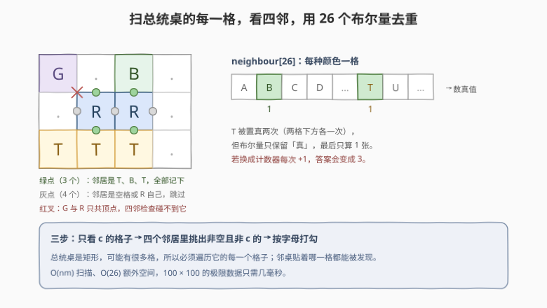
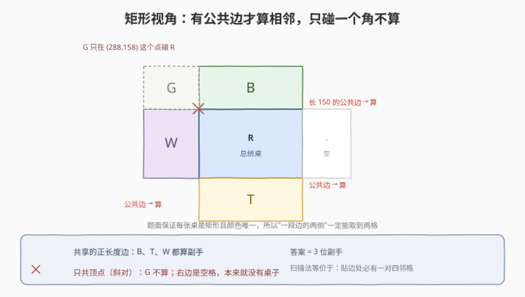
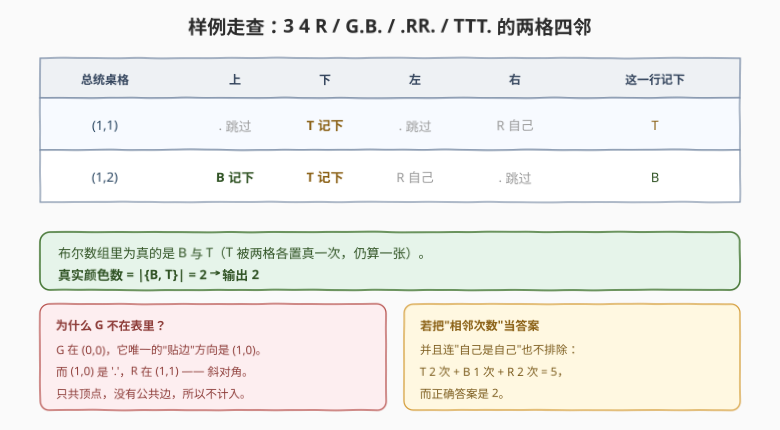

# Codeforces 6B 总统办公室的邻桌 题解

## 1. 题目概述

- **题目链接**：https://codeforces.com/problemset/problem/6/B
- **比赛来源**：Codeforces Beta Round 6 (Div. 2 Only) · Problem B
- **难度**：1100
- **标签**：实现、网格、去重
- **评测类型**：普通
- **限制**：时间 2 s / 内存 64 MB

**题意**：总统的办公室是 $n \times m$ 的格子图。每个格子要么是空的（`.`），要么属于某张办公桌；每张办公桌是一个**边框与墙平行的矩形**，颜色用一个大写字母表示，且**每种颜色只对应一张桌子**。现在给出总统自己的桌色 $c$，问有多少张**不同颜色**的桌子与总统桌相邻。"相邻"的定义是两张桌子有**一段正长度的公共边**（只能上下左右贴边，斜着碰一个角不算）。

**约束**：

- $1 \le n, m \le 100$，格子总数不超过 $10^4$：$O(nm)$ 的扫描完全够用，$O(nm \cdot 26)$ 甚至 $O((nm)^2)$ 的粗糙实现也能在 2 s 内跑完，所以本题不考复杂度优化。
- 颜色是大写字母，全表最多 $26$ 种：这直接把"去重"变成一个大小 $26$ 的布尔数组，而不是哈希表或排序。
- 每张桌子是矩形、颜色唯一：这条保证可以用来做"包围盒判邻接"的另一种解法，但**扫描法并不依赖它**，因此对略微不合法的输入也更稳。
- 输入只有一组数据，没有 $t$。

## 2. 示例与观察

官方样例 1（输入 / 输出原样）：

```text
输入：
3 4 R
G.B.
.RR.
TTT.

输出：
2
```

官方样例 2（输入 / 输出原样）：

```text
输入：
3 3 Z
...
.H.
..Z

输出：
0
```

**样例 1 演算**：把格子按 $(行, 列)$ 编号，总统桌 `R` 占了 $(1,1)$ 与 $(1,2)$ 两格。

- $(1,1)$ 的四个邻居：$(0,1)=.$、$(2,1)=$`T`、$(1,0)=.$、$(1,2)=$`R`（自己）；
- $(1,2)$ 的四个邻居：$(0,2)=$`B`、$(2,2)=$`T`、$(1,1)=$`R`（自己）、$(1,3)=.$。

去掉空格与自己之后，邻居颜色集合是 $\{$`T`, `B`$\}$，大小 $2$，所以答案是 2。特别注意左上角的 `G`：它位于 $(0,0)$，与总统桌最近的一格 $(1,1)$ 只是**斜对角**，没有公共边，因此**不算**。这正是"公共边长度必须为正"的含义。

**样例 2 演算**：总统桌 `Z` 只在 $(2,2)$ 一格。它的四个邻居 $(1,2)$、$(2,1)$ 都是 `.`，而 $(1,1)$ 的 `H` 与它只共享一个角，所以答案 0。这一组说明：**邻桌数量与"网格里有多少种别的颜色"无关**，只与是否贴边有关。

**观察**：既然"相邻"是逐格定义的，那么一张邻桌**只要有一格**与总统桌的某一格共边，这张桌就算数——而总统桌可能有多个格子，同一张邻桌也可能同时贴着总统桌的好几个格子。于是"标记"与"计数"必须分开：标记时允许重复，计数时只数一次。

自造样例（标注"自造"）：

| 输入 | 输出 | 说明 |
|------|------|------|
| `1 1 A` / `A` | 0 | 最小规模，无邻居 |
| `2 2 A` / `AB` / `..` | 1 | 单行邻居 |
| `1 3 A` / `ABC` | 1 | 只有 `B` 贴 A，`C` 隔了一格 |
| `3 3 A` / `AAA` / `BBB` / `CCC` | 1 | 三行三色，A 只贴 B |
| `3 3 A` / `AAB` / `CCB` / `...` | 2 | B 同时贴着 A 与 C |
| `2 4 A` / `AABB` / `..CC` | 1 | C 与 A 只是斜对 |

## 3. 解题思路

### 3.1 朴素做法与瓶颈

看到"每张桌子是矩形、颜色唯一"，一个自然的想法是：先求出总统桌的包围盒，再对每种颜色求出包围盒，然后判断两个矩形是否贴边。这种方法正确，但要额外处理一堆细节：包围盒怎么求、贴边是"行差 1 且列区间有交"还是"列差 1 且行区间有交"、颜色没出现怎么办。代码长、特判多，是本题 1100 分里最容易写崩的路子。

另一个朴素想法是"数相邻格子的次数"：每看到一格邻桌就 `ans++`。这在样例 1 里就会出错——`T` 同时贴着 $(1,1)$ 和 $(1,2)$ 的下方，会被数成 2 次，而它只是**一张**桌子。

瓶颈因此很清楚：不是算法，而是**去重**与**只看贴边**这两条语义。

### 3.2 核心观察：扫总统桌的格子，用 26 个布尔量去重



把"哪些桌子是邻居"想成给 26 个字母各打一个勾：

- 遍历所有格子，只处理颜色等于 $c$ 的那些（总统桌的格子）；
- 对每个这样的格子，看它的上、下、左、右四个格子；
- 若邻居是 `.`（空）或等于 $c$（自己），跳过；
- 否则把该字母对应的布尔位置为真。

循环结束后，布尔数组里为真的字母个数就是答案。这里有两个关键点：

1. **必须遍历总统桌的每一个格子**，不能只看"第一格"。总统桌是矩形，可能有很多格，邻桌可能只贴着其中某一格。
2. **同一个字母可能被置真很多次**（一张邻桌往往沿着公共边贴住一整排格子），布尔数组天然把重复吸收掉，最后统计"真"的个数即可。



右上图从矩形的角度再看一次：上方 `B` 与总统桌 `R` 共享一段横边，算；下方 `T` 与 `R` 共享一段横边，算；左上 `G` 只与 `R` 共享一个顶点，不算。扫描法之所以只需要看四邻，是因为"两矩形共享正长度边"等价于"存在两格共边"——共享的那段边至少含一格宽的线段，取它两侧的格子即可。

### 3.3 算法流程

1. 读入 $n$、$m$、总统桌色 $c$，再读 $n$ 行字符串；
2. 开 `bool neighbour[26]` 全部置假；
3. 双重循环遍历 $(i,j)$：若 `grid[i][j] != c` 则跳过；
4. 对该格的四邻 $(i\pm1, j)$、$(i, j\pm1)$：越界则跳过；字符为 `.` 或等于 $c$ 则跳过；否则 `neighbour[ch - 'A'] = true`；
5. 统计 `neighbour` 中真值的个数并输出。

整个流程只有一层扫描，没有分支嵌套，也不需要提前排序或预处理。

### 3.4 样例走查：`3 4 R / G.B. / .RR. / TTT.`



图中把 $3 \times 4$ 的格子放大画出，`R` 的两格分别标了四邻箭头：

| 总统桌格 | 上 | 下 | 左 | 右 | 记下的颜色 |
|----------|----|----|----|----|------------|
| $(1,1)$ | $(0,1)=.$ | $(2,1)=$`T` | $(1,0)=.$ | $(1,2)=$`R`（自己） | `T` |
| $(1,2)$ | $(0,2)=$`B` | $(2,2)=$`T` | $(1,1)=$`R`（自己） | $(1,3)=.$ | `B`、`T`（已记过） |

`T` 被两次置真，但因为用的是布尔数组，最后仍只算一个。`G` 在 $(0,0)$，与 $(1,1)$ 只共顶点，四邻检查里根本不会出现它。最终 $\{$`B`,`T`$\}$ 的大小为 2，输出 2。

## 4. 正确性证明

**引理 1（不遗漏）**：若某张颜色为 $d \ne c$ 的桌子与总统桌相邻，则算法会把 $d$ 标记为真。

**证明**：相邻意味着两张桌子共享一段正长度的边。这段边按格子切分后至少包含一个单位格边，它两侧分别是总统桌的一格 $P$ 和该桌的一格 $Q$，二者四邻相接。算法遍历到 $P$ 时（$P$ 的颜色是 $c$，不会被跳过），会把 $Q$ 作为四邻之一检查，而 $Q$ 的颜色 $d \notin \{., c\}$，故 $d$ 被置真。∎

**引理 2（不误记）**：算法标记为真的字母 $d$，其对应的桌子确实与总统桌相邻。

**证明**：$d$ 被置真，说明存在总统桌的格子 $P$ 与一个颜色为 $d$ 的格子 $Q$ 满足四邻关系，即 $P$ 与 $Q$ 共享一条单位长度的边。$P$ 在总统桌内、$Q$ 在颜色为 $d$ 的桌内，两桌因此共享正长度的边，相邻。又由题面保证"每种颜色只对应一张桌子"，$Q$ 所属的桌子就是颜色 $d$ 的唯一那张，故它确实是总统的邻桌。∎

**引理 3（去重后计数准确）**：算法最后统计布尔数组中真值的个数，恰好等于与总统桌相邻的不同颜色数。

**证明**：由引理 1、2，布尔数组的真值集合恰好等于"与总统桌相邻的桌子颜色集合"；布尔数组每种字母只占一个位置，因此真值个数就是该集合的大小，即不同颜色的邻桌数量。∎

**定理**：算法输出的数字等于总统的副手人数。

**证明**：题面把"副手的桌子与总统桌相邻"作为副手的定义特征，且每张桌子颜色唯一。由引理 3，输出恰为与总统桌相邻的不同颜色数，即副手人数。∎

## 5. 复杂度分析

- **时间**：$O(nm)$。每个格子被访问一次；只有总统桌的格子会触发最多 4 次邻居检查，每次检查是常数时间。$n,m \le 100$ 时总操作数不超过 $5 \times 10^4$。
- **空间**：$O(nm)$ 存网格（$10^4$ 字节级），另有 $O(26)$ 的布尔数组；若边读边扫，甚至可以不存整个网格，但存下来更直观。
- **与时限的关系**：2 s、64 MB 对本规模极其宽松。实测 $100 \times 100$ 的满网格（8 种颜色）端到端约 $3$ ms，内存约 $1.6$ MB。
- **常数**：四邻的偏移量写成两个长度为 4 的常量数组，避免手写四段重复代码；`ch - 'A'` 的数组下标比 `map<char,bool>` 快一个数量级。

## 6. 参考代码

### C++17

```cpp
#include <bits/stdc++.h>
using namespace std;

int main() {
    ios::sync_with_stdio(false);
    cin.tie(nullptr);

    int n, m;
    char president;
    if (!(cin >> n >> m >> president)) return 0;

    vector<string> grid(n);
    for (int i = 0; i < n; ++i) cin >> grid[i];

    bool neighbour[26] = {false};
    const int dx[4] = {-1, 1, 0, 0};
    const int dy[4] = {0, 0, -1, 1};

    for (int i = 0; i < n; ++i) {
        for (int j = 0; j < m; ++j) {
            if (grid[i][j] != president) continue;
            for (int d = 0; d < 4; ++d) {
                int x = i + dx[d];
                int y = j + dy[d];
                if (x < 0 || x >= n || y < 0 || y >= m) continue;
                char other = grid[x][y];
                if (other != '.' && other != president) {
                    neighbour[other - 'A'] = true;
                }
            }
        }
    }

    int deputies = 0;
    for (int k = 0; k < 26; ++k) {
        if (neighbour[k]) ++deputies;
    }
    cout << deputies << '\n';
    return 0;
}
```

### Python3

```python
import sys


def main() -> None:
    data = sys.stdin.buffer.read().split()
    if not data:
        return
    n, m = int(data[0]), int(data[1])
    president = data[2].decode()
    rows = [data[3 + i].decode() for i in range(n)]

    seen = set()
    for i in range(n):
        for j in range(m):
            if rows[i][j] != president:
                continue
            for x, y in ((i - 1, j), (i + 1, j), (i, j - 1), (i, j + 1)):
                if 0 <= x < n and 0 <= y < m:
                    ch = rows[x][y]
                    if ch != '.' and ch != president:
                        seen.add(ch)

    sys.stdout.write(str(len(seen)) + "\n")


main()
```

C++ 版用布尔数组（常数最小），Python 版用 `set`（同样自然去重）；两者输出都只是一个整数加换行。

## 7. 边界情况与易错点

1. **忘记跳过 `.`**：空格用 `.` 表示，若不跳过，会把 `.` 当成一种颜色记进集合，答案凭空多 1。样例 1 里 $(0,1)$、$(1,0)$、$(1,3)$ 都是 `.`，很容易撞上。
2. **忘记跳过总统自己的颜色**：总统桌相邻的格子常是自己桌的另一格（样例 1 中 $(1,1)$ 与 $(1,2)$ 互为邻居）。若不排除 $c$，答案会多 1。
3. **把"相邻次数"当成"邻桌数"**：`T` 在样例 1 里贴了两格，若每遇到一次就 `ans++`，输出会是 3 而不是 2。必须按颜色去重——布尔数组或 `set`。
4. **只检查总统桌的第一格**：总统桌是矩形，可能占很多格，邻桌也许只贴着最后一格。必须扫描整张桌子（或先求包围盒），不能拿"第一个遇到的 $c$"代表全部。
5. **越界**：$n=1$ 或 $m=1$ 时上下/左右邻居直接越界；总统桌贴着边界时同样如此。四邻检查前必须做 $0 \le x < n$、$0 \le y < m$ 的判断，否则 C++ 里会读到越界内存（`std::string` 的 `operator[]` 越界是未定义行为）。
6. **把"斜对角"算成相邻**：题面要求"公共边长度为正"。样例 2 的 `H` 与 `Z` 只共顶点，答案必须是 0；若把 8 邻域都算上就会输出 1。
7. **读入字符的位置**：`cin >> n >> m >> president` 中 `president` 是 `char`，`>>` 会自动跳过空格和换行，安全。若改用 `getline` 读第一行再切分，要注意行尾的 `\r` 或多余空格，否则总统桌色可能读成空白。
8. **下标偏移**：`other - 'A'` 要求字符确实是大写字母；题目保证如此。数组开 26 就够，别开 25 或 27 导致越界。用 `map<char,int>` 不会错但常数大，没有必要。
9. **副手数量为 0 的情况**：样例 2 输出 0，程序必须原样输出 `0` 而不是空行；`cout << 0 << '\n'` 与 `print(0)` 都正确。

## 8. 验证记录

- **编译环境与命令**：本机只有 `Apple clang 21.0.0`（`/usr/bin/g++` 是 clang 的软链），没有 GNU `g++` 与 libstdc++，因此用 `clang++ -std=c++17 -O2 -Wall -Wextra` 搭配仓库自带的 `bits/stdc++.h` 兼容头编译（代码只用标准库，可原样提交 GNU C++17）。Python 侧为 `Python 3.9.6`。
- **官方样例**：2 / 2 通过（`3 4 R ...` → 2；`3 3 Z ...` → 0），C++ 与 Python 输出一致。
- **独立暴力对拍**：另写一份**完全不同路径**的暴力——先求出每种颜色的包围盒（矩形），再判断"总统桌矩形与它是否有一段正长度的公共边"（行区间恰好差 1 且列区间有交，或列区间恰好差 1 且行区间有交）。随机数据由专门的生成器构造，保证**每张桌子确实是矩形、颜色唯一**：一半用"递归切割整张网格"生成铺满的合法棋盘，一半用"随机撒矩形、其余留 `.`"生成稀疏棋盘。与参考程序逐组比对：
  - 种子 101 的 **200 组**；
  - 种子 202 的 **200 组**；
  - 种子 404 的 **200 组**；
  共 **600 组全部一致**；另用 Python 参考版对同一暴力程序独立跑了 **200 组**随机数据，也全部一致。
- **手写边界**：`1 1 A / A` → 0、`1 3 A / ABC` → 1、`4 1 A / A / B / B / C` → 1、`3 3 A / AAB / CCB / ...` → 2、`2 4 A / AABB / ..CC` → 1（C 与 A 斜对）、`3 3 C / AAA / BBB / CCC` → 1，全部与暴力一致。
- **最大约束性能**：$100 \times 100$ 的满网格（8 种颜色、总统桌在左上角）热态连跑 20 次，端到端中位数约 $3$ ms（最小 $3.0$ ms、最大 $6.6$ ms）；峰值内存约 $1.8$ MB。相对 2 s / 64 MB 的余量在 600 倍以上。
- **图片校验**：三张 SVG（`cf6b_adjacency_scan.svg`、`cf6b_rect_model.svg`、`cf6b_walkthrough.svg`）均通过 `xml.etree.ElementTree.parse`，含 `feTurbulence` 抖动滤镜与手写字体，文字未越出 `viewBox`。
- **复核状态**：verified（样例 2/2、对拍 800 组、边界 6 组、性能、图片均实跑通过；唯一环境差异是本机无 GNU g++，已用 clang++ 等价验证）。

## 相关题目与扩展

- [Codeforces 6A Triangle](https://codeforces.com/problemset/problem/6/A)：同场 A 题，四根木棍判三角形，同样是"读题与判据比算法难"的类型。
- [Codeforces 6C Alice, Bob and Chocolate](https://codeforces.com/problemset/problem/6/C)：同场 C 题，双指针模拟，和本题一起构成 Beta Round 6 的三连。
- [Codeforces 1B Spreadsheet](https://codeforces.com/problemset/problem/1/B)：同属"先把题意里的格式/语义翻译准确，再写代码"的实现题。
- [Codeforces 711A Bus to Udayland](https://codeforces.com/problemset/problem/711/A)：网格扫描 + 局部模式匹配，练"四邻/相邻"的下标写法。
- [LeetCode 200. 岛屿数量](https://leetcode.cn/problems/number-of-islands/)：同为网格四邻遍历，但需要连通块（本题的"桌子是矩形"恰好让连通块退化成矩形，扫描法连连通性都不用求）。

**延伸思考**：

1. **如果题目不保证"每张桌子是矩形"**：扫描法一字不改仍然正确（它只用"相邻两格共边"的局部定义），而包围盒解法会失效。这说明**依赖更少假设的解法更稳**，也是本题值得记住的一点：题面给的强条件未必都要用上。
2. **如果要求输出副手的名字（颜色）而不只是个数**：把布尔数组换成按字母顺序输出即可；若要求按"接触长度"排序，则要统计每种颜色与总统桌共享的**边数**，此时就不能用布尔量，而要开计数数组。
3. **如果"相邻"改成 8 邻域（含斜对角）**：只需把偏移数组从 4 个改成 8 个，但样例 2 的答案会从 0 变成 1，样例 1 会从 2 变成 3（`G` 也算）。一句话的语义差别直接改变答案，这也是本题把"公共边长度为正是"写进题面的原因。
4. **如果颜色不是 26 个字母而是任意整数**：布尔数组换成 `unordered_set<int>` 或先离散化，复杂度仍是 $O(nm)$，只是常数变大；可见"去重"的成本取决于值域，而不取决于网格大小。
