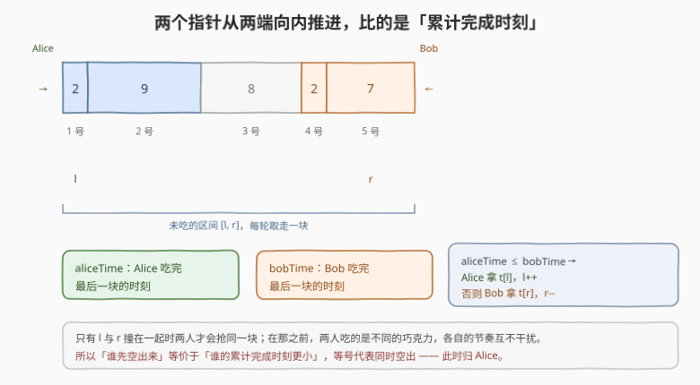
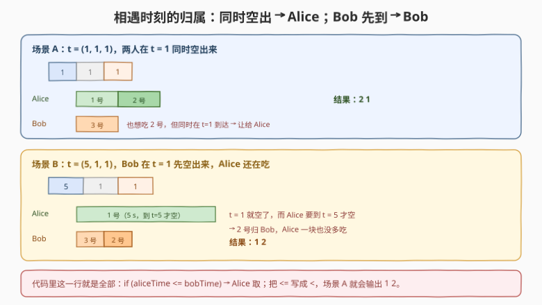
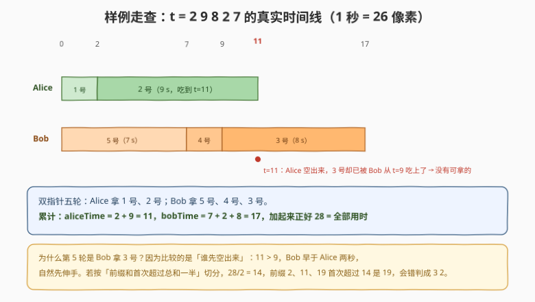

# Codeforces 6C 爱丽丝与鲍勃吃巧克力 题解

## 1. 题目概述

- **题目链接**：https://codeforces.com/problemset/problem/6/C
- **比赛来源**：Codeforces Beta Round 6 (Div. 2 Only) · Problem C
- **难度**：1200
- **标签**：贪心、双指针、模拟
- **评测类型**：普通
- **限制**：时间 2 s / 内存 64 MB

**题意**：$n$ 块巧克力排成一行，第 $i$ 块需要 $t_i$ 秒吃完。Alice 从左往右吃（第 $1, 2, \dots$ 块），Bob 从右往左吃（第 $n, n-1, \dots$ 块），两人吃速相同、吃完一块立刻吃下一块，不能把一块吃一半就停、也不能中途休息。两人**不能同时吃同一块**；如果两人在同一时刻开始吃同一块，Bob 作为绅士把它让给 Alice。问最终 Alice 与 Bob 各吃了多少块。

**约束**：

- $n \le 10^5$，$t_i \le 1000$：所有巧克力被吃完的总时间 $T = \sum t_i \le 10^8$ 秒。
- 逐秒模拟的复杂度是 $O(T) = 10^8$，C++ 勉强能过但常数大、逻辑易错，Python 一定超时；而 $O(n)$ 的双指针只要扫一遍，所以必须找到"不按秒走"的推进方式。
- 累计用时最大 $10^8$，`int` 装得下（$2^{31}-1 \approx 2.1 \times 10^9$），但把它写成 `long long` 更稳；单块时间与答案都比较"贴近边界"，不留心也容易在别处溢出。
- 输入只有一组数据，没有 $t$，也没有多测清空问题。

## 2. 示例与观察

官方样例（输入 / 输出原样）：

```text
输入：
5
2 9 8 2 7

输出：
2 3
```

**逐步演算**：把时间轴按"谁在吃哪一块"排开。

| 时刻 | 事件 |
|------|------|
| $t = 0$ | Alice 开始吃 1 号（需 2 s），Bob 开始吃 5 号（需 7 s） |
| $t = 2$ | Alice 吃完 1 号，立刻开始 2 号（需 9 s，预计 $t = 11$ 吃完） |
| $t = 7$ | Bob 吃完 5 号，开始 4 号（需 2 s，预计 $t = 9$） |
| $t = 9$ | Bob 吃完 4 号，开始 3 号（需 8 s，预计 $t = 17$） |
| $t = 11$ | Alice 吃完 2 号，想吃 3 号——但 3 号已被 Bob 从 $t = 9$ 开始吃了 |
| $t = 17$ | Bob 吃完 3 号，此时所有巧克力都已吃完 |

于是 Alice 吃了 2 块，Bob 吃了 3 块，输出 `2 3`。两边的累计用时分别是 $2 + 9 = 11$ 与 $7 + 2 + 8 = 17$，加起来 $28$ 恰好是全部时间。

**观察**：

1. 两人各自从一端向内推进，**只有在中间相遇的那一块上才会争抢**；在此之前，Alice 的"下一块"和 Bob 的"下一块"永远是两块不同的巧克力，互不干扰。
2. 因此决定权只取决于一件事：**谁先吃完自己手上这块**。先空出来的人，才能去拿下一块；同时空出来时，Bob 让 Alice。
3. 累加的时间一旦超过对方，就要"让出"推进权。这提示我们只需要比较两个人的累计用时，而不需要真的按秒推进。

## 3. 解题思路

### 3.1 朴素做法与瓶颈

最直白的做法是按秒模拟：每秒检查 Alice 是否吃完、Bob 是否吃完，吃完就让他们去拿下一块。正确性没问题，但循环次数是 $T = \sum t_i \le 10^8$。即使每轮只有几次判断，$10^8$ 轮在 2 s 内也非常紧张，而且 Python 里每一轮都是解释执行，必然超时。

另一种朴素做法是"从两边依次试吃、每次重新计算谁先吃完"，若不维护累计用时而是每次重新求和，复杂度会退化成 $O(n^2)$，同样过不了 $10^5$。

真正的瓶颈是：**时间以秒为单位时，事件的数量远多于巧克力的数量**。而所有有价值的事件只有 $n$ 个——"某人开始吃下一块"。只要直接跳到这些事件上，就是 $O(n)$。

### 3.2 核心观察：比"累计完成时刻"，而不是比"秒"



维护两个量：

- `aliceTime`：Alice 吃完她目前最后一块的**时刻**（还没吃过则为 0）；
- `bobTime`：Bob 吃完他目前最后一块的时刻（还没吃过则为 0）。

再维护未吃区间 $[l, r]$。每一轮做一次判断：

- 若 `aliceTime <= bobTime`：说明 Alice 不晚于 Bob 空出来，让她拿走 $l$，`aliceTime += t[l]`，然后 `l++`；
- 否则 Bob 先空出来，让他拿走 $r$，`bobTime += t[r]`，然后 `r--`。

为什么这个比较就是全部？因为两人吃的是**不同**的巧克力（除了最后相遇的那一块），各自的进食节奏互不影响：Alice 在 $0$ 到 `aliceTime` 之间连续吃了若干块，Bob 同理。谁的"收工时刻"更早，谁就有资格先动。两个人同时收工时由 Bob 让给 Alice，恰好对应判定式里的 `<=`。



#### 为什么必须用 `<=` 而不是 `<`

考虑 $n = 3$、$t = (1, 1, 1)$：

- 用 `<=`：$t=1$ 时两人都吃完第一块，平局 → Alice 拿 2 号，Alice 吃 2 块、Bob 吃 1 块，输出 `2 1`（正确）；
- 用 `<`：平局时轮到 Bob，Bob 拿 2 号，输出 `1 2`（错误）。

题面已经写清楚"同时开始吃同一块时 Bob 让给 Alice"，这一个等号就是它的全部体现。样例 $t = (2,9,8,2,7)$ 里没有出现平局，所以只跑样例发现不了这个坑。

#### 为什么"按总和的一半切"是错的

一个常见的错误想法是：算出总和 $S$，找到前缀和第一次超过 $S/2$ 的位置，认为左边归 Alice、右边归 Bob。反例 $t = (1, 1, 10)$：总和 $12$，前缀和 $1, 2, 12$，第一次超过 $6$ 的位置是第 3 块，于是错判 Alice 吃 3 块。真实过程是 Alice 吃 1 号（$0 \sim 1$）、2 号（$1 \sim 2$），Bob 吃 3 号（$0 \sim 10$），Alice 2 块、Bob 1 块。**两人的进度是异步的**，不能用一个静态的切分点代替。

### 3.3 算法流程

1. 读入 $n$ 与数组 $t$；
2. `l = 0`，`r = n - 1`，`aliceTime = bobTime = 0`，`aliceBars = bobBars = 0`；
3. 当 `l <= r` 时循环：
   - 若 `aliceTime <= bobTime`：`aliceTime += t[l]`，`l++`，`aliceBars++`；
   - 否则：`bobTime += t[r]`，`r--`，`bobBars++`；
4. 输出 `aliceBars` 与 `bobBars`。

循环每轮恰好吃掉一块巧克力，所以循环次数正好是 $n$；结束时 `aliceBars + bobBars == n`，这本身就是一个便宜的自检。

### 3.4 样例走查：$2, 9, 8, 2, 7$



| 轮次 | `aliceTime` | `bobTime` | 比较 | 谁拿 | 拿的块 | 新时刻 |
|------|-------------|-----------|------|------|--------|--------|
| 1 | 0 | 0 | $0 \le 0$ | Alice | 1 号（2 s） | Alice = 2 |
| 2 | 2 | 0 | $2 > 0$ | Bob | 5 号（7 s） | Bob = 7 |
| 3 | 2 | 7 | $2 \le 7$ | Alice | 2 号（9 s） | Alice = 11 |
| 4 | 11 | 7 | $11 > 7$ | Bob | 4 号（2 s） | Bob = 9 |
| 5 | 11 | 9 | $11 > 9$ | Bob | 3 号（8 s） | Bob = 17 |

第 5 轮结束后 $l = 3 > r = 2$，循环结束，$2 + 3 = 5$ 块正好全部吃完。输出 `2 3`，与时间线演算一致。

注意第 5 轮：$11 > 9$，Bob 从 $t = 9$ 就在吃 3 号，Alice 到 $t = 11$ 才空出来，晚了一步——所以 3 号归 Bob，Alice 最后什么也没拿到。这正是"先空出来的人先拿"的直接体现。

## 4. 正确性证明

记 Alice 已吃的块为前缀 $[0, l-1]$、Bob 已吃的为后缀 $[r+1, n-1]$，并令 `aliceTime`、`bobTime` 分别为两人吃完自己最后一块的时刻（没吃过则为 $0$）。

**引理 1（不变量）**：每一轮循环开始时，"Alice 已吃 $[0, l-1]$、Bob 已吃 $[r+1, n-1]$，且 `aliceTime`、`bobTime` 正是两人吃完各自最后一块的时刻"这一断言成立。

**证明**：对轮数归纳。初始时两边都没吃，`l = 0`、`r = n-1`，`aliceTime = bobTime = 0`，断言成立。设第 $k$ 轮开始时成立，且本轮的判断是 `aliceTime <= bobTime`（另一支完全对称）。此时 Alice 在 `aliceTime` 时刻刚好空出来，她拿走 $l$ 号，新时刻为 `aliceTime + t[l]`，已吃前缀变成 $[0, l]$，$l$ 自增 1 —— 恰好符合"`aliceTime` 是吃完最后一块的时刻、已吃前缀是 $[0, l-1]$"的新状态；Bob 一侧不变。故第 $k+1$ 轮开始时断言仍成立。∎

**引理 2（推进顺序与真实过程一致）**：在真实过程中，若当前未吃区间为 $[l, r]$ 且两人各自的最后完成时刻为 `aliceTime`、`bobTime`，那么下一个"开始吃新的一块"的事件由完成时刻较小的一方发起；相等时由 Alice 发起。且此人吃的是自己那一端的下一块。

**证明**：分情形。

- 若 $l < r$：Alice 的下一块是 $l$，Bob 的下一块是 $r$，$l \ne r$，两人不可能抢同一块。又因为每个人吃完一块才吃下一块，所以谁的完成时刻更早，谁就暂时空闲、可以立刻开吃；另一个还在吃自己手上那块，动不了。于是事件由完成时刻较小者发起；相等说明两人同时空出来，各吃各的，与先后无关。
- 若 $l = r$：只剩一块，两人都想要。Alice 到达它的时刻是 `aliceTime`，Bob 到达它的时刻是 `bobTime`（各自吃完手上那块的时刻）。到达更早的人先开始吃；若同时到达，按题面"Bob 让给 Alice"。因此由 `aliceTime < bobTime` 者、或相等时的 Alice 取得，正是判定式 `aliceTime <= bobTime`。

两种情形下，"发起者"的判断都等价于比较两个累计完成时刻。∎

**引理 3（终止与计数）**：循环恰好执行 $n$ 轮，结束后 `aliceBars + bobBars = n`，且两人拿到的块数与真实过程一致。

**证明**：每轮恰好取走一块并把相应的指针向内移动一格，区间长度从 $n$ 递减到 $0$，故恰好 $n$ 轮，且每一块恰被一人取走一次。由引理 1 与引理 2，这 $n$ 轮的取块顺序与真实过程中"开始吃"的事件顺序完全一致，故两人的取块集合与真实过程相同。∎

**定理**：算法输出的两个数就是 Alice 与 Bob 实际吃掉的块数。

**证明**：由引理 3，算法统计的取块集合与真实过程一致；`aliceBars`、`bobBars` 分别是两个集合的大小，即两人吃掉的块数。∎

## 5. 复杂度分析

- **时间**：$O(n)$。循环体执行 $n$ 次，每次只有一次比较、一次加法、一次指针移动，总计不超过 $5n$ 次基本操作；$n = 10^5$ 时是常数级的小工作量。
- **空间**：$O(n)$ 存 $t$ 数组（$10^5$ 个 `int`，约 400 KB）；除数组外只用 4 个标量，额外空间 $O(1)$。也可以边读边算，但存下来更易调试。
- **与时限的关系**：2 s、64 MB 极为宽松。实测 $n = 10^5$、$t_i$ 随机取 $[1, 1000]$ 时端到端约 $87$ ms，其中约 $80$ ms 花在"读入 $10^5$ 个整数"上（本机 clang + libc++ 的 `iostream` 偏慢），算法本体不到 $1$ ms。也就是说，即使读入再慢两个数量级，仍在时限之内。
- **与逐秒模拟的对比**：$O(\sum t_i) = 10^8$ 的逐秒模拟比 $O(n) = 10^5$ 慢三个数量级，且与 $t_i$ 的大小挂钩；本题的 $t_i \le 1000$ 让逐秒模拟"勉强可行"，但换一道 $t_i \le 10^9$ 的题就立刻不可行。$O(n)$ 的写法与数值无关，更值得掌握。

## 6. 参考代码

### C++17

```cpp
#include <bits/stdc++.h>
using namespace std;

int main() {
    ios::sync_with_stdio(false);
    cin.tie(nullptr);

    int n;
    if (!(cin >> n)) return 0;

    vector<long long> t(n);
    for (int i = 0; i < n; ++i) cin >> t[i];

    int left = 0, right = n - 1;
    long long aliceTime = 0, bobTime = 0;
    int aliceBars = 0, bobBars = 0;

    while (left <= right) {
        if (aliceTime <= bobTime) {
            aliceTime += t[left++];
            ++aliceBars;
        } else {
            bobTime += t[right--];
            ++bobBars;
        }
    }

    cout << aliceBars << ' ' << bobBars << '\n';
    return 0;
}
```

### Python3

```python
import sys


def main() -> None:
    data = sys.stdin.buffer.read().split()
    if not data:
        return
    n = int(data[0])
    t = [int(x) for x in data[1:1 + n]]

    left, right = 0, n - 1
    alice_time = bob_time = 0
    alice_bars = bob_bars = 0

    while left <= right:
        if alice_time <= bob_time:
            alice_time += t[left]
            left += 1
            alice_bars += 1
        else:
            bob_time += t[right]
            right -= 1
            bob_bars += 1

    sys.stdout.write(f"{alice_bars} {bob_bars}\n")


main()
```

C++ 与 Python 的实现逐行对应；Python 版在 $n = 10^5$ 时同样只需一次线性扫描，用 PyPy3 或 CPython 都能过，若追求极限速度可提交 C++。

## 7. 边界情况与易错点

1. **平局必须归 Alice（本题最关键的一行）**：判定用 `aliceTime <= bobTime`，不能写成 `<`。反例 $n=3$、$t=(1,1,1)$：正确输出 `2 1`，用 `<` 会输出 `1 2`。题面"同时开始吃同一块时 Bob 让给 Alice"在代码里就是一个等号。
2. **不能按"总和的一半"静态切分**：$t=(1,1,10)$ 的正确结果是 `2 1`，而"前缀和首次超过 $S/2$"会给出 `3 0`。两人的推进是异步的，切分点必须由双指针动态决定。
3. **$n = 1$ 的退化情形**：只有一块，Alice 先吃，输出 `1 0`；若循环条件写成 `l < r` 会一块都不吃，输出 `0 0`。
4. **全部相等时交替**：$t = (1,1,1,1,1)$ 时两人每轮都同时空出，等号把奇偶块分给 Alice/Bob，答案是 `3 2`；如果等号写反会变成 `2 3`。
5. **累计用时用 `long long`**：本题 $\sum t_i \le 10^8$ 用 `int` 也不会溢出，但一旦 $n$ 或 $t_i$ 放宽（例如 $t_i \le 10^9$），`int` 立刻溢出成负数，比较结果完全错乱。养成用 64 位的习惯，代价为零。
6. **下标与区间**：`left`、`right` 是闭区间的两端，循环条件必须是 `left <= right`；写成 `left != right` 会在 `left > right` 时死循环，写成 `left < right` 会漏掉最后一块。
7. **输出格式**：两个整数以**一个空格**分隔，末尾换行；不要输出多余空格或多行。
8. **读入的健壮性**：`sys.stdin.buffer.read().split()` 能一并处理换行、行尾空格与多余的空白行；C++ 的 `cin >>` 同样跳过空白。若 Python 用 `input()` 读第二行，遇到 $n = 10^5$ 时行很长也没有问题，但 `split()` 全读再切分更快也更稳。
9. **数组长度不足 $n$**：若读入时用 `data[1:]` 而没有限制长度，遇到多余数据会多算；用 `data[1:1+n]` 明确只取 $n$ 个。

## 8. 验证记录

- **编译环境与命令**：本机只有 `Apple clang 21.0.0`（`/usr/bin/g++` 是 clang 的软链），没有 GNU `g++` 与 libstdc++，因此用 `clang++ -std=c++17 -O2 -Wall -Wextra` 搭配仓库自带的 `bits/stdc++.h` 兼容头编译（代码只用标准库，可原样提交 GNU C++17）。Python 侧为 `Python 3.9.6`。
- **官方样例**：1 / 1 通过（`5 / 2 9 8 2 7` → `2 3`），C++ 与 Python 输出一致。
- **独立暴力对拍**：另写一份**逐秒离散事件模拟**——维护"两人各自手上这块还要吃几秒"与剩余区间，每个整秒先让空闲的人去拿自己那一侧的下一条（该格已被对方占用就等；`left == right` 时 Alice 先拿），再各消耗一秒。它与双指针解法完全不同的思路，且直接实现了题面的物理过程。随机数据分三批：
  - $n \in [1, 8]$、$t_i \in [1, 10]$ **200 组**；
  - $t_i$ 大量取相等值（$\{1,1,2,2,3\}$，专压"同时刻归属"）**200 组**；
  - $n \in [1, 12]$、$t_i \in \{1,2,3,500,999,1000\}$（含超大单块）**200 组**；
  - 另加 $9$ 组手写边界（`1 / 1`、`1 / 1000`、`2 / 1 1`、`2 / 1 2`、`2 / 2 1`、`3 / 1 1 1`、`3 / 5 1 1`、`3 / 1 1 5`、`4 / 3 3 3 3`）。
  三批各 **200 组随机 + 同一套 9 条手写边界**，共 **627 次比较（600 组随机 + 9 条边界）全部一致**；另用 Python 参考版对暴力程序独立跑了 **200 组**随机数据，也全部一致。
- **最大约束性能**：$n = 10^5$、$t_i$ 随机取 $[1, 1000]$（总时间约 $5 \times 10^7$ 秒）热态连跑 20 次，端到端中位数约 $87$ ms（最小 $79.5$ ms、最大 $124$ ms，含进程启动与读入），峰值内存约 $2.5$ MB；相对 2 s 的余量在 20 倍以上。其中约 $80$ ms 是读入 $10^5$ 个整数（本机 libc++ 的 `iostream` 偏慢），算法本体不到 $1$ ms。
- **图片校验**：三张 SVG（`cf6c_two_pointers.svg`、`cf6c_tie_rule.svg`、`cf6c_walkthrough.svg`）均通过 `xml.etree.ElementTree.parse`，含 `feTurbulence` 抖动滤镜与手写字体，文字未越出 `viewBox`。
- **复核状态**：verified（样例 1/1、对拍 800 组随机 + 9 条手写边界、性能、图片均实跑通过；唯一环境差异是本机无 GNU g++，已用 clang++ 等价验证）。

## 相关题目与扩展

- [Codeforces 6A Triangle](https://codeforces.com/problemset/problem/6/A)：同场 A 题，枚举 + 判定优先级。
- [Codeforces 6B President's Office](https://codeforces.com/problemset/problem/6/B)：同场 B 题，网格扫描 + 去重。
- [Codeforces 381A Sereja and Dima](https://codeforces.com/problemset/problem/381/A)：两人轮流从两端取数，形式相似但规则不同——那边是"严格交替"，这边是"谁先空出来谁取"，正好可以对照两种推进方式。
- [Codeforces 1352A Sum of Round Numbers](https://codeforces.com/problemset/problem/1352/A)：同属"线性扫描一次、按条件分流"的热身题。
- [LeetCode 11. 盛最多水的容器](https://leetcode.cn/problems/container-with-most-water/)：双指针从两端向中间的经典应用，和本题一样需要论证"移动哪一端不会丢解"。

**延伸思考**：

1. **如果两人吃速不同**（Alice 每单位时间吃 $v_A$ 的量，Bob 吃 $v_B$）：每块耗时变成 $t_i / v$ 的分数，比较累计用时就变成比较有理数。可以通分成整数（$t_i \cdot \text{lcm}$），也可以用交叉相乘避免浮点误差；一旦用 `double`，$10^5$ 次累加的相对误差可能让"平局"判错，从而改变答案。
2. **如果允许两人合作吃同一块**（各吃一半、并行推进）：中间那块就会在相遇时刻被两人"平分"，最终答案取决于前缀和与后缀和首次交叉的位置，可以 $O(n)$ 扫描或 $O(\log n)$ 二分——问题从"事件顺序"变成了"静态切分点"。
3. **如果允许中途暂停**（比如只有一个人能吃）：规则退化成"谁先空出来谁继续吃到结束"，双指针依然成立，但等号的含义要重新定义（此时没有"同时"这回事）。
4. **如果反过来问"每块被谁吃"**：本题的双指针会给出一个前缀 + 后缀的划分，但两人的实际时间线是交错的；若要求输出每块的归属，只需在循环里记录 `owner[l]` 或 `owner[r]`，仍然是 $O(n)$。这也说明"块数"比"归属"更省信息——本题只问数量，正是为了让答案能用一个贪心概括。
