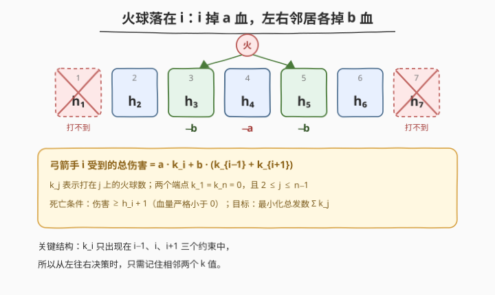
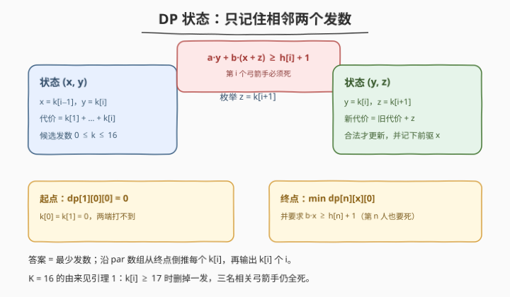
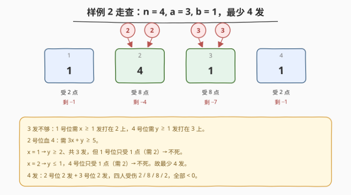

# Codeforces 6D 火球清空弓箭手 题解

## 1. 题目概述

- **题目链接**：https://codeforces.com/problemset/problem/6/D
- **比赛来源**：Codeforces Beta Round 6 (Div. 2 Only) · Problem D
- **难度**：2600
- **标签**：暴力、动态规划
- **评测类型**：特殊评测（多解，输出任意一个最优方案）
- **限制**：时间 2 s / 内存 64 MB

**题意**：一排 $n$ 个弓箭手，第 $i$ 个的血量为 $h_i$。波利卡普只能把火球砸向 $2 \le i \le n-1$ 的弓箭手（两端的 1 号与 $n$ 号太远，打不到）：命中 $i$ 后，$i$ 掉 $a$ 点血，左右相邻的 $i-1, i+1$ 各掉 $b$ 点血（$1 \le b < a \le 10$）。血量**严格小于 0** 才算死亡，已经死掉的弓箭手仍然可以被砸。求最少需要几发火球才能让所有人死亡，并输出每一发的落点（多解输出任意一个，落点顺序任意）。

**约束**：

- $3 \le n \le 10$：真正可选的落点只有 $n-2 \le 8$ 个。若没有好的状态设计，$17^{8} \approx 7 \times 10^{9}$ 种落点计数向量无法枚举完。
- $1 \le b < a \le 10$，于是 $a \ge 2$；每发火球对自己人至少造成 2 点伤害。
- $1 \le h_i \le 15$：血量很小，死亡条件是**严格大于** $h_i$ 的伤害，即至少 $h_i+1$ 点；这给出"单个落点最多需要几发"的常数上界。
- 只有一组数据，没有测试组数 $t$，也不是读到 EOF 的多组格式。
- 答案是"最少发数 + 任意最优方案"，属于特殊评测：不能拿样例输出逐字比对，必须校验方案合法且发数最优。

## 2. 示例与观察

官方样例 1（输入 / 输出原样）：

```text
输入：
3 2 1
2 2 2

输出：
3
2 2 2
```

官方样例 2：

```text
输入：
4 3 1
1 4 1 1

输出：
4
2 2 3 3
```

**样例 1 演算**：$n=3$ 时唯一能打的位置是 2。若打 $k_2$ 发，1 号受 $b k_2 = k_2$ 点、2 号受 $a k_2 = 2k_2$ 点、3 号受 $k_2$ 点。三人血量都是 2，要全部严格小于 0 就都要受至少 3 点伤害，故 $k_2 \ge 3$；三发刚好让三人分别剩 $-1, -4, -1$。答案是 3 发，全部落在 2 号位。

**样例 2 演算**：$n=4$，$a=3, b=1$，血量为 $1,4,1,1$。取"打 2 号位两发、3 号位两发"：四人受到的伤害依次是 $2, 8, 8, 2$，剩余血量 $-1, -4, -7, -1$，全部死亡，共 4 发。为什么 3 发不够见 3.4 节。注意本方案恰好与样例输出相同，但题面允许任意顺序、任意最优方案，评测器不会逐字比对。

自造样例（标注"自造"，均已用参考程序跑过，输出只列发数或一种方案）：

| 输入 | 输出（一种最优方案） | 说明 |
|------|------|------|
| `3 10 1` / `15 15 15` | `16` 后接 16 个 `2` | 两端只能吃 $b=1$ 的伤害，$k_2$ 必须到 16 |
| `4 2 1` / `15 15 15 15` | `32`：16 个 `2` + 16 个 `3` | 两个端点各自逼出 16 发 |
| `10 2 1` / 十个 `15` | `52` | 最大规模，靠 DP 才能算准 |
| `5 10 9` / `1 15 1 15 1` | `3`，落点 `2 3 4` | 三发同时覆盖五个人的极端配合 |
| `3 2 1` / `1 1 1` | `2`，落点 `2 2` | 最小血量，两发即全灭 |

**观察**：

1. 火球的效果可交换，答案只取决于"每个位置最终被打了几发"，与落点顺序无关。令 $k_i$ 为落在 $i$ 上的发数，则第 $i$ 个弓箭手受到的总伤害是

$$D_i = a k_i + b\left(k_{i-1} + k_{i+1}\right),$$

其中约定 $k_1 = k_n = 0$（两端不可打）。死亡条件是 $D_i \ge h_i + 1$。

2. 每个 $k_i$ 只出现在 $D_{i-1}, D_i, D_{i+1}$ 这三个式子里。也就是说，它只"管"相邻的三个约束——这正是从左往右逐位决策、只用记住相邻两个 $k$ 的依据。

## 3. 解题思路

### 3.1 朴素做法与瓶颈

最直接的想法：枚举所有落点计数向量 $(k_2, \dots, k_{n-1})$。由于每个 $k_i$ 至多 16 就够（见引理 1），枚举量是 $17^{n-2}$，$n=10$ 时约 $7 \times 10^{9}$，远超 2 s 能承受的范围。

另一个朴素想法是在"每个人剩余血量"上做 BFS 求最少发数。但每个弓箭手的血量可以取 $h_i+2$ 种状态（从 $h_i$ 到 $-1$），最坏 $11^{10} \approx 2.6 \times 10^{10}$ 个状态，同样不可行。瓶颈都在于**同一层里组合爆炸**：三种落点会互相影响，必须用一个能压缩"已经确定部分"的状态。

### 3.2 核心观察：局部影响 + 逐位决策



把 $k_i$ 看成变量，问题变成：

$$\min \sum_{i=1}^{n} k_i \quad \text{s.t.} \quad a k_i + b(k_{i-1}+k_{i+1}) \ge h_i + 1,\quad k_1 = k_n = 0,\ k_i \in \mathbb{Z}_{\ge 0}.$$

约束矩阵是三对角的：第 $i$ 行只含 $k_{i-1}, k_i, k_{i+1}$。于是从左往右决定 $k_1, k_2, \dots, k_n$ 时，**当 $k_{i+1}$ 选定，第 $i$ 个约束就彻底确定**，以后再也不受影响。需要携带的历史信息只有 $(k_{i-1}, k_i)$ 这一对。

### 3.3 算法流程与状态转移



**状态**：$\mathrm{dp}[i][x][y]$ 表示已经决定 $k_1, \dots, k_i$，其中 $k_{i-1}=x$、$k_i=y$，并且第 $1, \dots, i-1$ 个弓箭手均已死亡时，$\sum_{j \le i} k_j$ 的最小值。

**初值**：$\mathrm{dp}[1][0][0] = 0$（$k_0 = k_1 = 0$，这里 $k_0$ 是虚拟位置）。

**转移**：从状态 $(i, x, y)$ 枚举 $z = k_{i+1}$。先检查第 $i$ 个约束

$$a y + b(x + z) \ge h_i + 1,$$

满足则转移到 $(i+1, y, z)$，代价加 $z$。当 $i+1 = n$ 时只能取 $z = 0$，因为第 $n$ 位不可打。

**终点**：走完 $i = n-1$ 后状态是 $(n, x, 0)$，其中 $x = k_{n-1}$。第 $n$ 个弓箭手只吃 $k_{n-1}$ 的 $b$ 点伤害，需额外检查

$$b x \ge h_n + 1,$$

在满足它的状态里取代价最小者。沿记录的前驱数组倒推，就得到每个 $k_i$，再输出 $k_i$ 个 $i$ 即可。

**为什么 $k_i \le 16$**：若某个最优解里 $k_i \ge 17$，删掉一发落在 $i$ 的火球，则 $i$ 自己仍受 $a(k_i-1) \ge 16a \ge 32 > 15 \ge h_i$ 点伤害，左右邻居各仍受 $b(k_i-1) \ge 16b \ge 16 > 15 \ge h_{i\pm1}$ 点伤害——三名相关弓箭手依旧全死，总发数却少了一发，与最优性矛盾。因此存在最优解使所有 $k_i \le 16$，状态数只有 $17 \times 17$ 每层。严格陈述见引理 1。

### 3.4 样例走查：4 个弓箭手，3 发为什么不够



对样例 2（$a=3, b=1$，血量 $1,4,1,1$）：

- 4 号位血量 1，只能被落在 3 号位的火球打到（4 号位本身不可打），所以要杀死 4 号，至少要有 $y \ge 1$ 发落在 3 号位。
- 同理 1 号位只能被落在 2 号位的火球打到，所以至少要有 $x \ge 1$ 发落在 2 号位。
- 2 号位血量 4，受到的伤害是 $3x + y$，要 $\ge 5$。

分情况：若 $x = 1$，则 $3 + y \ge 5 \Rightarrow y \ge 2$，共 $x+y \ge 3$ 发；但此时 1 号位只受 $x = 1$ 点伤害，需要 2 点，不死。若 $x \ge 2$，则 3 发限制住 $y \le 3-x \le 1$，4 号位只受 $y \le 1$ 点伤害，需要 2 点，剩 $\ge 0$ 血仍不死。故 3 发不可能，最少 4 发。取 $x = y = 2$ 时四人受伤 $2, 8, 8, 2$，全部严格小于 0。

## 4. 正确性证明

**引理 1（发数上界）**：存在一个最优方案，使每个位置的火球数 $k_i \le 16$。

**证明**：设某最优方案中 $k_i \ge 17$。删去一发落在 $i$ 的火球。此时 $i$ 受到的伤害仍有 $a(k_i-1) \ge 16a \ge 32 > 15 \ge h_i$（用了 $a \ge 2$），$i$ 仍死。对 $i-1$ 与 $i+1$（若存在），它们从这 $k_i$ 发里得到的伤害是 $b k_i$，删一发后仍有 $b(k_i-1) \ge 16b \ge 16 > 15 \ge h_{i\pm1}$，也仍死；其余弓箭手完全不受影响。于是总发数减少 1 而所有人仍死，矛盾于最优性。所以最优方案中所有 $k_i \le 16$。∎

**引理 2（DP 不变式）**：对 $1 \le i \le n$ 与 $0 \le x, y \le 16$，$\mathrm{dp}[i][x][y]$ 等于所有满足下列条件的赋值 $k_1, \dots, k_i$ 的 $\sum_{j\le i} k_j$ 最小值：$k_1 = 0$，$k_{i-1} = x$，$k_i = y$，并且第 $1, \dots, i-1$ 个弓箭手全部死亡。若不存在这样的赋值则为 $+\infty$。

**证明**：对 $i$ 归纳。$i = 1$ 时只有 $k_1 = 0$，状态 $(0,0)$ 代价 0，无其他可行状态，成立。

设 $i$ 时成立，考虑 $i+1$。任何在 $i+1$ 层合法、状态为 $(y,z)$ 的赋值，其前缀恰好是 $i$ 层某个状态 $(x,y)$ 的合法赋值加上 $k_{i+1}=z$；前缀合法的充要条件是第 $i$ 个约束成立，即 $a y + b(x+z) \ge h_i+1$，而这正是转移的条件。代价恰为前缀代价加 $z$。因此转移枚举了全部可能，取最小后不变式在 $i+1$ 成立。∎

**引理 3（终点判定）**：$\mathrm{dp}[n][x][0]$ 且 $b x \ge h_n+1$ 的状态，恰好对应所有满足全部 $n$ 个约束的赋值。

**证明**：$i=n$ 时引理 2 保证第 $1..n-1$ 个约束成立，且 $k_n = 0$（转移只允许 $y=0$）。剩下第 $n$ 个约束是 $a k_n + b k_{n-1} = b x \ge h_n+1$。两者合起来就是全部约束。∎

**定理**：设 $\mathrm{best}$ 为终点状态的最小代价，则 $\mathrm{best}$ 就是最少火球数；按前驱还原出的落点序列共 $\mathrm{best}$ 发，且能杀死全部弓箭手。

**证明**：引理 3 说明终点集合与全部可行赋值一一对应，引理 2 说明每个状态的代价都是对应前缀的最小值，故 $\mathrm{best}$ 是所有可行赋值的总发数最小值。还原时每一步都取了记录的合法前驱，所得到的 $k$ 满足全部约束；输出每个 $i$ 恰好 $k_i$ 次，按 3.2 节的伤害公式，每个弓箭手受到的伤害都达到 $h_i+1$，全部死亡。∎

## 5. 复杂度分析

- **时间**：状态数 $O(n K^2)$，每个状态枚举 $O(K)$ 个 $z$，总计 $O(n K^3)$。取 $K=16$，$n \le 10$ 时约 $10 \times 17^3 \approx 4.9 \times 10^{4}$ 次转移，常量极小，2 s 时限的余量在数百倍（约 900 倍）。
- **空间**：DP 与前驱各 $O(n K^2)$ 个 `int`，约 $2 \times 12 \times 17 \times 17 \times 4\ \text{B} \approx 28\ \text{KB}$，远小于 64 MB。
- **输出规模**：在 $n=10$、$h$ 全为 15、$a=2, b=1$ 的实测中最优值是 52，第二行不超过几十个数，输出量可忽略。
- **数值范围**：伤害最大 $a k_i + b(k_{i-1}+k_{i+1}) \le 10 \times 16 + 9 \times 32 = 448$，`int` 足够；总发数 $\le 10 \times 16 = 160$。

## 6. 参考代码

### C++17

```cpp
#include <bits/stdc++.h>
using namespace std;

int main() {
    ios::sync_with_stdio(false);
    cin.tie(nullptr);

    int n, a, b;
    if (!(cin >> n >> a >> b)) return 0;
    vector<int> h(n + 1);
    for (int i = 1; i <= n; ++i) cin >> h[i];

    const int K = 16;          // 任一位置的火球数不超过 16（第 4 节引理 1）
    const int INF = 1000000000;

    // dp[i][x][y]：已决定 k1..ki，其中 k(i-1)=x、ki=y 时的最少总发数
    vector<vector<vector<int>>> dp(n + 2, vector<vector<int>>(K + 1, vector<int>(K + 1, INF)));
    // par[i][y][z]：第 i 层状态 (y,z) 是由上一层的哪个 x 转移来的
    vector<vector<vector<int>>> par(n + 2, vector<vector<int>>(K + 1, vector<int>(K + 1, -1)));

    dp[1][0][0] = 0;                     // k0 = k1 = 0：两端不可打
    for (int i = 1; i < n; ++i) {
        for (int x = 0; x <= K; ++x) {
            for (int y = 0; y <= K; ++y) {
                int cur = dp[i][x][y];
                if (cur >= INF) continue;
                int zmax = (i + 1 == n) ? 0 : K;          // 第 n 位不能打
                for (int z = 0; z <= zmax; ++z) {
                    if (a * y + b * (x + z) < h[i] + 1) continue;   // 要打到血量 < 0
                    int nc = cur + z;
                    if (nc < dp[i + 1][y][z]) {
                        dp[i + 1][y][z] = nc;
                        par[i + 1][y][z] = x;
                    }
                }
            }
        }
    }

    int best = INF, last = -1;
    for (int x = 0; x <= K; ++x) {        // 第 n 位只吃 k(n-1) 的 b 点伤害
        if (dp[n][x][0] < best && b * x >= h[n] + 1) {
            best = dp[n][x][0];
            last = x;
        }
    }

    vector<int> k(n + 1, 0);
    k[n - 1] = last;
    for (int i = n; i >= 2; --i) k[i - 2] = par[i][k[i - 1]][k[i]];

    vector<int> ans;
    for (int i = 2; i <= n - 1; ++i)
        for (int c = 0; c < k[i]; ++c) ans.push_back(i);

    cout << ans.size() << '\n';
    for (size_t i = 0; i < ans.size(); ++i) cout << ans[i] << (i + 1 == ans.size() ? '\n' : ' ');
    return 0;
}
```

### Python3

```python
import sys


def main() -> None:
    data = list(map(int, sys.stdin.buffer.read().split()))
    if not data:
        return
    n, a, b = data[0], data[1], data[2]
    h = [0] + data[3:3 + n]

    K = 16                     # 任一位置的火球数不超过 16
    INF = 10 ** 9

    dp = [[INF] * (K + 1) for _ in range(K + 1)]
    dp[0][0] = 0               # k0 = k1 = 0
    pars = [None] * (n + 1)    # pars[i][y][z]：第 i 层状态 (y,z) 的上一层 x

    for i in range(1, n):
        ndp = [[INF] * (K + 1) for _ in range(K + 1)]
        par = [[-1] * (K + 1) for _ in range(K + 1)]
        zmax = 0 if i + 1 == n else K
        need = h[i] + 1
        for x in range(K + 1):
            for y in range(K + 1):
                cur = dp[x][y]
                if cur >= INF:
                    continue
                base = a * y + b * x
                for z in range(zmax + 1):
                    if base + b * z < need:
                        continue
                    nc = cur + z
                    if nc < ndp[y][z]:
                        ndp[y][z] = nc
                        par[y][z] = x
        dp = ndp
        pars[i + 1] = par

    best, last = INF, -1
    for x in range(K + 1):
        val = dp[x][0]
        if val < best and b * x >= h[n] + 1:
            best, last = val, x

    k = [0] * (n + 1)
    k[n - 1] = last
    for i in range(n, 1, -1):
        k[i - 2] = pars[i][k[i - 1]][k[i]]

    shots = []
    for i in range(2, n):
        shots.extend([i] * k[i])
    sys.stdout.write(str(len(shots)) + "\n" + " ".join(map(str, shots)) + "\n")


main()
```

两份代码都只用标准库，可原样提交。本题是特殊评测，落点顺序与具体最优方案都不影响判题。

## 7. 边界情况与易错点

1. **死亡条件是严格小于 0**：伤害必须 $\ge h_i + 1$ 而不是 $\ge h_i$。若写成 `damage >= h[i]`，样例 1 会给出 2 发（2 号位受 4 点、两端各 2 点，恰好剩 0 血不死），与正确答案 3 不符。代码里统一写 `< h[i] + 1` 时 `continue`。
2. **两端不可打**：$k_1 = k_n = 0$ 必须显式保证。转移进入第 $n$ 层时把 `zmax` 设成 0；第 $n$ 个弓箭手的约束不在转移里检查，而在终点单独检查 `b * x >= h[n] + 1`。漏掉这一步，最后一名的约束就完全没人检查，方案会被 checker 判为不合法。
3. **$k_i$ 的上界不能拍脑袋取小**：取 $K = 8$ 在 `3 10 1 / 15 15 15` 上直接无解（需要 16 发落在 2 号位）。$K=16$ 有引理 1 作保；$K=17$ 也对但没必要。反过来，$K$ 太大（例如 64）会让 Python 版多算 60 倍。
4. **多解与输出顺序**：题面明说"任意顺序、任意最优方案"，评测器是特殊评测。不要照抄样例输出，也不要假定自己的方案与样例逐字相同；判题只看发数是否最少、落点是否在 $[2, n-1]$、是否全灭。
5. **前驱还原的下标**：$k_n = 0$ 是固定的，$k_{n-1}$ 由终点选择给出，之后每一层用 `par[i][k[i-1]][k[i]]` 得到 $k_{i-2}$。循环写 `i >= 2`，因为 $k_1 = 0$ 由初值固定；若从 $i=1$ 继续会越界写到 `k[-1]`。
6. **总发数为 0 的错觉**：$h_i \ge 1$，而 1 号、$n$ 号必须吃伤害，所以答案至少为 2，第二行一定非空；不需要特判空输出，但仍建议按 `ans.size()` 输出，避免格式问题。
7. **多测清空**：本题只有一组数据。若把代码改成循环读多组，必须同时清空 `dp`、`par`、`k`；`par` 的初值是 $-1$，若不重置，上一组的前驱会被下一组误用。
8. **Python 的读入与递归**：用 `sys.stdin.buffer.read().split()` 一次读完；本实现是迭代 DP，没有递归深度问题。若要改写成记忆化搜索，$n \le 10$ 深度也很浅，但仍建议显式 `sys.setrecursionlimit`。

## 8. 验证记录

- **编译环境与命令**：本机没有 GNU `g++`，`verify_solution.py` 自动改用 `Apple clang 21.0.0`（`clang++ -std=c++17 -O2`）加仓库自带的 `bits/stdc++.h` 兼容头编译；Python 为 `Python 3.9.6`。
  - `python3 codeforces/tools/verify_solution.py codeforces/contests/0001-0100/6/D_火球清空弓箭手.md --checker /tmp/cf_verify_6_d/chk.py`
  - 输出：`CF6D: samples 2 / C++ 编译 OK, 样例 2/2 / Python 语法 OK, 样例 2/2`。
- **官方样例**：2 / 2 通过（C++ 与 Python 都是 checker 通过，不逐字比对）。checker 的校验条件是：① 第一行 $t$ 与第二行数字个数一致；② 每个落点 $2 \le x \le n-1$；③ 按落点逐发扣血后所有人血量 $< 0$；④ $t$ 等于 checker 内单独实现的记忆化搜索（自顶向下，$K=17$，与正文自底向上的 $K=16$ 版本写法不同）算出的最少发数。样例 1 实际输出 `3 / 2 2 2`，样例 2 输出 `4 / 2 2 3 3`。
- **额外测试与暴力对拍**：共 **410 组**，全部实跑，0 组不一致：
  - 10 组极端/边界（$n=3$ 与 $n=10$、$a=10,b=1$、血全 15、血全 1、$a=10,b=9$ 的隔位配合等），与"枚举 $k$ 向量的 DFS 暴力"核对；其中 $n \le 7$ 的 7 组另外与"血量状态 BFS 暴力"核对；
  - 220 组随机 $3 \le n \le 6$、$2 \le a \le 10$、$1 \le b < a$、$1 \le h_i \le 9$，与**血量状态 BFS 暴力**对拍（BFS 在"每人剩余血量、死亡压成 $-1$"的状态上求最短步数，完全不使用 DP 的相邻状态思想）；
  - 60 组随机 $6 \le n \le 8$、$h_i \le 7$，同样与 BFS 暴力对拍；
  - 120 组随机 $3 \le n \le 10$、$1 \le h_i \le 15$，与**枚举 $k$ 向量 + 剪枝的 DFS 暴力**对拍。
  - 每组都比对了：参考程序输出合法（发数、落点范围、全灭）且发数等于暴力最少发数；另外单独跑 100 组随机数据，确认 Python 版输出同样合法、发数与 DFS 暴力一致。
- **上界 $K=16$ 的独立验证**：把 DFS 暴力的枚举上界从 16 放宽到 32，在 200 组随机 $n \le 10$、$h_i \le 15$ 的数据上与参考程序对比，最少发数全部一致，说明 $K=16$ 没有截断最优解（与引理 1 的证明互相印证）。
- **最大约束性能**：输入 `10 2 1` + 十个 `15`，C++ 端到端 100 次平均约 **2.2 ms**（含进程启动），Python 约 22 ms；相对 2 s 的余量约 900 倍。程序内 DP 与前驱数组合计约 28 KB（远小于 64 MB）。
- **图片校验**：`cf6d_hit_pattern.svg`、`cf6d_dp_chain.svg`、`cf6d_walkthrough.svg` 均通过 `xml.etree.ElementTree.parse`；另用 headless Chrome 量出每个 `<text>` 的真实包围盒，确认无文字越出 `viewBox`、无文字互相重叠、无文字溢出面板。
- **公式校验**：正文公式全部是 `$...$` / `$$...$$`，星号直接写 `*`，`\text{}` 内无裸 `#`，经 KaTeX（`throwOnError`）渲染无报错。
- **复核状态**：verified（样例、checker、对拍、上界放宽、性能、图片、公式均实跑通过；唯一环境差异是本机无 GNU g++，已用 clang++ 等价验证）。

## 相关题目与扩展

- [Codeforces 6C Alice, Bob and Chocolate](https://codeforces.com/problemset/problem/6/C)：同场 C 题，双指针模拟两人吃巧克力，是同一场比赛里最直接的热身题。
- [Codeforces 6E Exposition](https://codeforces.com/problemset/problem/6/E)：同场 E 题，最长极差不超过 $k$ 的区间，用双指针 + 单调队列求解。
- [Codeforces 607A Chain Reaction](https://codeforces.com/problemset/problem/607/A)：同样是"每个位置的选择只影响邻近位置"的线性 DP，对比本题"窗口宽度 3"的状态设计。
- [Codeforces 264B Good Sequences](https://codeforces.com/problemset/problem/264/B)：按数值关系建图的线性 DP，体会"转移只依赖少量前驱"时如何压状态。
- [LeetCode 198 打家劫舍](https://leetcode.cn/problems/house-robber/)：最经典的"只记相邻两个状态"的 DP，可与本题的 $(k_{i-1}, k_i)$ 状态对照。
- [LeetCode 213 打家劫舍 II](https://leetcode.cn/problems/house-robber-ii/)：环形版本需要枚举首尾的取舍，和本题"两端固定为 0"的边界处理是同一类思想。

**延伸思考**：

1. **如果火球能打两端**：只需把 $k_1, k_n$ 也当作变量，转移里放开端点，答案一般会变小。以样例 1 的 `3 2 1 / 2 2 2` 为例：允许打 1 号位后，一发落在 1 号位会让 1 号位掉 $a=2$ 点血、2 号位掉 $b=1$ 点血，1 号位剩 0 血仍不算死，还需要中间补刀。可以把端点也当成变量，用同一套 DP 验证答案如何变化。
2. **如果影响半径变成 $R$**：一发火球对 $i-R, \dots, i+R$ 都造成伤害，则第 $i$ 个约束含 $k_{i-R}, \dots, k_{i+R}$，DP 状态要记住最近 $R$ 个 $k$ 值，复杂度变成 $O(n K^{R+1})$。本题 $R=1$ 是最简情形。
3. **如果要求输出字典序最小的最优方案**：先按上面的 DP 求出最优值 $\mathrm{best}$，再从小到大贪心确定 $k_2, k_3, \dots$（每步检查"剩余位置能否在剩余发数内补完"），把方案比较变成按序列字典序比较。这是"最优值 + 贪心构造"的常见组合。
4. **如果每个位置只能打一次**：$k_i \in \{0,1\}$ 后退化成带权的集合覆盖问题（每个位置覆盖三个相邻弓箭手），一般情形是 NP 难的；本题能多项式求解，完全依赖"可以重复打"以及"伤害线性可加"。
