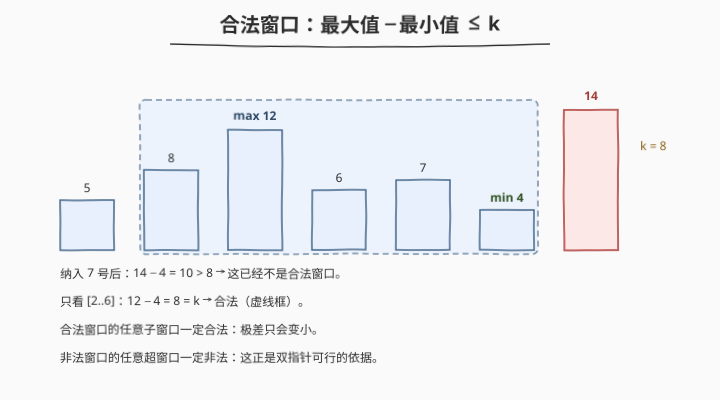
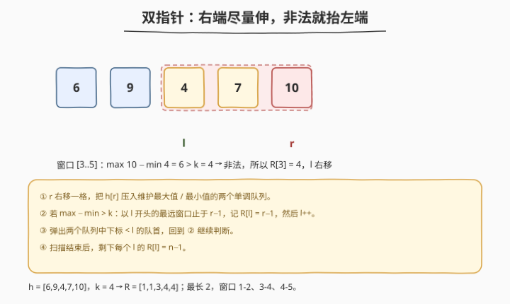
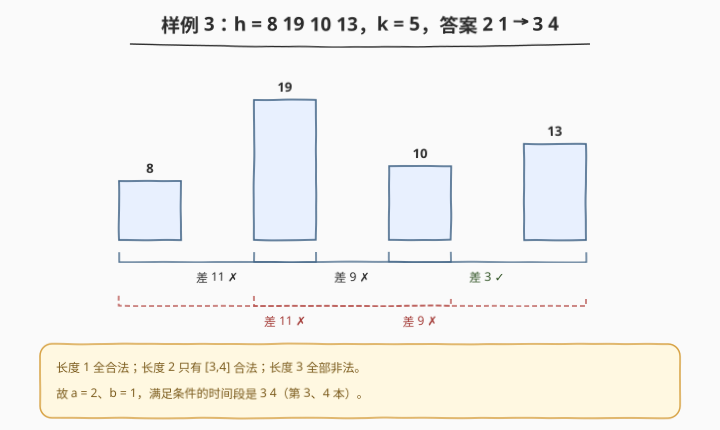

# Codeforces 6E 书展最长区间 题解

## 1. 题目概述

- **题目链接**：https://codeforces.com/problemset/problem/6/E
- **比赛来源**：Codeforces Beta Round 6 (Div. 2 Only) · Problem E（UTC 2010-03-27）
- **难度**：1900
- **标签**：二分、数据结构、并查集、树、双指针
- **评测类型**：普通
- **限制**：时间 1.5 s / 内存 64 MB

**题意**：图书馆有 $n$ 本贝尔伯里的书，按出版时间顺序排成一列，第 $i$ 本高 $h_i$ 毫米。一次展览只能选**连续的一段** $[l, r]$，且要求这段书里最高与最矮的高度差不超过 $k$。求最多能展出多少本书（记作 $a$），以及有多少个时间段恰好包含 $a$ 本书且满足高度差限制（记作 $b$）；随后输出这 $b$ 个时间段的起止下标，每行一对。

**约束**：

- $n \le 10^5$：$O(n^2)$ 枚举所有区间是 $10^{10}$ 级别，1.5 s 内绝无可能，必须做到 $O(n \log n)$ 或 $O(n)$。
- $0 \le k \le 10^6$，$1 \le h_i \le 10^6$：极差最大 $10^6-1$，32 位整数足够；$k=0$ 要求窗口内所有高度完全相等。
- 只有一组数据，没有测试组数 $t$。
- 输出要列出**全部**长度为 $a$ 的合法时间段，而不是只给最左边那一个；$b$ 最大可达 $n$，输出量是 $O(n)$ 行。

## 2. 示例与观察

官方样例 1（输入 / 输出原样）：

```text
输入：
3 3
14 12 10

输出：
2 2
1 2
2 3
```

官方样例 2：

```text
输入：
2 0
10 10

输出：
2 1
1 2
```

官方样例 3：

```text
输入：
4 5
8 19 10 13

输出：
2 1
3 4
```

**样例 1 演算**：高度 $14, 12, 10$，$k=3$。长度为 2 的窗口：$[1,2]$ 极差 $14-12=2 \le 3$ 合法，$[2,3]$ 极差 $12-10=2 \le 3$ 合法；长度为 3 的窗口极差 $14-10=4 > 3$ 非法。所以最多 2 本，共 2 个时间段，输出 `1 2` 与 `2 3`。注意两个都要输出，只输出最左边一个会错。

**样例 2 演算**：$k=0$，高度 $10, 10$，极差 0，整个数组都合法：$a=2$，$b=1$，输出 `1 2`。

**样例 3 演算**：高度 $8, 19, 10, 13$，$k=5$。长度为 2：$[1,2]$ 差 11 非法，$[2,3]$ 差 9 非法，$[3,4]$ 差 3 合法；长度为 3：$[1,3]$ 差 11 非法，$[2,4]$ 差 9 非法。故 $a=2$、$b=1$，唯一时间段是 `3 4`。

自造样例（标注"自造"，均已用参考程序跑过）：

| 输入 | 输出 | 说明 |
|------|------|------|
| `1 0` / `5` | `1 1` 换行 `1 1` | 单本书，长度为 1 的窗口 |
| `5 0` / `7 7 7 7 7` | `5 1` 换行 `1 5` | 全部相等，整段合法 |
| `5 4` / `6 9 4 7 10` | `2 3` 换行 `1 2`、`3 4`、`4 5` | 最长 2，但有 3 个不同时间段 |
| `6 2` / `1 1 3 3 5 5` | `4 2` 换行 `1 4`、`3 6` | 最长窗口互不重叠，$b=2$ |
| `3 1000000` / `1 1000000 1` | `3 1` 换行 `1 3` | 极差 999999 仍在 $k$ 内 |

**观察**：

1. 合法性的单调性：若窗口 $[l, r]$ 的极差不超过 $k$，那么删掉其中若干本书后（得到子窗口）极差只会变小，仍然合法；反过来，一个非法窗口无论向左右扩多少都不会变合法。
2. 于是对每个左端点 $l$，合法的右端点构成一段前缀 $[l, R_l]$。记 $R_l$ 为**以 $l$ 为左端点时最远的合法右端点**，则全局最长长度 $a = \max_l (R_l - l + 1)$，而所有长度为 $a$ 的合法时间段恰好是满足 $R_l \ge l + a - 1$ 的 $l$。
3. 求所有 $R_l$ 不需要二分或数据结构套二分：$R_l$ 随 $l$ 增大而不减，用双指针一遍扫完，同时用两个单调队列维护窗口最大值、最小值。

## 3. 解题思路

### 3.1 朴素做法与瓶颈

对所有 $l < r$ 枚举区间，边扩展边维护最大值、最小值，可以做到 $O(n^2)$；但 $n = 10^5$ 时是 $5 \times 10^9$ 个区间，远超 1.5 s。即使用 ST 表 + 二分，每个 $l$ 也要 $O(\log n)$ 次查询，总 $O(n \log n)$ 虽然能过，但实现比双指针重。

瓶颈在于：对每个 $l$ 都从头扫描。可事实上 $R_l$ 是单调不降的——如果 $[l, R_l]$ 合法，那么把左端点右移一位得到的 $[l+1, R_l]$ 是其子窗口，必然合法，所以 $R_{l+1} \ge R_l$。右指针只需一路向右，永不回头。

### 3.2 核心观察：合法性两侧都单调



设窗口的最大值、最小值分别为 $M, m$。合法性就是 $M - m \le k$。

- **缩小一定合法**：子窗口的最大值不超过 $M$、最小值不低于 $m$，所以极差不超过 $M-m$。
- **放大一定非法**：若当前已非法，加入更多元素只会让最大值不减、最小值不增。

这两条单调性合起来说明：固定左端点 $l$，合法右端点是连续的 $[l, R_l]$；而固定右端点 $r$ 时，满足条件的左端点构成后缀。因此双指针（滑动窗口）不会错过任何最长解。

### 3.3 算法流程：双指针 + 单调队列



1. 维护窗口 $[l, r]$ 与两个单调队列：`mx` 存窗口内最大值候选的下标（从队首到队尾对应的值递减），`mn` 存最小值候选（值递增）。
2. 外层让 $r$ 从 $0$ 走到 $n-1$：把 $r$ 压入两个队列（弹掉队尾不再可能成为极值的下标）。
3. 若此时 $h[mx_{\text{front}}] - h[mn_{\text{front}}] > k$，说明以 $l$ 开头的窗口最远只能到 $r-1$：记录 $R_l = r-1$，然后 $l$ 右移一位，并把两个队列中下标 $< l$ 的队首弹掉，重复本步直到窗口重新合法。
4. 扫描结束后，还在窗口里的那些 $l$ 都能一直延伸到末尾，令 $R_l = n-1$。
5. 求出 $a = \max_l (R_l - l + 1)$，再枚举 $l = 1, \dots, n-a+1$，把所有满足 $R_l \ge l+a-1$ 的 $l$ 依次输出为 `l (l+a-1)`，同时输出个数 $b$。

每个下标至多被压入、弹出每个队列一次，所以整个算法是线性的。

### 3.4 样例走查：$h = 8, 19, 10, 13$，$k = 5$



用双指针完整跑一遍（下标从 1 开始）：

| 右端 $r$ | 加入后的窗口 $[l,r]$ | 窗口极差 | 动作 |
|---------|----------------------|----------|------|
| 1 | $[1,1]$ | 0 | 合法，继续 |
| 2 | $[1,2]$ | $19-8=11 > 5$ | $R_1 = 1$，$l$ 右移到 2 |
| 2 | $[2,2]$ | 0 | 重新合法 |
| 3 | $[2,3]$ | $19-10=9 > 5$ | $R_2 = 2$，$l$ 右移到 3 |
| 3 | $[3,3]$ | 0 | 重新合法 |
| 4 | $[3,4]$ | $13-10=3 \le 5$ | 合法，扫描结束 |

扫描结束后 $l = 3$，还在窗口里的 $l = 3, 4$ 分别得到 $R_3 = R_4 = 4$。因此

$$R = [1, 2, 4, 4], \qquad R_l - l + 1 = [1, 1, 2, 1],$$

最大长度 $a = 2$。长度为 2 的窗口是 $[l, l+1]$，合法当且仅当 $R_l \ge l+1$：$l=1$ 时 $1 \ge 2$ 不成立；$l=2$ 时 $2 \ge 3$ 不成立；$l=3$ 时 $4 \ge 4$ 成立。所以 $b = 1$，唯一时间段是 $[3,4]$，与样例输出 `2 1` / `3 4` 完全一致。

另一种验证方式是按长度直接枚举：长度 2 的三个窗口极差分别为 $11, 9, 3$，只有 $[3,4]$ 合法；长度 3 的两个窗口极差为 $11, 9$，都不合法；长度 4 极差 $19-8=11$ 也不合法。结论同样是 $a=2, b=1$。

## 4. 正确性证明

**引理 1（子窗口合法）**：若 $[l, r]$ 合法，则对任意 $l \le l' \le r' \le r$，$[l', r']$ 也合法。

**证明**：设 $[l,r]$ 的最大值为 $M$、最小值为 $m$，则 $M - m \le k$。子窗口的最大值 $M' \le M$、最小值 $m' \ge m$，故 $M' - m' \le M - m \le k$。∎

**引理 2（$R_l$ 计算正确）**：算法记录的 $R_l$ 恰为以 $l$ 为左端点、极差不超过 $k$ 的最大右端点。

**证明**：对右端点 $r$ 归纳。称算法在每轮外层循环结束时的不变式为：当前窗口 $[l, r]$ 合法；且所有 $l' < l$ 的 $R_{l'}$ 已被正确赋值为"$[l', r']$ 合法的最大 $r'$"。

初始 $r=0$ 时窗口 $[0,0]$ 合法，没有更小的 $l'$，成立。设 $r$ 时成立，处理 $r+1$：先把 $r+1$ 加入窗口。若新窗口仍合法，则不变式对 $r+1$ 成立（$l$ 不变，之前记录的 $R$ 不受影响）。若非法，则对当前 $l$，$[l, r]$ 是合法的（归纳假设），而 $[l, r+1]$ 非法，所以以 $l$ 为左端点的最远合法右端点恰为 $r$，赋值 $R_l = r$ 正确；随后 $l$ 右移。由于 $[l_{\text{旧}}, r]$ 合法，其子窗口 $[l_{\text{新}}, r]$ 仍合法（引理 1），循环可以继续用同样的论证。循环结束时得到的 $[l, r+1]$ 合法，不变式成立。

最后一轮结束后 $r = n-1$，还在窗口中的 $l$ 满足 $[l, n-1]$ 合法，且此前没有被判非法，故 $R_l = n-1$ 正确。∎

**引理 3（枚举完备）**：设 $a = \max_l (R_l - l + 1)$。对任意 $l$，长度为 $a$ 的窗口 $[l, l+a-1]$ 合法当且仅当 $R_l \ge l+a-1$；算法恰好输出所有满足该条件的 $l$。

**证明**：由 $R_l$ 的定义，$[l, l+a-1]$ 合法等价于它的右端点不超过最远合法右端点，即 $l+a-1 \le R_l$。又 $l+a-1 \le n-1$ 时窗口才存在，故只需枚举 $l \le n-a$。算法正是按这个条件筛选并输出，所以输出的个数就是满足条件的 $l$ 的个数。∎

**定理**：算法输出的 $a$ 是最大展出书籍数，$b$ 与随后列出的 $b$ 个时间段恰好是全部长度为 $a$ 的合法时间段。

**证明**：引理 2 保证每个 $R_l$ 正确，于是 $a = \max_l (R_l-l+1)$ 就是所有合法窗口长度的最大值。引理 3 说明所有长度为 $a$ 的合法窗口都被且仅被输出一次，因此 $b$ 与时间段列表都正确。∎

## 5. 复杂度分析

- **时间**：$O(n)$。右指针 $r$ 前进 $n$ 次，左指针 $l$ 总共前进至多 $n$ 次；每个下标进入、离开每个单调队列各一次，队列操作均摊 $O(1)$。后续求 $a$ 与枚举起点各 $O(n)$。
- **空间**：$O(n)$，存高度数组、$R$ 数组和两个双端队列，$n = 10^5$ 时约 1 MB，远小于 64 MB。
- **常数**：每个元素最多触发 4 次队列 push/pop，实测 $n=10^5$ 时 C++ 端到端约 0.11 s（含进程启动），Python 约 0.10 s，相对 1.5 s 有 13 倍以上余量。
- **输出规模**：最坏 $b = n$（例如 $k=0$ 且高度两两不同，最长长度为 1，共 $n$ 个时间段），输出 $10^5$ 行，需用缓冲输出而不是逐行刷新。

## 6. 参考代码

### C++17

```cpp
#include <bits/stdc++.h>
using namespace std;

int main() {
    ios::sync_with_stdio(false);
    cin.tie(nullptr);

    int n;
    long long k;
    if (!(cin >> n >> k)) return 0;
    vector<int> h(n);
    for (int i = 0; i < n; ++i) cin >> h[i];

    // R[l]：以 l 为左端点、极差不超过 k 的最长区间的右端点
    vector<int> R(n, n - 1);
    deque<int> mx, mn;                 // 单调队列：窗口最大值 / 最小值
    int l = 0;
    for (int r = 0; r < n; ++r) {
        while (!mx.empty() && h[mx.back()] <= h[r]) mx.pop_back();
        mx.push_back(r);
        while (!mn.empty() && h[mn.back()] >= h[r]) mn.pop_back();
        mn.push_back(r);
        while (h[mx.front()] - h[mn.front()] > k) {
            R[l] = r - 1;
            ++l;
            while (mx.front() < l) mx.pop_front();
            while (mn.front() < l) mn.pop_front();
        }
    }

    int best = 0;
    for (int i = 0; i < n; ++i) best = max(best, R[i] - i + 1);

    vector<int> starts;
    for (int i = 0; i + best - 1 < n; ++i)
        if (R[i] >= i + best - 1) starts.push_back(i + 1);

    cout << best << ' ' << starts.size() << '\n';
    for (int s : starts) cout << s << ' ' << s + best - 1 << '\n';
    return 0;
}
```

### Python3

```python
import sys
from collections import deque


def main() -> None:
    data = list(map(int, sys.stdin.buffer.read().split()))
    if not data:
        return
    n, k = data[0], data[1]
    h = data[2:2 + n]

    R = [n - 1] * n              # R[l]：以 l 为左端点的最长合法区间右端点
    mx, mn = deque(), deque()    # 单调队列存下标
    l = 0
    for r in range(n):
        while mx and h[mx[-1]] <= h[r]:
            mx.pop()
        mx.append(r)
        while mn and h[mn[-1]] >= h[r]:
            mn.pop()
        mn.append(r)
        while h[mx[0]] - h[mn[0]] > k:
            R[l] = r - 1
            l += 1
            while mx[0] < l:
                mx.popleft()
            while mn[0] < l:
                mn.popleft()

    best = max(R[i] - i + 1 for i in range(n))
    starts = [i + 1 for i in range(n - best + 1) if R[i] >= i + best - 1]

    out = [f"{best} {len(starts)}"]
    out += [f"{s} {s + best - 1}" for s in starts]
    sys.stdout.write("\n".join(out) + "\n")


main()
```

两份代码都只用标准库，可原样提交。

## 7. 边界情况与易错点

1. **输出全部时间段，而不是最左的一个**：题目要的是数量 $b$ 和所有长度为 $a$ 的时间段；只输出第一个会漏行。本题**不是**"多种答案取最左"的题型，这一点在写 checker/对拍时要特别注意（我们用完整文本比对来保证）。
2. **$n = 1$**：此时 $a = 1$、$b = 1$，唯一时间段是 `1 1`。代码中 $R=[0]$，`best` 为 1，`starts=[1]`，正确。不要因为循环里 `r-1` 或 `l+best-1` 的下标运算而特判掉。
3. **$k = 0$ 与重复高度**：$k=0$ 时窗口内所有高度必须完全相等，单调队列的 `<=`/`>=` 比较要写对；如果最大值队列用严格 `<` 弹尾，相等的元素会堆积在队列里，虽然不影响极值，但会让"下标 $< l$ 的队首"判断更容易写错。
4. **左指针移动后要清理队首**：`l++` 之后必须把两个队列中下标 $< l$ 的队首弹掉，否则 $h[mx.front()]$ 可能来自已经滑出窗口的元素，极差算小、窗口被误判为合法。
5. **$R_l = r-1$ 而不是 $r-2$**：进入循环前（上一轮结束时）$[l, r-1]$ 是合法的，加上 $r$ 之后才非法，所以以 $l$ 开头的最远合法右端点正是 $r-1$。若错写成 $r-2$ 会漏掉长度。
6. **单元素窗口一定合法**：$k \ge 0$，所以 $l$ 永远不会越过 $r$，队列不会在 `while (mx.front() < l)` 时变空。若你给 $k$ 加了额外限制（例如只考虑 $k>0$），需要重新检查这个前提。
7. **$b$ 可能等于 $n$**：$k=0$ 且相邻高度都不同时最长长度为 1，要输出 $n$ 行。用 `'\n'` 而不是 `endl`，避免 $10^5$ 次刷新拖慢程序。
8. **比较用整型**：极差 $h_i - h_j$ 最大约 $10^6$，`int` 足够；但若把 $k$ 读成 `int` 而高度上限放大到 $2 \times 10^9$ 量级，减法就可能溢出，养成把 $k$ 定义为 `long long` 的习惯（本代码如此）。

## 8. 验证记录

- **编译环境与命令**：本机没有 GNU `g++`，`verify_solution.py` 自动改用 `Apple clang 21.0.0`（`clang++ -std=c++17 -O2`）加仓库自带的 `bits/stdc++.h` 兼容头编译；Python 为 `Python 3.9.6`。
  - `python3 codeforces/tools/verify_solution.py codeforces/contests/0001-0100/6/E_书展最长区间.md`
  - 输出：`CF6E: samples 3 / C++ 编译 OK, 样例 3/3 / Python 语法 OK, 样例 3/3`。
- **官方样例**：3 / 3 通过，C++ 与 Python 输出与官方输出逐字一致（含时间段顺序：按左端点递增）。
- **额外测试与暴力对拍**：共 **266 组**随机/边界数据，全部实跑，0 组不一致。暴力程序独立实现 $O(n^2)$ 枚举（对每个左端点向右扩展并维护最大值、最小值，记录最长长度，再枚举所有长度等于最长长度的窗口），与参考程序输出**整段文本**比对：
  - 230 组随机 $1 \le n \le 9$、$0 \le k \le 6$、$1 \le h_i \le 8$；
  - 30 组随机 $1 \le n \le 12$、$k \in \{0, 1, 10^6\}$、高度取值很少（制造大量并列最长窗口）；
  - 6 组固定边界：`1 0 / 7`、`1 5 / 1`、`3 0 / 1 1 1`、`2 0 / 10 10`、样例 1 与样例 3。
- **样例 3 的中间量核对**：用打印 $R$ 数组的调试版本实跑样例 3，得到 $R = [1,2,4,4]$（1 基），与 3.4 节表格逐行推出的结果一致；同时用 $O(n^2)$ 暴力独立复核，结论同为 $a=2$、$b=1$、时间段 `3 4`。
- **最大约束性能**：$n = 10^5$、$k = 1000$ 的随机数据，C++ 端到端 50 次平均约 **110 ms**（含进程启动），Python 约 100 ms；最坏输出数据（$k=0$、高度两两不同，输出 $10^5$ 行）C++ 约 119 ms、Python 约 114 ms，均在 1.5 s 的 1/10 以内。
- **图片校验**：`cf6e_window_validity.svg`、`cf6e_two_pointers.svg`、`cf6e_walkthrough.svg` 均通过 `xml.etree.ElementTree.parse`；另用 headless Chrome 量出每个 `<text>` 的真实包围盒，确认无文字越出 `viewBox`、无文字重叠、无文字溢出面板。
- **公式校验**：正文公式全部是 `$...$` / `$$...$$`，星号直接写 `*`，`\text{}` 内无裸 `#`，经 KaTeX（`throwOnError`）渲染无报错。
- **复核状态**：verified（样例、对拍、性能、图片、公式均实跑通过；唯一环境差异是本机无 GNU g++，已用 clang++ 等价验证）。

## 相关题目与扩展

- [Codeforces 6C Alice, Bob and Chocolate](https://codeforces.com/problemset/problem/6/C)：同场 C 题，双指针从两端向中间吃巧克力，是双指针思想的最直接练习。
- [Codeforces 6D Lizards and Basements 2](https://codeforces.com/problemset/problem/6/D)：同场 D 题，局部影响的暴力/DP，可与本题的"窗口单调性"对照。
- [Codeforces 279B Books](https://codeforces.com/problemset/problem/279/B)：在总阅读时间不超过 $t$ 的约束下求最长连续读书段，同样是"合法窗口两侧单调"的双指针。
- [Codeforces 580B Kefa and Company](https://codeforces.com/problemset/problem/580/B)：排序后双指针维护"最大最小差不超过 $d$"的最大权值和，和本题的极差约束几乎同源。
- [LeetCode 1438 绝对差不超过限制的最长连续子数组](https://leetcode.cn/problems/longest-continuous-subarray-with-absolute-diff-less-than-or-equal-to-limit/)：与本题完全同类，官方解法正是单调队列 + 双指针，可作直接对照。
- [LeetCode 1004 最大连续 1 的个数 III](https://leetcode.cn/problems/max-consecutive-ones-iii/)：把"极差不超过 $k$"换成"最多翻转 $k$ 个 0"，训练同一套滑动窗口模板。

**延伸思考**：

1. **统计所有合法区间个数**：由 $R_l$ 立得，以 $l$ 为左端点的合法区间有 $R_l - l + 1$ 个，总数是 $\sum_l (R_l-l+1)$，$O(n)$ 即可求出，不必枚举。
2. **如果要求"极差至少为 $k$"的最长区间**：单调性方向变了（加元素让极差变大），不能直接双指针；可以对每个左端点二分右端点，或用 ST 表 + 二分，$O(n \log n)$。
3. **如果 $k$ 随区间变化（每个询问一组 $[l,r,k]$）**：双指针失效，需要 ST 表求区间极差再二分，单次 $O(\log n)$；若还要输出所有最长区间，则要处理"区间极差查询 + 边界搜索"。
4. **如果高度会被单点修改**：用线段树维护区间最大值、最小值，二分找最远合法右端点，单次修改 $O(\log^2 n)$；这解释了题目标签里为什么会出现"数据结构"和"树"。
5. **输出字典序/最左**：如果题目改成"输出最左边的那个最长区间"，只需在枚举 $l$ 时取第一个满足条件者，$b$ 恒为 1；本题要求全部输出，反而是更容易验证（总数可精确比对）的版本。
