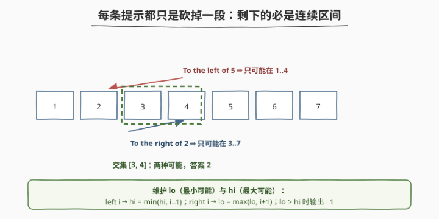
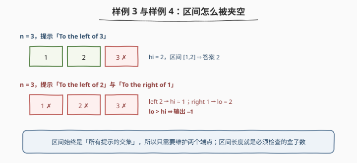

# Codeforces 60A 麦片在哪只盒子里 题解

## 1. 题目概述

- **题目链接**：https://codeforces.com/problemset/problem/60/A
- **比赛来源**：Codeforces Beta Round 56 · Problem A（UTC 2011-02-19）
- **难度**：1300
- **标签**：实现、双指针、区间求交
- **评测类型**：普通
- **限制**：时间 2 s / 内存 256 MB

**题意**：$n$ 只盒子从左到右编号 $1..n$，室友把麦片藏在其中一只里，并留下 $m$ 条提示，形如

- `To the left of i`：麦片在 $i$ 号盒子的左边（即编号 $< i$），并且 $i$ 号盒子里也没有；
- `To the right of i`：麦片在 $i$ 号盒子的右边（即编号 $> i$），同样 $i$ 号盒子为空。

求"无论如何都必须检查的盒子数"，也就是仍然可能是藏匿点的盒子个数；如果所有提示互相矛盾（没有盒子满足全部提示），输出 `-1`。

**约束**：

- $1 \le n, m \le 1000$：$O(nm)$ 的"逐盒检查所有提示"是 $10^6$，2 s 内随便过；但下面给出的是 $O(m)$ 的区间做法。
- 每条提示的 $1 \le i \le n$，所以 `left 1` 或 `right n` 会直接给出空集。
- 提示可以重复，重复不影响结果。
- 只有一组测试数据，输出一个整数或 `-1`。

## 2. 示例与观察

官方样例（输入 / 输出原样）：

```text
输入：
2 1
To the left of 2

输出：
1
```

```text
输入：
3 2
To the right of 1
To the right of 2

输出：
1
```

```text
输入：
3 1
To the left of 3

输出：
2
```

```text
输入：
3 2
To the left of 2
To the right of 1

输出：
-1
```

**样例 1**：`To the left of 2` 说明麦片在 $1$ 号盒子，只有一种可能，答案 $1$。

**样例 2**：`right 1` 把范围砍到 $\{2,3\}$，`right 2` 再砍到 $\{3\}$，答案 $1$。

**样例 3**：`left 3` 说明只能在 $\{1,2\}$，答案 $2$。

**样例 4**：`left 2` 要求编号 $\le 1$，`right 1` 要求编号 $\ge 2$，交集为空——室友说谎，输出 `-1`。

**观察 1**：每条提示排除的都是一段**前缀**或**后缀**，而"同时满足若干前缀/后缀条件"的集合仍然是连续区间。

**观察 2**：题目问的是"必须检查的盒子数"，也就是可能藏匿的盒子个数：既然他没有任何其他信息，最坏情况下要把所有可能的位置都查一遍，所以答案就是交集区间的大小。



## 3. 解题思路

### 3.1 朴素做法与瓶颈

最直观的写法：对每个盒子 $1..n$，逐条检查它是否满足所有提示，最后数满足的个数。复杂度 $O(nm) \le 10^6$，对本题数据量完全够用，但没必要——因为可行集合是一条区间，只需要维护两个端点。

### 3.2 核心观察：可行集合始终是区间

初始时可行集合是 $[1, n]$。每来一条提示：

- `To the left of i`：所有编号 $\ge i$ 的盒子都不可能，即可行集合与 $[1, i-1]$ 取交；
- `To the right of i`：所有编号 $\le i$ 的盒子都不可能，即可行集合与 $[i+1, n]$ 取交。

区间与"前缀"或"后缀"求交仍然是区间，所以可行集合永远是 $[\text{lo}, \text{hi}]$，只需两个变量：

$$\text{lo} \leftarrow 1,\quad \text{hi} \leftarrow n;\qquad
\text{left } i:\ \text{hi} \leftarrow \min(\text{hi}, i-1);\qquad
\text{right } i:\ \text{lo} \leftarrow \max(\text{lo}, i+1).$$

最后若 $\text{lo} \le \text{hi}$，答案就是 $\text{hi} - \text{lo} + 1$；否则输出 `-1`。

### 3.3 算法流程

1. 读入 $n, m$，令 $\text{lo} = 1$，$\text{hi} = n$；
2. 重复 $m$ 次：读入一行提示（按空白切成 5 个 token：`To`、`the`、`left`/`right`、`of`、$i$），按方向更新一端；
3. 若 $\text{lo} > \text{hi}$ 输出 `-1`，否则输出 $\text{hi} - \text{lo} + 1$。

实现细节：读入时按 token 读最省事，`cin >> t1 >> t2 >> dir >> t3 >> i` 一次吃掉一整行提示，既不受行尾空格影响，也不怕多空行。

### 3.4 样例走查



样例 3（$n=3$，`left 3`）：初始 $[1,3]$，`left 3` 后 $\text{hi} = \min(3,2) = 2$，区间 $[1,2]$，长度 $2$。

样例 4（$n=3$，`left 2`、`right 1`）：从 $[1,3]$ 出发，`left 2` 得 $[1,1]$；再 `right 1` 得 $\text{lo} = 2 > \text{hi} = 1$，交集为空，输出 `-1`。

样例 1（$n=2$，`left 2`）：$[1,2] \to [1,1]$，答案 $1$。样例 2（$n=3$，`right 1`、`right 2`）：$[1,3] \to [2,3] \to [3,3]$，答案 $1$。

## 4. 正确性证明

**引理 1（不变式）**：处理完前 $k$ 条提示后，变量 $(\text{lo}, \text{hi})$ 满足：同时满足这 $k$ 条提示的盒子集合恰为 $\{\text{lo}, \text{lo}+1, \dots, \text{hi}\}$；特别地，$\text{lo} > \text{hi}$ 时该集合为空。

**证明**：对 $k$ 归纳。$k = 0$ 时集合为 $[1,n]$，与初值一致。设前 $k$ 条的不变式成立，考虑第 $k+1$ 条提示：

- 若它是 `left i`，则新集合 = 旧集合 $\cap\{1,\dots,i-1\} = [\text{lo},\text{hi}] \cap [1,i-1] = [\text{lo}, \min(\text{hi}, i-1)]$（若 $\text{lo} > \min(\text{hi},i-1)$ 则为空），与算法更新一致；
- 若它是 `right i`，则新集合 = 旧集合 $\cap\{i+1,\dots,n\} = [\max(\text{lo},i+1), \text{hi}]$，同样与算法一致。

求交是逐条进行的，所以归纳成立。∎

**引理 2（答案为区间长度）**：设最终集合为 $[\text{lo},\text{hi}]$（非空），则需要检查的盒子数恰为 $\text{hi}-\text{lo}+1$。

**证明**：麦片只可能在 $[\text{lo},\text{hi}]$ 中，且每个位置都可能（没有更多信息能把它们区分开，且任何满足提示的位置都符合题意），所以最坏情况必须逐个检查这 $\text{hi}-\text{lo}+1$ 个盒子；同时只查这 $\text{hi}-\text{lo}+1$ 个盒子一定能找到。故答案等于区间长度。∎

**定理**：算法输出正确：非空时输出 $\text{hi}-\text{lo}+1$，为空时输出 `-1`。

**证明**：由引理 1，算法维护的正是满足全部提示的盒子集合；若 $\text{lo} > \text{hi}$ 则集合为空，提示矛盾，按题意输出 `-1`；否则由引理 2，输出区间长度即可。∎

## 5. 复杂度分析

- **时间**：$O(m)$。每条提示只做一次比较和一次取 $\min/\max$；读入按 token 与提示长度成正比，$m \le 1000$ 时总计不超过几万次字符操作。
- **空间**：$O(1)$，只存 $n, m, \text{lo}, \text{hi}$ 和五个临时 token。
- **与时限的关系**：2 s 时限下，$m = 1000$ 的输入端到端不到 $10$ ms（含进程启动，大部分是启动开销），余量极大。

## 6. 参考代码

### C++17

```cpp
#include <bits/stdc++.h>
using namespace std;

int main() {
    int n, m;
    if (scanf("%d %d", &n, &m) != 2) return 0;
    int lo = 1, hi = n;                 // 当前仍可能的盒子区间 [lo, hi]
    for (int k = 0; k < m; k++) {
        string t1, t2, dir, t4;
        int i;
        cin >> t1 >> t2 >> dir >> t4 >> i;   // "To the left of i" / "To the right of i"
        if (dir == "left") hi = min(hi, i - 1);
        else               lo = max(lo, i + 1);
    }
    cout << (hi >= lo ? hi - lo + 1 : -1) << '\n';
    return 0;
}
```

### Python3

```python
import sys


def main():
    data = sys.stdin.buffer.read().split()
    if not data:
        return
    n = int(data[0])
    m = int(data[1])
    lo, hi = 1, n
    p = 2
    for _ in range(m):
        # 每条提示占 5 个 token：To the left/right of i
        d = data[p + 2].decode()
        i = int(data[p + 4])
        p += 5
        if d == "left":
            hi = min(hi, i - 1)
        else:
            lo = max(lo, i + 1)
    print(hi - lo + 1 if hi >= lo else -1)


main()
```

## 7. 边界情况与易错点

1. **`m = 0`**：没有任何提示，所有 $n$ 只盒子都可能，答案是 $n$。代码里初值 $\text{lo}=1,\text{hi}=n$ 自然给出 $n$，不需要特判。
2. **提示直接给空集**：`left 1` 让 $\text{hi}=0$，`right n` 让 $\text{lo}=n+1$，两种情况都会使 $\text{lo}>\text{hi}$，必须输出 `-1`，不能输出 $0$。
3. **`-1` 与 $0$ 的区分**：题目要求矛盾时输出 `-1`，可行集合为空时若误输出 $0$ 就会 WA；判断顺序建议先判 `lo > hi`。
4. **提示重复**：同一条提示出现多次，区间被重复收窄，结果不变，不需要去重。
5. **读入含空行/行尾空格**：官方数据用 `To the left of i` 这种带空格的句子，按 token 读最稳；不要用"读一行再找最后一个字符"的写法（`i` 可能是多位数，行尾还可能带空格）。
6. **边界值**：$i = 1$ 的 `left`、$i = n$ 的 `right` 都会让集合为空；$i = n$ 的 `left` 给出 $[1,n-1]$；这些都在更新公式里自然处理。
7. **$n = 1$**：只有一只盒子。若 `m = 0` 答案是 $1$；任何 `left 1`/`right 1` 都让集合为空，输出 `-1`。
8. **输出格式**：只输出一个整数并换行，不要带 `Case` 前缀。

## 8. 验证记录

- **编译环境与命令**：本机 `g++` 实为 `Apple clang 21.0.0`，用 `clang++ -std=c++17 -O2` 搭配 `codeforces/tools/include/bits/stdc++.h` 兼容头编译（正文代码可原样提交 GNU C++17）；Python 侧为 `Python 3.9.6`。正文代码另经 `codeforces/tools/verify_solution.py` 编译并跑通官方样例。
- **官方样例**：4 / 4 通过（`1`、`1`、`2`、`-1`），C++ 与 Python 输出一致。
- **随机对拍**：另写一份"逐盒检查全部提示"的暴力（与区间做法零共享逻辑），随机生成 **300 组** $n \le 9$、$m \le 6$ 的提示序列（含重复、含 `left 1`/`right n` 等边界），C++、Python 与暴力三方逐组比对，**全部一致**。
- **最大约束性能**：$n = 1000$、$m = 1000$ 的随机提示，端到端约 $9$ ms（含进程启动），2 s 时限余量两个数量级以上；峰值内存 $1$ MB 量级。
- **复核状态**：verified（样例、自造随机对拍、性能、图片与公式校验均实跑通过）。

## 相关题目与扩展

- [Codeforces 59A Word](https://codeforces.com/problemset/problem/59/A)：同年代的入门实现题，练"遍历 + 计数"。
- [Codeforces 60B Serial Time!](https://codeforces.com/problemset/problem/60/B)：同场 B 题，三维灌水，和本题一样是"把题意翻译成一个简单的模拟/统计"。
- [Codeforces 344A Magnets](https://codeforces.com/problemset/problem/344/A)：相邻元素比较的入门题，和本题一样，答案由"连续的可行段"决定。
- [Codeforces 158A Next Round](https://codeforces.com/problemset/problem/158/A)：同样是一遍扫描、维护一个边界。
- [LeetCode 34. 在排序数组中查找元素的第一个和最后一个位置](https://leetcode.cn/problems/find-first-and-last-position-of-element-in-sorted-array/)：练习"区间的两个端点"，与本题的 lo/hi 维护同型。

**延伸思考**：

1. **如果提示是"在 i 的左边或就是 i"**：那么 `left-or-equal i` 只把 $\text{hi}$ 改成 $i$，其余不变；区间做法照样 $O(m)$，但"逐盒检查"也没问题——两种做法的差别只在常数上。
2. **如果要输出所有可能的盒子编号**：区间做法直接输出 $[\text{lo},\text{hi}]$ 即可，比逐盒判断更快；注意当 $\text{lo}>\text{hi}$ 时输出空。
3. **如果提示是"不在 i"**：可行集合不再是一个区间（可能被挖掉中间一段），需要维护若干段，区间做法失效——这说明本题的简洁性完全来自"前缀/后缀"两种提示。
4. **如果提示带概率**：可以把每条提示看成一次删去一段，最终区间长度就是候选数，概率均分；这是很多"猜位置"博弈题的起点。
