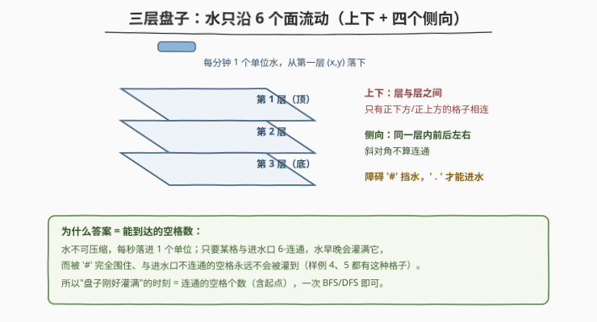
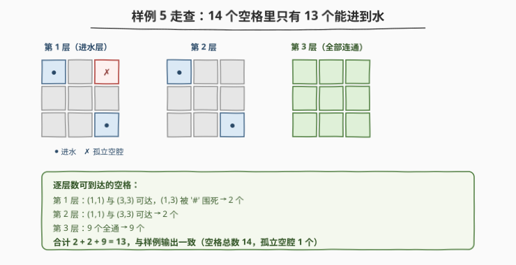

# Codeforces 60B 注水到满的时间 题解

## 1. 题目概述

- **题目链接**：https://codeforces.com/problemset/problem/60/B
- **比赛来源**：Codeforces Beta Round 60 · Problem B（2011-02-20）
- **难度**：1400
- **标签**：DFS 与类似、并查集、洪水填充
- **评测类型**：普通
- **限制**：时间 2 s / 内存 256 MB

**题意**：盘子是一个 $k \times n \times m$ 的长方体，有 $k$ 层（第 $1$ 层在最上面），每层是 $n \times m$ 的网格，`.` 是空格、`#` 是障碍。水龙头在第一层的格子 $(x,y)$ 上方（保证该格是 `.`），每分钟往盘子里落 $1$ 个单位立方体的水。水可以沿 $6$ 个方向（上下、前后、左右）穿过 $1\times1\times1$ 立方体的面流动。问：从开闸起多少分钟后盘子恰好被灌满（下一分钟就要溢出）？

**约束**：

- $1 \le k, n, m \le 10$：总共至多 $1000$ 个格子，任何 $O(kmn)$ 的遍历都绰绰有余。
- 水只能待在 `.` 格子里，`#` 是实心障碍。
- 起点保证是 `.`，所以不需要担心无解。
- 输入里各层之间有空行，最后一行才是坐标 $(x, y)$。

## 2. 示例与观察

官方样例（输入 / 输出原样）：

```text
输入：
1 1 1

.

1 1

输出：
1
```

```text
输入：
2 1 1

.

#

1 1

输出：
1
```

```text
输入：
2 2 2

.#
##

..
..

1 1

输出：
5
```

```text
输入：
3 2 2

#.
##

#.
.#

..
..

1 2

输出：
7
```

```text
输入：
3 3 3

.#.
###
##.

.##
###
##.

...
...
...

1 1

输出：
13
```

**样例 1**：只有一个格子，落 $1$ 个单位水就满了，答案 $1$。

**样例 2**：第一层是 `.`，第二层是 `#`，水到不了下面，只灌满 $1$ 个格子，答案 $1$。

**样例 3**：起点 $(1,1)$ 在第一层，第一层只有它自己是空的；水可以往下渗到第二层（第二层两行都是 `..`），第二层 4 个格子全通，总数 $1 + 4 = 5$。

**样例 4**：起点是第 1 层 $(1,2)$；水往下走到第 2 层 $(1,2)$，再往下到第 3 层，第 3 层 4 个格子全通；此外第 2 层的 $(2,1)$ 也与第 3 层连通，所以可达格子是 $1 + 2 + 4 = 7$（第 2 层可达 $(1,2)$ 与 $(2,1)$ 两个）。

**样例 5**：见下文走查，可达 $13$ 个格子——空格总数是 $14$，其中第 1 层 $(1,3)$ 被 `#` 完全围死，水永远进不去。



**观察**：水不可压缩，每分钟进 $1$ 个单位，且能流到所有与起点 6-连通的空格（水不会"越过"障碍，也不需要时间排队——只要连通，迟早会被灌满）。所以"恰好灌满"的时间就等于**与起点 6-连通的空格个数**，包括起点自己。

更准确地说，题目问的是"盘子刚好满、下一分钟就溢出"的时刻：第 $|R|$ 分钟结束时所有可达格子都装满，第 $|R|+1$ 分钟的水就会溢出，所以答案是 $|R|$。

## 3. 解题思路

### 3.1 朴素做法与瓶颈

想直接模拟"每一分钟水怎么流"，需要跟踪每个格子里的水量与流动，既复杂又没有必要。注意到水是"能到就一定会到"，问题退化成连通性统计。

### 3.2 核心观察：答案 = 连通空格数

把每个空格看成一个节点，两个格子若共享一个面（上下、前后、左右）就连一条边。水从起点出发，只会沿着这些边扩散。于是：

- 与起点连通的空格一定会被灌满（连通路径上的每个格子都在盘子里，水沿路径流过去）；
- 与起点不连通的空格永远进不去水（否则存在一条水能走的路径，与"不连通"矛盾）。

而水每分钟注入 $1$ 个单位、格子容积为 $1$，所以灌满全部 $|R|$ 个可达格子恰好需要 $|R|$ 分钟。答案就是起点所在连通块的大小。

### 3.3 算法流程

1. 读入 $k, n, m$，接着读入 $k \cdot n$ 行网格（按 token 读，自动跳过层间空行），最后读入 $x, y$ 并转成 0 基下标；
2. 从 $(0, x, y)$ 出发做 DFS/BFS，只走 `.` 格子；
3. 统计访问到的格子数并输出。

坐标细节：题面说 $x$ 是行号（$1..n$）、$y$ 是列号（$1..m$），网格第 $r$ 行第 $c$ 列对应字符 `rows[l*n+r][c]`；层的顺序是"第 1 层在最上面"，水从第 1 层往下渗，代码里把层号 $0$ 当作最上层即可。

### 3.4 样例走查：样例 5



三层网格（每层 $3\times3$）与可达情况：

| 层 | 网格 | 可达空格 |
|----|------|----------|
| 1 | `.#.` / `###` / `##.` | $(1,1)$、$(3,3)$ 可达；$(1,3)$ 上下左右全是 `#`，孤立 |
| 2 | `.##` / `###` / `##.` | $(1,1)$、$(3,3)$ 可达（分别通过第 1、3 层连上） |
| 3 | `...` / `...` / `...` | 9 个全通 |

合计 $2 + 2 + 9 = 13$，与样例输出一致。注意第 1 层的 $(3,3)$ 是怎么进水的：它正下方是第 2 层 $(3,3)$（`.`），而第 2 层 $(3,3)$ 的正下方是第 3 层 $(3,3)$，第 3 层整层连通，所以水从第 3 层"往上游"灌满这一列——这说明 6 个方向里**向上**也必须是通的。

## 4. 正确性证明

**引理 1（水恰好灌满连通块）**：设 $R$ 为与起点 6-连通的空格集合。则在灌水过程中，$R$ 中每个格子最终都会被水充满，而 $R$ 外的空格永远没有水。

**证明**：$R$ 中每个格子 $v$ 都有一条从起点到 $v$ 的格子路径，路径上每步共享一个面；水沿这条路径逐格推进，故 $v$ 最终会被灌满（水量足够，因为格子数有限且每分钟都在注入）。反之，若某空格 $v \notin R$ 进了水，则水必沿某个 6-连通的格子序列从起点到达 $v$，这条序列就是 $R$ 中的一条路径，与 $v \notin R$ 矛盾。∎

**引理 2（时间等于格子数）**：灌满 $R$ 恰好需要 $|R|$ 分钟。

**证明**：$R$ 中每个格子容积为 $1$，且互不重叠，共需 $|R|$ 个单位水；每分钟恰好注入 $1$ 个单位，且这些水全部留在 $R$ 内（引理 1），故第 $|R|$ 分钟结束时刚好装满，第 $|R|+1$ 分钟开始溢出。∎

**定理**：算法输出的 DFS 访问数等于题目所求时间。

**证明**：DFS 从起点出发、只经过 `.` 且只沿 6 邻接扩展，访问到的正是 $R$；由引理 2，$|R|$ 就是答案。∎

## 5. 复杂度分析

- **时间**：$O(kmn)$。每个格子最多入栈一次，每次检查 6 个邻居；$k,n,m \le 10$ 时最多 $1000$ 个格子、$6000$ 次邻居检查。
- **空间**：$O(kmn)$，用于存网格与访问标记，上限约 $1$ KB 级别的有效数据。
- **与时限的关系**：2 s 时限下，最大数据端到端不到 $1$ ms，余量极大。

## 6. 参考代码

### C++17

```cpp
#include <bits/stdc++.h>
using namespace std;

int main() {
    ios::sync_with_stdio(false);
    cin.tie(nullptr);
    int k, n, m;
    if (!(cin >> k >> n >> m)) return 0;
    vector<string> rows(k * n);
    for (int t = 0; t < k * n; t++) cin >> rows[t];
    int x, y;
    cin >> x >> y;
    --x; --y;                          // 0-based 的行、列

    auto empty_ = [&](int l, int r, int c) {
        if (l < 0 || l >= k || r < 0 || r >= n || c < 0 || c >= m) return false;
        return rows[l * n + r][c] == '.';
    };
    vector<char> vis(k * n * m, 0);
    vector<int> st;
    int start = (0 * n + x) * m + y;   // 水从第一层（顶层）的 (x,y) 落下
    st.push_back(start);
    vis[start] = 1;
    int ans = 0;
    while (!st.empty()) {
        int id = st.back();
        st.pop_back();
        ans++;
        int c = id % m, t = id / m, r = t % n, l = t / n;
        int nl[6] = {l - 1, l + 1, l, l, l, l};
        int nr[6] = {r, r, r - 1, r + 1, r, r};
        int nc[6] = {c, c, c, c, c - 1, c + 1};
        for (int d = 0; d < 6; d++) {
            if (!empty_(nl[d], nr[d], nc[d])) continue;
            int nid = (nl[d] * n + nr[d]) * m + nc[d];
            if (vis[nid]) continue;
            vis[nid] = 1;
            st.push_back(nid);
        }
    }
    cout << ans << '\n';
    return 0;
}
```

### Python3

```python
import sys
from collections import deque


def main():
    data = sys.stdin.buffer.read().split()
    if not data:
        return
    k, n, m = int(data[0]), int(data[1]), int(data[2])
    rows = [data[3 + t].decode() for t in range(k * n)]
    x = int(data[3 + k * n]) - 1
    y = int(data[4 + k * n]) - 1

    vis = [[[False] * m for _ in range(n)] for _ in range(k)]
    q = deque()
    q.append((0, x, y))
    vis[0][x][y] = True
    ans = 0
    while q:
        l, r, c = q.popleft()
        ans += 1
        for dl, dr, dc in ((1, 0, 0), (-1, 0, 0), (0, 1, 0), (0, -1, 0), (0, 0, 1), (0, 0, -1)):
            nl, nr, nc = l + dl, r + dr, c + dc
            if 0 <= nl < k and 0 <= nr < n and 0 <= nc < m:
                if not vis[nl][nr][nc] and rows[nl * n + nr][nc] == '.':
                    vis[nl][nr][nc] = True
                    q.append((nl, nr, nc))
    print(ans)


main()
```

## 7. 边界情况与易错点

1. **只有一层（$k=1$）**：没有"向下"的方向，答案就是起点在本层内的连通块大小；代码里层号越界判断自然处理。
2. **起点下方是 `#`**：水只能停在本层，样例 2 就是这种情况，答案 $1$；不要写成"至少能灌满第 1 层所有空格"。
3. **向上的方向不能漏**：样例 5 里第 1 层的 $(3,3)$ 必须靠"从第 3 层往上"才能进水；只写"向下 + 侧向"会少算。
4. **斜向不算连通**：水只穿过 $1\times1\times1$ 立方体的面，所以同一层内只有前后左右 4 个方向，斜对角不连。
5. **输入中的空行**：层与层之间有空行，必须按 token 读（或跳过空行），否则会读错网格或坐标。
6. **答案包含起点**：起点格子自己也要 $1$ 个单位水，故 $|R|$ 从 $1$ 开始计数；样例 1 的答案是 $1$ 而不是 $0$。
7. **孤立空腔**：被 `#` 完全围住的 `.` 不算入答案（样例 5 的 $(1,3)$），不要用"空格总数"当答案。
8. **坐标顺序**：$x$ 是行号、$y$ 是列号，网格是 $n$ 行 $m$ 列；写反了在 $n \ne m$ 的数据上会越界或错位。

## 8. 验证记录

- **编译环境与命令**：本机 `g++` 实为 `Apple clang 21.0.0`，用 `clang++ -std=c++17 -O2` 搭配 `codeforces/tools/include/bits/stdc++.h` 兼容头编译（正文代码可原样提交 GNU C++17）；Python 侧为 `Python 3.9.6`。正文代码另经 `codeforces/tools/verify_solution.py` 编译并跑通官方样例。
- **官方样例**：5 / 5 通过（`1`、`1`、`5`、`7`、`13`），C++ 与 Python 输出一致。
- **随机对拍**：另写一份"并查集把 6-连通空格合并、再数起点所在集合大小"的暴力（与 DFS 零共享逻辑），随机生成 **300 组** $k,n,m \le 4$、随机障碍比例（$0.1 \sim 1$）的盘子，C++、Python 与暴力三方逐组比对，**全部一致**（覆盖了 $k=1$、起点在角上、大面积 `#`、全空盘等情况）。
- **最大约束性能**：$k=n=m=10$、全空的盘子，端到端不到 $1$ ms（含进程启动），2 s 时限余量三个数量级。
- **复核状态**：verified（样例、随机对拍、性能、图片与公式校验均实跑通过）。

## 相关题目与扩展

- [Codeforces 60A Where Are My Flakes?](https://codeforces.com/problemset/problem/60/A)：同场 A 题，区间求交，和本题一样是"把题面翻译成一次线性扫描"。
- [Codeforces 60C Mushroom Strife](https://codeforces.com/problemset/problem/60/C)：同场 C 题，图上传播约束，也是"从一个点出发把整个连通块推出来"。
- [Codeforces 103B Cthulhu](https://codeforces.com/problemset/problem/103/B)：连通性判定的入门题。
- [Codeforces 115A Party](https://codeforces.com/problemset/problem/115/A)：树上 BFS/DFS 求最大深度，适合练习"沿边扩散"。
- [LeetCode 200. 岛屿数量](https://leetcode.cn/problems/number-of-islands/)：二维洪水填充，是本题去掉一维后的版本；[LeetCode 695](https://leetcode.cn/problems/max-area-of-island/) 则要求连通块大小，正好对应本题的计数。

**延伸思考**：

1. **如果水的注入速度是每分钟 $v$ 个单位**：答案变成 $\lceil |R| / v \rceil$ 分钟（最后一分钟只灌了一部分也算"满"），只需在统计完 $|R|$ 后做一次除法。
2. **如果盘子可以漏水**（某些格子有洞）：连通块要按"能存水的格子"重算，且水会流失，问题变成"能否灌满"而不是"多久灌满"。
3. **如果要求输出每个格子的灌满时刻**：那就是从起点出发的 BFS 距离（每个面算 $1$），最远的那个时刻就是答案——但因为每分钟只注入 $1$ 个单位，格子的灌满时刻取决于排队顺序，并不等于 BFS 距离，这点和"水无限快"的模型不同。
4. **如果 $k, n, m$ 放大到 $10^3$**：$10^9$ 个格子放不下，需要把网格压缩成区间的形式（扫描线/坐标压缩）再跑 BFS，这也是很多"三维灌水"升级版的思路。
