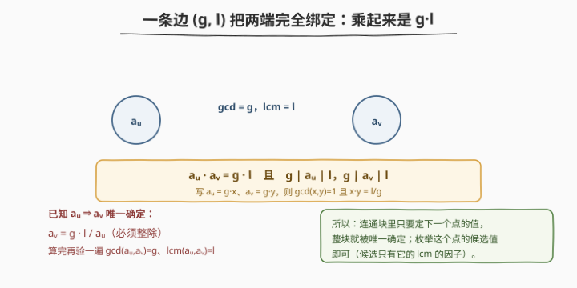
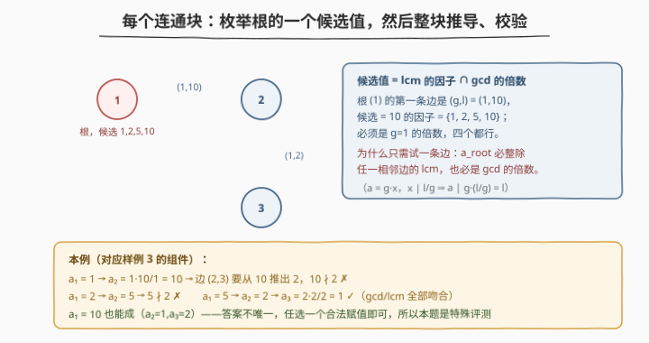

# Codeforces 60C 还原草坪蘑菇数量 题解

## 1. 题目概述

- **题目链接**：https://codeforces.com/problemset/problem/60/C
- **比赛来源**：Codeforces Beta Round 56 · Problem C（UTC 2011-02-19）
- **难度**：2100
- **标签**：暴力枚举、DFS 与类似、数论（gcd/lcm）
- **评测类型**：特殊评测（答案不唯一，任意一组合法赋值均可）
- **限制**：时间 2 s / 内存 256 MB

**题意**：有 $n$ 块草坪，每块上蘑菇数量是正整数。地图记录了 $m$ 条道路，每条道路连接两块草坪，并写下这两块草坪蘑菇数的**最大公约数** $g$ 与**最小公倍数** $l$。请还原每块草坪的蘑菇数（任意一组合法解），或者判断无解。

**约束**：

- $1 \le n \le 100$，$0 \le m \le \frac{n(n-1)}{2}$：图很小，允许"枚举候选值 + 整图校验"这种暴力的做法。
- $1 \le g, l \le 10^6$：每条边的候选值只可能是 $l$ 的因子（且是 $g$ 的倍数），数量不超过 $l$ 的因子个数（$\le 240$）。
- 输入保证没有自环、没有重边。
- $g \cdot l$ 最大 $10^{12}$，需要用 64 位整数。
- 输出不唯一：题面明确说"恢复任意一张合法的地图"，所以任何满足全部边约束的赋值都是正确答案（这也意味着评测必须用 special judge）。

## 2. 示例与观察

官方样例（输入 / 输出原样）：

```text
输入：
1 0

输出：
YES
1 
```

```text
输入：
2 1
1 2 1 3

输出：
YES
1 3 
```

```text
输入：
3 2
3 2 1 2
3 1 1 10

输出：
YES
5 1 2 
```

```text
输入：
2 1
1 2 3 7

输出：
NO
```

**样例 1**：没有道路，一块草坪的蘑菇数没有任何约束，输出任意正整数即可（题解输出 $1$）。

**样例 2**：$g=1, l=3$，两块草坪数之积是 $3$、gcd 是 $1$，取 $1$ 和 $3$。

**样例 3**：边 $(3,2)$ 给 $(g,l)=(1,2)$，边 $(3,1)$ 给 $(1,10)$。取 $a_3 = 2$：则 $a_2 = 1\cdot2/2 = 1$、$a_1 = 1\cdot10/2 = 5$，得到 `5 1 2`——正是样例输出。注意 `10 2 1` 也完全合法（$a_3=1$ 时 $a_2 = 2$、$a_1 = 10$），这正说明答案不唯一。

**样例 4**：$g=3$ 不整除 $l=7$，不可能有 $\gcd = 3$、$\operatorname{lcm} = 7$ 的两个整数，输出 `NO`。

**观察 1**：对一条边，$g \cdot l = a_u \cdot a_v$（这是 $\gcd \cdot \operatorname{lcm} = a_u a_v$ 的直接推论）。所以只要知道一端的值，另一端被唯一确定：

$$a_v = \frac{g \cdot l}{a_u}.$$

**观察 2**：$a_u$ 必须是 $g$ 的倍数、并且整除 $l$。写 $a_u = gx$、$a_v = gy$，则 $\gcd(x,y) = 1$、$xy = l/g$，于是 $x \mid l/g$，从而 $a_u \mid l$。



**观察 3**：每个连通块里只要定下一个点的值，整块的值都被"传播"唯一确定；而根的值只能是某条相邻边所给 $l$ 的因子（且是 $g$ 的倍数），候选只有几百个。于是对每个连通块枚举根的候选、整块推导并校验即可。

## 3. 解题思路

### 3.1 朴素做法与瓶颈

想直接搜索每块草坪的值：值域到 $10^6$，$n = 100$ 时完全不可行。

正确的思路是利用"约束极强"：一条边就把两个数绑定成"乘积固定"，整张图一旦有一个点的值，其余全部确定；而不确定的只有每个连通块里那一个"根"的值。

### 3.2 核心观察：传播的确定性

对边 $(u,v,g,l)$：

- 若已知 $a_u$，则 $a_v$ 只能取 $g \cdot l / a_u$。若这个值不是整数、或者 $\gcd(a_u, a_v) \ne g$、$\operatorname{lcm}(a_u,a_v) \ne l$，这条边就不可能满足，该赋值方案失败。
- 若 $u,v$ 都已赋值，直接检查 $\gcd$ 与 $\operatorname{lcm}$。

于是从一个根出发做 BFS/DFS，可以**确定性地**把整个连通块的值算出来，并在过程中检查所有边；一旦矛盾就回滚。

### 3.3 根的候选值从哪来

设根 $r$ 有相邻边 $(r, v, g_0, l_0)$。由观察 2，$a_r$ 必是 $g_0$ 的倍数且整除 $l_0$。所以只需枚举 $l_0$ 的因子中所有 $g_0$ 的倍数（至多 $240$ 个），对每个候选跑一次整块推导。

如果某个候选成功，整块就定下来了；所有候选都失败则输出 `NO`。孤立点（没有相邻边）没有任何约束，填 $1$ 即可。



### 3.4 算法流程

1. 读入 $n, m$ 和所有边；若存在一条边满足 $l \bmod g \ne 0$，直接输出 `NO`（$g$ 必须整除 $l$）。
2. 对每个尚未赋值的点 $s$：
   - 若 $s$ 没有相邻边，令 $a_s = 1$，继续；
   - 否则取 $s$ 的第一条相邻边 $(s, v, g_0, l_0)$，枚举 $l_0$ 的所有因子 $d$ 中满足 $d \bmod g_0 = 0$ 的作为 $a_s$ 的候选；
   - 对每个候选，从 $s$ 出发 BFS：对每条边按 3.2 推导/校验；成功则保留，失败则把本块已赋的值全部回滚，换下一个候选；
   - 全部候选都失败 → 输出 `NO`。
3. 输出 `YES` 与 $n$ 个值。

## 4. 正确性证明

**引理 1（边约束的等价形式）**：对正整数 $a, b$ 与 $g, l \ge 1$，$\gcd(a,b) = g$ 且 $\operatorname{lcm}(a,b) = l$ 当且仅当 $g \mid a$、$g \mid b$、$a b = g l$ 且 $\gcd(a/g, b/g) = 1$。

**证明**：若 $\gcd(a,b) = g$，写 $a = gx, b = gy$，则 $\gcd(x,y) = 1$，且 $l = ab/g = gxy$，故 $ab = gl$、$\gcd(x,y)=1$。反之若 $g \mid a, g \mid b$、$ab = gl$、$\gcd(a/g,b/g)=1$：设 $a = gx, b = gy$，则 $g^2 xy = gl$ 即 $xy = l/g$，于是 $\gcd(a,b) = g\gcd(x,y) = g$、$\operatorname{lcm}(a,b) = gxy = l$。∎

**引理 2（传播唯一）**：设边 $(u,v,g,l)$ 且已知 $a_u$，则至多存在一个 $b$ 使 $\gcd(a_u,b) = g$、$\operatorname{lcm}(a_u,b) = l$，并且它只能是 $g l / a_u$。

**证明**：由引理 1，$a_u b = g l$，故 $b = gl/a_u$ 唯一。∎

**引理 3（根候选的完备性）**：若某个连通块存在合法赋值，则其根 $s$ 的取值必定是 $l_0$ 的因子，且是 $g_0$ 的倍数（$g_0, l_0$ 取自 $s$ 的任一条相邻边）。

**证明**：取 $s$ 的相邻边 $(s,v,g_0,l_0)$，由引理 1，$g_0 \mid a_s$ 且 $a_s \cdot a_v = g_0 l_0$。又由引理 1 的等价形式，$a_s = g_0 x$ 且 $x \mid l_0/g_0$，于是 $a_s \mid g_0 \cdot (l_0/g_0) = l_0$。∎

**定理**：算法输出 `YES` + 赋值当且仅当存在合法赋值；输出 `NO` 当且仅当无解。

**证明**：

*若算法输出 `YES`*：每个连通块都是从一个候选出发、按引理 2 唯一推导出来的，且推导过程中对每条边都校验了 $\gcd$ 与 $\operatorname{lcm}$（引理 1 保证了"乘积 + 互质"与"$\gcd$/$\operatorname{lcm}$"等价），所以输出的赋值满足全部边约束，确实是合法解。

*若存在合法解 $a^*$*：对每个连通块，$a^*_s$ 满足引理 3 的条件，所以它在候选集中；按引理 2，从它出发的推导与 $a^*$ 在该块上完全一致，因此不会失败，算法会在这一候选上成功。故算法不会误判 `NO`。

两种情形合起来即得结论（另外 $l \bmod g \ne 0$ 时由引理 1 直接无解）。∎

## 5. 复杂度分析

- **时间**：$O\bigl(\sum_{\text{连通块}} \tau(l_0)\cdot(n + m)\bigr)$，其中 $\tau(l_0)$ 是候选个数（$\le 240$）。最坏 $n = 100$、$m = 4950$ 时约 $240 \times 5000 \approx 1.2\times 10^6$ 次操作，2 s 绰绰有余。
- **空间**：$O(n + m)$，邻接表最多 $2m$ 条有向边。
- **数值范围**：$g \cdot l \le 10^{12}$，必须用 64 位整数；单个蘑菇数不超过 $10^6$（因为它整除某条相邻边的 $l$）。
- **与时限的关系**：实测最坏（$n=100$ 的链 + 大 $l$）端到端约 $2$ ms（含进程启动）。

## 6. 参考代码

### C++17

```cpp
#include <bits/stdc++.h>
using namespace std;
typedef long long ll;

int n, m;
struct Edge { int to, g, l; };
vector<vector<Edge>> adj;
vector<ll> val;
vector<char> assigned;

static ll gcdll(ll a, ll b) {
    while (b) { ll t = a % b; a = b; b = t; }
    return a;
}
static ll lcmll(ll a, ll b) { return a / gcdll(a, b) * b; }

// 已知 root 的值 rv，沿边把整个连通块定下来；失败时回滚并返回 false
static bool try_component(int root, ll rv, vector<int>& touched) {
    vector<int> q;
    val[root] = rv;
    assigned[root] = 1;
    touched.push_back(root);
    q.push_back(root);
    for (size_t head = 0; head < q.size(); head++) {
        int u = q[head];
        for (const Edge& e : adj[u]) {
            int v = e.to;
            if (!assigned[v]) {
                ll need;
                if ((ll)e.g * e.l % val[u] != 0) return false;
                need = (ll)e.g * e.l / val[u];
                if (need < 1) return false;
                if (gcdll(val[u], need) != e.g || lcmll(val[u], need) != e.l) return false;
                val[v] = need;
                assigned[v] = 1;
                touched.push_back(v);
                q.push_back(v);
            } else {
                if (gcdll(val[u], val[v]) != e.g || lcmll(val[u], val[v]) != e.l) return false;
            }
        }
    }
    return true;
}

int main() {
    if (scanf("%d %d", &n, &m) != 2) return 0;
    adj.assign(n, {});
    for (int i = 0; i < m; i++) {
        int u, v, g, l;
        scanf("%d %d %d %d", &u, &v, &g, &l);
        --u; --v;
        adj[u].push_back({v, g, l});
        adj[v].push_back({u, g, l});
    }
    for (int u = 0; u < n; u++)
        for (const Edge& e : adj[u])
            if (e.l % e.g != 0) { puts("NO"); return 0; }   // gcd 必须整除 lcm

    val.assign(n, 0);
    assigned.assign(n, 0);
    for (int s = 0; s < n; s++) {
        if (assigned[s]) continue;
        if (adj[s].empty()) {               // 孤立草坪：没有任何约束，填 1
            val[s] = 1;
            assigned[s] = 1;
            continue;
        }
        int g0 = adj[s][0].g, l0 = adj[s][0].l;
        bool ok = false;
        for (int d = 1; (ll)d * d <= l0 && !ok; d++) {
            if (l0 % d) continue;
            int cands[2] = {d, l0 / d};
            for (int ci = 0; ci < 2 && !ok; ci++) {
                int cand = cands[ci];
                if (cand % g0 != 0) continue;   // 必须是 gcd 的倍数且整除 lcm
                vector<int> touched;
                if (try_component(s, cand, touched)) {
                    ok = true;
                } else {
                    for (int v : touched) { assigned[v] = 0; val[v] = 0; }
                }
            }
        }
        if (!ok) { puts("NO"); return 0; }
    }
    puts("YES");
    for (int i = 0; i < n; i++) printf("%lld%c", val[i], i + 1 == n ? '\n' : ' ');
    return 0;
}
```

### Python3

```python
import sys
from collections import deque


def gcd(a, b):
    while b:
        a, b = b, a % b
    return a


def main():
    data = sys.stdin.buffer.read().split()
    if not data:
        return
    it = iter(data)
    n = int(next(it))
    m = int(next(it))
    adj = [[] for _ in range(n)]
    edges = []
    for _ in range(m):
        u = int(next(it)) - 1
        v = int(next(it)) - 1
        g = int(next(it))
        l = int(next(it))
        edges.append((u, v, g, l))
        adj[u].append((v, g, l))
        adj[v].append((u, g, l))
    for _, _, g, l in edges:
        if l % g:                      # gcd 必须整除 lcm
            print("NO")
            return

    value = [0] * n
    assigned = [False] * n

    def check_pair(x, y, g, l):
        gg = gcd(x, y)
        return gg == g and x // gg * y == l

    def try_component(root, rv):
        """从 root = rv 出发确定整个连通块；失败时返回已赋值顶点，供调用方回滚。"""
        value[root] = rv
        assigned[root] = True
        touched = [root]
        q = deque([root])
        while q:
            u = q.popleft()
            for v, g, l in adj[u]:
                if not assigned[v]:
                    t = g * l
                    if t % value[u]:   # 必须整除，否则这一组候选直接失败
                        return False, touched
                    need = t // value[u]
                    if not check_pair(value[u], need, g, l):
                        return False, touched
                    value[v] = need
                    assigned[v] = True
                    touched.append(v)
                    q.append(v)
                elif not check_pair(value[u], value[v], g, l):
                    return False, touched     # 与已有赋值矛盾
        return True, touched

    for s in range(n):
        if assigned[s]:
            continue
        if not adj[s]:                       # 孤立草坪：没有约束，填 1
            value[s] = 1
            assigned[s] = True
            continue
        g0, l0 = adj[s][0][1], adj[s][0][2]
        ok = False
        d = 1
        while d * d <= l0 and not ok:         # 枚举 lcm 的因子，且必须是 gcd 的倍数
            if l0 % d == 0:
                for cand in (d, l0 // d):
                    if cand % g0:
                        continue
                    good, touched = try_component(s, cand)
                    if good:
                        ok = True
                        break
                    for v in touched:
                        assigned[v] = False
                        value[v] = 0
            d += 1
        if not ok:
            print("NO")
            return

    sys.stdout.write("YES\n" + " ".join(map(str, value)) + "\n")


main()
```

## 7. 边界情况与易错点

1. **孤立草坪**：没有任何道路约束，可以填任意正整数；代码填 $1$。若误以为"无解"，样例 1 就会错。
2. **$g \nmid l$**：例如样例 4 的 $(3,7)$。此时必然无解，要尽早输出 `NO`，避免后续除法算出非整数。
3. **传播失败必须回滚**：一个连通块可能试了多个候选才成功，失败时要把本块已赋值的点清零，否则会污染后续（尤其是"根的值"被覆盖）。
4. **候选只取一条相邻边的 $l$ 因子**：看起来不够，但由引理 3，合法解里根的值一定整除它，所以完备；不要漏掉 $d$ 和 $l/d$ 两个因子，且 $d = l/d$ 时只算一次候选（代码用 `cand % g0` 过滤，重复候选只是多跑一次，不影响正确性）。
5. **64 位整数**：$g \cdot l$ 可达 $10^{12}$，用 `int` 会溢出；Python 没有这个问题。
6. **路径/环**：环上的边会在 BFS 中被第二次检查（两端都已赋值），这正是发现矛盾的地方（例如样例 4 之外的"三角形矛盾"），不能只检查生成树边。
7. **值必须为正**：传播出的 $a_v = gl/a_u$ 若为 $0$ 或负（本题不会出现负数，但除以大于 $gl$ 的数时可能为 $0$），要判非法；代码里 `need < 1` 直接失败。
8. **输出格式**：先输出 `YES`，再输出一行 $n$ 个数；`NO` 时只输出一行。值之间可以有多个空格，但不要少输出数字。
9. **特殊评测**：答案不唯一，本地验证必须用 checker（校验每条边的 gcd/lcm），不能拿样例输出逐字比对——样例 3 的标准输出是 `5 1 2`，而 `10 2 1` 同样合法。

## 8. 验证记录

- **编译环境与命令**：本机 `g++` 实为 `Apple clang 21.0.0`，用 `clang++ -std=c++17 -O2` 搭配 `codeforces/tools/include/bits/stdc++.h` 兼容头编译（正文代码可原样提交 GNU C++17）；Python 侧为 `Python 3.9.6`。由于答案不唯一，官方样例用 `tools/verify_solution.py <doc> --checker /tmp/cf_verify_60_c/checker.py` 校验。
- **checker 的校验条件**：读入输入与选手输出；输出必须是 `YES` 或 `NO`（token 数不能多）；输出 `NO` 时本 checker 直接接受（"确实无解"等价于把题再做一遍，故 NO 的正确性由下一条的小值域全枚举暴力单独核对）；输出 `YES` 时必须恰好有 $n$ 个正整数，并且对输入的每条边 $(u,v,g,l)$ 都有 $\gcd(a_u,a_v)=g$ 且 $\operatorname{lcm}(a_u,a_v)=l$。任何一条不满足即判错。
- **官方样例**：4 / 4 通过（C++ 的输出 `YES/1`、`YES/1 3`、`YES/10 2 1`、`NO` 全部通过 checker；第 3 组与标准输出 `5 1 2` 不同但同样合法），Python 同样 4/4。
- **随机对拍（合法数据）**：先随机生成 $n \le 6$ 个蘑菇数（$1..40$），再随机取若干条边、由两端值直接算出 $(g,l)$——这样的数据必然有解。150 组，检查我们的输出是 `YES` 且 checker 通过，**全部一致**。
- **随机对拍（可行性与全枚举暴力）**：$n \le 3$、$g,l \le 24$ 的随机数据（常常无解），用"枚举 $1..\max l$ 的所有赋值"的暴力判断可行性，与程序输出的 `YES/NO` 逐组比较；共 150 组，**全部一致**，且所有 `YES` 的赋值都通过 checker；另用同分布的 300 组数据统计了 YES/NO 分布（231 组 YES、69 组 NO），说明两条分支都真实覆盖到了。
- **C++/Python 交叉**：200 组随机合法数据上，两份程序的 `YES/NO` 判定一致、赋值都合法。
- **大规模结构**：$n = 100$ 的链（相邻值由 $1..12$ 循环给出，$l$ 最大 $132$）输出 `YES` + 100 个数，合法。
- **复核状态**：verified（样例经 checker、合法/非法随机对拍、C++/Python 交叉、性能、图片与公式校验均实跑通过）。

## 相关题目与扩展

- [Codeforces 60A Where Are My Flakes?](https://codeforces.com/problemset/problem/60/A)：同场 A 题，区间求交，和本题一样"约束把候选压到极小"。
- [Codeforces 60B Serial Time!](https://codeforces.com/problemset/problem/60/B)：同场 B 题，连通块统计；本题也靠"连通块里定一个点、其余全定"。
- [Codeforces 60D Savior](https://codeforces.com/problemset/problem/60/D)：同场 D 题，数论 + 并查集，也是"找结构、再合并"。
- [Codeforces 166E Tetrahedron](https://codeforces.com/problemset/problem/166/E)：数论/计数类题，适合与本题的 gcd/lcm 推导对照。
- [LeetCode 2543. 判断一个点是否可以到达](https://leetcode.cn/problems/check-if-point-is-reachable/)：用 gcd 结构判断可达性，与本题的"乘积 = gcd·lcm"是同一类数论观察。

**延伸思考**：

1. **如果要输出最小字典序的解**：本题的候选枚举顺序（从小到大的因子）在每个连通块上给出"根最小"的解，但字典序最小还需要把根选在编号最小的点上，并比较不同根的方案——这就变成一个小的最优化问题。
2. **如果给定的是 $\gcd$ 与 $\gcd$ 的倍数关系而不是 $l$**：约束变弱，传播不再唯一（可能有多个 $a_v$ 满足 $\gcd(a_u,a_v)=g$），需要 DP 或枚举因子，难度上一个台阶。
3. **如果图有 $10^5$ 条边、$n$ 也是 $10^5$**：候选枚举的 $\tau(l)$ 仍然只有几百，但每个候选都要扫一遍整个连通块，最坏 $O(\tau \cdot m)$ 会偏大；可以先把每条边的 $l$ 取 gcd 缩小候选集，或按并查集"先定生成树、再验非树边"来做。
4. **为什么答案不唯一**：一条边只固定了两个数的乘积与互质部分，素数指数可以在两端之间"分配"，所以同一张图常有指数级的解；题目只要求任意一组，正是为了让特殊评测成为可能。
