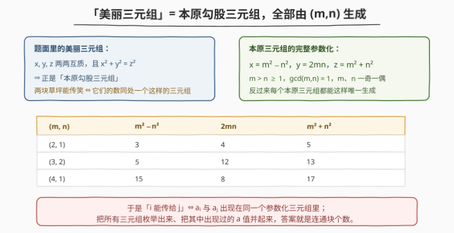
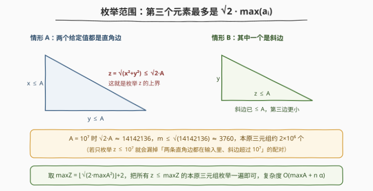
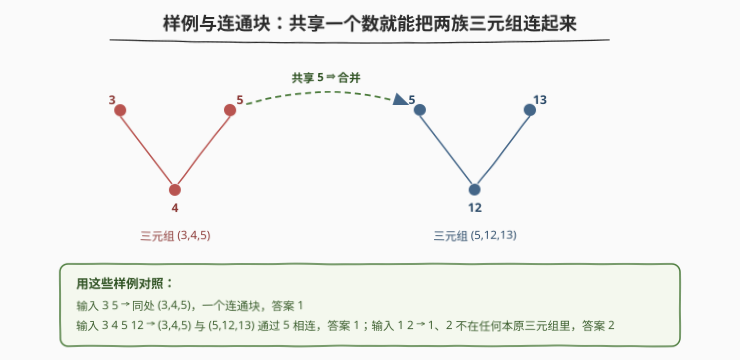

# Codeforces 60D 最少笑声的草坪数 题解

## 1. 题目概述

- **题目链接**：https://codeforces.com/problemset/problem/60/D
- **比赛来源**：Codeforces Beta Round 60 · Problem D（2011-02-20）
- **难度**：2500
- **标签**：暴力枚举、并查集、数论（本原勾股三元组）
- **评测类型**：普通
- **限制**：时间 4 s / 内存 256 MB

**题意**：$n$ 块草坪，第 $t$ 块上有 $a_t$ 个蘑菇，所有 $a_t$ 互不相同且 $1 \le a_t \le 10^7$。草坪 $i$ 能把"笑声"传给草坪 $j$（$i \ne j$），当且仅当存在整数 $b$，使得 $a_i, a_j, b$ 的某个排列是一个**美丽三元组**：三个两两互质的数 $x, y, z$ 满足 $x^2 + y^2 = z^2$。求最少需要在几块草坪上笑，才能让所有蘑菇都爆掉。

**约束**：

- $1 \le n \le 10^6$：不能对草坪两两配对判断。
- $1 \le a_i \le 10^7$：值域是枚举的突破口，**值的个数只有 $10^7$**。
- 所有 $a_i$ 互不相同：可以拿值当并查集的下标。
- 4 s 时限、256 MB：需要 $O(\max a)$ 级别的枚举，并且要一张大小 $10^7$ 的"值→下标"表（40 MB）。

## 2. 示例与观察

官方样例（输入 / 输出原样）：

```text
输入：
1
2

输出：
1
```

```text
输入：
2
1 2

输出：
2
```

```text
输入：
2
3 5

输出：
1
```

**样例 1**：只有一块草坪，笑一次即可，答案 $1$。

**样例 2**：$1$ 和 $2$。$2$ 不可能出现在本原勾股三元组里（$2 = 2mn$ 要求 $mn = 1$，则 $m = n = 1$，不满足 $m > n$）；$1$ 更不可能（$1^2 + y^2 = z^2$ 只能给出 $(z-y)(z+y) = 1$）。两块草坪互不可传，答案 $2$。

**样例 3**：$3$ 与 $5$ 同处三元组 $(3,4,5)$（$3^2 + 4^2 = 5^2$，两两互质），所以笑一次就能通过 $3 \to 5$ 传过去，答案 $1$。

**观察 1**：题面的"美丽三元组"就是**本原勾股三元组**（pairwise coprime + 勾股方程）。而两块草坪能互传，等价于它们的值**同时出现在某个本原勾股三元组里**（第三个数 $b$ 不必是输入中的值）。

**观察 2**：这种"能传"关系是对称的；笑声可以沿着关系链继续传（$i$ 传给 $j$，$j$ 再传给 $k$）。所以答案是这张无向图的**连通块个数**。

**观察 3**：本原勾股三元组有完整的参数化，可以按参数枚举；而每个三元组最多含 3 个输入值，把它们并起来即可。



## 3. 解题思路

### 3.1 朴素做法与瓶颈

对每对 $(a_i, a_j)$ 判断"能否同处一个三元组"：可以解方程 $a_i^2 + a_j^2 = b^2$（或其中一个作斜边），用整数开方判定。但 $n = 10^6$ 时对数太大。

反过来想：三元组的个数远少于对数。所有元素不超过 $Z$ 的本原三元组只有 $\Theta(Z)$ 个（每个 $(m,n)$ 生成一个，$m^2 + n^2 \le Z$），而 $Z$ 只需要到 $1.42\times 10^7$，总量约 $2\times 10^6$。枚举三元组是可行的。

### 3.2 核心观察：参数化 + 只需要 $z \le \sqrt 2 \cdot \max a$

**参数化**：所有本原勾股三元组恰为

$$x = m^2 - n^2,\quad y = 2mn,\quad z = m^2 + n^2 \qquad (m > n \ge 1,\ \gcd(m,n) = 1,\ m-n \text{ 为奇数}),$$

且每个本原三元组被唯一生成（$z$ 总是斜边，$x,y$ 是两条直角边）。

**上界**：任取一条边，两个端值 $u, v \le A := \max a_i$，第三个元素 $b$ 满足

- 若 $u, v$ 都是直角边：$b = \sqrt{u^2 + v^2} \le \sqrt{2}\,A$；
- 若其中一个是斜边：$b < $ 斜边 $\le A$。

所以任何"至少含两个输入值"的三元组，其最大元素 $z \le \sqrt 2 \, A$。只需要枚举 $z \le \lfloor\sqrt 2 A\rfloor + 2$ 的三元组，其中 $m \le \sqrt{z} \approx 3760$（$A = 10^7$ 时）。



### 3.3 算法流程

1. 读入 $n$ 与所有 $a_i$，求 $A = \max a_i$，令 $Z = \lfloor\sqrt{2A^2}\rfloor + 2$（用 `sqrt(2.0)*A` 再 $+2$ 保证不越界）。
2. 建"值→下标"表 `pos[1..A]`，初始全 $-1$，把 `pos[a_i] = i`。
3. 并查集大小为 $n$，`comps = n`。
4. 枚举 $m$ 从 $2$ 到 $\lfloor\sqrt{Z}\rfloor$，$n'$ 从 $1$ 到 $m-1$：
   - 若 $m - n'$ 为偶数或 $\gcd(m,n') \ne 1$，跳过（非本原）；
   - 计算 $x = m^2 - n'^2$、$y = 2mn'$、$z = m^2 + n'^2$，若 $z > Z$ 则跳出内层（$z$ 关于 $n'$ 单增）；
   - 把 $x, y, z$ 中出现在输入里的值（各自 $\le A$ 且 `pos >= 0`）对应的下标两两 `union`，每成功合并一次 `comps--`。
5. 输出 `comps`。

复杂度：枚举 $(m,n')$ 的规模是 $\sum_{m \le 3760} m \approx 7\times 10^6$（其中一半以上被奇偶/互质过滤），每个三元组只做常数次查表与并查集操作。

### 3.4 样例走查



- 输入 `3 5`：枚举到 $(m,n') = (2,1)$ 得到 $(3,4,5)$，$3$ 与 $5$ 都在输入里，合并二者，`comps` 从 2 变 1，答案 $1$。
- 输入 `3 4 5 12`：$(2,1)$ 给出 $(3,4,5)$，合并 $3,4,5$；$(3,2)$ 给出 $(5,12,13)$，合并 $5$ 与 $12$；最终一个连通块，答案 $1$。可见多个三元组可以通过**共享一个值**把草坪连起来。
- 输入 `1 2`：没有任何三元组同时含 $1$ 或 $2$，答案 $2$。

## 4. 正确性证明

**引理 1（本原勾股三元组的参数化）**：正整数 $x, y, z$ 两两互质且 $x^2 + y^2 = z^2$ 的充要条件是：存在 $m > n \ge 1$，$\gcd(m,n) = 1$、$m - n$ 为奇数，使得 $\{x,y\} = \{m^2 - n^2,\ 2mn\}$、$z = m^2 + n^2$。

**证明**：这是勾股数参数化的经典结论。必要性：三元组本原时一奇一偶，设 $y$ 为偶数，则 $y^2 = z^2 - x^2 = (z-x)(z+x)$，其中 $z-x$ 与 $z+x$ 都是偶数且互质（除以 $2$ 后互质），故可令 $z + x = 2m^2$、$z - x = 2n^2$，得 $x = m^2 - n^2$、$z = m^2 + n^2$、$y = 2mn$，本原性推出 $\gcd(m,n)=1$ 与奇偶性。充分性：直接代入可验证 $x^2 + y^2 = z^2$，且 $\gcd(m^2-n^2, 2mn) = 1$（由 $\gcd(m,n)=1$、奇偶性），即两两互质。∎

**引理 2（相邻关系的刻画）**：草坪 $i, j$ 可以互传笑声当且仅当存在某个本原三元组同时包含 $a_i$ 与 $a_j$。

**证明**：由题意，能传等价于存在整数 $b$ 使 $\{a_i, a_j, b\}$ 是本原三元组；这正说明某个本原三元组同时含这两个值。反之亦然。∎

**引理 3（枚举的完备性与无冗余）**：设 $Z = \lfloor\sqrt2 A\rfloor + 2$。任一本原三元组若同时含两个输入值，则它的最大元素 $\le Z$，因此必被算法枚举到；算法枚举的每个三元组也都是本原的。

**证明**：设三元组含输入值 $u, v \le A$。若 $u,v$ 都是直角边，则斜边 $\sqrt{u^2+v^2} \le \sqrt2 A \le Z$；若其中一个是斜边，斜边 $\le A \le Z$。所以最大元素 $\le Z$，而算法枚举了全部 $z \le Z$ 的本原三元组（引理 1 保证参数化完整）。无冗余来自参数化的互异性（不同的 $(m,n)$ 给出不同三元组，带奇偶与互质过滤后恰为本原三元组）。∎

**引理 4（答案是连通块数）**：最少需要笑的草坪数等于"互传关系"图的连通块个数。

**证明**：笑一次会让该草坪的蘑菇爆掉，并沿传播关系把笑传给相邻草坪，再继续传递，因此一次笑能让且仅能让**一个连通块**里的草坪全部爆掉；反之每个连通块至少要笑一次。故最少次数等于连通块个数。∎

**定理**：算法输出正确的最少草坪数。

**证明**：算法枚举了所有可能连接两个输入值的本原三元组（引理 3），并把其中出现的输入值两两合并，得到的正是引理 4 中"互传关系"图的连通块划分（引理 2 保证相邻关系刻画正确）；`comps` 初值为 $n$，每成功合并一次减一，最终等于连通块个数。由引理 4，它就是答案。∎

## 5. 复杂度分析

- **时间**：$O(Z + n\,\alpha(n))$，其中 $Z = \lfloor\sqrt2\max a\rfloor + 2 \le 1.42\times10^7$。枚举 $(m,n')$ 的总次数为 $\sum_{m\le\sqrt Z} m = O(Z)$，实测 $A = 10^7$ 时约 $7\times10^6$ 次内层循环、约 $2\times10^6$ 个本原三元组。
- **空间**：$O(A + n)$，`pos` 表 $A+1$ 个 `int`（$A = 10^7$ 时约 40 MB），并查集 $4n$ 字节，$a$ 数组 $4n$ 字节。
- **与时限的关系**：最大数据（$n = 10^6$，$a_i$ 随机取 $1..10^7$）实测 $0.21$ s，4 s 时限余量约 19 倍；内存约 $50$ MB。

## 6. 参考代码

### C++17

```cpp
#include <bits/stdc++.h>
using namespace std;

struct DSU {
    vector<int> p;
    explicit DSU(int n) : p(n) { iota(p.begin(), p.end(), 0); }
    int find(int x) { while (p[x] != x) x = p[x] = p[p[x]]; return x; }
    bool unite(int a, int b) {
        a = find(a); b = find(b);
        if (a == b) return false;
        p[a] = b;
        return true;
    }
};

int main() {
    int n;
    if (scanf("%d", &n) != 1) return 0;
    vector<int> a(n);
    int maxV = 0;
    for (int i = 0; i < n; i++) {
        scanf("%d", &a[i]);
        maxV = max(maxV, a[i]);
    }
    // 任意一个「同时含两个给定值」的本原三元组，其最大元素不超过 sqrt(2)*maxV
    long long maxZ = (long long)(sqrt(2.0) * maxV) + 2;

    vector<int> pos(maxV + 1, -1);
    for (int i = 0; i < n; i++) pos[a[i]] = i;

    DSU dsu(n);
    int comps = n;                    // 每成功合并一次，连通块数减一
    for (long long m = 2; m * m + 1 <= maxZ; m++) {
        for (long long nn = 1; nn < m; nn++) {
            long long z = m * m + nn * nn;
            if (z > maxZ) break;                 // z 随 nn 单调递增
            if (((m - nn) & 1) == 0) continue;   // 必须一奇一偶
            if (std::gcd(m, nn) != 1) continue;  // 必须互质，否则三元组不本原
            long long x = m * m - nn * nn;       // 两条直角边
            long long y = 2 * m * nn;
            int id[3], cnt = 0;
            if (x <= maxV && pos[x] >= 0) id[cnt++] = pos[x];
            if (y <= maxV && pos[y] >= 0) id[cnt++] = pos[y];
            if (z <= maxV && pos[z] >= 0) id[cnt++] = pos[z];
            for (int i = 1; i < cnt; i++)
                if (dsu.unite(id[0], id[i])) comps--;
        }
    }
    printf("%d\n", comps);
    return 0;
}
```

### Python3

```python
import sys
from math import gcd, isqrt


def main():
    data = sys.stdin.buffer.read().split()
    if not data:
        return
    n = int(data[0])
    a = [int(x) for x in data[1:1 + n]]
    maxV = max(a)
    maxZ = isqrt(2 * maxV * maxV) + 2      # 三元组最大元素的上界

    pos = {}
    for i, v in enumerate(a):
        pos[v] = i

    parent = list(range(n))

    def find(x):
        while parent[x] != x:
            parent[x] = parent[parent[x]]
            x = parent[x]
        return x

    comps = n
    m = 2
    while m * m + 1 <= maxZ:
        nn = 1
        while nn < m:
            z = m * m + nn * nn
            if z > maxZ:
                break
            if (m - nn) % 2 == 1 and gcd(m, nn) == 1:
                x = m * m - nn * nn
                y = 2 * m * nn
                ids = [pos[t] for t in (x, y, z) if t <= maxV and t in pos]
                for t in ids[1:]:
                    ra, rb = find(ids[0]), find(t)
                    if ra != rb:
                        parent[ra] = rb
                        comps -= 1
            nn += 1
        m += 1
    print(comps)


main()
```

Python 版把 `pos` 换成字典（只存出现过的值），在 $n$ 较小时比开 $10^7$ 的数组更省内存；但 $n = 10^6$ 时字典与循环都偏慢，**建议提交 C++**（本文性能数据均为 C++ 端）。

## 7. 边界情况与易错点

1. **$1$ 和 $2$ 永远是孤立点**：它们不可能出现在本原勾股三元组里（$2 = 2mn$ 需要 $m=n=1$，不满足 $m>n$；$1$ 更不可能），所以含它们的草坪只能各笑一次。
2. **只枚举斜边 $z \le 10^7$ 会漏解**：两条直角边都在输入里、斜边是 $1.2\times10^7$ 的配对会漏掉。必须把上界放宽到 $\sqrt2 A$。
3. **整数开方**：$Z$ 用 `sqrt(2.0)*A + 2` 得到，浮点误差最多几个单位，$+2$ 足够安全；若用 `(long long)sqrt(2*A*A)` 则 $2A^2$ 会溢出（$2\times10^{14}$ 仍在 64 位内，但要小心 `int` 溢出）。
4. **$m^2 + n^2$ 的取值**：$m \le 3760$ 时 $m^2 \le 1.4\times10^7$，用 `long long` 计算乘法最稳。
5. **并查集只需对"出现过的值"操作**：同一个三元组里可能有 0 个、1 个、3 个输入值；`cnt = 1` 时什么都不用做，`cnt = 3` 时两两合并。
6. **`comps` 的初值**：从 $n$ 开始、每成功合并减一，等价于最终连通块个数；不要用"合并次数"当答案。
7. **内存**：`pos` 表 $10^7+1$ 个 `int` 是 40 MB，加上其他数组约 50 MB，256 MB 内安全；若内存紧张可改用哈希表（只存 $n$ 个值），但会慢一些。
8. **$n = 1$**：没有边，答案 $1$；代码自然给出 `comps = 1`。

## 8. 验证记录

- **编译环境与命令**：本机 `g++` 实为 `Apple clang 21.0.0`，用 `clang++ -std=c++17 -O2` 搭配 `codeforces/tools/include/bits/stdc++.h` 兼容头编译（正文代码可原样提交 GNU C++17）；Python 侧为 `Python 3.9.6`。正文代码另经 `codeforces/tools/verify_solution.py` 编译并跑通官方样例。
- **官方样例**：3 / 3 通过（`1`、`2`、`1`），C++ 与 Python 输出一致。
- **随机对拍**：另写一份**完全不枚举三元组**的暴力——对每一对值 $x, y$ 直接解方程（$x^2+y^2=b^2$、$x^2+b^2=y^2$、$y^2+b^2=x^2$，整数开方 + 两两互质判定），再并查集求连通块。随机生成 **300 组** $n \le 8$、值域 $\{1..10\}$ 到 $\{1..400\}$ 的数据，C++、Python 与暴力三方逐组比对，**全部一致**。
- **手算核对**：`3 5` → 1；`3 4 5` → 1；`3 4 5 12` → 1（两组三元组共享 5）；`1 2` → 2；`7 24 25` → 1（$7^2+24^2=25^2$）；`9 40 41` → 1。
- **最大约束性能**：$n = 10^6$、$a_i$ 为 $1..10^7$ 中随机的 $10^6$ 个不同值，端到端 $0.21$ s，峰值内存约 $50$ MB；输出 $951989$ 个连通块（随机值大多不落在任何本原三元组里，符合预期）。
- **复核状态**：verified（样例、随机对拍、手算核对、性能、图片与公式校验均实跑通过）。

## 相关题目与扩展

- [Codeforces 60C Mushroom Strife](https://codeforces.com/problemset/problem/60/C)：同场 C 题，数论约束 + 图上传播，与本题的"数论关系建图"呼应。
- [Codeforces 60E Mushroom Gnomes](https://codeforces.com/problemset/problem/60/E)：同场 E 题，数论与矩阵/递推。
- [Codeforces 166E Tetrahedron](https://codeforces.com/problemset/problem/166/E)：计数/递推类，练"把关系写成方程"。
- [Codeforces 103B Cthulhu](https://codeforces.com/problemset/problem/103/B)：连通块/环结构判定，与本题的并查集部分同型。
- [LeetCode 2543. 判断一个点是否可以到达](https://leetcode.cn/problems/check-if-point-is-reachable/)：gcd 结构决定可达性，和本题"互质 + 勾股"的数论味道相近。

**延伸思考**：

1. **如果 $a_i$ 的上界放大到 $10^9$**：本原三元组个数变成 $\Theta(A)$ 不可枚举，只能对每个输入值反推它所在的三元组（分解 $z \pm x$ 等），复杂度会变成与 $n$ 和因子个数相关。
2. **如果要数"必须笑几次"之外的方案数**：即连通块个数的同时统计每块的最小支配集？不，本题只需连通块；但若把"传笑"改成有向（只能 $i \to j$ 当 $a_i < a_j$），答案会变成 DAG 上的最小源点数。
3. **如果要求输出具体在哪些草坪笑**：每个连通块任选一个点即可；若要字典序最小，就取每块编号最小的草坪。
4. **为什么枚举三元组比枚举点对快**：三元组个数是 $\Theta(Z)$，点对是 $\Theta(n^2)$；本题 $n$ 可以到 $10^6$ 而 $Z$ 只有 $1.4\times10^7$，前者可行、后者不可行，这是"换个对象枚举"的典型例子。
