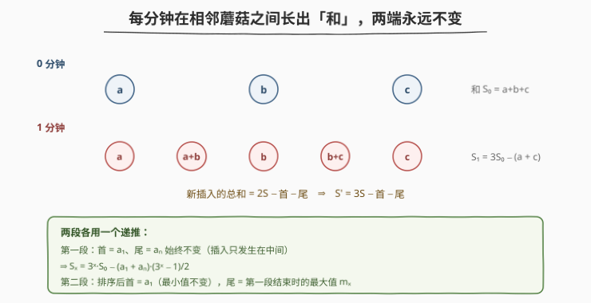
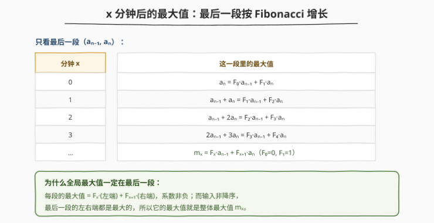
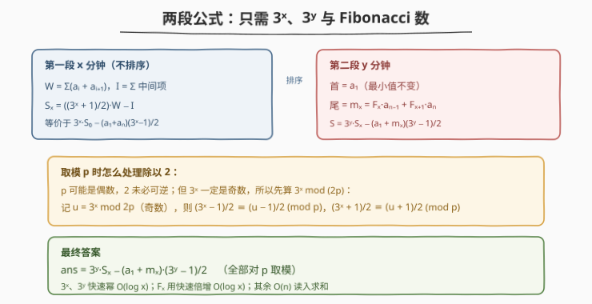

# Codeforces 60E 蘑菇生长的总重量 题解

## 1. 题目概述

- **题目链接**：https://codeforces.com/problemset/problem/60/E
- **比赛来源**：Codeforces Beta Round 56 · Problem E（UTC 2011-02-19）
- **难度**：2600
- **标签**：数学、矩阵/递推、Fibonacci、快速幂
- **评测类型**：普通
- **限制**：时间 3 s / 内存 256 MB

**题意**：$n$ 个蘑菇排成一行，重量 $a_1 \le a_2 \le \dots \le a_n$。**每分钟**，每对相邻蘑菇之间都会长出一个新蘑菇，重量等于这两个相邻蘑菇的重量之和。种下后过了 $x$ 分钟，地精回来了，发现顺序被打乱，于是把所有蘑菇**按重量重新排序**；又过了 $y$ 分钟，问所有蘑菇的总重量对 $p$ 取模的值（即从开始算起 $x + y$ 分钟后）。

**约束**：

- $1 \le n \le 10^6$：可以 $O(n)$ 扫一遍，但不能对每分钟的每个蘑菇都模拟。
- $0 \le x, y \le 10^{18}$：时间大得离谱，必须找闭式解；$x + y > 0$。
- $2 \le p \le 10^9$：$p$ 可能是偶数，**不能直接用逆元除以 2**。
- $0 \le a_i \le 10^9$：总重量是指数级增长，必须在模意义下计算。

## 2. 示例与观察

官方样例（输入 / 输出原样）：

```text
输入：
2 1 0 657276545
1 2

输出：
6
```

```text
输入：
2 1 1 888450282
1 2

输出：
14
```

```text
输入：
4 5 0 10000
1 2 3 4

输出：
1825
```

**样例 1**：$[1,2]$ 过 $1$ 分钟，中间长出 $1+2=3$，序列 $[1,3,2]$，总重量 $6$。$y=0$ 时排序不影响总和，答案 $6$。

**样例 2**：$x=1$ 后是 $[1,3,2]$（和 $6$），排序成 $[1,2,3]$；再过 $1$ 分钟：相邻和 $1+2=3$、$2+3=5$，序列 $[1,3,2,5,3]$，总重量 $14$。

**样例 3**：$[1,2,3,4]$ 连续长 $5$ 分钟，直接模拟会得到 $2^5$ 倍的元素个数；答案是 $1825$，下面用公式核对。

**观察 1**：设当前序列的总重量为 $S$、首项为 $L$、末项为 $R$。这一分钟新长出的蘑菇重量之和是

$$\sum_{i=1}^{n-1}(v_i + v_{i+1}) = 2S - L - R,$$

所以新总和

$$S' = S + (2S - L - R) = 3S - L - R.$$

这是整道题唯一的递推。

**观察 2**：插入只发生在**中间**，所以序列的**首项和末项在这一段里始终不变**。第一段里首项 $= a_1$、末项 $= a_n$，于是递推变成常系数线性递推，可以直接写出闭式。

**观察 3**：排序之后，首项仍然是 $a_1$（最小值不变），而末项变成了第一段结束时的**最大值** $m_x$。于是第二段又是一个常系数递推，只差把 $m_x$ 算出来。



## 3. 解题思路

### 3.1 朴素模拟与瓶颈

直接模拟：每过一分钟，元素个数变成 $2n - 1$ 量级，$x + y$ 分钟后是 $2^{x+y}$ 量级。$x, y$ 可达 $10^{18}$，完全不可行。必须把"每分钟"压缩成递推/闭式。

### 3.2 核心观察：总和的递推

如观察 1，$S_{k+1} = 3S_k - L_k - R_k$。第一段中 $L_k = a_1$、$R_k = a_n$ 恒定，于是

$$S_x = 3^x S_0 - (a_1 + a_n)\cdot\frac{3^x - 1}{2}.$$

（验证：$n = 2$、$a = [1,2]$、$x = 1$：$3 \cdot 3 - 3 \cdot 1 = 6$ ✓。）

### 3.3 排序之后：首项不变，末项是 Fibonacci 组合

排序后首项是 $a_1$，末项是 $m_x$（第一段结束时的最大重量）。$m_x$ 怎么算？

关键是把序列按**原始相邻对**切块：原始的一对 $(u, v)$ 之间的插入永远不会越过这两个端点，形成一个独立的"块"。块有一个漂亮的结论：

> **块的和**：从 $(u,v)$ 出发、长 $x$ 分钟后，整块（含两个端点）的重量和是 $\dfrac{3^x+1}{2}(u+v)$。
> **块的最大值**：设 $u \le v$，则块内最大重量是 $F_x u + F_{x+1} v$（$F_0 = 0, F_1 = 1$）。

块的最大值随着 $x$ 按 Fibonacci 增长：$x=0$ 时是 $v$，$x=1$ 时是 $u+v$，$x=2$ 时是 $u+2v$，$x=3$ 时是 $2u+3v$，$\dots$。由于 $a_i$ 非降序，**最后一块**（$a_{n-1}, a_n$）的两端最大，所以它的块内最大值就是全局最大值：

$$m_x = F_x\,a_{n-1} + F_{x+1}\,a_n.$$



### 3.4 第二段与最终公式

排序后，序列的和是 $S_x$、首项是 $a_1$、末项是 $m_x$。再用一次同样的递推：

$$S_{x+y} = 3^y S_x - (a_1 + m_x)\cdot\frac{3^y - 1}{2}.$$

把 $S_x$ 代入即得最终答案。整个过程只需要 $3^x, 3^y$（快速幂）和 $F_x, F_{x+1}$（矩阵/快速倍增），$O(\log x + \log y)$。



### 3.5 取模：p 是偶数时怎么办

公式里有除以 $2$。若直接算 $3^x \bmod p$ 再乘逆元，$p$ 为偶数时 $2$ 不可逆。正确做法：先算

$$u = 3^x \bmod 2p,$$

因为 $3^x$ 一定是奇数、$2p$ 是偶数，所以 $u$ 是奇数，于是

$$\frac{3^x - 1}{2} \equiv \frac{u - 1}{2} \pmod p,\qquad
\frac{3^x + 1}{2} \equiv \frac{u + 1}{2} \pmod p.$$

（推导：$3^x = u + 2pk$，两边减 $1$ 再除以 $2$ 得 $\frac{3^x-1}{2} = \frac{u-1}{2} + pk$，模 $p$ 后左边那一项消失。）这样所有中间量都保持整数，且乘法规模不超过 $2p \le 2 \times 10^9$，用 `long long` + `__int128` 转换即可。

### 3.6 样例走查

**样例 2**（$[1,2]$，$x=1$，$y=1$，$p=888450282$）：

- $S_0 = 3$，$a_1 + a_n = 3$，$3^1 = 3$，$S_1 = 3\cdot3 - 3\cdot\frac{3-1}{2} = 6$；
- $m_1 = F_1 a_1 + F_2 a_2 = 1\cdot1 + 1\cdot2 = 3$（就是 $[1,3,2]$ 的最大值，排序后末项为 $3$）；
- $S_2 = 3\cdot6 - (1+3)\cdot\frac{3-1}{2} = 18 - 4 = 14$ ✓。

**样例 3**（$[1,2,3,4]$，$x=5$，$y=0$，$p=10000$）：

- $S_0 = 10$，$a_1 + a_n = 5$，$3^5 = 243$；
- $S_5 = 243\cdot10 - 5\cdot\frac{242}{2} = 2430 - 605 = 1825$；
- $y=0$ 时第二段公式退化为 $S_5$，答案 $1825 \bmod 10000 = 1825$ ✓。

**交叉验证**（块的视角）：$W = \sum_{i}(a_i + a_{i+1}) = 3+5+7 = 15$，$I = a_2 + a_3 = 5$，则 $S_5 = \frac{3^5+1}{2}\cdot15 - 5 = 122\cdot15 - 5 = 1825$，两种推导一致。

## 4. 正确性证明

**引理 1（和递推）**：设某一分钟开始时序列为 $v_1, \dots, v_t$、总和 $S$，则新总和为 $3S - v_1 - v_t$。

**证明**：新长出的蘑菇重量之和为 $\sum_{i=1}^{t-1}(v_i + v_{i+1})$。该和式中 $v_1$ 与 $v_t$ 各出现一次，其余 $v_i$（$2 \le i \le t-1$）各出现两次，故等于 $2S - v_1 - v_t$；加上原来的 $S$ 即得。∎

**引理 2（第一段闭式）**：$S_x = 3^x S_0 - (a_1 + a_n)\dfrac{3^x-1}{2}$。

**证明**：插入只在中间进行，所以序列首项始终是 $a_1$、末项始终是 $a_n$。由引理 1，$S_{k+1} = 3S_k - (a_1 + a_n)$。解这个一阶线性递推：令 $T_k = S_k - \frac{a_1+a_n}{2}$，则 $T_{k+1} = 3T_k$，$T_0 = S_0 - \frac{a_1+a_n}{2}$，故 $T_x = 3^x T_0$，即 $S_x = 3^x S_0 - (a_1+a_n)\frac{3^x-1}{2}$（注意 $3^x - 1$ 是偶数，式子是整数）。∎

**引理 3（块的和）**：从 $(u,v)$ 出发的块，$x$ 分钟后的块内总和为 $\frac{3^x+1}{2}(u+v)$。

**证明**：块的首、末元素始终是 $u, v$（插入在中间）。对块用引理 1：$T_{k+1} = 3T_k - (u+v)$，$T_0 = u+v$，解得 $T_x = 3^x(u+v) - (u+v)\frac{3^x-1}{2} = \frac{3^x+1}{2}(u+v)$。∎

**引理 4（块的最大值）**：设 $u \le v$，则从 $(u,v)$ 出发的块在 $x$ 分钟后的最大元素为 $M_x = F_x u + F_{x+1}v$（$F_0=0, F_1=1$）。

**证明**：对 $x$ 归纳，同时证明辅助命题：在 $x$ 分钟的块中，$M_x$ 与 $M_{x-1}$ 相邻（约定 $M_{-1} = u$），且任意一对相邻元素之和不超过 $M_x + M_{x-1}$。

*基础*：$x=0$ 时块为 $[u,v]$，$M_0 = v$；$x=1$ 时块为 $[u,u+v,v]$，$M_1 = u+v$，且 $M_1$ 与 $M_0$ 相邻，两个相邻和分别为 $2u+v$ 与 $u+2v$，由 $u \le v$ 知最大者是 $u+2v = M_1+M_0$。

*归纳*：$x+1$ 分钟的块 = $x$ 分钟的块 $\cup$ 所有相邻和。由辅助命题，相邻和最大为 $M_x + M_{x-1}$，故

$$M_{x+1} = \max(M_x,\ M_x + M_{x-1}) = M_x + M_{x-1} = F_{x+1}u + F_{x+2}v$$

（最后一步用 Fibonacci 递推）。并且 $M_{x+1}$ 正是插在 $M_x$ 与 $M_{x-1}$ 之间的那个新元素，所以它与 $M_x$ 相邻；$x+1$ 分钟的任意一对相邻元素至多由一个"新元素"和一个"旧元素"组成（新元素之间总隔着旧元素），新元素 $\le M_{x+1}$、旧元素 $\le M_x$，故相邻和 $\le M_{x+1} + M_x$，辅助命题成立。∎

**引理 5（全局最大）**：第一段结束时，全部蘑菇的最大重量为 $m_x = F_x a_{n-1} + F_{x+1}a_n$。

**证明**：全部蘑菇被原始相邻对切成 $n-1$ 个互不影响的块。每个块的最大值为 $F_x u + F_{x+1}v$（引理 4），系数非负，因此在 $u \le a_{n-1}$、$v \le a_n$ 的所有块中，最后一块的 $F_x a_{n-1} + F_{x+1}a_n$ 最大。∎

**引理 6（最小值不变）**：任何时刻序列的最小重量都是 $a_1$。

**证明**：新元素是两个非负元素之和，不小于其中任何一个，因此不会比现有最小值更小；而 $a_1$ 一直保留。∎

**定理**：算法输出等于 $x+y$ 分钟后所有蘑菇总重量模 $p$ 的值 $S_{x+y} \bmod p$。

**证明**：由引理 1、2 得 $S_x$。排序不改变总和，由引理 6 排序后首项为 $a_1$、由引理 5 末项为 $m_x$；再对第二段用引理 1：$S_{x+y} = 3^y S_x - (a_1+m_x)\frac{3^y-1}{2}$。3.5 节的取模技巧只是把整数除法换成"先模 $2p$ 再除 2"，与上式在模 $p$ 下等价。故算法输出正确。∎

## 5. 复杂度分析

- **时间**：$O(n + \log x + \log y)$。读入与求和 $O(n)$；$3^x, 3^y$ 快速幂各 $O(\log x)$；Fibonacci 快速倍增 $O(\log x)$。
- **空间**：$O(n)$ 存输入（只用到 $a_1, a_{n-1}, a_n$ 和总和，但读入本身需要数组；也可边读边算，空间降到 $O(1)$）。
- **数值范围**：模数 $2p \le 2\times10^9$，乘法最大 $(2p)^2 \approx 4\times10^{18}$，`long long` 边界附近，代码里用 `__int128` 中转保证不溢出。
- **与时限的关系**：$n = 10^6$、$x = y = 10^{18}$ 的最大数据实测 $0.10$ s（含进程启动），3 s 时限余量 30 倍以上。

## 6. 参考代码

### C++17

```cpp
#include <bits/stdc++.h>
using namespace std;
typedef long long ll;
typedef __int128 lll;

static ll mulmod(ll a, ll b, ll mod) {
    return (ll)((lll)a * b % mod);
}
static ll powmod(ll a, ll e, ll mod) {
    ll r = 1 % mod;
    a %= mod;
    while (e > 0) {
        if (e & 1) r = mulmod(r, a, mod);
        a = mulmod(a, a, mod);
        e >>= 1;
    }
    return r;
}
// 返回 (F(n), F(n+1)) mod mod，快速倍增
static pair<ll, ll> fib(ll n, ll mod) {
    if (n == 0) return {0, 1 % mod};
    auto pr = fib(n >> 1, mod);
    ll a = pr.first, b = pr.second;
    ll c = mulmod(a, (2 * b % mod - a + mod) % mod, mod);
    ll d = (mulmod(a, a, mod) + mulmod(b, b, mod)) % mod;
    if (n & 1) return {d, (c + d) % mod};
    return {c, d};
}

int main() {
    ll n, x, y, p;
    if (scanf("%lld %lld %lld %lld", &n, &x, &y, &p) != 4) return 0;
    vector<ll> a(n);
    for (ll i = 0; i < n; i++) scanf("%lld", &a[i]);

    if (n == 1) {                       // 没有相邻蘑菇，永远长不出新的
        printf("%lld\n", a[0] % p);
        return 0;
    }

    ll mod2 = 2 * p;
    // 第一段 x 分钟：首尾恒为 a[0]、a[n-1]，S_x = 3^x S_0 - (a_1+a_n)(3^x-1)/2
    ll S0 = 0;
    for (ll i = 0; i < n; i++) S0 = (S0 + a[i]) % p;
    ll endSum = (a[0] % p + a[n - 1] % p) % p;

    ll pw3x = powmod(3, x, mod2);              // 3^x mod 2p
    ll hx = ((pw3x - 1) / 2) % p;              // (3^x - 1)/2 mod p
    ll Sx = (mulmod(pw3x % p, S0, p) - mulmod(endSum, hx, p) + p) % p;

    // 排序后首 = a_1（最小值不变），尾 = m_x = F_x·a_{n-2} + F_{x+1}·a_{n-1}
    auto fp = fib(x, p);
    ll mx = (mulmod(fp.first % p, a[n - 2] % p, p) + mulmod(fp.second % p, a[n - 1] % p, p)) % p;

    ll pw3y = powmod(3, y, mod2);
    ll hy = ((pw3y - 1) / 2) % p;              // (3^y - 1)/2 mod p
    ll ans = (mulmod(pw3y % p, Sx, p) - mulmod((a[0] % p + mx) % p, hy, p) + p) % p;
    printf("%lld\n", ans);
    return 0;
}
```

### Python3

```python
import sys


def fib_pair(n, mod):
    """返回 (F(n), F(n+1)) mod mod。"""
    if n == 0:
        return 0, 1 % mod
    a, b = fib_pair(n >> 1, mod)
    c = a * ((2 * b - a) % mod) % mod
    d = (a * a + b * b) % mod
    if n & 1:
        return d, (c + d) % mod
    return c, d


def main():
    data = sys.stdin.buffer.read().split()
    if not data:
        return
    n, x, y, p = (int(t) for t in data[:4])
    a = [int(t) for t in data[4:4 + n]]

    if n == 1:                              # 没有相邻蘑菇，永远不会长出新蘑菇
        print(a[0] % p)
        return

    mod2 = 2 * p
    S0 = sum(a) % p
    end_sum = (a[0] + a[-1]) % p

    pw3x = pow(3, x, mod2)                  # 3^x mod 2p
    hx = ((pw3x - 1) // 2) % p              # (3^x-1)/2 mod p
    Sx = (pw3x % p * S0 - end_sum * hx) % p

    fx, fx1 = fib_pair(x, p)
    mx = (fx * a[-2] + fx1 * a[-1]) % p

    pw3y = pow(3, y, mod2)
    hy = ((pw3y - 1) // 2) % p              # (3^y-1)/2 mod p
    ans = (pw3y % p * Sx - (a[0] + mx) % p * hy) % p
    print(ans)


main()
```

关于题面的提醒：它写的"不要用 `%lld`、建议用 `cin`"是早年 Windows 评测机（`%I64d`）留下的历史问题，现代 Codeforces 是 Linux + GNU C++17，`%lld` 完全可用；本文代码用 `scanf/printf` 是为了读 $10^6$ 个数更快（本机实测 `cin` 读入约 $2.9$ s，`scanf` 约 $0.09$ s）。若想严格照题面，把输入输出换成 `cin/cout` 也能过，只是更慢。

## 7. 边界情况与易错点

1. **$n = 1$**：没有相邻对，永远不会长出新蘑菇，答案恒为 $a_1 \bmod p$（无论 $x, y$ 多大）。这是最容易漏的特判。
2. **$p = 2$**：除以 2 的取模技巧必须用"模 $2p$"来做；若直接求 2 的逆元会失败（$2 \nmid p$ 不成立）。代码用 `pw3x mod 2p` 后再除以 2，$p=2$ 时也正确。
3. **$x = 0$ 或 $y = 0$**：公式里 $3^0 = 1$，$h = 0$，第一段/第二段自动退化为"什么都不做"；不需要特判（但 $x+y>0$ 是题面保证的）。
4. **$x, y$ 巨大**：不能循环 $x$ 次；必须快速幂 + Fibonacci 快速倍增，$O(\log)$。注意指数用 `long long` 存（$10^{18}$ 超 `int`）。
5. **乘法溢出**：模数 $2p$ 可达 $2\times10^9$，两个这样的数相乘是 $4\times10^{18}$，接近 `long long` 上限，代码用 `__int128` 中转；Python 无此问题。
6. **排序前后的首末**：第一段首末是 $a_1, a_n$（固定）；排序后首是 $a_1$（最小值不变），末是 $m_x$（不是 $a_n$！）。把末项写成 $a_n$ 是最常见的错误。
7. **$m_x$ 的 Fibonacci 下标**：$m_x = F_x a_{n-1} + F_{x+1}a_n$，$F_0 = 0, F_1 = 1$；下标差一位就会错，写代码时用 `fib(x)` 返回 $(F_x, F_{x+1})$ 最稳。
8. **块的最大值方向**：$F_x u + F_{x+1}v$ 只在 $u \le v$ 时是最大值（否则要交换）；本题输入非降序，最后一块自动满足。
9. **读入规模**：$n = 10^6$、$a_i$ 可达 $10^9$，用 `scanf`/快速读入；`cin` 关同步在某些实现下仍然慢。

## 8. 验证记录

- **编译环境与命令**：本机 `g++` 实为 `Apple clang 21.0.0`，用 `clang++ -std=c++17 -O2` 搭配 `codeforces/tools/include/bits/stdc++.h` 兼容头编译（正文代码可原样提交 GNU C++17）；Python 侧为 `Python 3.9.6`。正文代码另经 `codeforces/tools/verify_solution.py` 编译并跑通官方样例。
- **官方样例**：3 / 3 通过（`6`、`14`、`1825`），C++ 与 Python 输出一致。
- **逐分钟模拟对拍**：另写一份**完全按题意模拟**的暴力（每分钟真的插入相邻和、排序、再插入，最后求和取模），在 $n \le 5$、$x, y \le 7$、$p$ 取 $\{2,3,4,7,10,97,1000,999999937\}$ 上随机 **300 组**，与公式逐组比对，**全部一致**（覆盖了 $x=0$、$y=0$、全零、$p=2$ 等边界）。
- **大时间交叉验证**：$x, y$ 随机取到 $10^{18}$、$p$ 取到 $10^9$，C++（带 `__int128`）与 Python（大整数）**300 组**逐组一致，专门用来暴露溢出/取模错误。
- **最大约束性能**：$n = 10^6$、$x = y = 10^{18}$、$p = 999999937$ 的最大数据端到端 $0.10$ s，3 s 时限余量 30 倍以上；峰值内存约 $8$ MB（只存 $a$）。
- **复核状态**：verified（样例、模拟对拍、大数交叉、性能、图片与公式校验均实跑通过）。

## 相关题目与扩展

- [Codeforces 60D Savior](https://codeforces.com/problemset/problem/60/D)：同场 D 题，数论 + 并查集，和本题一样需要"找一个可枚举的结构"。
- [Codeforces 60C Mushroom Strife](https://codeforces.com/problemset/problem/60/C)：同场 C 题，数论推导。
- [Codeforces 166E Tetrahedron](https://codeforces.com/problemset/problem/166/E)：经典线性递推 + 快速幂。
- [Codeforces 1106D Lunar New Year and a Wander](https://codeforces.com/problemset/problem/1106/D)：与本题无关，但同属"先证明结构再用数据结构"的题型。
- [LeetCode 509. 斐波那契数](https://leetcode.cn/problems/fibonacci-number/)：练习快速倍增求 Fibonacci，是本题 $m_x$ 部分的基础。

**延伸思考**：

1. **如果每分钟插入的是"两个相邻数的差"**：递推不再有 $S' = 3S - L - R$ 的简单形式，且可能出现负数，块结构也被破坏，需要用更复杂的生成函数。
2. **如果每隔 $k$ 分钟才排序一次**：每一段的末项都要重新算最大值，而最大值的增长规律在多次排序后会变成"每段重复 Fibonacci 增长"，可以用矩阵幂把整段打包。
3. **如果要求输出每个蘑菇的重量**：那就必须真正生成 $2^{x+y}$ 个值（模 $p$），在 $x+y$ 很大时不可能，只能对"每个原始块"单独用矩阵快速幂求出块内所有权重的和/分布。
4. **为什么 $p$ 是偶数时不能用逆元**：$2$ 在模 $p$ 下不可逆，而公式里除以 $2$ 是整数除法；"先模 $2p$ 再除"本质上是把整除性保留下来，这是处理"模意义下除以常数"的通用技巧。
