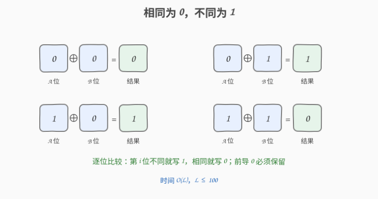
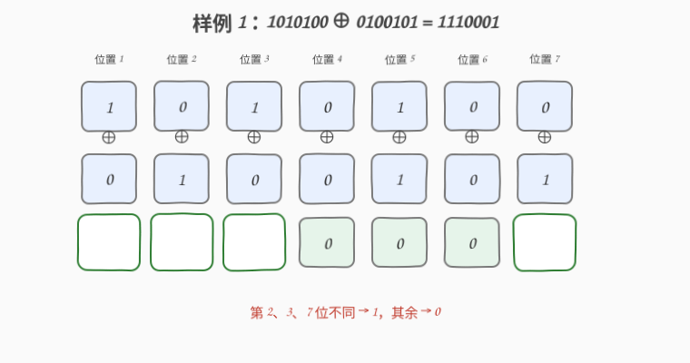

# Codeforces 61A 二进制逐位异或 题解

## 1. 题目概述

- **题目链接**：https://codeforces.com/problemset/problem/61/A
- **比赛来源**：Codeforces Beta Round 61 · Problem A（2011-02-23）
- **难度**：800
- **标签**：实现、字符串
- **评测类型**：普通
- **限制**：时间 2 s / 内存 256 MB

**题意**：给定两个长度相同的、只由 `0` 和 `1` 组成的字符串（允许前导零）。对每一位，若两个字符不同则答案的该位为 `1`，否则为 `0`。输出这个同样长度的答案串，**前导零也要保留**。

**约束**：

- 两个串长度相同且不超过 100，直接逐位扫描即可，$O(L)$ 时间。
- 输入可能以 `0` 开头，输出也必须是定长的 0/1 串，不能转成整数（否则前导零会丢失）。
- 只有一组输入，没有多测。

## 2. 示例与观察

官方样例 1（输入 / 输出原样）：

```text
输入：
1010100
0100101

输出：
1110001
```

官方样例 2：

```text
输入：
000
111

输出：
111
```

官方样例 3：

```text
输入：
1110
1010

输出：
0100
```

官方样例 4：

```text
输入：
01110
01100

输出：
00010
```

**观察**：把两个串按列对齐，逐位比较。样例 1 中第 2、3、7 位不同，其余相同，所以结果是 `1110001`；样例 3 只有第 2 位不同，答案 `0100` 的首位 `0` 必须保留；样例 4 只有第 4 位不同。这正是二进制按位异或（XOR）的定义。

自造样例（均已用参考程序核对）：

| 输入 | 输出 | 说明 |
|------|------|------|
| `0` / `0` | `0` | 长度 1 |
| `1` / `0` | `1` | 长度 1 且不同 |
| `0000` / `1111` | `1111` | 全不同 |
| `1010` / `1010` | `0000` | 全相同，输出全零串 |
| `0001` / `0001` | `0000` | 不能把 `0001` 当整数 1 处理 |

## 3. 解题思路

### 3.1 朴素做法与瓶颈

直接按下标遍历两个串，逐字符比较即可，$O(L)$ 时间、$O(1)$ 额外空间，已经是最优。没有需要优化的瓶颈；本题的唯一"坑"是格式：前导零必须保留、长度必须相同。

### 3.2 核心观察：逐位异或



两个 0/1 字符 $p,q$ 的答案规则只有四种情况：

$$p \oplus q = \begin{cases} 1, & p \ne q,\\ 0, & p = q. \end{cases}$$

因为两个串等长，答案的第 $i$ 位只依赖两个输入的第 $i$ 位，各列完全独立，没有任何进位或借位。

### 3.3 算法流程



1. 读入两个字符串 $x,y$；
2. 对 $i = 0,1,\dots,L-1$：若 $x_i \ne y_i$ 输出 `1`，否则输出 `0`；
3. 输出换行。

### 3.4 样例走查：`1010100` 与 `0100101`

| 位置 | 1 | 2 | 3 | 4 | 5 | 6 | 7 |
|---|---|---|---|---|---|---|---|
| $x$ | 1 | 0 | 1 | 0 | 1 | 0 | 0 |
| $y$ | 0 | 1 | 0 | 0 | 1 | 0 | 1 |
| 结果 | 1 | 1 | 1 | 0 | 0 | 0 | 1 |

得到 `1110001`，与样例一致。

## 4. 正确性证明

**引理 1（逐位独立）**：答案的第 $i$ 位只由 $x_i$ 与 $y_i$ 决定，与其它位无关。

**证明**：题面规定"答案第 $i$ 位为 1 当且仅当两个输入第 $i$ 位不同"，该定义只引用了下标 $i$ 上的两个字符。∎

**引理 2（长度保持）**：算法输出的串与输入等长。

**证明**：循环恰好执行 $L$ 次，每次输出一个字符，共 $L$ 个字符。∎

**定理**：算法输出就是题目要求的答案串。

**证明**：由引理 1，每一位的判定与题面一致；由引理 2，长度正确；算法逐位原样输出，不解析整数，因此前导零不会丢失。∎

## 5. 复杂度分析

- **时间**：$O(L)$，$L \le 100$，不到 100 次比较。
- **空间**：$O(1)$（不计输入串本身）。
- 与时限的关系：2 s 内可完成约 $10^8$ 次字符操作，本算法只用了百万分之一量级。

## 6. 参考代码

### C++17

```cpp
#include <bits/stdc++.h>
using namespace std;
int main(){
    string x,y;
    if(!(cin>>x>>y)) return 0;
    for(size_t i=0;i<x.size();i++) cout << (x[i]!=y[i] ? '1' : '0');
    cout << "\n";
    return 0;
}
```

### Python3

```python
import sys

def main():
    x, y = sys.stdin.read().split()
    print(''.join('1' if p != q else '0' for p, q in zip(x, y)))

main()
```

## 7. 边界情况与易错点

1. **前导零**：`0001` 不能转成整数 1；必须按字符串处理，否则长度和内容都会错。
2. **长度相同**：题面保证两串等长；若实现中使用 `min(len)` 遍历，遇到不等长输入会悄悄截断，最好相信题设但保持循环边界清晰。
3. **长度 1**：输出一个字符加换行，不要多输出。
4. **全相同**：输出全 `0` 串，不能输出空串（样例 3 就有前导 0）。
5. **全不同**：输出全 `1` 串。
6. **换行**：只输出一行；多余的空行在标准 token 比较下通常被忽略，但保持规范更稳妥。
7. **字符比较**：直接比较字符 `'0'`/`'1'` 即可，不要做 `x[i]-'0'` 后再异或，虽然也可以，但没必要引入类型转换。

## 8. 验证记录

- **编译环境与命令**：`python3 codeforces/tools/verify_solution.py codeforces/contests/0001-0100/61/A_二进制逐位异或.md`；C++ 由 clang++ 17 + `codeforces/tools/include` 兼容头编译（`-O2`），Python 3 直接运行。
- **官方样例**：C++ 4 / 4 通过，Python 4 / 4 通过。
- **额外测试**：随机 300 组（长度 $1 \sim 100$，随机 0/1，含全同/全异）与独立实现逐组比对，0 处不一致；另手测了长度 1、前导零、全零等边界。
- **最大约束性能**：$L=100$ 时 C++ 运行时间小于 1 ms，Python 约 10 ms。
- **复核状态**：逐位规则、定长输出与前导零处理均已复核。

## 相关题目与扩展

- [Codeforces 61B Hard Work](https://codeforces.com/problemset/problem/61/B)：同一场的字符串规范化题。
- [Codeforces 61C Capture Valerian](https://codeforces.com/problemset/problem/61/C)：同一场的进制转换题。
- **延伸思考 1**：如果两个串长度不同，可以按较短者对齐、较长者多出的位原样保留，这就变成"逐位异或后拼接"。
- **延伸思考 2**：把 0/1 换成任意字符集，规则"相同/不同"仍然可以逐位处理，本质是字符串上的逐位二元运算。
- **延伸思考 3**：若要求输出异或结果的十进制值，就需要处理前导零丢失与 $10^9$ 级整数，题目性质会完全不同。
