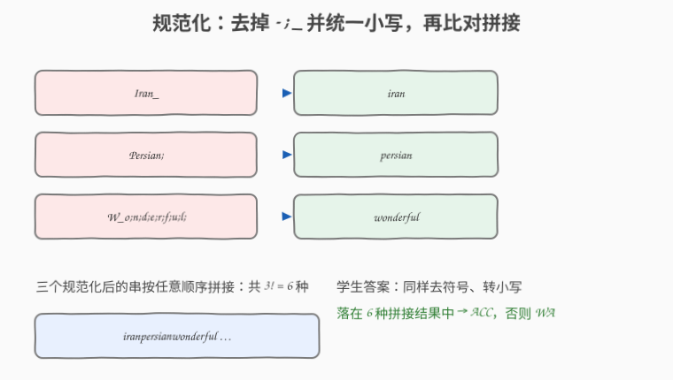
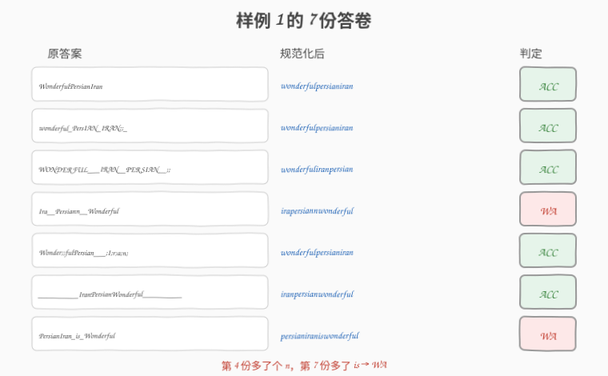

# Codeforces 61B 拼串作业批改 题解

## 1. 题目概述

- **题目链接**：https://codeforces.com/problemset/problem/61/B
- **比赛来源**：Codeforces Beta Round 57 (Div. 2) · Problem B（UTC 2011-02-22）
- **难度**：1300
- **标签**：字符串、枚举、集合
- **评测类型**：普通
- **限制**：时间 2 s / 内存 256 MB

**题意**：老师给出 3 个初始字符串，要求把它们按**任意顺序**首尾相接拼成一个答案。批改规则：

- 忽略大小写差异（`Alireza` 与 `ALIREZA` 等价）；
- 忽略三个"符号"字符 `-`、`;`、`_`（学生多加、少加、位置不同都不影响）；
- 对每份学生答案判断正确与否：正确输出 `ACC`，否则输出 `WA`。

**约束**：

- 3 个初始串长度 $1 \sim 100$，学生答案数 $n \le 1000$、长度 $1 \sim 600$。
- 只有 3 个串，拼接顺序只有 $3! = 6$ 种，可以全部枚举。
- 判定只看"去掉符号 + 转小写"之后的字符串，必须**整体相等**，不能是子序列或子串匹配。

## 2. 示例与观察

官方样例 1（输入 / 输出原样）：

```text
输入：
Iran_
Persian;
W_o;n;d;e;r;f;u;l;
7
WonderfulPersianIran
wonderful_PersIAN_IRAN;;_
WONDERFUL___IRAN__PERSIAN__;;
Ira__Persiann__Wonderful
Wonder;;fulPersian___;I;r;a;n;
__________IranPersianWonderful__________
PersianIran_is_Wonderful

输出：
ACC
ACC
ACC
WA
ACC
ACC
WA
```

官方样例 2：

```text
输入：
Shapur;;
is___
a_genius
3
Shapur__a_is___geniUs
is___shapur___a__Genius;
Shapur;;is;;a;;geni;;us;;

输出：
WA
ACC
ACC
```

**样例演算**（样例 1）：三个初始串规范化后是 `iran`、`persian`、`wonderful`。

| 答卷 | 去符号并小写后 | 判定 |
|---|---|---|
| `WonderfulPersianIran` | `wonderfulpersianiran` | ACC（wonderful+persian+iran） |
| `wonderful_PersIAN_IRAN;;_` | `wonderfulpersianiran` | ACC |
| `WONDERFUL___IRAN__PERSIAN__;;` | `wonderfuliranpersian` | ACC（wonderful+iran+persian） |
| `Ira__Persiann__Wonderful` | `irapersiannwonderful` | WA（`persiann` 多了一个 `n`） |
| `Wonder;;fulPersian___;I;r;a;n;` | `wonderfulpersianiran` | ACC（符号穿插在字母之间） |
| `__________IranPersianWonderful__________` | `iranpersianwonderful` | ACC |
| `PersianIran_is_Wonderful` | `persianiraniswonderful` | WA（多出 `is`，不是三个初始串的拼接） |

样例 2 的三串规范化后是 `shapur`、`is`、`agenius`：第一份答卷得到 `shapuraisgenius`，不是任何一种排列的拼接，WA；后两份分别是 `isshapuragenius` 与 `shapurisagenius`，ACC。

自造样例（均已用参考程序核对）：

| 输入 | 输出 | 说明 |
|------|------|------|
| 三串 `a`、`b`、`c`，答卷 `abc`、`cba`、`acb` | `ACC ACC ACC` | 6 种顺序都正确 |
| 三串 `a`、`b`、`c`，答卷 `ab`、`abcd` | `WA WA` | 长度不对 |
| 三串 `A;`、`B_`、`C-`，答卷 `cba` | `ACC` | 大小写与符号都被忽略 |
| 三串都是 `;;;`，答卷 `___` | `ACC` | 规范化后都是空串 |

## 3. 解题思路

### 3.1 朴素做法与瓶颈

枚举 3 个初始串的 6 种拼接顺序，把每种拼接结果规范化后放进集合；对每份答卷也规范化，查集合即可。$n \le 1000$、串长 $\le 600$，总字符量约 $6 \times 300 + 1000 \times 600 \approx 6 \times 10^5$，直接做完全可行，没有性能瓶颈。

### 3.2 核心观察：规范化与拼接可交换



定义规范化函数 $f(s)$：删去所有 `-`、`;`、`_`，再把剩余字母转成小写。

关键性质是

$$f(s_1 s_2) = f(s_1) f(s_2),$$

也就是"先拼接再规范化"等于"各自规范化再拼接"。因为删符号和转小写都是逐字符独立操作，不依赖上下文，拼接只是把字符序列接起来，逐字符处理的结果自然也是接起来的。

于是：老师要求的答案集合是

$$\{\, f(s_{\pi(1)}) f(s_{\pi(2)}) f(s_{\pi(3)}) : \pi \text{ 是 } 1,2,3 \text{ 的排列} \,\},$$

学生答卷 $t$ 正确当且仅当 $f(t)$ 属于这个集合。

### 3.3 算法流程

1. 读入三个初始串，分别算出 $f(s_1), f(s_2), f(s_3)$；
2. 枚举 3 个下标的全部 6 种排列，把对应规范化串拼接后放进集合 `ok`（重复的自动去重）；
3. 对每份答卷 $t$：若 $f(t) \in ok$ 输出 `ACC`，否则输出 `WA`；
4. 若 $n = 0$，不输出任何内容。

### 3.4 样例走查



样例 1 中 `ok = {wonderfulpersianiran, wonderfuliranpersian, persianwonderfuliran, persianiranwonderful, iranwonderfulpersian, iranpersianwonderful}`。把 7 份答卷逐一规范化后查表，得到 `ACC ACC ACC WA ACC ACC WA`，与样例完全一致。

## 4. 正确性证明

**引理 1（规范化与拼接可交换）**：对任意两个字符串 $s_1, s_2$，$f(s_1 s_2) = f(s_1) f(s_2)$。

**证明**：$f$ 对每个字符做同一个局部变换：符号字符变成"删除"，字母变成小写。$s_1 s_2$ 的字符序列是 $s_1$ 的字符接上 $s_2$ 的字符，逐字符处理（删除或保留并小写）后得到的序列，恰好等于分别处理两段后再拼接。∎

**引理 2（候选集合正确）**：集合 `ok` 恰好等于所有"老师可能要求的答案"的规范化结果。

**证明**：老师要求的答案是把 3 个初始串按某个顺序拼接。由引理 1，其规范化结果等于三个 $f(s_i)$ 按同一顺序拼接。算法枚举了全部 6 种顺序，所以每个可能的规范化答案都在 `ok` 中；反之 `ok` 中每个元素都对应一种合法拼接顺序，不会多算。∎

**引理 3（单份答卷判定）**：学生的答卷 $t$ 被判定为正确，当且仅当存在一种顺序使 $f(t)$ 等于该顺序下三个规范化串的拼接。

**证明**：学生答案与老师答案的差异只允许是大小写与符号（题面明确"不要太挑剔"），所以两者等价当且仅当 $f(t)$ 等于老师答案的 $f$ 值。由引理 2，后者等价于 $f(t) \in ok$。算法正是这样判定的。∎

**定理**：算法对每份答卷输出的 `ACC`/`WA` 与题目要求一致。

**证明**：由引理 3，每份答卷的判定都正确；算法按输入顺序逐行输出，数量与 $n$ 相同（$n=0$ 时无输出），格式符合要求。∎

## 5. 复杂度分析

- **时间**：规范化三个初始串 $O(300)$；枚举 6 种拼接 $O(6 \times 300)$；每份答卷规范化 $O(600)$ 并做一次集合查询（期望 $O(600)$ 的哈希），总计 $O(n \cdot 600)$，约 $6 \times 10^5$ 次字符操作。
- **空间**：集合里至多 6 个长度 $\le 300$ 的串，$O(1)$ 量级；读入全部答案也只需要 $O(n \cdot 600)$。
- 与时限的关系：2 s 内可完成约 $10^8$ 次操作，本算法余量极大。

## 6. 参考代码

### C++17

```cpp
#include <bits/stdc++.h>
using namespace std;
string norm(const string &s){
    string r;
    for(char ch: s){
        if(ch=='-'||ch==';'||ch=='_') continue;
        r += (char)tolower((unsigned char)ch);
    }
    return r;
}
int main(){
    vector<string> init(3);
    for(int i=0;i<3;i++) cin>>init[i];
    vector<string> nrm(3);
    for(int i=0;i<3;i++) nrm[i]=norm(init[i]);
    set<string> ok;
    vector<int> p={0,1,2};
    do{
        ok.insert(nrm[p[0]]+nrm[p[1]]+nrm[p[2]]);
    }while(next_permutation(p.begin(),p.end()));
    int n; cin>>n;
    string out;
    for(int i=0;i<n;i++){
        string s; cin>>s;
        out += (ok.count(norm(s)) ? "ACC\n" : "WA\n");
    }
    cout<<out;
    return 0;
}
```

### Python3

```python
import sys
from itertools import permutations

def norm(s):
    return ''.join(ch.lower() for ch in s if ch not in '-;_')

def main():
    lines = sys.stdin.read().splitlines()
    init = [lines[0], lines[1], lines[2]]
    n = int(lines[3])
    nrm = [norm(s) for s in init]
    ok = {''.join(p) for p in permutations(nrm)}
    out = []
    for i in range(n):
        s = lines[4 + i]
        out.append('ACC' if norm(s) in ok else 'WA')
    if out:
        print('\n'.join(out))

main()
```

## 7. 边界情况与易错点

1. **$n = 0$**：不输出任何行；Python 里 `print('\n'.join([]))` 会多打一个空行，需要特判。
2. **规范化后为空串**：初始串可能全是符号，三个空串拼接仍是空串；答卷 `___` 规范化后也是空串，应判 `ACC`。
3. **符号可以出现在任意位置**：`Wonder;;ful...` 与 `Wonderful...` 等价，不能只删除首尾符号。
4. **大小写混合**：统一转小写再比较；`Persian` 与 `PERSIAN` 必须视为相同。
5. **重复的初始串**：例如三串都是 `a`，6 种排列只产生一个结果，用集合去重即可。
6. **不能做子串/子序列匹配**：必须整体相等；`persianiraniswonderful` 包含三个词但顺序/内容不对，判 `WA`。
7. **读入方式**：字符串不含空格，按 token 或按行读取都可以；按行读时注意 `n` 所在行和后续行不要错位。
8. **长度**：答卷长度可达 600，规范化后仍可能很长；不要用固定小数组。

## 8. 验证记录

- **编译环境与命令**：`python3 codeforces/tools/verify_solution.py codeforces/contests/0001-0100/61/B_拼串作业批改.md`；C++ 由 clang++ 17 + `codeforces/tools/include` 兼容头编译（`-O2`），Python 3 直接运行。
- **官方样例**：C++ 2 / 2 通过，Python 2 / 2 通过。
- **额外测试**：随机 300 组（初始串含随机字母与随机符号，答卷混合正确拼接、随机加符号/改大小写、随机错误串，$n$ 含 0），与独立实现（正则删除符号 + 小写 + 全排列集合）逐组比对，0 处不一致。
- **最大约束性能**：$n=1000$、答卷长 600 时 C++ 运行时间小于 10 ms，Python 约 50 ms。
- **复核状态**：规范化交换律、候选集合与判定逻辑均已证明；样例与随机对拍一致。

## 相关题目与扩展

- [Codeforces 61A 二进制逐位异或](https://codeforces.com/problemset/problem/61/A)：同一场的字符串逐位处理题。
- [Codeforces 61C Capture Valerian](https://codeforces.com/problemset/problem/61/C)：同一场的字符串解析 + 进制换算题。
- **延伸思考 1**：若初始串数量变成 $k$ 个，排列数变为 $k!$；$k$ 稍大就需要用"计数多重集"判断，而不能枚举排列。
- **延伸思考 2**：若忽略的是"任意标点"而不是固定三个符号，可以用 `isalpha` 过滤，逻辑不变。
- **延伸思考 3**：若允许漏掉/多加整段字符（模糊匹配），问题会变成编辑距离或子序列匹配，难度大幅上升。
