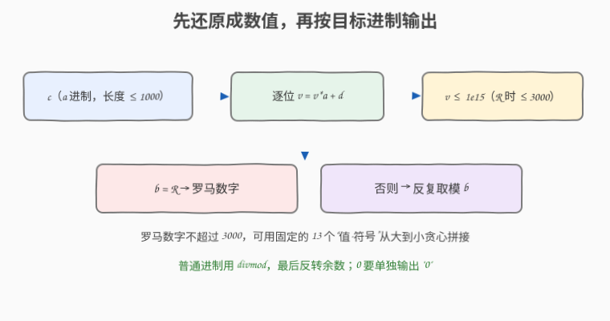
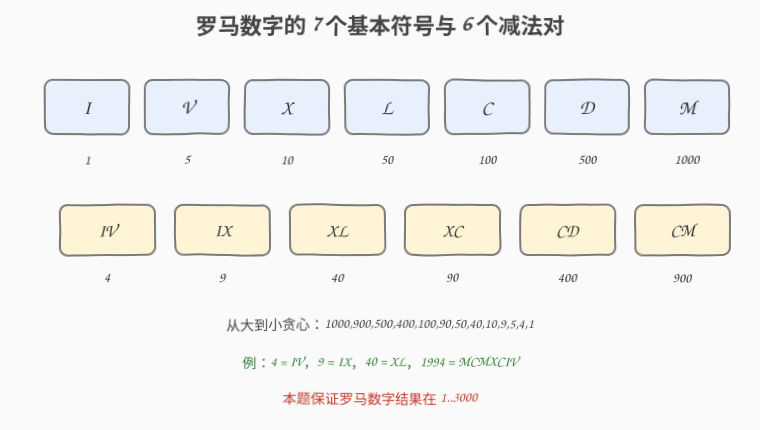
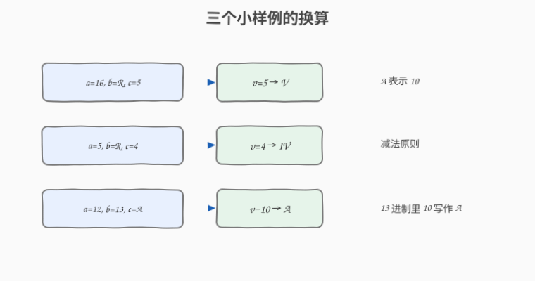

# Codeforces 61C 进制与罗马数字 题解

## 1. 题目概述

- **题目链接**：https://codeforces.com/problemset/problem/61/C
- **比赛来源**：Codeforces Beta Round 57 (Div. 2) · Problem C（UTC 2011-02-22）
- **难度**：2000
- **标签**：数学、进制转换、大数、罗马数字
- **评测类型**：普通
- **限制**：时间 2 s / 内存 256 MB

**题意**：给定 $a, b$（$2 \le a,b \le 25$）以及一个 $a$ 进制下的非负整数 $c$（可能有前导零，长度不超过 $1000$）。把 $c$ 用 $b$ 进制输出。特殊的：$b$ 可能是一个字母 `R`，表示罗马数字体系，此时要输出 $c$ 的罗马数字表示（保证值在 $1 \sim 3000$）。

进制大于 10 时，数字 $10,11,\dots$ 依次用 `A,B,...` 表示；罗马数字使用 `I,V,X,L,C,D,M` 与减法原则（如 `IV=4`、`IX=9`、`XL=40`、`XC=90`、`CD=400`、`CM=900`）。

**约束**：

- $a, b \le 25$：数字字符最大到 `O`，比常见的 16 进制稍大。
- $c$ 长度不超过 1000：不能按普通 `int` 读入；但题面保证换算成十进制后不超过 $10^{15}$（罗马数字情形不超过 3000），所以**数值**可以放进 64 位整数，用逐位 Horner 累加即可，不需要大整数库。
- 罗马数字结果非 0；普通进制结果可能是 0（此时输出 `0`），且必须省略前导零。

## 2. 示例与观察

官方样例 1：

```text
输入：
10 2
1

输出：
1
```

官方样例 2：

```text
输入：
16 R
5

输出：
V
```

官方样例 3：

```text
输入：
5 R
4

输出：
IV
```

官方样例 4：

```text
输入：
2 2
1111001

输出：
1111001
```

官方样例 5：

```text
输入：
12 13
A

输出：
A
```

**样例演算**：

- 样例 1：十进制 1 转二进制还是 1。
- 样例 2：十六进制的 5 是十进制 5，罗马数字写作 `V`。
- 样例 3：五进制的 4 是十进制 4，罗马数字是 `IV`（减法原则：4 = 5 − 1）。
- 样例 4：$a=b=2$，原样输出。
- 样例 5：十二进制的 `A` 是十进制 10，十三进制中 10 也写作 `A`。

自造样例（均已用参考程序核对）：

| 输入 | 输出 | 说明 |
|------|------|------|
| `10 10` / `0` | `0` | 零的普通进制输出 |
| `2 R` / `1001` | `IX` | 二进制 1001 = 9 |
| `10 R` / `3000` | `MMM` | 罗马数字上界 |
| `16 25` / `F` | `F` | 15 在 25 进制中仍是 `F` |
| `2 25` / 1000 个 `0` 加 `1` | `1` | 大量前导零不影响数值 |

## 3. 解题思路

### 3.1 朴素做法与瓶颈

如果 $c$ 很长（1000 位），按"每位乘 $a$ 的幂再相加"需要大整数运算，而且 $a^{1000}$ 巨大。但题面保证了**真实数值**不超过 $10^{15}$（罗马情形不超过 3000），所以前导零之外的有效位数很少，可以用 Horner 法边读边算：

$$\text{value} \leftarrow \text{value} \cdot a + d_i.$$

这不需要大整数：中间值不超过最终值再乘一次 $a$，即 $10^{15} \times 25 = 2.5 \times 10^{16}$，在 64 位整数范围内。

### 3.2 核心观察：先还原成数值，再按目标体系输出



整个问题的本质是"同一个数值的两种表示"：

1. 用 Horner 法把 $a$ 进制串 $c$ 还原成整数 $v$；
2. 若 $b$ 是普通进制，不断取 $v \bmod b$ 得到最低位，再 $v \leftarrow \lfloor v/b \rfloor$，最后反转；
3. 若 $b = \texttt{R}$，用固定的"值—符号"表从大到小贪心拼接罗马数字。

### 3.3 罗马数字的构造



罗马数字的基本符号：`I=1`、`V=5`、`X=10`、`L=50`、`C=100`、`D=500`、`M=1000`。减法对：`IV=4`、`IX=9`、`XL=40`、`XC=90`、`CD=400`、`CM=900`。

把 13 个"值—符号"对按值从大到小排列：

$$(1000,M),(900,CM),(500,D),(400,CD),(100,C),(90,XC),(50,L),(40,XL),(10,X),(9,IX),(5,V),(4,IV),(1,I).$$

从大到小扫描，只要当前值不小于该符号的值，就输出该符号并减去它，直到值为 0。因为值不超过 3000，这个贪心会终止，且得到的正是标准罗马数字。

### 3.4 样例走查



- `16 R`、$c=5$：$v=5$；贪心表里第一个不超过 5 的是 `(5,V)`，输出 `V`。
- `5 R`、$c=4$：$v=4$；先试 `(5,V)` 不行，试 `(4,IV)`，输出 `IV`。
- `12 13`、$c=A$：字符 `A` 的值是 10，$v = 10$；$10 = 0 \cdot 13 + 10$，余数 10 写作 `A`，输出 `A`。

## 4. 正确性证明

**引理 1（Horner 法还原数值）**：设 $c$ 的各位数字为 $d_0, d_1, \dots, d_{L-1}$（从左到右），则循环结束后 `value` $= \sum_{i=0}^{L-1} d_i a^{L-1-i}$，即 $c$ 在 $a$ 进制下的值。

**证明**：对读入的位数归纳。读入前 $k$ 位后，`value` $= \sum_{i=0}^{k-1} d_i a^{k-1-i}$。读入下一位 $d_k$ 时更新为 `value` $\cdot a + d_k = \sum_{i=0}^{k} d_i a^{k-i}$，归纳成立。∎

**引理 2（普通进制输出正确）**：对 $v \ge 0$、$b \ge 2$，反复取模得到的余数序列反转后是 $v$ 的 $b$ 进制表示（无前导零，$v=0$ 时输出 `0`）。

**证明**：这是带余除法的标准结论：$v = q b + r$，$0 \le r < b$，最低位是 $r$；对 $q$ 继续做同样的事，直到 $q=0$。得到的余数序列从低位到高位排列，反转即得。若 $v=0$，循环不执行，特判输出 `0`。∎

**引理 3（罗马数字贪心正确）**：对 $1 \le v \le 3000$，从 13 个"值—符号"对按值降序贪心拼接，得到的字符串等于 $v$ 的标准罗马数字。

**证明**：标准罗马数字的每一位（千位、百位、十位、个位）都只有有限种写法：千位 `M` 重复，百位取 `""/C/CC/CCC/CD/D/DC/DCC/DCCC/CM`，十位与个位同理。贪心表恰好按这些写法的值从大到小排列，且同一数位上不会同时用到两个相冲突的写法（例如用了 `CM=900` 后剩余不足 100，不会再取 `D` 或 `C`）。逐位对应可知贪心输出就是标准写法。$v \le 3000$ 保证千位最多三个 `M`，不会出现非标准写法。∎

**定理**：对任意合法输入，算法输出 $c$ 在目标体系（$b$ 进制或罗马数字）下的正确表示，且不含前导零。

**证明**：引理 1 保证数值还原正确；若 $b$ 是普通进制，引理 2 保证输出正确并省略前导零；若 $b=\texttt{R}$，引理 3 保证罗马数字正确。∎

## 5. 复杂度分析

- **时间**：解析 $O(|c|) \le 1000$；普通进制输出 $O(\log_b v) \le 50$ 次除法；罗马数字最多输出约 15 个符号。总时间远小于 1 ms 量级。
- **空间**：$O(1)$（不计输入串）。
- **数值**：解析中间值不超过 $10^{15} \times 25 = 2.5 \times 10^{16}$，`long long` 安全；罗马情形数值不超过 3000。

## 6. 参考代码

### C++17

```cpp
#include <bits/stdc++.h>
using namespace std;
string toRoman(long long v){
    static const pair<int,string> tab[] = {
        {1000,"M"},{900,"CM"},{500,"D"},{400,"CD"},{100,"C"},{90,"XC"},
        {50,"L"},{40,"XL"},{10,"X"},{9,"IX"},{5,"V"},{4,"IV"},{1,"I"}};
    string r;
    for(auto &pr: tab){
        while(v>=pr.first){ r+=pr.second; v-=pr.first; }
    }
    return r;
}
int main(){
    int a; string b;
    if(!(cin>>a>>b)) return 0;
    string c; cin>>c;
    long long v=0;
    for(char ch: c){
        int d;
        if(ch>='0'&&ch<='9') d=ch-'0';
        else if(ch>='A'&&ch<='Z') d=ch-'A'+10;
        else d=ch-'a'+10;
        v = v*(long long)a + d;
    }
    if(b=="R"){ cout<<toRoman(v)<<"\n"; return 0; }
    int base=stoi(b);
    if(v==0){ cout<<"0\n"; return 0; }
    string res;
    while(v>0){
        int d=(int)(v%base);
        res += (char)(d<10 ? '0'+d : 'A'+d-10);
        v/=base;
    }
    reverse(res.begin(),res.end());
    cout<<res<<"\n";
    return 0;
}
```

### Python3

```python
import sys

ROMAN = [(1000, "M"), (900, "CM"), (500, "D"), (400, "CD"), (100, "C"),
         (90, "XC"), (50, "L"), (40, "XL"), (10, "X"), (9, "IX"),
         (5, "V"), (4, "IV"), (1, "I")]


def to_roman(v):
    out = []
    for val, sym in ROMAN:
        while v >= val:
            out.append(sym)
            v -= val
    return ''.join(out)


def main():
    data = sys.stdin.read().split()
    a = int(data[0])
    b = data[1]
    c = data[2]
    v = 0
    for ch in c:
        if '0' <= ch <= '9':
            d = ord(ch) - ord('0')
        elif 'A' <= ch <= 'Z':
            d = ord(ch) - ord('A') + 10
        else:
            d = ord(ch) - ord('a') + 10
        v = v * a + d
    if b == 'R':
        print(to_roman(v))
        return
    base = int(b)
    if v == 0:
        print(0)
        return
    digits = []
    while v:
        d = v % base
        digits.append(chr(ord('0') + d) if d < 10 else chr(ord('A') + d - 10))
        v //= base
    print(''.join(reversed(digits)))


main()
```

## 7. 边界情况与易错点

1. **$v = 0$ 且 $b$ 不是 `R`**：循环不执行，必须特判输出 `0`；不能输出空行。罗马数字保证非零，不需要处理 0 的罗马表示。
2. **大量前导零**：$c$ 可能有 1000 位而有效值很小；Horner 法对前导零天然安全，不要试图先 `stoll` 整个串。
3. **数字字符大于 9**：$a$ 可达 25，字符可能是 `A`~`O`；解析时按 `A=10` 的规则处理，不能只认 `0-9`。
4. **输出字符大于 9**：$b$ 可达 25，余数 10~24 要输出 `A`~`O`，不能只写数字。
5. **$a = b$**：数值不变，但输出要求"省略前导零"，所以不能直接原样输出 $c$（除非 $c$ 本身没有前导零）。
6. **罗马减法原则**：4、9、40、90、400、900 必须用 `IV/IX/XL/XC/CD/CM`，不能写成 `IIII`、`VIIII` 等非标准形式。
7. **罗马数值上界**：保证 $\le 3000$，千位最多 `MMM`；若实现里硬编码 3999 的规则也不会错，但没必要。
8. **数值范围**：普通进制保证 $v \le 10^{15}$，Horner 中间值最大约 $2.5 \times 10^{16}$，`long long` 足够；`int` 会溢出。
9. **`b` 的读入**：第二列可能是数字也可能是字母 `R`，用字符串读入再判断，不要先按整数读。

## 8. 验证记录

- **编译环境与命令**：`python3 codeforces/tools/verify_solution.py codeforces/contests/0001-0100/61/C_进制与罗马数字.md`；C++ 由 clang++ 17 + `codeforces/tools/include` 兼容头编译（`-O2`），Python 3 直接运行。
- **官方样例**：C++ 5 / 5 通过，Python 5 / 5 通过。
- **额外测试**：随机 300 组（$a,b \in [2,25]$，普通进制值取 $0 \sim 10^{15}$、罗马情形取 $1 \sim 3000$，随机加入前导零）与独立实现（Python 大整数 + 另一种罗马逐位写法）逐组比对，0 处不一致；另测了 1000 位前导零、$a=b$、`0`、`3000` 等边界。
- **最大约束性能**：$|c| = 1000$ 时 C++ 运行时间小于 1 ms。
- **复核状态**：Horner 解析、进制除法、罗马贪心三部分均已证明并与对拍一致。

## 相关题目与扩展

- [Codeforces 61B 拼串作业批改](https://codeforces.com/problemset/problem/61/B)：同一场的字符串处理题。
- [Codeforces 61E 三元逆序对计数](https://codeforces.com/problemset/problem/61/E)：同一场的数据结构题。
- **延伸思考 1**：若 $c$ 的数值可以超过 $10^{15}$，Horner 法就需要大整数或 $O(L^2)$ 的竖式乘法；本题的"长度 1000 但数值小"是刻意设置的上界。
- **延伸思考 2**：若目标体系也是"任意 2~25 进制 + 罗马"之外的体系（如玛雅数字），只需替换最后的输出函数。
- **延伸思考 3**：罗马数字不是位置制，不能直接用"取模"生成；这正说明"先还原数值再按目标规则输出"是处理混合表示系统的通用套路。
