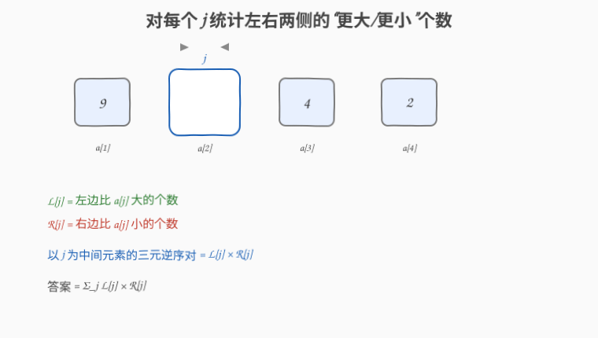
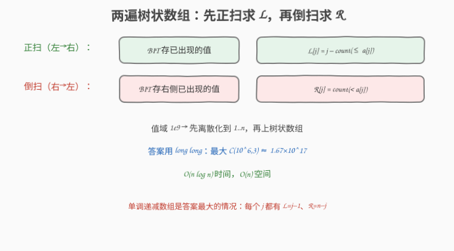
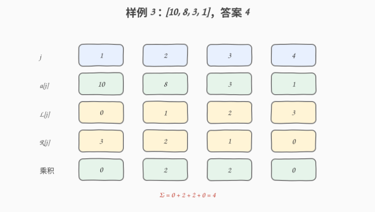

# Codeforces 61E 三元逆序对计数 题解

## 1. 题目概述

- **题目链接**：https://codeforces.com/problemset/problem/61/E
- **比赛来源**：Codeforces Beta Round 61 · Problem E（2011-02-23）
- **难度**：1900
- **标签**：数据结构、树状数组、逆序对
- **评测类型**：普通
- **限制**：时间 5 s / 内存 256 MB

**题意**：给定 $n$ 个**互不相同**的正整数 $a_1, \dots, a_n$（$n \le 10^6$），统计满足 $i < j < k$ 且 $a_i > a_j > a_k$ 的三元组 $(i,j,k)$ 的个数。

**约束**：

- $n \le 10^6$：$O(n^2)$ 或 $O(n^3)$ 都不行，必须 $O(n \log n)$。读取也需要快速输入。
- $a_i \le 10^9$：需要离散化（或动态结构），不能直接拿值当树状数组下标。
- 答案上界是 $\binom{10^6}{3} \approx 1.67 \times 10^{17}$，必须用 64 位整数；中间量 $L_j \times R_j$ 也接近 $2.5 \times 10^{11}$。
- 所有 $a_i$ 互不相同，所以比较时不用处理相等的情况。

## 2. 示例与观察

官方样例 1：

```text
输入：
3
3 2 1

输出：
1
```

官方样例 2：

```text
输入：
3
2 3 1

输出：
0
```

官方样例 3：

```text
输入：
4
10 8 3 1

输出：
4
```

官方样例 4：

```text
输入：
4
1 5 4 3

输出：
1
```

**样例演算**：

- 样例 1：$3 > 2 > 1$，唯一三元组 $(1,2,3)$，答案 1。
- 样例 2：$(2,3,1)$ 中 $2<3$，没有严格递减的三元组，答案 0。
- 样例 3：数组严格递减，任意选 3 个下标都满足条件，$\binom{4}{3}=4$。
- 样例 4：$[1,5,4,3]$，只有 $(2,3,4)$ 满足 $5>4>3$，答案 1。

自造样例（均已用参考程序核对）：

| 输入 | 输出 | 说明 |
|------|------|------|
| `3` / `1 2 3` | `0` | 严格递增，没有逆序 |
| `5` / `5 4 3 2 1` | `10` | 完全逆序，$\binom{5}{3}=10$ |
| `4` / `4 1 3 2` | `1` | $(4,3,2)$ 一组 |
| `6` / `6 5 1 4 3 2` | `7` | 混合情况，靠对拍核对 |

## 3. 解题思路

### 3.1 朴素做法与瓶颈

三重循环枚举 $i<j<k$ 是 $O(n^3)$，$n=10^6$ 时不可能。即使用二维前缀和，也至少 $O(n^2)$，同样不可行。

注意到三元组的"中间元素"是 $j$：只要固定 $j$，左边比 $a_j$ 大的元素个数与右边比 $a_j$ 小的元素个数相乘，就是"以 $j$ 为中间元素"的三元组数。

### 3.2 核心观察：固定中间元素，左右独立



对每个位置 $j$ 定义

$$L_j = \#\{\, i < j : a_i > a_j \,\}, \qquad R_j = \#\{\, k > j : a_k < a_j \,\}.$$

那么以 $j$ 为中间元素的三元组数恰好是 $L_j \cdot R_j$：左边每个比 $a_j$ 大的 $i$ 与右边每个比 $a_j$ 小的 $k$ 都能自由组合，且组合出的 $(i,j,k)$ 必然满足 $i<j<k$、$a_i>a_j>a_k$。

于是

$$\text{答案} = \sum_{j=1}^{n} L_j \cdot R_j.$$

每个三元组有唯一的中间下标 $j$，所以不会重复计数。

### 3.3 用两遍树状数组求 L 和 R



值域 $10^9$ 太大，先离散化：把 $a$ 排序去重，用每个值的名次 $1 \sim n$ 作为树状数组下标。

- **正扫**（$j = 1 \to n$）：树状数组里存"已经出现过的值"。到 $j$ 时，已插入 $j-1$ 个元素，其中不大于 $a_j$ 的有 `sum(rank_j)` 个（值互不相同，不大于即小于），所以
  $$L_j = (j-1) - \text{sum}(rank_j).$$
  然后把 $rank_j$ 插入。
- **倒扫**（$j = n \to 1$）：树状数组里存"右侧已经出现过的值"。到 $j$ 时，
  $$R_j = \text{sum}(rank_j - 1).$$
  然后把 $rank_j$ 插入。
- 最后累加 $\sum L_j R_j$（用 64 位整数）。

### 3.4 样例走查：$[10, 8, 3, 1]$



| $j$ | 1 | 2 | 3 | 4 |
|---|---|---|---|---|
| $a_j$ | 10 | 8 | 3 | 1 |
| $L_j$ | 0 | 1 | 2 | 3 |
| $R_j$ | 3 | 2 | 1 | 0 |
| $L_j R_j$ | 0 | 2 | 2 | 0 |

总和 $0+2+2+0 = 4$，与样例 3 一致。

## 4. 正确性证明

**引理 1（分解不重不漏）**：对任意三元组 $i<j<k$，它被计入且只被计入中间下标 $j$ 的 $L_j R_j$ 中。

**证明**：三元组有唯一的中间下标 $j$，且 $i<j<k$ 自动满足"$i$ 在 $j$ 左侧、$k$ 在 $j$ 右侧"。若 $a_i > a_j > a_k$，则 $i$ 被 $L_j$ 统计、$k$ 被 $R_j$ 统计，组合 $(i,k)$ 被计入 $L_j R_j$；反之，若某个 $(i,k)$ 被 $L_j R_j$ 计入，则 $a_i > a_j$ 且 $a_j > a_k$，三元组合法。不同 $j$ 的中间下标不同，不会重复。∎

**引理 2（树状数组求得 L、R）**：正扫得到的 $L_j$ 等于左侧严格大于 $a_j$ 的元素个数，倒扫得到的 $R_j$ 等于右侧严格小于 $a_j$ 的元素个数。

**证明**：正扫到 $j$ 时，树状数组中恰好是 $a_1, \dots, a_{j-1}$ 的名次集合，`sum(rank_j)` 统计其中名次 $\le rank_j$ 的个数，即值 $\le a_j$ 的个数；由于所有值互不相同，这等于值 $< a_j$ 的个数。左侧共 $j-1$ 个元素，减去它即为 $> a_j$ 的个数，正是 $L_j$。倒扫完全对称：树状数组中是 $a_{j+1}, \dots, a_n$，`sum(rank_j - 1)` 统计值 $< a_j$ 的个数，正是 $R_j$。∎

**定理**：算法输出的 $\sum_j L_j R_j$ 等于满足条件的三元组个数。

**证明**：由引理 2，每个 $L_j, R_j$ 都算对了；由引理 1，乘积求和恰好把每个合法三元组计一次、非法三元组计零次。∎

## 5. 复杂度分析

- **时间**：离散化排序 $O(n \log n)$；两遍树状数组各 $O(n \log n)$；总 $O(n \log n)$，$n=10^6$ 时约 $4 \times 10^7$ 次树状数组操作。
- **空间**：数组 $a$、离散化值、名次、$L$、$R$ 与两个树状数组，各约 $4$ MB（`int`），总计约 30 MB。
- **数值**：答案最大 $\binom{10^6}{3} \approx 1.67 \times 10^{17}$，`long long` 安全；$L_j R_j \le (10^6)^2 = 10^{12}$，累加也不会超过答案上界。
- **实现注意**：$n=10^6$ 时用 `scanf` 或快速读入；Python 版本在 $10^6$ 规模会较慢，建议 PyPy3 或直接提交 C++。

## 6. 参考代码

### C++17

```cpp
#include <bits/stdc++.h>
using namespace std;

struct BIT {
    int n;
    vector<int> t;
    BIT(int n=0):n(n),t(n+1,0){}
    void add(int i){ for(;i<=n;i+=i&-i) t[i]++; }
    int sum(int i) const { int s=0; for(;i>0;i-=i&-i) s+=t[i]; return s; }
};

int main(){
    int n;
    if(scanf("%d",&n)!=1) return 0;
    vector<int> a(n);
    for(int i=0;i<n;i++) scanf("%d",&a[i]);
    vector<int> vals=a;
    sort(vals.begin(),vals.end());
    vals.erase(unique(vals.begin(),vals.end()),vals.end());
    vector<int> rk(n);
    for(int i=0;i<n;i++) rk[i]=(int)(lower_bound(vals.begin(),vals.end(),a[i])-vals.begin())+1;
    int K=(int)vals.size();
    vector<int> left(n,0), right(n,0);
    BIT bit(K);
    for(int j=0;j<n;j++){
        left[j] = j - bit.sum(rk[j]);   // 前面比 a[j] 大的个数（值互不相同）
        bit.add(rk[j]);
    }
    BIT bit2(K);
    for(int j=n-1;j>=0;j--){
        right[j] = bit2.sum(rk[j]-1);   // 后面比 a[j] 小的个数
        bit2.add(rk[j]);
    }
    long long ans=0;
    for(int j=0;j<n;j++) ans += (long long)left[j]*right[j];
    cout<<ans<<"\n";
    return 0;
}
```

### Python3

```python
import sys
from bisect import bisect_left


class BIT:
    def __init__(self, n):
        self.n = n
        self.t = [0] * (n + 1)

    def add(self, i):
        t = self.t
        while i <= self.n:
            t[i] += 1
            i += i & -i

    def sum(self, i):
        s = 0
        t = self.t
        while i > 0:
            s += t[i]
            i -= i & -i
        return s


def main():
    data = sys.stdin.buffer.read().split()
    n = int(data[0])
    a = [int(x) for x in data[1:1 + n]]
    vals = sorted(set(a))
    rk = [bisect_left(vals, v) + 1 for v in a]
    K = len(vals)
    left = [0] * n
    right = [0] * n
    bit = BIT(K)
    for j in range(n):
        left[j] = j - bit.sum(rk[j])
        bit.add(rk[j])
    bit = BIT(K)
    for j in range(n - 1, -1, -1):
        right[j] = bit.sum(rk[j] - 1)
        bit.add(rk[j])
    ans = 0
    for j in range(n):
        ans += left[j] * right[j]
    print(ans)


main()
```

## 7. 边界情况与易错点

1. **严格递减数组**：答案是 $\binom{n}{3}$，$n=10^6$ 时为 $166666166667000000$，是本题最大答案，用来检验溢出最合适。
2. **严格递增数组**：$L_j = R_j = 0$，答案 0。
3. **值域压缩**：$a_i$ 可达 $10^9$，必须离散化；`rank` 从 1 开始（树状数组下标不能为 0）。
4. **互不相同**：题面保证所有 $a_i$ 不同，所以 `sum(rank_j)` 与 `sum(rank_j - 1)` 不会把相等元素算进严格不等式；若数据有重复需要额外处理。
5. **64 位累加**：$L_j R_j$ 用 `int` 相乘会溢出，必须转 `long long`；答案本身也超过 `int`。
6. **读入性能**：$10^6$ 个整数用 `cin` 未加速可能偏慢，代码用 `scanf`。
7. **下标约定**：$j$ 从 0 开始时，左侧元素个数是 $j$，不要写成 $j+1$。
8. **两棵树状数组**：可以复用同一个并清空，但清空 $10^6$ 的数组也要 $O(n)$；直接开两个更省事。

## 8. 验证记录

- **编译环境与命令**：`python3 codeforces/tools/verify_solution.py codeforces/contests/0001-0100/61/E_三元逆序对计数.md`；C++ 由 clang++ 17 + `codeforces/tools/include` 兼容头编译（`-O2`），Python 3 直接运行。
- **官方样例**：C++ 4 / 4 通过，Python 4 / 4 通过。
- **额外测试**：随机 300 组（$n \le 9$，值互不相同）与 $O(n^3)$ 三重循环暴力逐组比对，0 处不一致；另测严格递增、严格递减、随机排列。
- **最大约束性能**：$n=10^6$ 严格递减，C++ 运行约 0.23 s，答案 $166666166667000000 = \binom{10^6}{3}$ 与公式一致；Python 版本在 $10^6$ 规模约 8 s，建议 PyPy3 或提交 C++。
- **复核状态**：分解不重不漏、树状数组左右计数与溢出范围均已证明并实测。

## 相关题目与扩展

- [Codeforces 61D 遍历全树最短路](https://codeforces.com/problemset/problem/61/D)：同一场的树形贪心题。
- [Codeforces 61C 进制与罗马数字](https://codeforces.com/problemset/problem/61/C)：同一场的数学题。
- **延伸思考 1**：若要统计长度为 $m$ 的递减子序列个数，可以用 $m$ 棵树状数组或线段树做 $O(m n \log n)$ 的 DP。
- **延伸思考 2**：若改为"非严格"递减（允许相等），离散化时要把相同值合并到同一名次，并在 `sum` 时决定是否包含自身名次。
- **延伸思考 3**：答案上界 $\binom{n}{3}$ 说明任何正确算法至少要有能装下 $O(n^3)$ 的整数；这也提示在别的语言里必须用 64 位或大整数。
